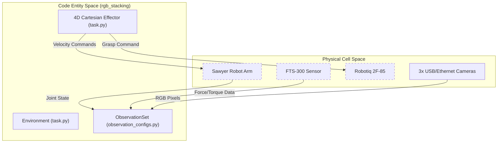
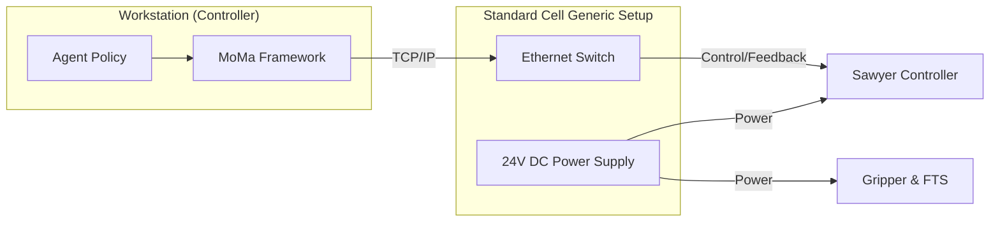

<!-- source: DeepWiki mcp.deepwiki.com · repo google-deepmind/rgb_stacking · page 4.2 Bill of Materials and Cell Wiring · fetched 2026-10-26 -->

# Bill of Materials and Cell Wiring

Relevant source files

The following files were used as context for generating this wiki page:

- [real_cell_documentation/bill_of_materials.pdf](real_cell_documentation/bill_of_materials.pdf)
- [real_cell_documentation/standard_cell_generic_setup.pdf](real_cell_documentation/standard_cell_generic_setup.pdf)

This page details the physical hardware composition and electrical architecture of the RGB stacking robot cell. It describes the specific components required to replicate the environment and the wiring schemas that facilitate communication between the robot, sensors, and the control workstation.

## Bill of Materials (BOM)

The physical cell is designed to be a reproducible research platform. The Bill of Materials provides a comprehensive list of structural, robotic, and sensing components.

### Core Robotic Components
The cell is built around the **Rethink Robotics Sawyer** arm and the **Robotiq 2F-85** gripper. These components are modeled in simulation within `rgb_stacking/task.py` to ensure high-fidelity sim-to-real transfer.

| Category | Component | Quantity | Purpose |
| :--- | :--- | :--- | :--- |
| **Robot** | Rethink Robotics Sawyer | 1 | 7-DOF Manipulator |
| **End Effector** | Robotiq 2F-85 Gripper | 1 | Parallel-jaw grasping |
| **Sensor** | Robotiq FTS-300 | 1 | Wrist Force-Torque sensing |
| **Computing** | Linux Workstation | 1 | Controller running the agent and MoMa |

### Structural and Environmental Components
The environment consists of a specific workspace (the "basket") and a fixed camera rig.

*   **Basket Assembly**: A precision-machined or 3D-printed enclosure that defines the robot's workspace boundaries.
*   **Camera Mounts**: Rigid fixtures for three specialized cameras (Left, Right, and Overhead).
*   **RGB Objects**: Three distinct blocks (Red, Green, Blue) with specific geometries defined in the STL files.

**Sources:**
*   `real_cell_documentation/bill_of_materials.pdf:1-113`()
*   `rgb_stacking/task.py:72-100`()

---

## Cell Wiring and Network Architecture

The `standard_cell_generic_setup.pdf` defines the electrical and data flow connections. This physical setup maps directly to the `dm_control` and `MoMa` interfaces used in the software.

### Data Flow Diagram: Hardware to Code
The following diagram illustrates how physical hardware signals are routed to the software entities defined in the `rgb_stacking` codebase.

**Hardware-to-Software Mapping**

**Sources:**
*   `real_cell_documentation/standard_cell_generic_setup.pdf:1-124`()
*   `rgb_stacking/task.py:120-150`()

### Network and Electrical Connections
The cell requires a unified grounding and network strategy to ensure low-latency control and synchronized sensor readings.

1.  **Robot Controller**: Connected via Ethernet to the main workstation.
2.  **Gripper/FTS**: Usually daisy-chained via RS-485 or connected through the Sawyer's head/wrist ports.
3.  **Cameras**: Connected via high-bandwidth USB 3.0 or PoE (Power over Ethernet) to the workstation to minimize frame drop.

**Electrical Interface Mapping**

**Sources:**
*   `real_cell_documentation/standard_cell_generic_setup.pdf:97-124`()

---

## Sim-to-Real Interface Mapping

The physical wiring and component selection are designed to match the simulation's sensor and effector interfaces exactly.

### Sensors to Observations
The sensors defined in the BOM map to the `ObservationSet` used by the agent:
*   **Sawyer Internal Encoders**: Map to `proprioception` observations in `rgb_stacking/task.py`.
*   **FTS-300**: Maps to the force-torque sensor observations used for detecting contact during grasping.
*   **Cameras**: Map to the `VISION_ONLY` or `ALL` observation sets, providing the pixel data for the vision-based policies.

### Effectors to Actuators
The `4D Cartesian velocity effector` in the simulation maps to the physical robot's motion controller:
*   **X, Y, Z Velocities**: Translated into joint velocities via the robot's Inverse Kinematics (IK) solver or Jacobian-based control.
*   **Rotation (Yaw)**: Controlled as the 4th dimension of the Cartesian action space.
*   **Gripper Actuation**: Binary or continuous signal sent to the Robotiq controller.

**Sources:**
*   `rgb_stacking/task.py:155-180`()
*   `real_cell_documentation/bill_of_materials.pdf:45-80`()
*   `real_cell_documentation/standard_cell_generic_setup.pdf:100-115`()

---

