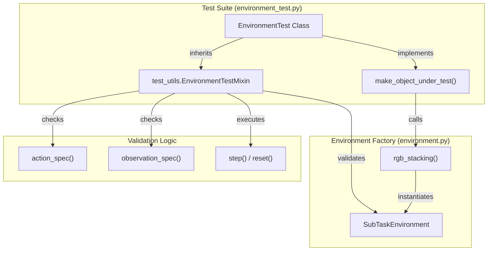
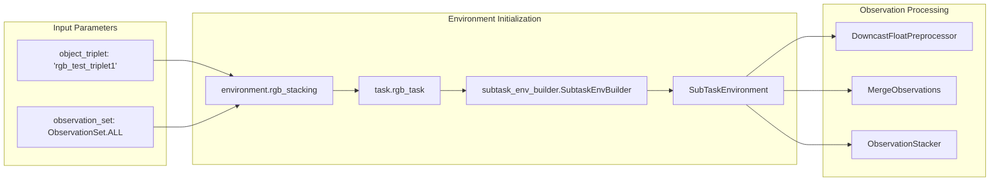

<!-- source: DeepWiki mcp.deepwiki.com · repo google-deepmind/rgb_stacking · page 5.1 Running Tests · fetched 2026-10-26 -->

# Running Tests

<details>
<summary>Relevant source files</summary>

The following files were used as context for generating this wiki page:

- [rgb_stacking/environment.py](rgb_stacking/environment.py)
- [rgb_stacking/environment_test.py](rgb_stacking/environment_test.py)

</details>


The `rgb_stacking` repository provides a suite of automated tests to ensure that the environment, its observation/action specs, and the underlying MuJoCo simulation lifecycle remain consistent with the requirements of the `dm_env` interface.

## Overview of `environment_test.py`

The primary test file is `rgb_stacking/environment_test.py` [rgb_stacking/environment_test.py:1-34](). This script validates the integrity of the `SubTaskEnvironment` returned by the factory function `environment.rgb_stacking` [rgb_stacking/environment.py:137-141]().

The test suite leverages `dm_env.test_utils.EnvironmentTestMixin`, a standard utility provided by DeepMind's `dm_env` library. This mixin automatically runs a battery of tests against the environment instance to ensure it adheres to the Reinforcement Learning environment API.

### Validated Components
The tests verify several critical aspects of the simulation:
*   **Action Spec Compliance**: Ensures that the `action_spec()` returned by the environment matches the dimensions and types expected by the `CompositeActionSpace` [rgb_stacking/environment.py:183-185]().
*   **Observation Spec Compliance**: Validates that all observations defined in the selected `ObservationSet` (e.g., `ALL`, `STATE_ONLY`) are present in the `TimeStep` and match their defined shapes and types [rgb_stacking/environment.py:114-135]().
*   **Step/Reset Lifecycle**: Validates that calling `reset()` returns a `FIRST` step, and subsequent calls to `step()` return `MID` steps until the episode terminates (reaching `_MAX_STEPS` or a reward condition) [rgb_stacking/environment.py:54-54]().
*   **Data Types**: Confirms that observation preprocessors, such as the `DowncastFloatPreprocessor`, correctly convert floating-point data to `float32` [rgb_stacking/environment.py:188-189]().

### Test Architecture
The following diagram illustrates how `EnvironmentTest` interacts with the environment factory and the underlying `dm_env` mixin.

**Test Execution Flow**

**Sources:** [rgb_stacking/environment_test.py:24-29](), [rgb_stacking/environment.py:137-141]()

## Invocation

To run the tests, execute the script directly using Python. Ensure that all dependencies listed in `requirements.txt` are installed in your environment.

```bash
python3 -m rgb_stacking.environment_test
```

The `absltest.main()` entry point [rgb_stacking/environment_test.py:32-33]() handles the test discovery and reporting.

## Implementation Details

The `EnvironmentTest` class implements the `make_object_under_test` method, which is the required hook for the `EnvironmentTestMixin`.

| Feature | Implementation |
| :--- | :--- |
| **Target Class** | `EnvironmentTest` [rgb_stacking/environment_test.py:24]() |
| **Object Triplet** | `rgb_test_triplet1` [rgb_stacking/environment_test.py:28]() |
| **Observation Set** | `ObservationSet.ALL` [rgb_stacking/environment_test.py:29]() |
| **Library** | `absl.testing.absltest` [rgb_stacking/environment_test.py:18]() |

By default, the test uses the `ALL` observation set to ensure that both state-based (proprioception/poses) and vision-based (camera pixels) observation pipelines are exercised during the test run.

**Environment Construction Data Flow**

**Sources:** [rgb_stacking/environment_test.py:26-29](), [rgb_stacking/environment.py:137-200]()

## Extending Tests

Developers adding new features should update or add tests in the following scenarios:

### New Observation Sets
If a new `ObservationSet` is added to `environment.py` [rgb_stacking/environment.py:114-135](), create a new test method or parameterize `EnvironmentTest` to validate that the new set contains the expected keys.

### New Object Triplets
The test currently uses `rgb_test_triplet1`. If a new triplet is defined in `dm_robotics.manipulation.props.rgb_objects.rgb_object.PROP_TRIPLETS`, you can verify its compatibility by updating the `object_triplet` argument in `make_object_under_test` [rgb_stacking/environment_test.py:28]().

### Reward Function Validation
While `EnvironmentTestMixin` validates the environment lifecycle, specific reward logic (e.g., the shaped reward pipeline in `reward_functions.py`) may require additional unit tests if new reward components like `DistanceReward` or `StackPair` are introduced.

**Sources:** [rgb_stacking/environment_test.py:24-30](), [rgb_stacking/environment.py:114-141]()

---

