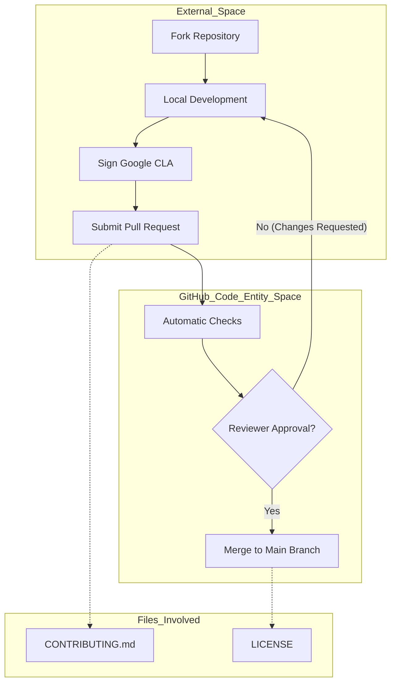
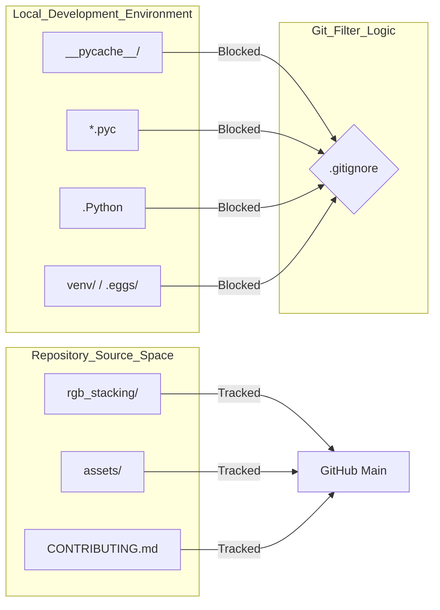

<!-- source: DeepWiki mcp.deepwiki.com · repo google-deepmind/rgb_stacking · page 5.2 Contributing and Licensing · fetched 2026-10-26 -->

# Contributing and Licensing

Relevant source files

The following files were used as context for generating this wiki page:

- [.gitignore](.gitignore)
- [CONTRIBUTING.md](CONTRIBUTING.md)
- [LICENSE](LICENSE)

This page details the protocols for contributing to the `rgb_stacking` project and the legal frameworks governing its use. The project utilizes a dual-licensing model: the source code is provided under the Apache 2.0 license, while the pre-trained model weights are provided under a Creative Commons license.

## 1. Contribution Workflow

Contributions to the `rgb_stacking` repository are managed through GitHub Pull Requests. All submissions, whether from external contributors or project members, must undergo a formal review process [CONTRIBUTING.md:19-24]().

### 1.1 Contributor License Agreement (CLA)
Before a Pull Request can be accepted, contributors must have a signed Contributor License Agreement (CLA) on file with Google. This agreement clarifies that the contributor (or their employer) retains copyright while granting permission for the project to use and redistribute the contribution [CONTRIBUTING.md:7-13]().

*   **Submission:** CLAs are managed at [https://cla.developers.google.com/](https://cla.developers.google.com/).
*   **Scope:** Generally, a CLA only needs to be submitted once and covers contributions across different Google-managed projects [CONTRIBUTING.md:15-17]().

### 1.2 Pull Request Review Process
The repository follows standard GitHub collaboration patterns. The following diagram illustrates the flow from local development to code integration.

**Contribution and Review Flow**

Sources: [CONTRIBUTING.md:1-25](), [LICENSE:1-130]()

## 2. Licensing

The `rgb_stacking` project is distributed under two distinct licenses to account for the difference between functional source code and research data (model weights).

### 2.1 Apache License 2.0 (Source Code)
The primary codebase is licensed under the **Apache License, Version 2.0** [LICENSE:2-4](). This is a permissive license that allows for:
*   **Reproduction and Distribution:** Users may reproduce and distribute copies of the work or derivative works [LICENSE:90-94]().
*   **Patent Grant:** Contributors grant a perpetual, worldwide patent license to users [LICENSE:74-82]().
*   **Modification:** Users can modify the code, provided they include prominent notices of changes and retain copyright/attribution notices [LICENSE:98-106]().

### 2.2 CC BY 4.0 (Policy Weights)
The pre-trained specialist policies located in `assets/saved_models/` are governed by the **Creative Commons Attribution 4.0 International (CC BY 4.0)** license. This allows users to share and adapt the models for any purpose, including commercial ones, as long as appropriate credit is given.

### 2.3 License Summary Table

| Asset Type | Location | License |
| :--- | :--- | :--- |
| **Source Code** | Root directory, `rgb_stacking/` | Apache 2.0 |
| **Documentation** | Root directory, `real_cell_documentation/` | Apache 2.0 |
| **Model Weights** | `assets/saved_models/` | CC BY 4.0 |
| **3D Assets** | `assets/` (excluding `saved_models/`) | Apache 2.0 |

Sources: [LICENSE:1-130](), [CONTRIBUTING.md:1-25]()

## 3. Development Environment and File Management

To maintain a clean repository and ensure contributions adhere to the project structure, a `.gitignore` file is provided to exclude build artifacts and environment-specific files.

### 3.1 Ignored Files and Directories
The repository explicitly ignores Python-specific metadata and distribution folders to prevent accidental commits of local environment data [ .gitignore:1-25]().

**Repository File Handling Logic**

Sources: [.gitignore:1-25]()

### 3.2 Key Ignored Categories
*   **Byte-compiled files:** `__pycache__`, `.py[cod]`, and `$py.class` are excluded to avoid architecture-specific conflicts [.gitignore:1-4]().
*   **Packaging artifacts:** Directories like `build/`, `dist/`, and `*.egg-info/` are ignored to keep the repository focused on source code rather than distribution binaries [.gitignore:8-21]().
*   **Local environments:** Virtual environment markers such as `.Python` and `lib/` are excluded [.gitignore:7-14]().

Sources: [.gitignore:1-25](), [CONTRIBUTING.md:1-25](), [LICENSE:1-130]()

---

