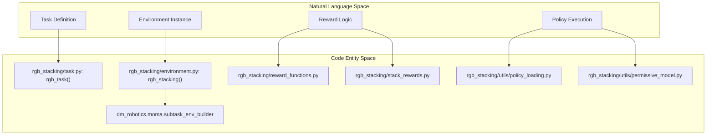
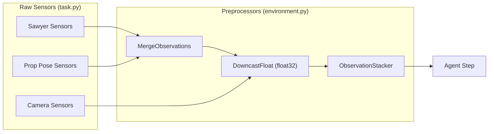

<!-- source: DeepWiki mcp.deepwiki.com · repo google-deepmind/rgb_stacking · page 6 Glossary · fetched 2026-10-26 -->

# Glossary

Relevant source files

The following files were used as context for generating this wiki page:

- [README.md](README.md)
- [assets/saved_models/mpo_state_rgb_test_triplet1/saved_model.pb](assets/saved_models/mpo_state_rgb_test_triplet1/saved_model.pb)
- [rgb_stacking/environment.py](rgb_stacking/environment.py)
- [rgb_stacking/physics_utils.py](rgb_stacking/physics_utils.py)
- [rgb_stacking/reward_functions.py](rgb_stacking/reward_functions.py)
- [rgb_stacking/stack_rewards.py](rgb_stacking/stack_rewards.py)
- [rgb_stacking/task.py](rgb_stacking/task.py)
- [rgb_stacking/utils/permissive_model.py](rgb_stacking/utils/permissive_model.py)
- [rgb_stacking/utils/policy_loading.py](rgb_stacking/utils/policy_loading.py)

This page provides definitions for codebase-specific terms, abbreviations, and domain concepts used in the `rgb_stacking` repository. It includes technical implementation details and pointers to relevant code entities to assist onboarding engineers.

## Core Domain Concepts

### RGB Stacking Task
The primary robotic manipulation task where a robot arm must stack a **Red** object on top of a **Blue** object while a **Green** object serves as a distractor/obstacle [README.md:19-23](). The task is considered successful if the objects are stacked and the robot is not touching them within a 20-second limit [README.md:21-23]().

### Object Triplets
Specific sets of three 3D-printed shapes (Red, Green, Blue). The environment supports different splits for research purposes:
*   **Test Triplets**: 5 specific fixed combinations (1-5) used for evaluating "Skill Mastery" [README.md:138-141]().
*   **Train/Held-out Random**: Randomized selections from larger pools of objects to test "Skill Generalization" [README.md:142-143]().

### Control Loop & Timesteps
The environment operates with two distinct timesteps:
*   **Physics Timestep**: Set to 0.0005s (2000Hz) for MuJoCo simulation stability [rgb_stacking/environment.py:57-57]().
*   **Control Timestep**: Set to 0.05s (20Hz), which is the frequency at which the agent receives observations and provides actions [rgb_stacking/task.py:89-89]().

## System Architecture: Code Entity Map

The following diagram maps natural language concepts to the specific Python classes and functions that implement them.

**System Entity Mapping**

Sources: [rgb_stacking/task.py:116-118](), [rgb_stacking/environment.py:137-141](), [rgb_stacking/utils/policy_loading.py:47-47]().

## Technical Glossary

| Term | Definition | Code Pointer |
| :--- | :--- | :--- |
| **MoMa** | Modular Manipulation framework. A library used to build MuJoCo tasks by composing robots, arenas, and props [README.md:25-26](). | `dm_robotics.moma` |
| **4D Cartesian Velocity** | The action space of the robot: linear velocity (x, y, z) and angular velocity around the z-axis [README.md:23-25](). | [rgb_stacking/task.py:44-45]() |
| **Observation Stacking** | The process of concatenating previous $N$ frames of data into a single observation vector to provide temporal context [rgb_stacking/environment.py:47-51](). | `_OBSERVATION_STACK_DEPTH` |
| **Shaped Reward** | A continuous reward signal that guides the agent through stages (reach $\to$ grasp $\to$ lift $\to$ hover $\to$ stack) [rgb_stacking/stack_rewards.py:65-111](). | `get_shaped_stacking_reward` |
| **Sparse Reward** | A binary reward (0 or 1) given only when the stacking goal is fully achieved and the robot has retreated [rgb_stacking/stack_rewards.py:114-117](). | `get_sparse_stacking_reward` |
| **TCP** | Tool Center Point. The coordinate frame located between the gripper fingers [rgb_stacking/task.py:75-76](). | `sawyer/tcp/pose` |
| **Pinch Pose** | The specific point where the gripper fingers meet, used for precise distance calculations [rgb_stacking/task.py:85-86](). | `sawyer/pinch/pose` |

## Data Flow: Observation Preprocessing

The environment uses a `SubtaskEnvBuilder` to transform raw MuJoCo sensor data into the format expected by the agents.

**Observation Processing Pipeline**

Sources: [rgb_stacking/environment.py:188-203](), [rgb_stacking/task.py:153-160]().

## Policy & Inference Terms

### PermissiveModel
A wrapper class found in [rgb_stacking/utils/permissive_model.py:43-44]() that allows a TensorFlow `SavedModel` to be called with flexible arguments. It handles signature matching and ignores extraneous keyword arguments that might be present in the environment's observation dictionary but not required by the specific model [rgb_stacking/utils/permissive_model.py:60-63]().

### _MPOState
A `NamedTuple` used to track the internal state of the Maximum a Posteriori Policy Optimization (MPO) agent. It contains a `counter`, and state structures for the `actor` and `critic` [rgb_stacking/utils/policy_loading.py:31-35]().

### StatefulPolicyCallable
A helper class that maintains the `_MPOState` across environment steps, making the policy compatible with the `dm_control` viewer's expectation of a simple mapping from `TimeStep` to `Action` [rgb_stacking/utils/policy_loading.py:77-89]().

## Physics & Collision Utilities

The module `rgb_stacking/physics_utils.py` provides helpers to query the MuJoCo `contact` buffer.

*   **`has_collision`**: The base function that iterates through `physics.data.contact` to find intersections between geoms with specific prefixes [rgb_stacking/physics_utils.py:59-74]().
*   **Collision Prefixes**:
    *   `rgb`: Used for the manipulatable objects [rgb_stacking/physics_utils.py:24-24]().
    *   `work_surface`/`ground`: Used for the basket floor [rgb_stacking/physics_utils.py:25-25]().
    *   `robot`: Used for the Sawyer arm and gripper [rgb_stacking/physics_utils.py:26-26]().

Sources: [rgb_stacking/physics_utils.py:21-26](), [rgb_stacking/physics_utils.py:59-62]().