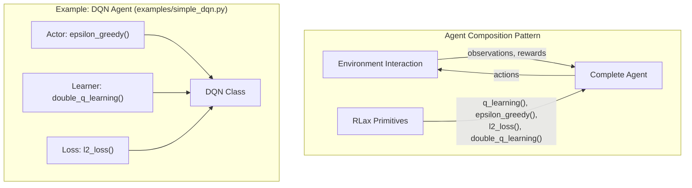
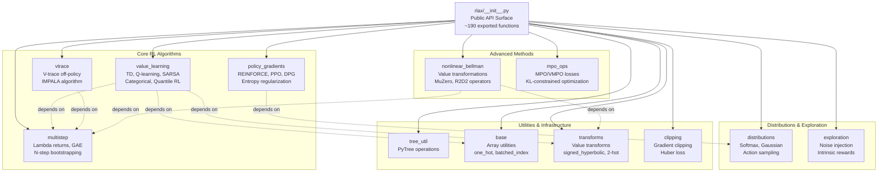
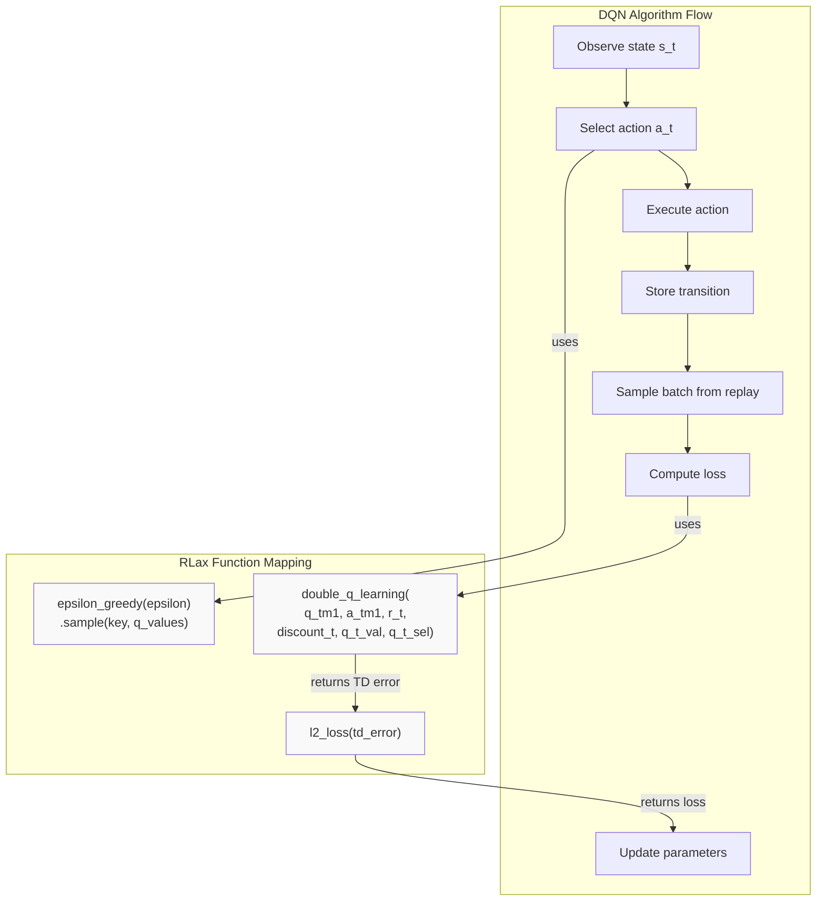

<!-- source: DeepWiki mcp.deepwiki.com · repo google-deepmind/rlax · page 1 Overview · fetched 2026-10-26 -->

# Overview

<details>
<summary>Relevant source files</summary>

The following files were used as context for generating this wiki page:

- [README.md](README.md)
- [examples/__init__.py](examples/__init__.py)
- [examples/experiment.py](examples/experiment.py)
- [examples/online_q_learning.py](examples/online_q_learning.py)
- [examples/pop_art.py](examples/pop_art.py)
- [examples/simple_dqn.py](examples/simple_dqn.py)
- [rlax/__init__.py](rlax/__init__.py)
- [rlax/_src/embedding.py](rlax/_src/embedding.py)

</details>


This document provides a high-level introduction to RLax, explaining its purpose, design philosophy, architectural organization, and how to navigate the codebase. For installation instructions and quick start examples, see [Installation and Quick Start](#1.1). For detailed documentation of specific algorithm families, see the subsequent chapters on value-based learning ([#2](#2)), multistep returns ([#3](#3)), distributions ([#4](#4)), and policy optimization ([#5](#5)).

## Purpose and Scope

RLax is a library of **modular reinforcement learning building blocks** built on JAX. Unlike full-featured RL frameworks that provide complete agent implementations, RLax focuses on providing primitive mathematical operations that can be composed to build custom RL algorithms. The library exposes approximately 190 functions through its public API, organized into functional domains such as value learning, policy gradients, multistep credit assignment, and probability distributions.

RLax is designed for researchers and practitioners who want:
- Fine-grained control over algorithm implementation
- JAX-compatible RL operations that support JIT compilation, automatic differentiation, and hardware acceleration
- Reusable components that can be mixed and matched across different RL paradigms
- Well-tested implementations of complex RL operations (e.g., V-trace, distributional Bellman operators, MPO)

**Sources:** [README.md:1-139](), [rlax/__init__.py:1-284]()

## Design Philosophy: Building Blocks, Not Algorithms

RLax provides **operations and functions**, not complete algorithms. Each function implements a specific mathematical transformation used in RL. For example:

- `rlax.q_learning()` computes the Q-learning TD error, but does not implement a full DQN agent
- `rlax.policy_gradient_loss()` computes a policy gradient loss, but does not implement PPO
- `rlax.lambda_returns()` computes λ-returns, but does not implement an actor-critic algorithm

Complete agents are built by **composing** these primitives. The `examples/` directory demonstrates this pattern:



This modular design allows users to:
1. Mix components from different RL families (e.g., distributional Q-learning with n-step returns)
2. Implement novel algorithms by recombining primitives in new ways
3. Swap individual components while keeping the rest of an agent unchanged

**Sources:** [README.md:35-52](), [examples/simple_dqn.py:95-154](), [examples/online_q_learning.py:80-123]()

## Core Functional Areas

RLax is organized into distinct functional modules. The following diagram shows the main areas and their relative importance (based on code change frequency):



**Sources:** [rlax/__init__.py:17-143]()

### Module Descriptions

| Module | Primary Functions | Purpose |
|--------|------------------|---------|
| `value_learning` | `q_learning`, `double_q_learning`, `categorical_q_learning`, `retrace`, `sarsa` | Temporal difference methods for value-based RL |
| `multistep` | `lambda_returns`, `n_step_bootstrapped_returns`, `truncated_generalized_advantage_estimation` | Multi-step return computation and credit assignment |
| `vtrace` | `vtrace`, `vtrace_td_error_and_advantage`, `leaky_vtrace` | Off-policy correction for actor-critic methods |
| `policy_gradients` | `policy_gradient_loss`, `clipped_surrogate_pg_loss`, `dpg_loss`, `entropy_loss` | Policy optimization losses |
| `mpo_ops` | `mpo_loss`, `vmpo_loss`, `compute_parametric_kl_penalty_and_dual_loss` | Maximum a Posteriori Policy Optimization |
| `nonlinear_bellman` | `transformed_q_lambda`, `muzero_pair`, `SIGNED_HYPERBOLIC_PAIR` | Transformed value functions for deep RL |
| `distributions` | `softmax`, `epsilon_greedy`, `gaussian_diagonal`, `squashed_gaussian` | Action selection and probability distributions |
| `tree_util` | `tree_select`, `tree_map_zipped`, `tree_split_key` | Operations on nested structures (PyTrees) |
| `base` | `batched_index`, `one_hot`, `lhs_broadcast` | Fundamental array operations |

**Sources:** [rlax/__init__.py:17-143]()

## Public API Organization

All public functions are exported through a single entry point: `rlax/__init__.py`. The `__all__` tuple explicitly defines the public API surface. Functions are organized by domain:

### Value Learning Functions (30+ functions)

```python
# Basic TD methods
rlax.q_learning(q_tm1, a_tm1, r_t, discount_t, q_t)
rlax.double_q_learning(q_tm1, a_tm1, r_t, discount_t, q_t_value, q_t_selector)
rlax.sarsa(q_tm1, a_tm1, r_t, discount_t, q_t, a_t)
rlax.expected_sarsa(q_tm1, a_tm1, r_t, discount_t, q_t, probs_a_t)

# Distributional RL
rlax.categorical_q_learning(atoms_tm1, logits_tm1, a_tm1, r_t, discount_t, atoms_t, logits_t)
rlax.quantile_q_learning(dist_tm1, tau_tm1, a_tm1, r_t, discount_t, dist_t)

# Off-policy
rlax.retrace(q_tm1, q_t, a_tm1, a_t, r_t, discount_t, rho_tm1, lambda_)
```

**Sources:** [rlax/__init__.py:120-139]()

### Multistep Return Functions (5+ functions)

```python
rlax.discounted_returns(r_t, discount_t, v_t)
rlax.lambda_returns(r_t, discount_t, v_t, lambda_)
rlax.n_step_bootstrapped_returns(r_t, discount_t, v_t, n)
rlax.truncated_generalized_advantage_estimation(r_t, discount_t, lambda_, values)
```

**Sources:** [rlax/__init__.py:60-65]()

### Policy Gradient Functions (8+ functions)

```python
rlax.policy_gradient_loss(logprobs_actions, advantages, w)
rlax.clipped_surrogate_pg_loss(prob_ratios, advantages, epsilon)
rlax.dpg_loss(a_t, dq_da)
rlax.entropy_loss(logits, w)
```

**Sources:** [rlax/__init__.py:84-90]()

### Distribution Functions (11+ functions)

```python
rlax.softmax(temperature)  # Returns a distribution
rlax.epsilon_greedy(epsilon)  # Returns a distribution
rlax.greedy()  # Returns a distribution
rlax.gaussian_diagonal(mu, sigma)
rlax.squashed_gaussian(mu, sigma, ...)
```

**Sources:** [rlax/__init__.py:24-34]()

## How Building Blocks Compose

The following diagram illustrates how RLax primitives compose into a complete DQN agent, mapping high-level algorithm steps to specific RLax functions:



**Concrete Example from `examples/simple_dqn.py`:**

```python
# Action selection (actor_step)
q = self._network.apply(params.online, obs)
epsilon = self._epsilon_by_frame(actor_state.count)
a = rlax.epsilon_greedy(epsilon).sample(key, q)

# Learning (learner_step -> _loss)
q_tm1 = self._network.apply(online_params, obs_tm1)
q_t_val = self._network.apply(target_params, obs_t)
q_t_select = self._network.apply(online_params, obs_t)
batched_loss = jax.vmap(rlax.double_q_learning)
td_error = batched_loss(q_tm1, a_tm1, r_t, discount_t, q_t_val, q_t_select)
return jnp.mean(rlax.l2_loss(td_error))
```

**Sources:** [examples/simple_dqn.py:126-154]()

### Composition Patterns

RLax functions follow consistent composition patterns:

1. **TD Learning Pipeline**: `value_learning` functions return TD errors → feed to loss functions (`l2_loss`, `huber_loss`)
2. **Multistep + Value Learning**: `multistep` functions compute targets → combine with predictions in `value_learning` functions
3. **Distribution + Policy Gradient**: `distributions` provide action sampling → `policy_gradients` compute losses
4. **Transform + Bellman**: `TxPair` objects wrap Bellman operators in `nonlinear_bellman` module

**Sources:** [examples/simple_dqn.py:146-153](), [examples/online_q_learning.py:118-122]()

## JAX Integration and Features

RLax is deeply integrated with the JAX ecosystem and leverages JAX's core features:

### JIT Compilation
All RLax functions are designed to work with `jax.jit`:

```python
# From examples/simple_dqn.py
self.actor_step = jax.jit(self.actor_step)
self.learner_step = jax.jit(self.learner_step)
```

### Automatic Vectorization
Functions are designed for single transitions but can be batched with `jax.vmap`:

```python
# Single transition
td_error = rlax.double_q_learning(q_tm1, a_tm1, r_t, discount_t, q_t_val, q_t_select)

# Batched transitions
batched_loss = jax.vmap(rlax.double_q_learning)
td_errors = batched_loss(q_tm1_batch, a_tm1_batch, r_t_batch, ...)
```

### Automatic Differentiation
Losses are differentiable and work with `jax.grad`:

```python
# Compute gradient of loss w.r.t. parameters
dloss_dtheta = jax.grad(self._loss)(params, data)
```

### Hardware Acceleration
Code runs unchanged on CPU, GPU, or TPU through JAX's device abstraction.

**Sources:** [README.md:26-28](), [examples/simple_dqn.py:107-109](), [examples/simple_dqn.py:151-153]()

## Codebase Structure

The codebase follows a clear organizational structure:

```
rlax/
├── __init__.py              # Public API (all exports)
├── _src/                    # Private implementation modules
│   ├── base.py             # Array utilities
│   ├── clipping.py         # Gradient clipping, Huber loss
│   ├── distributions.py    # Action distributions
│   ├── exploration.py      # Exploration strategies
│   ├── multistep.py        # Multi-step returns
│   ├── policy_gradients.py # Policy optimization
│   ├── value_learning.py   # TD methods
│   ├── vtrace.py           # V-trace algorithm
│   ├── mpo_ops.py          # MPO/VMPO
│   ├── nonlinear_bellman.py# Value transformations
│   ├── tree_util.py        # PyTree operations
│   ├── transforms.py       # Value transforms
│   └── ...                 # Other specialized modules
└── examples/
    ├── simple_dqn.py       # DQN implementation
    ├── online_q_learning.py# Online Q-learning
    ├── pop_art.py          # PopArt normalization
    └── experiment.py       # Training loop utilities
```

### Navigating Implementation

- **Public API**: All user-facing functions are in `rlax/__init__.py` (lines 17-272)
- **Implementation**: Private modules in `rlax/_src/` contain actual implementations
- **Examples**: Complete agent implementations in `examples/` show usage patterns
- **Documentation**: Function docstrings contain mathematical definitions and paper references

**Key principle**: Users should only import from `rlax`, never from `rlax._src`:

```python
# Correct
import rlax
td_error = rlax.q_learning(...)

# Incorrect - _src is private
from rlax._src.value_learning import q_learning  # Don't do this
```

**Sources:** [rlax/__init__.py:274-282]()

## Naming Conventions

RLax follows consistent naming conventions to clarify temporal relationships:

- **`_tm1`**: Values at the *source* state of a transition (time minus 1)
- **`_t`**: Values at the *destination* state (current time)
- **`_tp1`**: Values at the next state (time plus 1)

**Example:**
```python
# q_tm1: Q-values in source state
# a_tm1: action taken in source state  
# r_t: reward received after taking action
# discount_t: discount factor for this transition
# q_t: Q-values in destination state
td_error = rlax.q_learning(q_tm1, a_tm1, r_t, discount_t, q_t)
```

**Sources:** [README.md:112-121]()

## Data Requirements and Constraints

**Important**: RLax functions compute correct updates only when input data satisfies algorithm-specific requirements:

- **On-policy algorithms** (e.g., `policy_gradient_loss`): Require trajectories sampled from the current policy
- **Off-policy algorithms** (e.g., `q_learning`, `retrace`): Can learn from data sampled by different policies
- **Importance sampling**: Some functions (e.g., `vtrace`) require importance ratios when learning off-policy

The library **does not enforce** these constraints; users must ensure data is sampled correctly. Function docstrings specify requirements.

**Sources:** [README.md:99-104]()

## External Dependencies

RLax integrates with the JAX ecosystem:

| Dependency | Purpose |
|-----------|---------|
| **JAX** | Core numerical computation, JIT, autodiff, vmap |
| **jax.numpy** | NumPy-compatible array operations |
| **chex** | Runtime type checking and assertions |
| **distrax** | Probability distributions (being migrated to) |
| **optax** | Gradient-based optimization (examples) |
| **haiku** | Neural networks (examples only) |

The core library depends only on JAX and chex. Examples additionally require optax, haiku, and bsuite.

**Sources:** [README.md:29-33](), [examples/simple_dqn.py:17-28]()

## Next Steps

To start using RLax:

1. **Install the library**: See [Installation and Quick Start](#1.1)
2. **Explore examples**: Review complete agent implementations in `examples/`
3. **Deep dive into algorithms**: 
   - Value-based methods: [#2](#2)
   - Multistep returns: [#3](#3)
   - Distributions: [#4](#4)
   - Policy gradients: [#5](#5)
4. **Browse API reference**: See [Complete API Reference](#8) for all functions

**Sources:** [README.md:1-139](), [examples/simple_dqn.py:1-186](), [examples/online_q_learning.py:1-150]()

---

