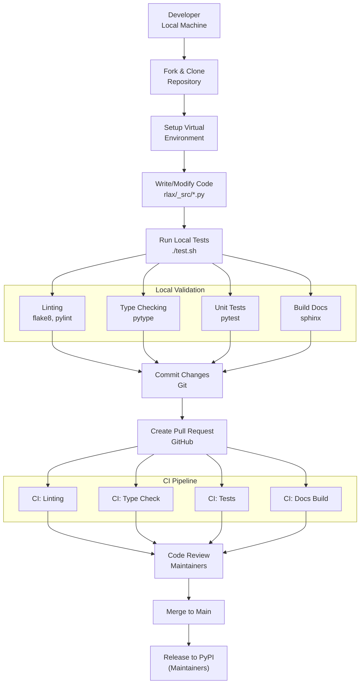
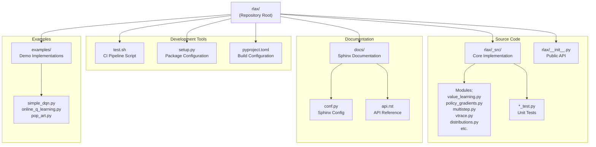
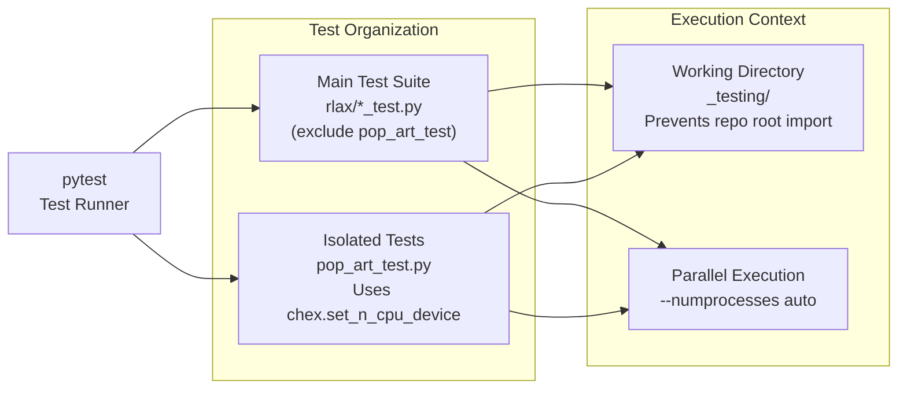
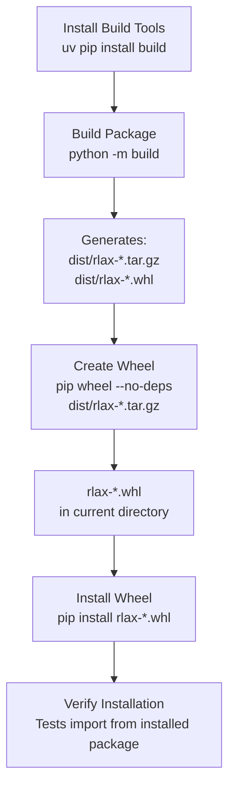
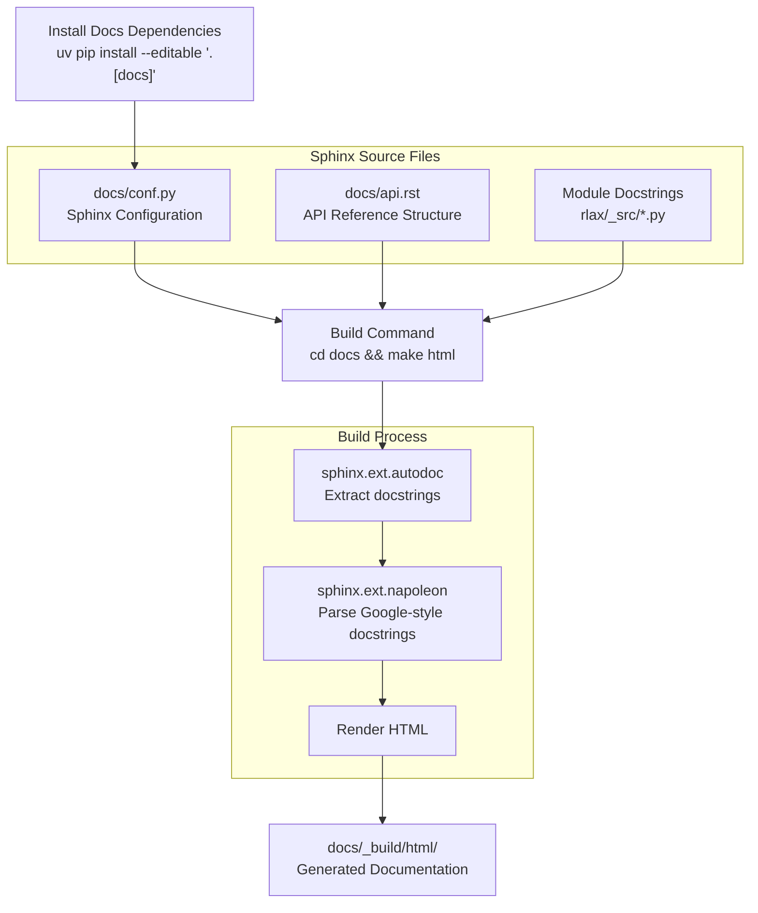
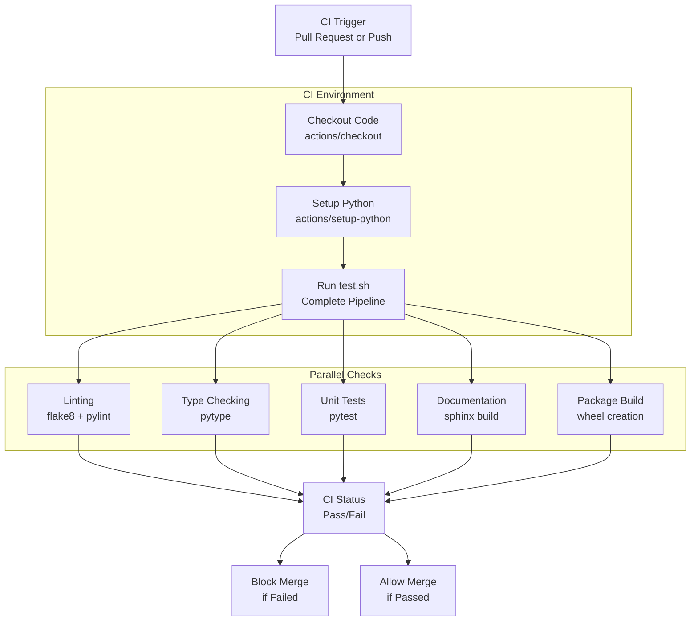

<!-- source: DeepWiki mcp.deepwiki.com · repo google-deepmind/rlax · page 10 Development Guide · fetched 2026-10-26 -->

# Development Guide

<details>
<summary>Relevant source files</summary>

The following files were used as context for generating this wiki page:

- [rlax/_src/__init__.py](rlax/_src/__init__.py)
- [test.sh](test.sh)

</details>


This document provides comprehensive information for contributors to the RLax codebase. It covers the development workflow, testing infrastructure, documentation system, and CI/CD pipeline. This guide is intended for developers who want to contribute code, fix bugs, or improve the library.

For information about using RLax in your projects, see [Installation and Quick Start](#1.1). For details on specific algorithms and features, see the other sections of this wiki.

---

## Purpose and Scope

This Development Guide covers:

- **Development workflow**: Setting up your local environment, running tests, and validating changes
- **CI/CD pipeline**: Understanding the automated checks that run on all contributions via [test.sh]()
- **Testing infrastructure**: How tests are organized and executed (details in [Testing Infrastructure](#10.1))
- **Documentation system**: How to build and contribute to documentation (details in [Documentation System](#10.2))
- **Release process**: Package building and publishing workflow (details in [CI/CD and Release Process](#10.3))

This page provides an overview of all development processes. The sub-pages provide detailed information on specific aspects.

---

## Development Workflow Overview

The typical development workflow for RLax contributors follows this pattern:



**Sources**: [test.sh:1-106]()

---

## Repository Structure for Development

Understanding the repository structure is essential for effective contribution:



| Directory/File | Purpose |
|----------------|---------|
| `rlax/_src/` | Core implementation of all algorithms and utilities |
| `rlax/__init__.py` | Public API surface that exports functions |
| `test.sh` | Main CI/CD script for local and automated testing |
| `docs/` | Sphinx documentation source files |
| `examples/` | Complete agent implementations demonstrating usage |
| `setup.py`, `pyproject.toml` | Package configuration and dependencies |

**Sources**: [test.sh:1-106]()

---

## CI/CD Pipeline Architecture

The [test.sh]() script orchestrates all quality assurance checks. This script runs both locally and in continuous integration:

```mermaid
graph TB
    START["./test.sh<br/>Entry Point"]
    
    subgraph "Environment Setup"
        CLEAN["Clean Old Artifacts<br/>rm -rf _testing .pytype"]
        VENV["Create Virtual Env<br/>python3 -m venv"]
        DEPS["Install Dependencies<br/>uv pip install"]
        JAX["Install JAX Version<br/>Based on JAX_VERSION env var"]
        UNINSTALL["Uninstall Old RLax<br/>Prevent version conflicts"]
    end
    
    subgraph "Code Quality Checks"
        FLAKE8["flake8 Linting<br/>E9,F63,F7,F82,E225,E251"]
        PYLINT["pylint Linting<br/>Google Style Guide<br/>Two-space indent"]
    end
    
    subgraph "Build Verification"
        BUILD["Build Package<br/>python -m build"]
        WHEEL["Create Wheel<br/>pip wheel"]
        INSTALL["Install Wheel<br/>pip install rlax-*.whl"]
    end
    
    subgraph "Type Checking"
        PYTYPE_CHECK["Check Python Version<br/>< 3.11 only"]
        PYTYPE["pytype Type Check<br/>-j auto --keep-going"]
    end
    
    subgraph "Unit Testing"
        CD_TEST["cd _testing<br/>Avoid repo root import"]
        PYTEST_MAIN["pytest Main Tests<br/>--numprocesses auto<br/>Exclude pop_art_test"]
        PYTEST_ISO["pytest Isolated Tests<br/>pop_art_test only<br/>Uses chex.set_n_cpu_device"]
    end
    
    subgraph "Documentation"
        SPHINX["Build Sphinx Docs<br/>make html"]
    end
    
    CLEANUP["Cleanup<br/>rm -rf _testing<br/>deactivate venv"]
    SUCCESS["All tests passed!"]
    
    START --> CLEAN
    CLEAN --> VENV
    VENV --> DEPS
    DEPS --> JAX
    JAX --> UNINSTALL
    
    UNINSTALL --> FLAKE8
    FLAKE8 --> PYLINT
    
    PYLINT --> BUILD
    BUILD --> WHEEL
    WHEEL --> INSTALL
    
    INSTALL --> PYTYPE_CHECK
    PYTYPE_CHECK --> PYTYPE
    
    PYTYPE --> CD_TEST
    CD_TEST --> PYTEST_MAIN
    PYTEST_MAIN --> PYTEST_ISO
    
    PYTEST_ISO --> SPHINX
    
    SPHINX --> CLEANUP
    CLEANUP --> SUCCESS
```



**Sources**: [test.sh:16-105]()

---

## Development Environment Setup

### Prerequisites

RLax requires:
- Python 3.8+ (note: pytype only supports up to Python 3.10)
- JAX and jaxlib
- Development tools: flake8, pylint, pytest, pytype, sphinx

### Local Setup Process

The [test.sh]() script handles environment setup automatically:

1. **Virtual Environment Creation**: [test.sh:20-26]()
   ```bash
   python3 -m venv "${VENV_DIR}"
   source "${VENV_DIR}/bin/activate"
   ```

2. **Dependency Installation**: [test.sh:29-33]()
   - Uses `uv` for fast package installation
   - Installs development tools: flake8, pytest-xdist, pylint, pylint-exit
   - Installs package in editable mode with test extras: `--editable ".[test]"`

3. **JAX Version Management**: [test.sh:35-44]()
   - Controlled via `JAX_VERSION` environment variable
   - Options: default (from requirements), `newest`, `nightly`, or specific version
   - Example: `JAX_VERSION=0.4.13 ./test.sh`

4. **Version Conflict Prevention**: [test.sh:46-49]()
   - Uninstalls any existing rlax installation to ensure tests run against local code

**Sources**: [test.sh:20-49]()

---

## Quality Assurance Checks

### Linting

RLax uses two complementary linting tools:

#### flake8 Linting

[test.sh:51-52]() runs flake8 with strict error codes:

```
flake8 --count --select=E9,F63,F7,F82,E225,E251 --show-source --statistics
```

| Error Code | Meaning |
|------------|---------|
| E9 | Runtime errors (syntax errors, indentation) |
| F63 | Invalid print statements |
| F7 | Syntax errors in type comments |
| F82 | Undefined names |
| E225, E251 | Whitespace around operators |

#### pylint Linting

[test.sh:54-67]() uses Google's Python style guide with customizations:

1. Downloads Google OSS pylintrc configuration
2. Enforces two-space indentation (sed modification)
3. Disables specific checks: `unnecessary-lambda-assignment`, `no-value-for-parameter`, `use-dict-literal`
4. Separates module linting from test linting:
   - Modules: Standard checks, disables E1102
   - Tests: Additionally disables W0212 (protected-access), E1130, E1120

**Sources**: [test.sh:51-67]()

### Type Checking

Type checking with pytype [test.sh:75-82]():

```python
if [ `python -c 'import sys; print(sys.version_info.minor)'` -lt 11 ];
then
  python3 -m pytype "rlax" -j auto --keep-going --disable import-error
fi;
```

- **Python version restriction**: Only runs on Python < 3.11 due to pytype limitations
- **Parallel execution**: `-j auto` uses all available cores
- **Fault tolerance**: `--keep-going` continues checking after errors
- **Import flexibility**: `--disable import-error` allows dynamic imports

**Sources**: [test.sh:75-82]()

---

## Testing Infrastructure Overview

### Test Execution Strategy



The test suite is split into two execution phases [test.sh:84-93]():

1. **Main Tests**: [test.sh:89]()
   ```bash
   python3 -m pytest --numprocesses auto --pyargs rlax -k "not pop_art_test"
   ```
   - Runs all tests except pop_art_test
   - Uses parallel execution across all CPU cores
   - Executed from `_testing/` directory to avoid import conflicts

2. **Isolated Tests**: [test.sh:92]()
   ```bash
   python3 -m pytest --numprocesses auto --pyargs rlax -k "pop_art_test"
   ```
   - Runs pop_art_test separately
   - Required because it uses `chex.set_n_cpu_device()` which affects global state

For detailed information on test structure and utilities, see [Testing Infrastructure](#10.1).

**Sources**: [test.sh:84-93]()

---

## Build and Packaging Process

The build process verifies that RLax can be packaged and installed correctly:



The build steps [test.sh:69-73]():

1. **Install build tools**: `python3 -m uv pip install build`
2. **Build source and wheel distributions**: `python3 -m build`
   - Creates source tarball in `dist/`
   - Creates wheel in `dist/`
3. **Create wheel from source**: `python3 -m pip wheel --no-deps dist/rlax-*.tar.gz`
   - Verifies source distribution is valid
4. **Install wheel**: `python3 -m pip install rlax-*.whl`
   - Ensures installation works correctly
   - Subsequent tests run against this installed version

This process validates that:
- The package configuration is correct
- All source files are included in distributions
- The package can be installed from both source and wheel formats
- Import paths work correctly after installation

**Sources**: [test.sh:69-73]()

---

## Documentation Generation

RLax uses Sphinx to generate API documentation from docstrings:



Documentation build process [test.sh:95-98]():

1. **Install documentation dependencies**: Includes sphinx and extensions
2. **Navigate to docs directory**: `cd docs`
3. **Run Sphinx build**: `make html`
4. **Output location**: `docs/_build/html/index.html`

The documentation system:
- Uses `sphinx.ext.autodoc` to automatically extract docstrings
- Supports Google-style docstrings via `sphinx.ext.napoleon`
- Generates API reference from [rlax/__init__.py]() exports
- Includes hand-written guides and tutorials

For detailed information on documentation structure and conventions, see [Documentation System](#10.2).

**Sources**: [test.sh:95-98]()

---

## Key Development Commands

### Running the Full CI Pipeline Locally

```bash
./test.sh
```

This runs all checks that will be executed in CI. The script is self-contained and handles environment setup automatically.

### Running Individual Components

While `test.sh` provides the complete pipeline, developers can run individual checks during development:

| Check | Command | Script Reference |
|-------|---------|------------------|
| Linting (flake8) | `flake8 rlax --select=E9,F63,F7,F82,E225,E251` | [test.sh:51-52]() |
| Linting (pylint) | `pylint rlax` | [test.sh:54-67]() |
| Type checking | `pytype rlax -j auto` | [test.sh:75-82]() |
| Unit tests | `pytest --pyargs rlax` | [test.sh:84-93]() |
| Documentation | `cd docs && make html` | [test.sh:95-98]() |
| Package build | `python -m build` | [test.sh:69-73]() |

### JAX Version Testing

Test against different JAX versions:

```bash
# Test with newest JAX
JAX_VERSION=newest ./test.sh

# Test with specific version
JAX_VERSION=0.4.13 ./test.sh

# Test with nightly build
JAX_VERSION=nightly ./test.sh
```

The JAX version handling is implemented in [test.sh:35-44]().

**Sources**: [test.sh:35-44](), [test.sh:51-98]()

---

## Continuous Integration Pipeline

The CI pipeline runs automatically on all pull requests and commits to the main branch. It executes the same `test.sh` script that developers run locally, ensuring consistency between local development and automated testing.



The CI pipeline ensures:
- All code passes linting standards
- Type annotations are correct
- All tests pass
- Documentation builds successfully
- Package can be built and installed

For information on the release process and publishing to PyPI, see [CI/CD and Release Process](#10.3).

**Sources**: [test.sh:1-106]()

---

## Common Development Scenarios

### Adding a New Algorithm Module

1. Create implementation file: `rlax/_src/new_algorithm.py`
2. Write comprehensive docstrings using Google style
3. Create test file: `rlax/_src/new_algorithm_test.py`
4. Export public functions in [rlax/__init__.py]()
5. Run `./test.sh` to validate all checks pass
6. Add usage example to `examples/` if appropriate

### Fixing a Bug

1. Write a failing test that reproduces the bug
2. Fix the implementation
3. Verify the test now passes
4. Run `./test.sh` to ensure no regressions
5. Update documentation if behavior changes

### Updating Dependencies

1. Modify requirements in `setup.py` or `pyproject.toml`
2. Test with different JAX versions:
   ```bash
   JAX_VERSION=oldest ./test.sh
   JAX_VERSION=newest ./test.sh
   ```
3. Update CI configuration if needed
4. Document any breaking changes

**Sources**: [test.sh:1-106]()

---

## Error Handling and Troubleshooting

### Common Issues

| Issue | Cause | Solution |
|-------|-------|----------|
| Import errors during tests | Testing against installed package instead of local code | Run from `_testing/` directory [test.sh:86]() |
| pytype failures on Python 3.11+ | pytype doesn't support Python 3.11+ | Use Python 3.10 or earlier [test.sh:78]() |
| pop_art_test failures | Conflicts with other tests using CPU devices | Tests run in isolation [test.sh:92]() |
| pylint two-space violations | Code uses four-space indentation | Follow Google style guide with two spaces [test.sh:59]() |

### Debugging Test Failures

When tests fail:

1. **Run specific test**: `pytest rlax/_src/module_test.py::test_function`
2. **Enable verbose output**: `pytest -v --pyargs rlax`
3. **Show print statements**: `pytest -s --pyargs rlax`
4. **Run without parallelization**: `pytest --pyargs rlax` (omit `--numprocesses`)

### Build Issues

If package build fails:

1. Verify `setup.py` and `pyproject.toml` are valid
2. Check that all required files are included in `MANIFEST.in`
3. Clean build artifacts: `rm -rf build/ dist/ *.egg-info`
4. Rebuild: `python -m build`

**Sources**: [test.sh:75-93]()

---

## Best Practices for Contributors

### Code Style

- Follow Google Python Style Guide (enforced by pylint)
- Use two-space indentation [test.sh:59]()
- Write comprehensive docstrings for all public functions
- Include type annotations (checked by pytype)
- Keep lines under 80 characters where reasonable

### Testing

- Write tests for all new functionality
- Aim for high test coverage
- Use descriptive test names: `test_<function>_<scenario>_<expected>`
- Test edge cases and error conditions
- Use `chex.assert_*` for shape and type checks

### Documentation

- Document all public APIs with Google-style docstrings
- Include `Args`, `Returns`, and `Raises` sections
- Provide usage examples in docstrings
- Update `docs/api.rst` when adding new modules
- Build docs locally to verify formatting [test.sh:95-98]()

### Version Control

- Create feature branches from `main`
- Write clear, descriptive commit messages
- Keep commits focused and atomic
- Reference issues in commit messages when applicable
- Ensure `./test.sh` passes before pushing

**Sources**: [test.sh:51-98]()

---

## Summary

The RLax development workflow is designed to maintain high code quality through automated checks:

- **Environment isolation**: Virtual environments prevent conflicts
- **Comprehensive linting**: flake8 and pylint enforce style consistency
- **Type safety**: pytype catches type errors before runtime
- **Thorough testing**: pytest with parallel execution validates correctness
- **Documentation validation**: Sphinx build ensures docs are accurate
- **Build verification**: Package creation confirms distribution integrity

All these checks run via the single `./test.sh` command, making it easy for contributors to validate their changes locally before submitting pull requests.

For detailed information on specific aspects:
- Testing organization and utilities: [Testing Infrastructure](#10.1)
- Documentation structure and conventions: [Documentation System](#10.2)
- Release and publishing workflow: [CI/CD and Release Process](#10.3)

**Sources**: [test.sh:1-106]()

---

