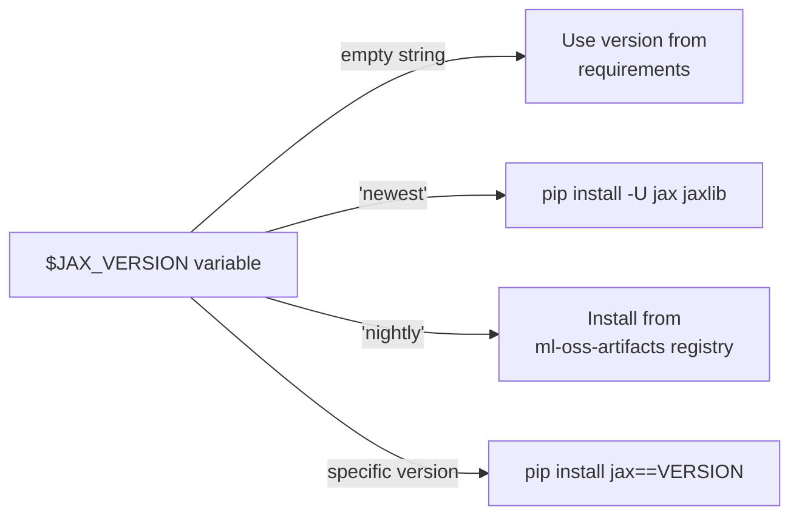
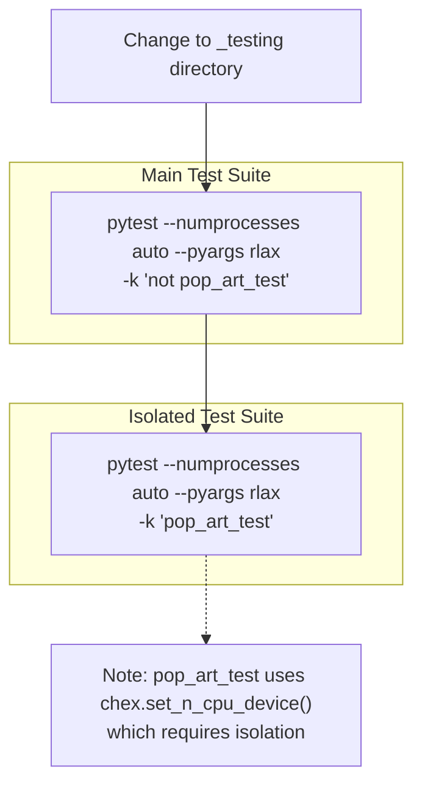
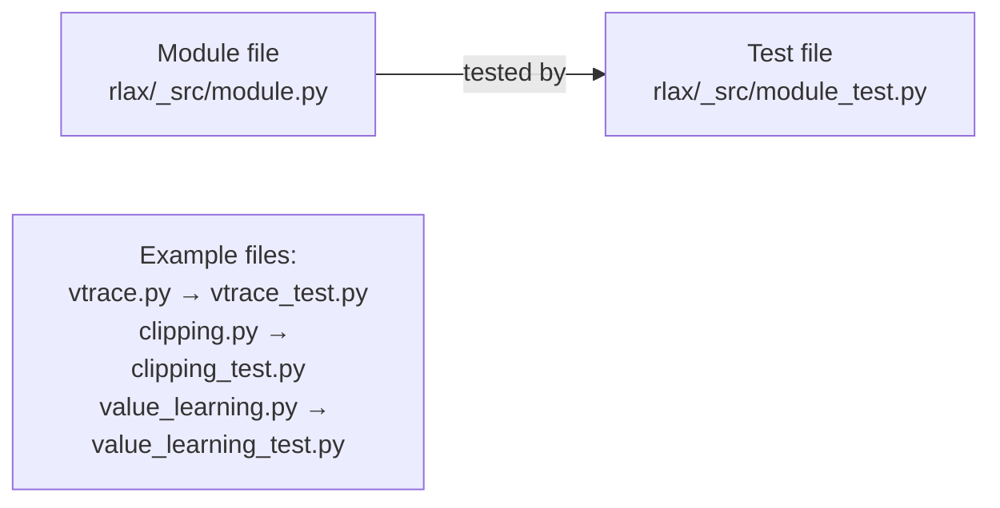
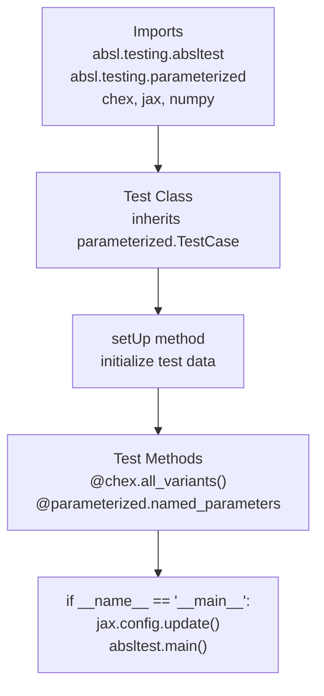
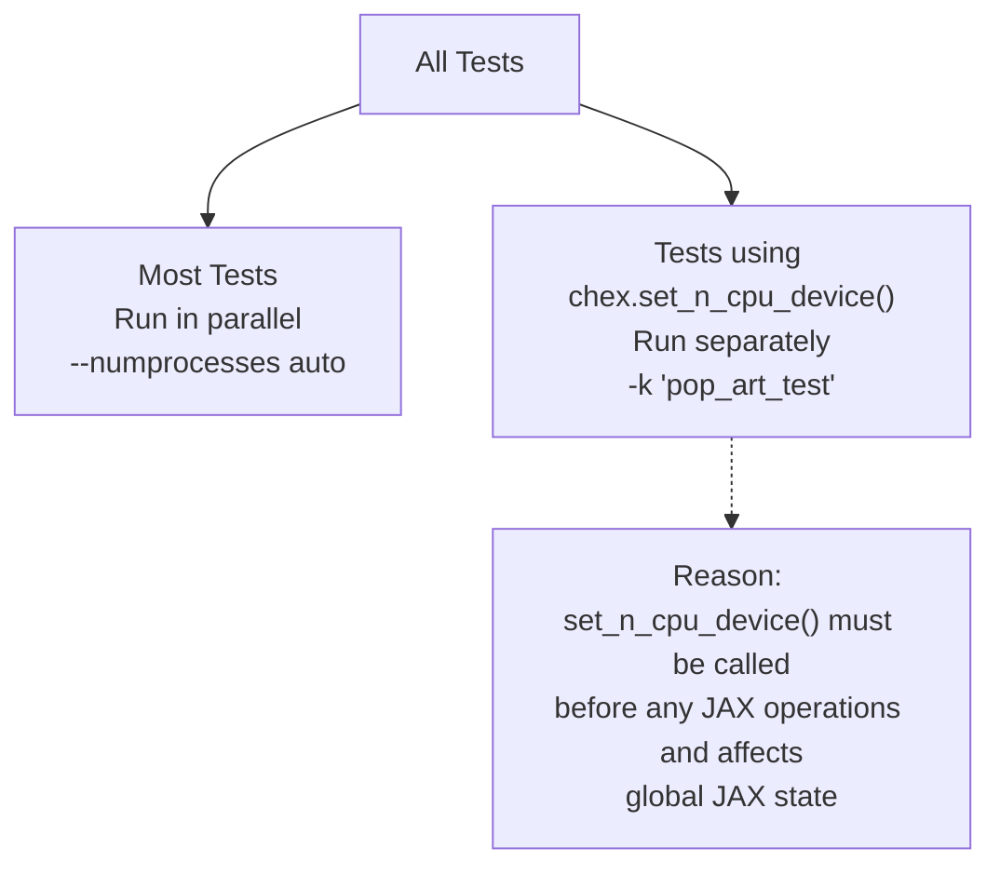
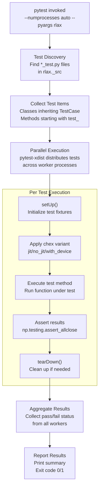

<!-- source: DeepWiki mcp.deepwiki.com · repo google-deepmind/rlax · page 10.1 Testing Infrastructure · fetched 2026-10-26 -->

# Testing Infrastructure

<details>
<summary>Relevant source files</summary>

The following files were used as context for generating this wiki page:

- [rlax/_src/__init__.py](rlax/_src/__init__.py)
- [rlax/_src/clipping_test.py](rlax/_src/clipping_test.py)
- [rlax/_src/vtrace_test.py](rlax/_src/vtrace_test.py)
- [test.sh](test.sh)

</details>


## Purpose and Scope

This document describes the testing infrastructure used in RLax for validating code correctness, maintaining code quality, and ensuring compatibility across different JAX versions. It covers the CI pipeline script, test organization, test execution procedures, and common testing patterns used throughout the codebase.

For information about documentation generation (which is also part of the CI pipeline), see [Documentation System](#10.2). For the complete CI/CD and release process, see [CI/CD and Release Process](#10.3).

**Sources:** [test.sh:1-106]()

---

## Test Infrastructure Overview

The RLax testing infrastructure is centered around the [`test.sh`](test.sh:1-106)() script, which orchestrates all quality assurance steps including linting, type checking, unit testing, and documentation building. Tests are written using pytest and leverage JAX testing utilities through the chex library.

### CI Pipeline Architecture

```mermaid
graph TB
    START["test.sh invoked"]
    
    subgraph "Environment Setup"
        CLEAN["Clean previous artifacts<br/>rm -rf _testing .pytype"]
        VENV["Create virtual environment<br/>python3 -m venv"]
        DEPS["Install dependencies<br/>pip install flake8 pytest-xdist pylint"]
        EDITABLE["Install rlax --editable"]
        JAX_VER["Install JAX version<br/>newest/nightly/specific"]
        UNINSTALL["Ensure no pre-installed rlax"]
    end
    
    subgraph "Linting Stage"
        FLAKE8["flake8 linting<br/>E9,F63,F7,F82,E225,E251"]
        PYLINT_DL["Download .pylintrc<br/>google.github.io/styleguide"]
        PYLINT_MOD["pylint modules<br/>rlax/**/*.py"]
        PYLINT_TEST["pylint tests<br/>*_test.py"]
        PYLINT_CLEAN["rm .pylintrc"]
    end
    
    subgraph "Build Stage"
        BUILD["Build package<br/>python3 -m build"]
        WHEEL["Create wheel<br/>pip wheel dist/rlax-*.tar.gz"]
        INSTALL["Install wheel<br/>pip install rlax-*.whl"]
    end
    
    subgraph "Type Checking Stage"
        PYTYPE_CHECK{"Python < 3.11?"}
        PYTYPE["pytype rlax<br/>-j auto --keep-going"]
        SKIP_PYTYPE["Skip pytype"]
    end
    
    subgraph "Test Execution Stage"
        CD_TEST["cd _testing"]
        PYTEST_MAIN["pytest main tests<br/>--numprocesses auto<br/>-k 'not pop_art_test'"]
        PYTEST_ISO["pytest isolated tests<br/>--numprocesses auto<br/>-k 'pop_art_test'"]
        CD_BACK["cd .."]
    end
    
    subgraph "Documentation Stage"
        DOCS_DEPS["Install docs dependencies<br/>pip install .[docs]"]
        SPHINX["Build Sphinx docs<br/>cd docs && make html"]
    end
    
    CLEANUP["Cleanup<br/>rm -rf _testing"]
    SUCCESS["All tests passed!"]
    
    START --> CLEAN
    CLEAN --> VENV
    VENV --> DEPS
    DEPS --> EDITABLE
    EDITABLE --> JAX_VER
    JAX_VER --> UNINSTALL
    
    UNINSTALL --> FLAKE8
    FLAKE8 --> PYLINT_DL
    PYLINT_DL --> PYLINT_MOD
    PYLINT_MOD --> PYLINT_TEST
    PYLINT_TEST --> PYLINT_CLEAN
    
    PYLINT_CLEAN --> BUILD
    BUILD --> WHEEL
    WHEEL --> INSTALL
    
    INSTALL --> PYTYPE_CHECK
    PYTYPE_CHECK -->|Yes| PYTYPE
    PYTYPE_CHECK -->|No| SKIP_PYTYPE
    PYTYPE --> CD_TEST
    SKIP_PYTYPE --> CD_TEST
    
    CD_TEST --> PYTEST_MAIN
    PYTEST_MAIN --> PYTEST_ISO
    PYTEST_ISO --> CD_BACK
    
    CD_BACK --> DOCS_DEPS
    DOCS_DEPS --> SPHINX
    
    SPHINX --> CLEANUP
    CLEANUP --> SUCCESS
```



**Sources:** [test.sh:1-106]()

---

## CI Pipeline Stages

The [`test.sh`](test.sh:1-106)() script executes a series of quality assurance stages in strict order. Each stage must succeed before proceeding to the next.

### Environment Setup

The script creates an isolated virtual environment to ensure reproducible test conditions:

| Step | Command | Purpose |
|------|---------|---------|
| Clean artifacts | `rm -rf _testing .pytype` | Remove previous test runs |
| Create venv | `python3 -m venv ${VENV_DIR}` | Isolated Python environment |
| Upgrade pip | `python3 -m pip install --upgrade pip uv` | Latest package installer |
| Install deps | `python3 -m uv pip install flake8 pytest-xdist pylint` | Testing tools |
| Editable install | `python3 -m uv pip install --editable ".[test]"` | Install rlax in development mode |
| JAX version | Conditional install based on `$JAX_VERSION` | Support multiple JAX versions |
| Uninstall rlax | `python3 -m uv pip uninstall rlax` | Prevent version conflicts |

**Sources:** [test.sh:19-49]()

### JAX Version Matrix

The test script supports testing against multiple JAX versions through the `$JAX_VERSION` environment variable:



**Sources:** [test.sh:35-44]()

### Linting Stage

Two linters validate code style and quality:

#### Flake8 Linting

Checks for critical syntax errors and style violations:

```bash
python3 -m flake8 `find rlax -name '*.py' | xargs` \
  --count --select=E9,F63,F7,F82,E225,E251 \
  --show-source --statistics
```

Error codes checked:
- **E9**: Runtime syntax errors
- **F63/F7/F82**: Undefined names and imports
- **E225/E251**: Whitespace around operators

**Sources:** [test.sh:51-52]()

#### Pylint Linting

Performs comprehensive static analysis using Google's style guide:

| Component | Configuration | Purpose |
|-----------|---------------|---------|
| Config download | `wget https://google.github.io/styleguide/pylintrc` | Google OSS standards |
| Indent override | `sed -i "s/indent-string.*/indent-string='  '/"` | Two-space indentation |
| Disabled checks | `unnecessary-lambda-assignment,no-value-for-parameter,use-dict-literal` | Avoid false positives |
| Module checks | `pylint *.py -d E1102` | Main modules |
| Test checks | `pylint *_test.py -d W0212,E1130,E1102,E1120` | Tests with relaxed rules |

The test files allow `protected-access` (W0212) since tests frequently access private members.

**Sources:** [test.sh:54-67]()

### Build and Package Stage

The script verifies that the package can be built and installed:

```bash
python3 -m uv pip install build
python3 -m build
python3 -m pip wheel --no-deps dist/rlax-*.tar.gz
python3 -m pip install rlax-*.whl
```

This ensures the package metadata and distribution are valid.

**Sources:** [test.sh:69-73]()

### Type Checking Stage

Type annotations are checked using pytype (Python < 3.11 only):

```bash
if [ `python -c 'import sys; print(sys.version_info.minor)'` -lt 11 ]; then
  python3 -m pip install pytype
  python3 -m pytype "rlax" -j auto --keep-going --disable import-error
fi
```

The `--keep-going` flag allows checking all files even if some fail, and `--disable import-error` ignores import resolution issues.

**Sources:** [test.sh:75-82]()

### Test Execution Stage

Tests are executed using pytest with parallel execution:



The directory change to `_testing` prevents importing from the repository root, ensuring tests run against the installed package.

**Sources:** [test.sh:84-93]()

---

## Test Organization and Structure

### File Naming Convention

RLax follows a consistent test file naming pattern:



Each implementation module has a corresponding `*_test.py` file in the same directory.

**Sources:** [rlax/_src/vtrace_test.py:1-164](), [rlax/_src/clipping_test.py:1-120]()

### Test File Structure

Test files follow a standard structure using absltest and parameterized testing:



**Example from vtrace_test.py:**

The `VTraceTest` class structure:
- **Imports**: [rlax/_src/vtrace_test.py:17-24]()
- **Test class**: [rlax/_src/vtrace_test.py:27-27]()
- **setUp method**: [rlax/_src/vtrace_test.py:29-62]()
- **Test methods**: [rlax/_src/vtrace_test.py:73-159]()
- **Main block**: [rlax/_src/vtrace_test.py:161-163]()

**Sources:** [rlax/_src/vtrace_test.py:1-164](), [rlax/_src/clipping_test.py:1-120]()

---

## Running Tests

### Running All Tests

Execute the complete CI pipeline:

```bash
./test.sh
```

This runs all stages: linting, type checking, unit tests, and documentation building.

### Running Tests with Specific JAX Version

```bash
JAX_VERSION=newest ./test.sh
JAX_VERSION=nightly ./test.sh
JAX_VERSION=0.4.13 ./test.sh
```

### Running Tests Directly with Pytest

For faster iteration during development:

```bash
# All tests with parallel execution
pytest --numprocesses auto --pyargs rlax

# Specific test module
pytest --pyargs rlax._src.vtrace_test

# Specific test class
pytest --pyargs rlax._src.vtrace_test::VTraceTest

# Specific test method
pytest --pyargs rlax._src.vtrace_test::VTraceTest::test_vtrace_td_error_and_advantage

# Filter by keyword
pytest --pyargs rlax -k "vtrace"
pytest --pyargs rlax -k "not pop_art"
```

### Test Isolation Requirements

Some tests require isolation because they use `chex.set_n_cpu_device()`:



**Sources:** [test.sh:88-92]()

---

## Test Utilities and Patterns

### Chex Variants

RLax tests extensively use the `@chex.all_variants()` decorator to test functions across different JAX transformations:

```python
@chex.all_variants()
def test_vtrace_td_error_and_advantage(self):
    vtrace_fn = self.variant(jax.vmap(functools.partial(
        vtrace.vtrace_td_error_and_advantage,
        clip_rho_threshold=self._clip_rho_threshold)))
    # ... test code
```

The `self.variant()` wrapper applies JAX transformations:
- **jit**: JIT compilation
- **no transformation**: Pure Python execution
- **with_device**: Explicit device placement

This ensures functions work correctly under all execution modes.

**Sources:** [rlax/_src/vtrace_test.py:73-89]()

### JAX Configuration

Tests configure JAX for strict error checking:

```python
if __name__ == '__main__':
  jax.config.update('jax_numpy_rank_promotion', 'raise')
  absltest.main()
```

This flag raises errors on implicit rank promotion, catching shape errors early.

**Sources:** [rlax/_src/vtrace_test.py:162-163](), [rlax/_src/clipping_test.py:118-119]()

### Parameterized Testing

Complex test scenarios use `@parameterized.named_parameters`:

```python
@parameterized.named_parameters(
    ('scalar_lambda',
     np.array([[0., 1., 1., 0., 0., 1., 1., 1.]], dtype=np.float32),
     np.array([1.], dtype=np.float32)),
    ('vector_lambda',
     np.array([[0., 1., 1., 0., 0., 1., 1., 1.]], dtype=np.float32),
     np.array([[1., 1., 1., 1., 1., 1., 1., 1.]], dtype=np.float32)),
)
def test_vtrace_lambda_multiple_episodes_per_trace(self, discount_t, lambda_):
    # ... test code
```

This runs the same test logic with different input configurations.

**Sources:** [rlax/_src/vtrace_test.py:92-123]()

### Common Testing Patterns

| Pattern | Purpose | Example |
|---------|---------|---------|
| **JAX vmap testing** | Test batched operations | `jax.vmap(functools.partial(fn, ...))` |
| **Gradient testing** | Verify gradient computation | `jax.grad(loss_fn)(inputs)` |
| **Numerical comparison** | Check output values | `np.testing.assert_allclose(actual, expected, rtol=1e-3)` |
| **setUp initialization** | Prepare test data | `self.setUp()` with instance variables |
| **Explicit dtypes** | Ensure type consistency | `np.array([...], dtype=np.float32)` |

**Sources:** [rlax/_src/vtrace_test.py:29-158](), [rlax/_src/clipping_test.py:29-114]()

---

## Writing New Tests

### Test File Template

```python
# Copyright header
"""Tests for `module.py`."""

import functools
from absl.testing import absltest
from absl.testing import parameterized
import chex
import jax
import jax.numpy as jnp
import numpy as np
from rlax._src import module

class ModuleTest(parameterized.TestCase):

  def setUp(self):
    super().setUp()
    # Initialize test data
    self._test_data = ...
  
  @chex.all_variants()
  def test_function_name(self):
    """Tests for function description."""
    function_under_test = self.variant(module.function_name)
    
    # Prepare inputs
    inputs = ...
    
    # Compute outputs
    actual = function_under_test(inputs)
    
    # Verify results
    expected = ...
    np.testing.assert_allclose(actual, expected, rtol=1e-3)

if __name__ == '__main__':
  jax.config.update('jax_numpy_rank_promotion', 'raise')
  absltest.main()
```

### Test Checklist

When writing tests for RLax:

1. ✅ **Use `@chex.all_variants()`** for functions that should work under JAX transformations
2. ✅ **Test with explicit dtypes** (typically `np.float32`)
3. ✅ **Use `np.testing.assert_allclose`** with appropriate tolerance (usually `rtol=1e-3`)
4. ✅ **Test both scalar and batched inputs** using `jax.vmap`
5. ✅ **Verify gradients** when testing loss functions using `jax.grad`
6. ✅ **Set `jax_numpy_rank_promotion` to 'raise'** in main block
7. ✅ **Include docstrings** describing what each test validates
8. ✅ **Isolate tests** that use `chex.set_n_cpu_device()` with appropriate naming

**Sources:** [rlax/_src/vtrace_test.py:1-164](), [rlax/_src/clipping_test.py:1-120]()

---

## Test Execution Flow



**Sources:** [test.sh:84-92](), [rlax/_src/vtrace_test.py:73-89]()

---

## Summary

The RLax testing infrastructure provides comprehensive validation through:

- **Automated CI pipeline** via `test.sh` covering linting, type checking, testing, and documentation
- **Parallel test execution** using pytest-xdist for fast feedback
- **Multiple JAX version support** for compatibility testing
- **Rigorous code quality checks** with flake8 and pylint
- **Type safety validation** with pytype (Python < 3.11)
- **Consistent test patterns** using chex, absltest, and parameterized testing

All tests must pass before code can be merged, ensuring high code quality and preventing regressions.

**Sources:** [test.sh:1-106](), [rlax/_src/vtrace_test.py:1-164](), [rlax/_src/clipping_test.py:1-120]()

---

