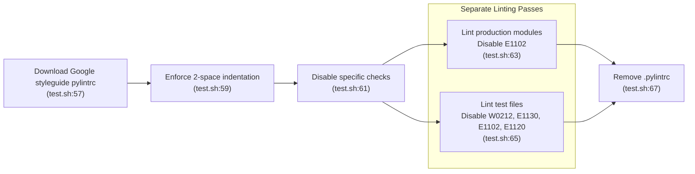
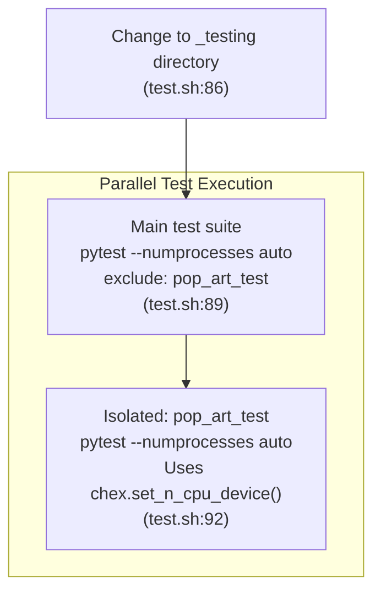
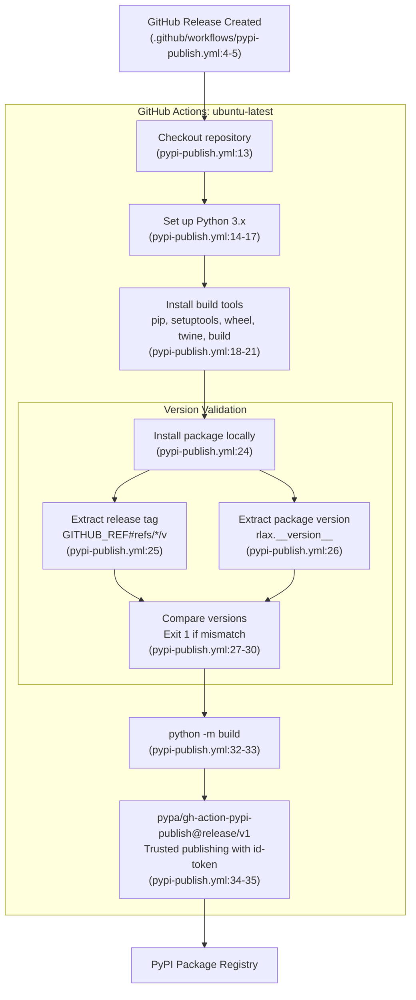
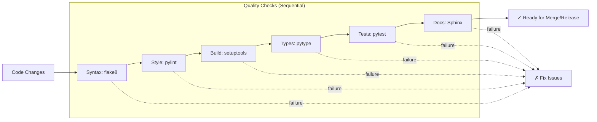

<!-- source: DeepWiki mcp.deepwiki.com · repo google-deepmind/rlax · page 10.3 CI/CD and Release Process · fetched 2026-10-26 -->

# CI/CD and Release Process

<details>
<summary>Relevant source files</summary>

The following files were used as context for generating this wiki page:

- [.github/workflows/pypi-publish.yml](.github/workflows/pypi-publish.yml)
- [.gitignore](.gitignore)
- [rlax/_src/__init__.py](rlax/_src/__init__.py)
- [test.sh](test.sh)

</details>


## Purpose and Scope

This document describes the continuous integration, testing, and release infrastructure for RLax. It covers the automated pipeline that validates code quality, runs tests, and publishes releases to PyPI. For information about the testing infrastructure itself (test organization, utilities), see [Testing Infrastructure](#10.1). For documentation generation details, see [Documentation System](#10.2).

---

## CI Pipeline Overview

RLax uses a comprehensive shell-based CI pipeline defined in [test.sh](). This script orchestrates all quality checks, testing, and validation steps that must pass before code can be merged or released.

### Pipeline Stages

```mermaid
graph TB
    START["Pipeline Start"]
    
    subgraph "Environment Setup"
        CLEAN["Clean _testing and .pytype directories<br/>(test.sh:20-21)"]
        VENV["Create virtual environment<br/>(test.sh:23-26)"]
        DEPS["Install dependencies with uv<br/>(test.sh:30-33)"]
        JAX_VER["Install JAX version<br/>(test.sh:36-44)"]
        UNINSTALL["Uninstall conflicting rlax<br/>(test.sh:49)"]
    end
    
    subgraph "Quality Gates"
        FLAKE8["flake8: Syntax & Import Errors<br/>(test.sh:52)"]
        PYLINT["pylint: Code Quality<br/>(test.sh:54-67)"]
    end
    
    subgraph "Package Build"
        BUILD_PKG["Build source & wheel distributions<br/>(test.sh:69-73)"]
        INSTALL_WHL["Install built wheel<br/>(test.sh:73)"]
    end
    
    subgraph "Type Checking"
        PYTYPE_CHECK["Check Python version < 3.11<br/>(test.sh:78)"]
        PYTYPE["Run pytype type checker<br/>(test.sh:80-81)"]
    end
    
    subgraph "Testing"
        MAIN_TESTS["pytest main tests<br/>--numprocesses auto<br/>(test.sh:89)"]
        ISOLATED_TESTS["pytest pop_art_test<br/>isolated execution<br/>(test.sh:92)"]
    end
    
    subgraph "Documentation"
        SPHINX["Build Sphinx HTML docs<br/>(test.sh:96-98)"]
    end
    
    CLEANUP["Cleanup _testing directory<br/>(test.sh:101)"]
    SUCCESS["All tests passed"]
    
    START --> CLEAN
    CLEAN --> VENV
    VENV --> DEPS
    DEPS --> JAX_VER
    JAX_VER --> UNINSTALL
    
    UNINSTALL --> FLAKE8
    FLAKE8 --> PYLINT
    
    PYLINT --> BUILD_PKG
    BUILD_PKG --> INSTALL_WHL
    
    INSTALL_WHL --> PYTYPE_CHECK
    PYTYPE_CHECK --> PYTYPE
    
    PYTYPE --> MAIN_TESTS
    MAIN_TESTS --> ISOLATED_TESTS
    
    ISOLATED_TESTS --> SPHINX
    
    SPHINX --> CLEANUP
    CLEANUP --> SUCCESS
```



**Sources:** [test.sh:1-106]()

---

## Environment Setup

### Virtual Environment Isolation

The pipeline creates a fresh virtual environment for each run to ensure reproducibility:

```bash
# test.sh:20-26
rm -rf _testing
rm -rf .pytype
mkdir -p _testing
readonly VENV_DIR="$(mktemp -d -p `pwd`/_testing rlax-env.XXXXXXXX)"
python3 -m venv "${VENV_DIR}"
source "${VENV_DIR}/bin/activate"
```

This approach prevents interference from system-wide or user-installed packages.

### Dependency Management

Dependencies are installed using `uv`, a fast Python package installer:

| Step | Tool | Purpose |
|------|------|---------|
| Base tools | `pip`, `uv` | Package management infrastructure |
| Quality tools | `flake8`, `pytest-xdist`, `pylint`, `pylint-exit` | Linting and testing |
| Project dependencies | Editable install `.[test]` | RLax with test extras |
| Build tools | `build` | Package distribution creation |
| Type checker | `pytype` (Python < 3.11) | Static type validation |
| Documentation | `.[docs]` | Sphinx and extensions |

**Sources:** [test.sh:30-33, 70, 80, 96]()

### JAX Version Flexibility

The pipeline supports multiple JAX versions via the `JAX_VERSION` environment variable:

| Value | Behavior |
|-------|----------|
| Empty string | Use version from requirements |
| `"newest"` | Install latest stable via `pip install -U jax jaxlib` |
| `"nightly"` | Install from ML OSS nightly artifacts |
| Specific version | Install exact version: `jax==${JAX_VERSION}` |

This allows testing against different JAX releases to ensure compatibility.

**Sources:** [test.sh:36-44]()

---

## Quality Gates

### Linting with flake8

The first quality gate uses `flake8` to catch syntax errors, undefined names, and import issues:

```bash
# test.sh:52
python3 -m flake8 `find rlax -name '*.py' | xargs` \
  --count \
  --select=E9,F63,F7,F82,E225,E251 \
  --show-source \
  --statistics
```

**Checked Violations:**
- `E9`: Syntax errors
- `F63`: Invalid syntax constructs
- `F7`: Syntax errors in assert/raise statements
- `F82`: Undefined names
- `E225`, `E251`: Whitespace around operators

**Sources:** [test.sh:52]()

### Linting with pylint

The second gate uses `pylint` with Google's style guide configuration:



**Key Configuration:**
- **Indent style:** 2 spaces (enforced via sed modification at [test.sh:59]())
- **Disabled checks:** `unnecessary-lambda-assignment`, `no-value-for-parameter`, `use-dict-literal`
- **Test-specific:** `protected-access` disabled for tests (accessing private members is common in testing)

The `pylint-exit` utility converts pylint exit codes to fail on errors/warnings but not on conventions/refactoring suggestions.

**Sources:** [test.sh:54-67]()

---

## Package Building

### Distribution Creation

The pipeline builds both source and wheel distributions:

```bash
# test.sh:69-73
python3 -m uv pip install build
python3 -m build                           # Creates source (.tar.gz) and wheel (.whl)
python3 -m pip wheel --no-deps dist/rlax-*.tar.gz
python3 -m pip install rlax-*.whl
```

This verifies that the package can be correctly built and installed, catching issues like missing files in `MANIFEST.in` or incorrect `setup.py` configuration.

**Sources:** [test.sh:69-73]()

---

## Type Checking

### pytype Static Analysis

For Python versions below 3.11, the pipeline runs `pytype` for static type checking:

```bash
# test.sh:78-82
if [ `python -c 'import sys; print(sys.version_info.minor)'` -lt 11 ];
then
  python3 -m pip install pytype
  python3 -m pytype "rlax" -j auto --keep-going --disable import-error
fi;
```

**Configuration:**
- `-j auto`: Parallel execution using all available cores
- `--keep-going`: Continue checking after errors
- `--disable import-error`: Ignore import resolution issues (common with JAX)

**Note:** pytype does not support Python 3.11+ as of the implementation date. This limitation is explicitly noted at [test.sh:76-77]().

**Sources:** [test.sh:75-82]()

---

## Testing

### Test Execution Strategy



**Rationale for Separation:**

Tests are split into two groups:
1. **Main tests** ([test.sh:89]()): Run in parallel with process-level parallelism via `pytest-xdist`
2. **Isolated tests** ([test.sh:92]()): Tests like `pop_art_test` that use `chex.set_n_cpu_device()` must run separately because this function modifies global JAX device configuration

The directory change to `_testing` at [test.sh:86]() prevents accidentally importing the package from the repository root instead of the installed wheel.

**Sources:** [test.sh:84-93]()

---

## Documentation Building

The pipeline validates that documentation can be built successfully:

```bash
# test.sh:96-98
python3 -m uv pip install --editable ".[docs]"
cd docs && make html
cd ..
```

This catches:
- Missing or broken API references
- Sphinx configuration errors
- ReStructuredText syntax issues
- Missing docstrings for public functions

For details on the documentation system itself, see [Documentation System](#10.2).

**Sources:** [test.sh:95-98]()

---

## Release Process

### PyPI Publishing Workflow

RLax uses GitHub Actions for automated PyPI publishing, triggered on GitHub release creation:



**Sources:** [.github/workflows/pypi-publish.yml:1-36]()

### Version Consistency Check

A critical safety check ensures the GitHub release tag matches the package version:

```bash
# .github/workflows/pypi-publish.yml:22-30
RELEASE_VER=${GITHUB_REF#refs/*/}
PACKAGE_VER="v`python -c 'import rlax; print(rlax.__version__)'`"
if [ $RELEASE_VER != $PACKAGE_VER ]
then
  echo "package ver. ($PACKAGE_VER) != release ver. ($RELEASE_VER)"; exit 1
fi
```

This prevents accidental publication of incorrect versions. The release tag must be prefixed with `v` (e.g., `v0.1.3`) to match the pattern at [.github/workflows/pypi-publish.yml:25]().

**Sources:** [.github/workflows/pypi-publish.yml:22-30]()

### Trusted Publishing

The workflow uses OpenID Connect (OIDC) trusted publishing with the `id-token: write` permission at [.github/workflows/pypi-publish.yml:11](). This eliminates the need for long-lived API tokens, improving security by allowing GitHub Actions to authenticate directly with PyPI.

**Sources:** [.github/workflows/pypi-publish.yml:10-11, 34-35]()

---

## Excluded Artifacts

The `.gitignore` file defines what's excluded from version control:

| Category | Patterns | Purpose |
|----------|----------|---------|
| Build artifacts | `*.egg-info`, `*.pyc`, `*.so`, `build/`, `dist/` | Compiled/generated files |
| Virtual environments | `venv/`, `_testing/` | Local development environments |
| Documentation | `docs/_autosummary`, `docs/_build/`, `docs/_collections`, `docs/modules/generated` | Generated documentation |
| Type checking | `.mypy_cache/`, `.pytype/` | Type checker caches |
| OS files | `.DS_Store` | macOS metadata |
| Editor files | `.idea`, `.vscode`, `.ipynb_checkpoints` | IDE configurations |

The `_testing/` directory is particularly important—it's created during CI runs at [test.sh:22]() and cleaned up at [test.sh:101]() to ensure isolation between runs.

**Sources:** [.gitignore:1-28]()

---

## Running CI Locally

Developers can run the full CI pipeline locally before pushing:

```bash
# Set optional JAX version
export JAX_VERSION=""        # Use default from requirements
# export JAX_VERSION="newest"  # Or use latest
# export JAX_VERSION="0.4.13"  # Or specific version

# Run full CI pipeline
bash test.sh
```

The script is designed to be idempotent and can be run repeatedly. It handles cleanup of previous runs automatically at [test.sh:20-21]().

**Sources:** [test.sh:1-106]()

---

## Quality Metrics Summary



All checks must pass for code to be merged. The sequential nature (enforced by `set -e` at [test.sh:17]()) ensures early failure on basic issues before running expensive operations like testing.

**Sources:** [test.sh:17]()

---

## Release Checklist

For maintainers preparing a release:

1. **Update version** in `rlax/__init__.py` (set `__version__` string)
2. **Commit version change** to main branch
3. **Create GitHub release** with tag `v{version}` (must match package version)
4. **GitHub Actions automatically:**
   - Validates version consistency
   - Builds distributions
   - Publishes to PyPI via trusted publishing

The version check at [.github/workflows/pypi-publish.yml:22-30]() will prevent publication if the tag doesn't match the package version.

**Sources:** [.github/workflows/pypi-publish.yml:4-5, 22-30]()