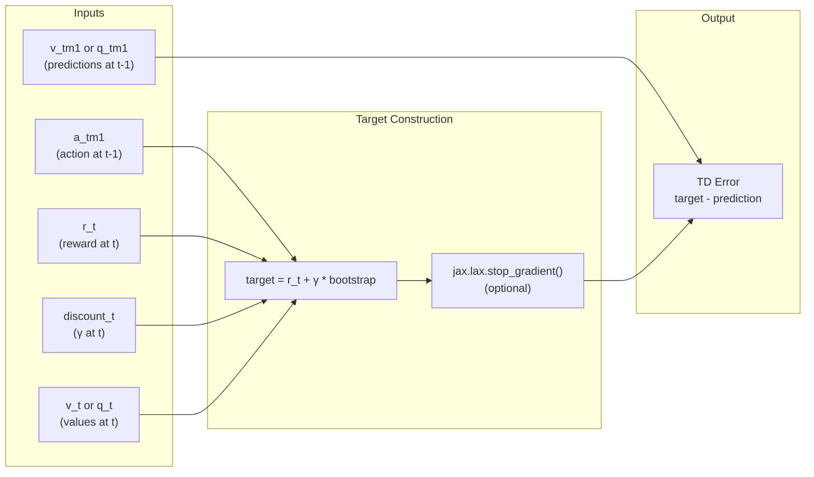
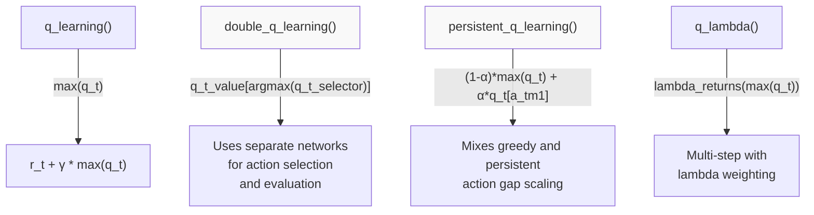
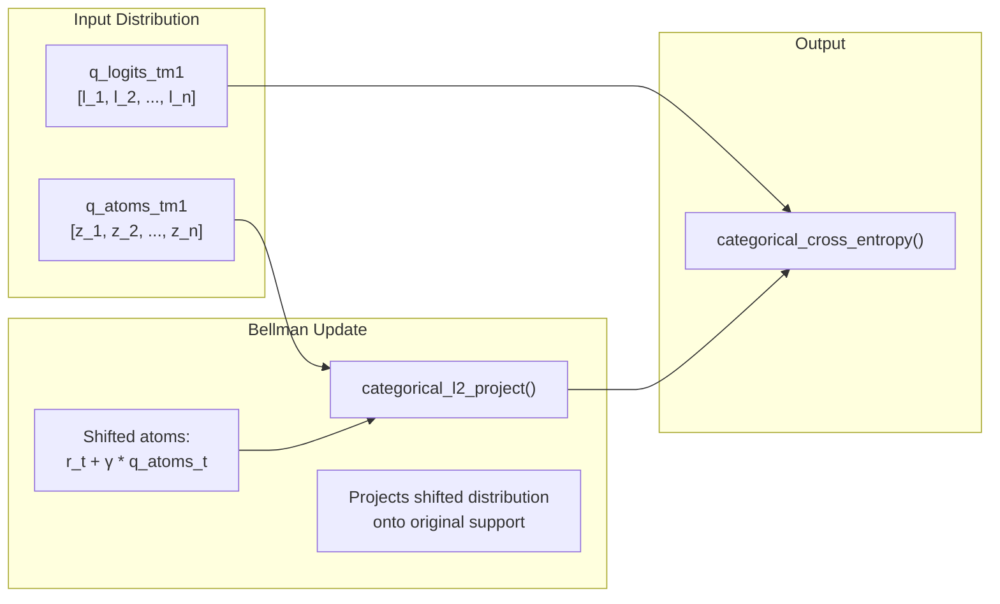
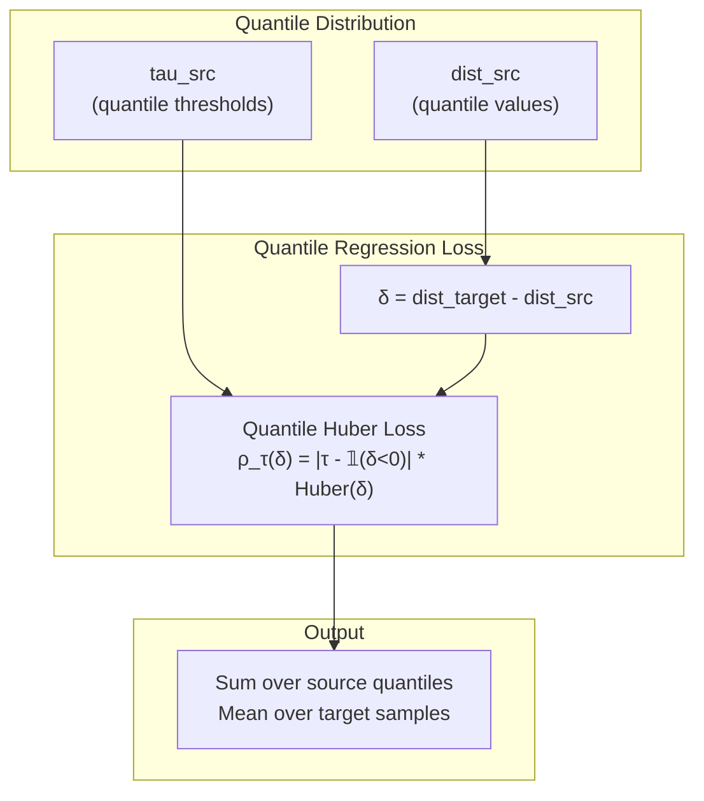
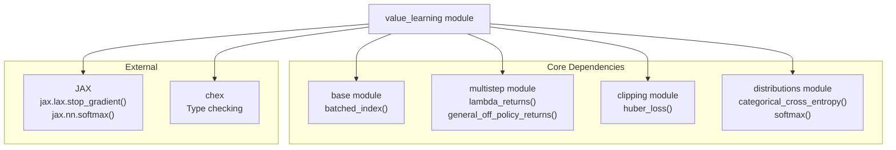

<!-- source: DeepWiki mcp.deepwiki.com · repo google-deepmind/rlax · page 2 Value-Based Learning · fetched 2026-10-26 -->

# Value-Based Learning

<details>
<summary>Relevant source files</summary>

The following files were used as context for generating this wiki page:

- [rlax/_src/value_learning.py](rlax/_src/value_learning.py)
- [rlax/_src/value_learning_test.py](rlax/_src/value_learning_test.py)

</details>


## Purpose and Scope

This document covers the value learning algorithms provided by RLax for estimating state values and action-values (Q-values) in discrete action spaces. Value-based methods learn to estimate the expected return an agent can collect under a given policy by applying various forms of temporal difference (TD) learning and Bellman operators.

This page provides a comprehensive overview of both **point-estimate** methods (standard TD, Q-learning, SARSA and variants) and **distributional** methods (categorical and quantile-based approaches). For detailed coverage of specific algorithm families, see:
- [Basic Value Learning (TD, Q-learning, SARSA)](#2.1) for fundamental temporal difference methods
- [Distributional Reinforcement Learning](#2.2) for categorical and quantile methods

For multistep return computation used by many value learning algorithms, see [Multistep Returns and Credit Assignment](#3).

Sources: [rlax/_src/value_learning.py:15-22]()

## Module Overview

The `value_learning` module provides JAX functions for computing temporal difference errors and losses in discrete action spaces. Actions are represented as integer indices in the range `[0, A)` where `A` is the number of distinct actions. The module contains approximately 20 distinct algorithms organized into three categories:

| Category | Algorithms | Key Characteristics |
|----------|-----------|---------------------|
| **Point-Estimate TD** | `td_learning`, `td_lambda`, `sarsa`, `expected_sarsa`, `sarsa_lambda`, `q_learning`, `double_q_learning`, `persistent_q_learning`, `qv_learning`, `qv_max`, `q_lambda`, `retrace`, `retrace_continuous` | Single scalar value per state/action, standard Bellman updates |
| **Distributional Categorical** | `categorical_l2_project`, `categorical_td_learning`, `categorical_q_learning`, `categorical_double_q_learning` | Represent value as categorical distribution over support atoms |
| **Distributional Quantile** | `quantile_regression_loss`, `quantile_q_learning`, `quantile_expected_sarsa` | Represent value as quantile distribution |

Sources: [rlax/_src/value_learning.py:1-924]()

## Value Learning Taxonomy

The following diagram maps the conceptual algorithm names to their concrete function implementations in the codebase:

```mermaid
graph TD
    VL["value_learning module"]
    
    subgraph "Point-Estimate Methods"
        TD["Temporal Difference Learning"]
        TD --> td_learning["td_learning()"]
        TD --> td_lambda["td_lambda()"]
        
        SARSA["SARSA Family"]
        SARSA --> sarsa["sarsa()"]
        SARSA --> expected_sarsa["expected_sarsa()"]
        SARSA --> sarsa_lambda["sarsa_lambda()"]
        
        QL["Q-Learning Family"]
        QL --> q_learning["q_learning()"]
        QL --> double_q_learning["double_q_learning()"]
        QL --> persistent_q_learning["persistent_q_learning()"]
        QL --> q_lambda["q_lambda()"]
        
        QV["QV Family"]
        QV --> qv_learning["qv_learning()"]
        QV --> qv_max["qv_max()"]
        
        RET["Off-Policy Correction"]
        RET --> retrace["retrace()"]
        RET --> retrace_continuous["retrace_continuous()"]
    end
    
    subgraph "Distributional Methods"
        CAT["Categorical / C51"]
        CAT --> categorical_l2_project["categorical_l2_project()"]
        CAT --> categorical_td_learning["categorical_td_learning()"]
        CAT --> categorical_q_learning["categorical_q_learning()"]
        CAT --> categorical_double_q_learning["categorical_double_q_learning()"]
        
        QUANT["Quantile Regression"]
        QUANT --> quantile_regression_loss["quantile_regression_loss()"]
        QUANT --> quantile_q_learning["quantile_q_learning()"]
        QUANT --> quantile_expected_sarsa["quantile_expected_sarsa()"]
    end
    
    VL --> TD
    VL --> SARSA
    VL --> QL
    VL --> QV
    VL --> RET
    VL --> CAT
    VL --> QUANT
```



Sources: [rlax/_src/value_learning.py:36-924]()

## Core Data Flow Pattern

All value learning functions follow a consistent computational pattern for computing temporal difference errors:



**Key Pattern Elements:**

1. **Predictions at t-1** (`v_tm1` or `q_tm1`): Values from the network being trained
2. **Reward** (`r_t`): Immediate reward observed at time t
3. **Discount** (`discount_t`): Discount factor γ, typically in [0, 1]
4. **Bootstrap Values** (`v_t` or `q_t`): Values at next state for bootstrapping
5. **Stop Gradients**: The `stop_target_gradients` parameter controls whether gradients flow through targets

Sources: [rlax/_src/value_learning.py:36-66](), [rlax/_src/value_learning.py:219-251]()

## Point-Estimate Value Learning

Point-estimate methods represent values as single scalar quantities and compute temporal difference errors using various Bellman operators.

### Basic Temporal Difference Learning

The fundamental `td_learning` function computes the TD(0) error for state values:

```
TD Error = (r_t + γ * v_t) - v_tm1
```

**Signature:** [rlax/_src/value_learning.py:36-66]()
```python
td_learning(v_tm1, r_t, discount_t, v_t, stop_target_gradients=True)
```

The `td_lambda` function extends this to TD(λ) by utilizing the `multistep.lambda_returns` function for credit assignment over multiple timesteps.

Sources: [rlax/_src/value_learning.py:36-99]()

### SARSA Family

SARSA (State-Action-Reward-State-Action) algorithms use the actually executed action at time t for bootstrapping:

| Function | Bootstrap Method | Use Case |
|----------|------------------|----------|
| `sarsa()` | Uses `q_t[a_t]` | On-policy learning with actual next action |
| `expected_sarsa()` | Uses `∑ probs_a_t * q_t` | Expected value under policy distribution |
| `sarsa_lambda()` | Uses `lambda_returns()` with actual actions | Multi-step on-policy learning |

**Example:** [rlax/_src/value_learning.py:101-136]()
```python
# SARSA updates Q-value using the next action actually taken
td_error = sarsa(q_tm1, a_tm1, r_t, discount_t, q_t, a_t)
```

Sources: [rlax/_src/value_learning.py:101-217]()

### Q-Learning Family

Q-learning algorithms use the maximum Q-value at the next state (greedy action selection):



**Double Q-Learning** addresses overestimation bias by decoupling action selection from value estimation: [rlax/_src/value_learning.py:254-290]()

**Persistent Q-Learning** increases the action gap by mixing the greedy action value with the current action: [rlax/_src/value_learning.py:292-331]()

Sources: [rlax/_src/value_learning.py:219-442]()

### Retrace: Off-Policy Correction

The `retrace` and `retrace_continuous` functions implement safe off-policy learning with importance sampling:

**Key computation:** [rlax/_src/value_learning.py:444-494]()
```python
# Importance sampling ratio clipped by lambda
c_t = min(1.0, π_t(a_t) / μ_t(a_t)) * λ

# Uses general_off_policy_returns from multistep module
target = general_off_policy_returns_from_action_values(q_t, a_t, r_t, discount_t, c_t, π_t)
```

The trace cutting coefficient `c_t` prevents excessive variance by clipping importance weights.

Sources: [rlax/_src/value_learning.py:444-541]()

## Distributional Value Learning

Distributional methods represent the entire distribution of returns rather than just the expected value, providing richer information about outcome uncertainty.

### Categorical Distributions (C51)

Categorical methods represent the value distribution as a discrete categorical distribution over fixed atoms (support points):



**Categorical Projection:** [rlax/_src/value_learning.py:543-603]()

The `categorical_l2_project` function is the core operation that projects a distribution `(z_p, probs)` onto a different support `z_q` by minimizing the L2 (Cramér) distance between cumulative distribution functions. This is essential because after the Bellman update shifts the atoms, they no longer align with the original support.

**Algorithm implementations:**
- `categorical_td_learning`: TD learning for state value distributions [rlax/_src/value_learning.py:605-653]()
- `categorical_q_learning`: Q-learning with greedy action selection [rlax/_src/value_learning.py:655-711]()
- `categorical_double_q_learning`: Double Q-learning variant [rlax/_src/value_learning.py:713-770]()

Sources: [rlax/_src/value_learning.py:543-770]()

### Quantile Regression (QR-DQN, IQN)

Quantile methods represent the value distribution via quantile estimates at specified thresholds:



**Quantile Regression Loss:** [rlax/_src/value_learning.py:772-814]()

The asymmetric quantile loss penalizes over-predictions and under-predictions differently based on the quantile threshold τ. An optional Huber loss can smooth the gradient for stability.

**Q-Learning with Quantiles:** [rlax/_src/value_learning.py:816-871]()
```python
# Select greedy action using mean of quantile distribution
q_t_selector_mean = jnp.mean(dist_q_t_selector, axis=0)
a_t = jnp.argmax(q_t_selector_mean)

# Compute target distribution
dist_target = r_t + discount_t * dist_q_t[:, a_t]

# Apply quantile regression loss
loss = quantile_regression_loss(dist_qa_tm1, tau_q_tm1, dist_target, huber_param)
```

**Expected SARSA variant** averages over action distribution: [rlax/_src/value_learning.py:873-924]()

Sources: [rlax/_src/value_learning.py:772-924]()

## Dependencies and Integration

The value learning module integrates with several other RLax components:



**Key dependencies:**

- **`base.batched_index()`**: Efficiently indexes Q-values at selected actions [rlax/_src/value_learning.py:211-212]()
- **`multistep.lambda_returns()`**: Computes λ-weighted returns for temporal credit assignment [rlax/_src/value_learning.py:95](), [rlax/_src/value_learning.py:213]()
- **`multistep.general_off_policy_returns_from_action_values()`**: Off-policy return computation for retrace [rlax/_src/value_learning.py:486-487]()
- **`clipping.huber_loss()`**: Robust loss function for quantile regression [rlax/_src/value_learning.py:807]()
- **`distributions.categorical_cross_entropy()`**: Loss for categorical distributions [rlax/_src/value_learning.py:651-652]()

Sources: [rlax/_src/value_learning.py:24-31]()

## Common Usage Patterns

### Pattern 1: Single-Step Q-Learning

```python
# Basic Q-learning update
q_tm1 = network(state_tm1)  # Shape: [num_actions]
a_tm1 = 0  # Action taken
r_t = 1.0  # Reward received
discount_t = 0.99
q_t = target_network(state_t)

td_error = rlax.q_learning(q_tm1, a_tm1, r_t, discount_t, q_t)
loss = 0.5 * td_error ** 2
```

### Pattern 2: Double Q-Learning with Separate Networks

```python
# Double Q-learning to reduce overestimation
q_tm1 = online_network(state_tm1)
q_t_selector = online_network(state_t)  # Select action
q_t_value = target_network(state_t)      # Evaluate action

td_error = rlax.double_q_learning(
    q_tm1, a_tm1, r_t, discount_t, 
    q_t_value, q_t_selector
)
```

### Pattern 3: Categorical Q-Learning (C51)

```python
# Fixed support atoms
atoms = jnp.linspace(-10, 10, 51)

# Network outputs logits over atoms
q_logits_tm1 = network(state_tm1)  # Shape: [num_actions, 51]
q_logits_t = target_network(state_t)

loss = rlax.categorical_q_learning(
    atoms, q_logits_tm1, a_tm1, r_t, discount_t,
    atoms, q_logits_t
)
```

### Pattern 4: Quantile Q-Learning

```python
# Quantile thresholds
tau = jnp.array([0.1, 0.3, 0.5, 0.7, 0.9])

# Network outputs quantile values
dist_q_tm1 = network(state_tm1)  # Shape: [num_quantiles, num_actions]
dist_q_t = target_network(state_t)

loss = rlax.quantile_q_learning(
    dist_q_tm1, tau, a_tm1, r_t, discount_t,
    dist_q_t, dist_q_t,  # Can use same for both selector and target
    huber_param=1.0
)
```

### Pattern 5: Retrace for Off-Policy Learning

```python
# Off-policy correction with importance sampling
q_tm1 = network(states[:-1])  # Sequence of Q-values
q_t = target_network(states[1:])
a_tm1 = actions[:-1]
a_t = actions[1:]
r_t = rewards[:-1]
discount_t = discounts[:-1]
pi_t = target_policy_probs  # Current policy
mu_t = behavior_policy_probs  # Behavior policy

td_errors = rlax.retrace(
    q_tm1, q_t, a_tm1, a_t, r_t, discount_t,
    pi_t, mu_t, lambda_=0.95
)
```

Sources: [rlax/_src/value_learning_test.py:28-897]()

## Implementation Characteristics

### Array Shapes and Batching

All value learning functions are designed for single transitions. To process batches, use `jax.vmap`:

```python
# Single transition
td_error = rlax.q_learning(q_tm1, a_tm1, r_t, discount_t, q_t)

# Batched transitions
batch_q_learning = jax.vmap(rlax.q_learning)
td_errors = batch_q_learning(q_tm1_batch, a_tm1_batch, r_t_batch, 
                              discount_t_batch, q_t_batch)
```

### Type Safety

All functions use `chex` assertions to validate input shapes and types: [rlax/_src/value_learning.py:59-60]()

```python
chex.assert_rank([v_tm1, r_t, discount_t, v_t], 0)
chex.assert_type([v_tm1, r_t, discount_t, v_t], float)
```

### Gradient Control

The `stop_target_gradients` parameter (default `True`) controls whether gradients flow through target values. This is essential for stable learning with target networks:

```python
target_tm1 = r_t + discount_t * v_t
target_tm1 = jax.lax.select(
    stop_target_gradients,
    jax.lax.stop_gradient(target_tm1), 
    target_tm1
)
```

Sources: [rlax/_src/value_learning.py:41](), [rlax/_src/value_learning.py:63-64]()

## Algorithm Selection Guide

| Scenario | Recommended Algorithm | Key Benefit |
|----------|----------------------|-------------|
| On-policy, single-step | `sarsa()` | Follows actual policy |
| Off-policy, single-step | `q_learning()` | Learns optimal policy regardless of behavior |
| Reduce Q-value overestimation | `double_q_learning()` | Decouples action selection from evaluation |
| Multi-step credit assignment | `q_lambda()`, `sarsa_lambda()` | Better bias-variance tradeoff |
| Off-policy with importance sampling | `retrace()` | Safe off-policy learning |
| Estimate return distribution | `categorical_q_learning()` | Full distributional information |
| Flexible quantile estimation | `quantile_q_learning()` | No fixed support required |
| Increase action gap | `persistent_q_learning()` | Better exploration properties |

Sources: [rlax/_src/value_learning.py:1-924]()

---

