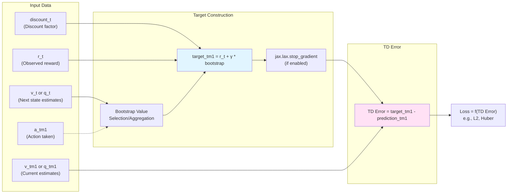
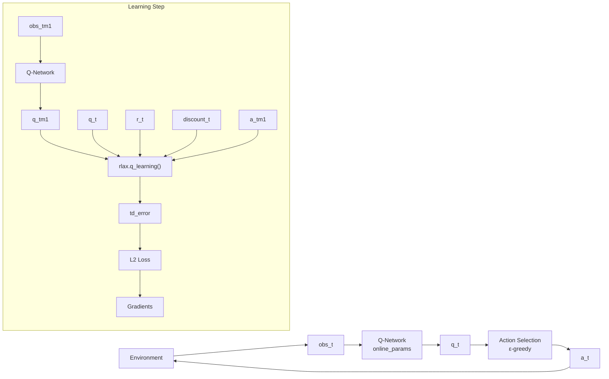
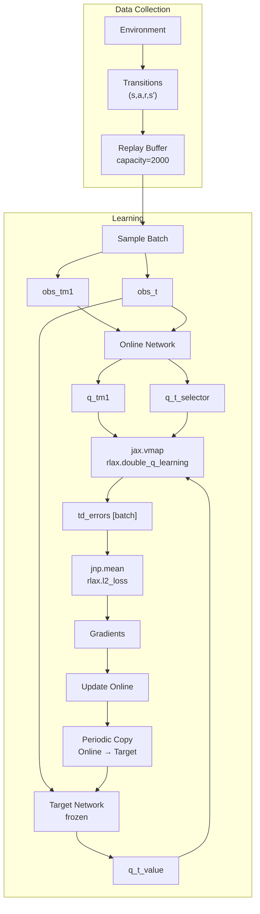
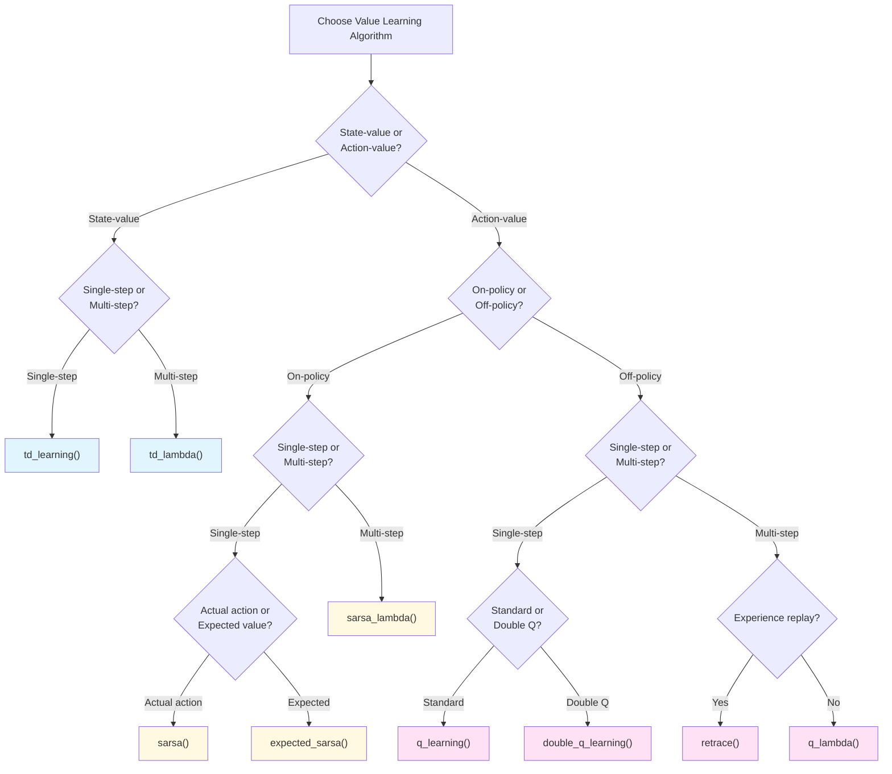

<!-- source: DeepWiki mcp.deepwiki.com · repo google-deepmind/rlax · page 2.1 Basic Value Learning (TD, Q-learning, SARSA) · fetched 2026-10-26 -->

# Basic Value Learning (TD, Q-learning, SARSA)

<details>
<summary>Relevant source files</summary>

The following files were used as context for generating this wiki page:

- [README.md](README.md)
- [examples/__init__.py](examples/__init__.py)
- [examples/experiment.py](examples/experiment.py)
- [examples/online_q_learning.py](examples/online_q_learning.py)
- [examples/pop_art.py](examples/pop_art.py)
- [examples/simple_dqn.py](examples/simple_dqn.py)
- [rlax/_src/embedding.py](rlax/_src/embedding.py)
- [rlax/_src/value_learning.py](rlax/_src/value_learning.py)
- [rlax/_src/value_learning_test.py](rlax/_src/value_learning_test.py)

</details>


## Purpose and Scope

This page documents the fundamental temporal difference (TD) learning algorithms provided by RLax for estimating state values and action-values in discrete action spaces. These building blocks implement point-estimate value functions that compute TD errors for gradient-based learning.

**Scope:** This page covers basic TD methods including TD learning, Q-learning, double Q-learning, SARSA, expected SARSA, and their lambda-based variants. These functions compute temporal difference errors that can be used directly as pseudo-losses for training value networks.

**Related pages:**
- For distributional value learning (categorical/quantile methods), see [Distributional Reinforcement Learning](#2.2)
- For multistep return computation used by lambda-based methods, see [Multistep Returns and Credit Assignment](#3)
- For off-policy corrections like Retrace, see [V-trace for Off-Policy Learning](#3.2)
- For value transformations and nonlinear Bellman equations, see [Nonlinear Bellman Equations and Value Transformations](#6.1)

## Value Learning Function Taxonomy

The following diagram maps the natural language algorithm names to their corresponding RLax function implementations:

```mermaid
graph TB
    subgraph "State-Value Methods"
        TD_ALG["TD Learning"]
        TDL_ALG["TD(λ)"]
        QVMAX_ALG["QV-Max"]
    end
    
    subgraph "Action-Value On-Policy"
        SARSA_ALG["SARSA"]
        ESARSA_ALG["Expected SARSA"]
        SARSAL_ALG["SARSA(λ)"]
    end
    
    subgraph "Action-Value Off-Policy"
        Q_ALG["Q-Learning"]
        DQ_ALG["Double Q-Learning"]
        PQ_ALG["Persistent Q-Learning"]
        QL_ALG["Q(λ)"]
        QV_ALG["QV-Learning"]
        RET_ALG["Retrace"]
        RETC_ALG["Retrace Continuous"]
    end
    
    subgraph "value_learning.py Functions"
        TD_FN["td_learning()"]
        TDL_FN["td_lambda()"]
        SARSA_FN["sarsa()"]
        ESARSA_FN["expected_sarsa()"]
        SARSAL_FN["sarsa_lambda()"]
        Q_FN["q_learning()"]
        DQ_FN["double_q_learning()"]
        PQ_FN["persistent_q_learning()"]
        QL_FN["q_lambda()"]
        QV_FN["qv_learning()"]
        QVMAX_FN["qv_max()"]
        RET_FN["retrace()"]
        RETC_FN["retrace_continuous()"]
    end
    
    TD_ALG --> TD_FN
    TDL_ALG --> TDL_FN
    QVMAX_ALG --> QVMAX_FN
    SARSA_ALG --> SARSA_FN
    ESARSA_ALG --> ESARSA_FN
    SARSAL_ALG --> SARSAL_FN
    Q_ALG --> Q_FN
    DQ_ALG --> DQ_FN
    PQ_ALG --> PQ_FN
    QL_ALG --> QL_FN
    QV_ALG --> QV_FN
    RET_ALG --> RET_FN
    RETC_ALG --> RETC_FN
    
    style TD_FN fill:#e1f5ff
    style TDL_FN fill:#e1f5ff
    style SARSA_FN fill:#fff9e1
    style ESARSA_FN fill:#fff9e1
    style SARSAL_FN fill:#fff9e1
    style Q_FN fill:#ffe1f5
    style DQ_FN fill:#ffe1f5
    style PQ_FN fill:#ffe1f5
    style QL_FN fill:#ffe1f5
    style QV_FN fill:#ffe1f5
    style QVMAX_FN fill:#e1f5ff
    style RET_FN fill:#ffe1f5
    style RETC_FN fill:#ffe1f5
```



**Sources:** [rlax/_src/value_learning.py:1-924]()

## Temporal Difference Error Computation Pattern

All value learning functions in RLax follow a consistent pattern for computing TD errors. Understanding this pattern is essential for using these functions correctly:



**Key concepts:**
- **Source state (t-1):** The state where the agent was and took action `a_tm1`
- **Destination state (t):** The state where the agent ended up after the action
- **Target construction:** Combines reward `r_t` with bootstrapped estimate from next state
- **Stop gradients:** The `stop_target_gradients` parameter prevents backpropagation through targets

**Sources:** [rlax/_src/value_learning.py:36-66](), [rlax/_src/value_learning.py:219-251](), [rlax/_src/value_learning.py:101-136]()

## Basic TD Learning

### `td_learning()`

The fundamental TD(0) algorithm for state-value estimation. Computes the temporal difference between the actual observed return (reward + bootstrapped next-state value) and the current estimate.

**Function signature:**
```python
td_learning(
    v_tm1: Numeric,      # Value estimate at time t-1
    r_t: Numeric,        # Reward at time t
    discount_t: Numeric, # Discount factor at time t
    v_t: Numeric,        # Value estimate at time t
    stop_target_gradients: bool = True
) -> Numeric
```

**Bellman equation:**
```
TD Error = [r_t + γ * V(s_t)] - V(s_t-1)
```

**Implementation details:**
- All inputs must be scalars (rank 0)
- Target is `r_t + discount_t * v_t`
- Gradients are stopped on the target by default
- Returns the TD error (not the loss)

**Usage example from tests:**
```python
# Batched computation using vmap
td_learning_batch = jax.vmap(rlax.td_learning)
td_errors = td_learning_batch(v_tm1, r_t, discount_t, v_t)
```

**Sources:** [rlax/_src/value_learning.py:36-66](), [rlax/_src/value_learning_test.py:28-53]()

### `td_lambda()`

Implements TD(λ), which computes multi-step bootstrapped targets using eligibility traces. The λ parameter controls the trade-off between bias (low λ) and variance (high λ).

**Function signature:**
```python
td_lambda(
    v_tm1: Array,        # Sequence of values at t-1
    r_t: Array,          # Sequence of rewards at t
    discount_t: Array,   # Sequence of discounts at t
    v_t: Array,          # Sequence of values at t
    lambda_: Numeric,    # Mixing parameter (scalar or sequence)
    stop_target_gradients: bool = True
) -> Array
```

**Key characteristics:**
- Requires sequences of length T (rank 1 arrays)
- Uses `multistep.lambda_returns()` for target computation
- λ=0 reduces to TD(0), λ=1 gives Monte Carlo returns
- Can accept per-timestep λ values for adaptive weighting

**Sources:** [rlax/_src/value_learning.py:68-99](), [rlax/_src/value_learning_test.py:55-84]()

## Q-Learning Family

Q-learning methods estimate action-values Q(s,a) using off-policy updates that bootstrap from the maximum Q-value in the next state, regardless of the action actually taken.

### `q_learning()`

The standard Q-learning algorithm that uses greedy action selection for bootstrapping.

**Function signature:**
```python
q_learning(
    q_tm1: Array,        # Q-values at t-1, shape [num_actions]
    a_tm1: Numeric,      # Action taken at t-1 (integer index)
    r_t: Numeric,        # Reward at t
    discount_t: Numeric, # Discount at t
    q_t: Array,          # Q-values at t, shape [num_actions]
    stop_target_gradients: bool = True
) -> Numeric
```

**Bellman optimality equation:**
```
TD Error = [r_t + γ * max_a Q(s_t, a)] - Q(s_t-1, a_t-1)
```

**Key characteristics:**
- Off-policy: learns optimal policy while following different behavior policy
- Bootstrap uses `jnp.max(q_t)` regardless of actual action taken
- Returns scalar TD error for the action `a_tm1`

**Example usage from `online_q_learning.py`:**
```python
def _loss(self, params, obs_tm1, a_tm1, r_t, discount_t, obs_t):
    q_tm1 = self._network.apply(params, obs_tm1)
    q_t = self._network.apply(params, obs_t)
    td_error = rlax.q_learning(q_tm1, a_tm1, r_t, discount_t, q_t)
    return rlax.l2_loss(td_error)
```

**Sources:** [rlax/_src/value_learning.py:219-251](), [examples/online_q_learning.py:118-122]()

### `double_q_learning()`

Addresses overestimation bias in Q-learning by decoupling action selection from action evaluation using two separate Q-networks.

**Function signature:**
```python
double_q_learning(
    q_tm1: Array,           # Q-values at t-1
    a_tm1: Numeric,         # Action at t-1
    r_t: Numeric,           # Reward at t
    discount_t: Numeric,    # Discount at t
    q_t_value: Array,       # Q-values for evaluation
    q_t_selector: Array,    # Q-values for action selection
    stop_target_gradients: bool = True
) -> Numeric
```

**Double Q-learning equation:**
```
a* = argmax_a Q_selector(s_t, a)
TD Error = [r_t + γ * Q_value(s_t, a*)] - Q(s_t-1, a_t-1)
```

**Key characteristics:**
- Action selected using `q_t_selector.argmax()`
- Action evaluated using `q_t_value[a*]`
- Reduces maximization bias compared to standard Q-learning
- In practice, `q_t_selector` is often the online network, `q_t_value` is the target network

**Example from `simple_dqn.py`:**
```python
def _loss(self, online_params, target_params, obs_tm1, a_tm1, r_t, discount_t, obs_t):
    q_tm1 = self._network.apply(online_params, obs_tm1)
    q_t_val = self._network.apply(target_params, obs_t)
    q_t_select = self._network.apply(online_params, obs_t)
    batched_loss = jax.vmap(rlax.double_q_learning)
    td_error = batched_loss(q_tm1, a_tm1, r_t, discount_t, q_t_val, q_t_select)
    return jnp.mean(rlax.l2_loss(td_error))
```

**Sources:** [rlax/_src/value_learning.py:254-290](), [examples/simple_dqn.py:146-153]()

### `persistent_q_learning()`

Implements the persistent Q-learning operator that increases the action gap between the best and second-best actions, potentially improving learning stability.

**Function signature:**
```python
persistent_q_learning(
    q_tm1: Array,
    a_tm1: Numeric,
    r_t: Numeric,
    discount_t: Numeric,
    q_t: Array,
    action_gap_scale: float,  # Coefficient in [0, 1]
    stop_target_gradients: bool = True
) -> Numeric
```

**Modified Bellman equation:**
```
corrected_q_t = (1 - α) * max_a Q(s_t, a) + α * Q(s_t, a_t-1)
TD Error = [r_t + γ * corrected_q_t] - Q(s_t-1, a_t-1)
```

**Key characteristics:**
- `action_gap_scale` (α) controls the persistence effect
- α=0 reduces to standard Q-learning
- α=1 reduces to on-policy learning (like SARSA)
- Designed to increase action gap, improving exploration-exploitation trade-off

**Sources:** [rlax/_src/value_learning.py:292-331](), [rlax/_src/value_learning_test.py:235-260]()

## SARSA Family

SARSA (State-Action-Reward-State-Action) methods are on-policy algorithms that bootstrap using the actual action taken in the next state.

### `sarsa()`

The standard SARSA algorithm that updates Q-values based on the actual action sequence.

**Function signature:**
```python
sarsa(
    q_tm1: Array,        # Q-values at t-1
    a_tm1: Numeric,      # Action at t-1
    r_t: Numeric,        # Reward at t
    discount_t: Numeric, # Discount at t
    q_t: Array,          # Q-values at t
    a_t: Numeric,        # Action at t (actually taken)
    stop_target_gradients: bool = True
) -> Numeric
```

**SARSA equation:**
```
TD Error = [r_t + γ * Q(s_t, a_t)] - Q(s_t-1, a_t-1)
```

**Key characteristics:**
- On-policy: requires the actual action `a_t` taken in state s_t
- Bootstrap uses `q_t[a_t]` (the Q-value for the action actually taken)
- More stable than Q-learning in stochastic environments
- Learns the value of the policy being followed

**Sources:** [rlax/_src/value_learning.py:101-136](), [rlax/_src/value_learning_test.py:86-108]()

### `expected_sarsa()`

Computes the expectation over all possible actions weighted by the policy, reducing variance compared to standard SARSA.

**Function signature:**
```python
expected_sarsa(
    q_tm1: Array,
    a_tm1: Numeric,
    r_t: Numeric,
    discount_t: Numeric,
    q_t: Array,
    probs_a_t: Array,    # Action probabilities π(a|s_t)
    stop_target_gradients: bool = True
) -> Numeric
```

**Expected SARSA equation:**
```
TD Error = [r_t + γ * Σ_a π(a|s_t) * Q(s_t, a)] - Q(s_t-1, a_t-1)
```

**Key characteristics:**
- Bootstrap is `jnp.dot(q_t, probs_a_t)` - expectation over policy
- Does not require the actual action taken at time t
- Lower variance than SARSA
- Approaches Q-learning when policy is greedy

**Sources:** [rlax/_src/value_learning.py:138-175](), [rlax/_src/value_learning_test.py:110-139]()

## Lambda-Based Variants

Lambda-based methods extend basic TD algorithms with eligibility traces for multi-step bootstrapping.

### `sarsa_lambda()`

Multi-step SARSA with eligibility traces.

**Function signature:**
```python
sarsa_lambda(
    q_tm1: Array,        # Sequence of Q-values at t-1, shape [T, num_actions]
    a_tm1: Array,        # Sequence of actions at t-1, shape [T]
    r_t: Array,          # Sequence of rewards, shape [T]
    discount_t: Array,   # Sequence of discounts, shape [T]
    q_t: Array,          # Sequence of Q-values at t, shape [T, num_actions]
    a_t: Array,          # Sequence of actions at t, shape [T]
    lambda_: Numeric,    # Mixing parameter
    stop_target_gradients: bool = True
) -> Array
```

**Process:**
1. Extract Q-values for taken actions: `qa_tm1 = q_tm1[a_tm1]`, `qa_t = q_t[a_t]`
2. Compute lambda returns: `target_tm1 = lambda_returns(r_t, discount_t, qa_t, λ)`
3. Return TD errors: `target_tm1 - qa_tm1`

**Sources:** [rlax/_src/value_learning.py:177-217](), [rlax/_src/value_learning_test.py:141-185]()

### `q_lambda()`

Multi-step Q-learning variant using eligibility traces. Can implement either Peng's Q(λ) (constant λ) or Watkins' Q(λ) (variable λ).

**Function signature:**
```python
q_lambda(
    q_tm1: Array,        # Sequence of Q-values, shape [T, num_actions]
    a_tm1: Array,        # Sequence of actions, shape [T]
    r_t: Array,          # Sequence of rewards, shape [T]
    discount_t: Array,   # Sequence of discounts, shape [T]
    q_t: Array,          # Sequence of Q-values, shape [T, num_actions]
    lambda_: Numeric,    # Scalar (Peng) or sequence (Watkins)
    stop_target_gradients: bool = True
) -> Array
```

**Key distinction:**
- **Peng's Q(λ):** λ is a scalar, always uses multi-step returns
- **Watkins' Q(λ):** λ is a sequence, can be 0 when off-policy actions occur

**Process:**
1. Extract current action Q-values: `qa_tm1 = batched_index(q_tm1, a_tm1)`
2. Compute max Q-values for next states: `v_t = max(q_t, axis=-1)`
3. Compute lambda returns using max Q-values
4. Return TD errors

**Sources:** [rlax/_src/value_learning.py:402-442](), [rlax/_src/value_learning_test.py:317-358]()

## Specialized Methods

### `qv_learning()` and `qv_max()`

These methods combine Q-learning and V-learning into hybrid algorithms.

**`qv_learning()` function:**
```python
qv_learning(
    q_tm1: Array,        # Q-values at t-1
    a_tm1: Numeric,      # Action at t-1
    r_t: Numeric,        # Reward at t
    discount_t: Numeric, # Discount at t
    v_t: Numeric,        # State value at t (not Q-values!)
    stop_target_gradients: bool = True
) -> Numeric
```

Updates Q-values using a separate V-value estimate as the bootstrap target:
```
TD Error = [r_t + γ * V(s_t)] - Q(s_t-1, a_t-1)
```

**`qv_max()` function:**
```python
qv_max(
    v_tm1: Numeric,      # State value at t-1
    r_t: Numeric,        # Reward at t
    discount_t: Numeric, # Discount at t
    q_t: Array,          # Q-values at t
    stop_target_gradients: bool = True
) -> Numeric
```

Updates V-values using the maximum Q-value:
```
TD Error = [r_t + γ * max_a Q(s_t, a)] - V(s_t-1)
```

**Sources:** [rlax/_src/value_learning.py:333-400](), [rlax/_src/value_learning_test.py:262-315]()

## Retrace for Off-Policy Learning

Retrace is an advanced off-policy algorithm that safely combines importance sampling with eligibility traces. It appears in this module but is conceptually related to V-trace.

### `retrace()` for Discrete Actions

**Function signature:**
```python
retrace(
    q_tm1: Array,        # Sequence of Q-values, shape [T, num_actions]
    q_t: Array,          # Sequence of Q-values, shape [T, num_actions]
    a_tm1: Array,        # Sequence of actions, shape [T]
    a_t: Array,          # Sequence of actions, shape [T]
    r_t: Array,          # Sequence of rewards, shape [T]
    discount_t: Array,   # Sequence of discounts, shape [T]
    pi_t: Array,         # Target policy probs, shape [T, num_actions]
    mu_t: Array,         # Behavior policy probs, shape [T]
    lambda_: float,      # Trace decay parameter
    eps: float = 1e-8,   # Numerical stability
    stop_target_gradients: bool = True
) -> Array
```

**Retrace mechanics:**
1. Compute importance sampling ratios: `ρ_t = π(a_t|s_t) / μ(a_t|s_t)`
2. Clip ratios and multiply by λ: `c_t = min(1.0, ρ_t) * λ`
3. Compute generalized off-policy returns using `multistep.general_off_policy_returns_from_action_values()`
4. Return TD errors

**Key advantages:**
- Safe off-policy learning with bounded importance weights
- Reduces variance compared to standard importance sampling
- Suitable for experience replay and distributed training

**Sources:** [rlax/_src/value_learning.py:444-494](), [rlax/_src/value_learning_test.py:360-415]()

### `retrace_continuous()` for Continuous Actions

Variant of Retrace designed for continuous action spaces where importance sampling ratios are computed from log-probabilities.

**Function signature:**
```python
retrace_continuous(
    q_tm1: Array,        # Q-values at t-1, shape [K]
    q_t: Array,          # Q-values at t (on-policy), shape [K-1]
    v_t: Array,          # Value estimates at t, shape [K]
    r_t: Array,          # Rewards, shape [K]
    discount_t: Array,   # Discounts, shape [K]
    log_rhos: Array,     # Log importance ratios, shape [K-1]
    lambda_: Union[Array, float],
    stop_target_gradients: bool = True
) -> Array
```

**Key differences from discrete version:**
- Uses log importance ratios: `c_t = min(1.0, exp(log_rhos)) * λ`
- Requires both Q-values and V-values
- Uses `multistep.general_off_policy_returns_from_q_and_v()`

**Sources:** [rlax/_src/value_learning.py:496-541](), [rlax/_src/value_learning_test.py:430-487]()

## Algorithm Comparison Table

| Algorithm | Type | Policy | Bootstrap | Lambda | Best Use Case |
|-----------|------|--------|-----------|--------|---------------|
| `td_learning` | State-value | N/A | V(s_t) | No | Simple value prediction |
| `td_lambda` | State-value | N/A | Multi-step | Yes | Value prediction with bias-variance trade-off |
| `q_learning` | Action-value | Off-policy | max Q(s_t) | No | Learning optimal policy from suboptimal data |
| `double_q_learning` | Action-value | Off-policy | Q_value[argmax Q_selector] | No | Reducing overestimation bias |
| `persistent_q_learning` | Action-value | Off-policy | Weighted max | No | Improving action gap |
| `sarsa` | Action-value | On-policy | Q(s_t, a_t) | No | Learning value of current policy |
| `expected_sarsa` | Action-value | On-policy | 𝔼[Q(s_t, a)] | No | Lower variance than SARSA |
| `sarsa_lambda` | Action-value | On-policy | Multi-step | Yes | On-policy with eligibility traces |
| `q_lambda` | Action-value | Off-policy | Multi-step max | Yes | Off-policy with eligibility traces |
| `qv_learning` | Hybrid | On-policy | V(s_t) | No | Combining Q and V networks |
| `retrace` | Action-value | Off-policy | Multi-step clipped IS | Yes | Safe off-policy with replay |

## Usage Patterns

### Pattern 1: Single-Step Learning (Online Q-Learning)

Simplest pattern for online learning without replay buffers:



**Example:** [examples/online_q_learning.py:80-123]()

**Sources:** [examples/online_q_learning.py:1-150]()

### Pattern 2: Experience Replay with Target Networks (DQN)

Standard pattern for stable off-policy learning:



**Key components:**
- Replay buffer decouples data collection from learning
- Target network provides stable bootstrap targets
- Periodic updates (e.g., every 50 steps) prevent harmful correlations
- Batched computation using `jax.vmap`

**Example:** [examples/simple_dqn.py:95-154]()

**Sources:** [examples/simple_dqn.py:1-186]()

### Pattern 3: Batched Computation

All RLax value learning functions operate on single transitions. Use `jax.vmap` for batch processing:

```python
# Single transition
td_error = rlax.q_learning(q_tm1, a_tm1, r_t, discount_t, q_t)

# Batched transitions
batched_q_learning = jax.vmap(rlax.q_learning)
td_errors = batched_q_learning(
    q_tm1_batch,      # shape [B, A]
    a_tm1_batch,      # shape [B]
    r_t_batch,        # shape [B]
    discount_t_batch, # shape [B]
    q_t_batch         # shape [B, A]
)  # Returns shape [B]
```

**Benefits:**
- Automatic parallelization across batch dimension
- No explicit loops needed
- JIT-compatible for maximum performance

**Sources:** [rlax/_src/value_learning_test.py:46-52](), [rlax/_src/value_learning_test.py:201-207]()

### Pattern 4: Lambda-Based Multi-Step Learning

For algorithms using eligibility traces, you need sequences of transitions:

```python
# Sequences of length T
q_tm1_seq = jnp.array([[...], [...], ...])  # shape [T, A]
a_tm1_seq = jnp.array([...])                # shape [T]
r_t_seq = jnp.array([...])                  # shape [T]
discount_t_seq = jnp.array([...])           # shape [T]
q_t_seq = jnp.array([[...], [...], ...])    # shape [T, A]

# Compute multi-step TD errors
td_errors = rlax.q_lambda(
    q_tm1_seq, a_tm1_seq, r_t_seq, 
    discount_t_seq, q_t_seq, lambda_=0.9
)  # Returns shape [T]
```

**Note:** Lambda-based methods internally use functions from the `multistep` module (see [Multistep Returns and Credit Assignment](#3)).

**Sources:** [rlax/_src/value_learning.py:402-442]()

## When to Use Each Algorithm

### Decision Tree for Algorithm Selection



**Sources:** [rlax/_src/value_learning.py:15-22]()

### Practical Guidelines

**Use `q_learning()` when:**
- Learning optimal policy from off-policy data (exploration, demonstrations)
- Simple environments without overestimation issues
- Baseline implementation before trying variants

**Use `double_q_learning()` when:**
- Concerned about Q-value overestimation (common in complex environments)
- Using target networks (which naturally provide two Q-estimates)
- Need more stable learning than standard Q-learning

**Use `sarsa()` when:**
- Learning value of current policy (on-policy learning)
- Environment has high stochasticity
- Want conservative policy that accounts for exploration
- Safety is important (learns actual behavior, not optimal)

**Use `expected_sarsa()` when:**
- Want lower variance than SARSA
- Have access to policy probabilities
- Interpolating between SARSA (stochastic policy) and Q-learning (greedy policy)

**Use lambda-based methods (`td_lambda`, `sarsa_lambda`, `q_lambda`) when:**
- Need to balance bias-variance trade-off
- Have sequences of transitions (trajectories)
- Want faster credit assignment than single-step methods
- λ ∈ (0, 1): tune based on environment characteristics

**Use `retrace()` when:**
- Using experience replay with off-policy data
- Need safe importance sampling with bounded weights
- Distributed training with multiple actors (like IMPALA)
- Want multi-step learning with off-policy correction

**Use `persistent_q_learning()` when:**
- Want to increase action gap between best and second-best actions
- Experimenting with improved exploration-exploitation
- Research setting (less commonly used in practice)

**Sources:** [README.md:35-52](), [rlax/_src/value_learning.py:1-22]()

## Loss Functions and Optimization

The value learning functions return TD errors, not losses. You must apply a loss function before computing gradients:

```python
# Common pattern
td_error = rlax.q_learning(q_tm1, a_tm1, r_t, discount_t, q_t)

# Option 1: L2 loss (mean squared error)
loss = rlax.l2_loss(td_error)  # 0.5 * td_error^2

# Option 2: Huber loss (for robustness)
loss = rlax.huber_loss(td_error, delta=1.0)

# For batches, typically take mean
batch_td_errors = jax.vmap(rlax.q_learning)(...)
batch_loss = jnp.mean(rlax.l2_loss(batch_td_errors))
```

**Available loss functions:**
- `rlax.l2_loss()`: Standard squared error
- `rlax.huber_loss()`: Robust to outliers, linear beyond threshold

**Sources:** [examples/simple_dqn.py:153](), [examples/online_q_learning.py:122]()

## Common Pitfalls and Best Practices

### Pitfall 1: Forgetting to Stop Gradients

```python
# WRONG: Gradients flow through target
td_error = rlax.q_learning(q_tm1, a_tm1, r_t, discount_t, q_t, 
                           stop_target_gradients=False)

# CORRECT: Default stops gradients through bootstrap target
td_error = rlax.q_learning(q_tm1, a_tm1, r_t, discount_t, q_t)
```

**Why it matters:** Without stopped gradients, the network chases a moving target, causing instability.

### Pitfall 2: Incorrect Shapes for Lambda Methods

```python
# WRONG: Scalar inputs for lambda methods
td_error = rlax.q_lambda(q_tm1_scalar, a_tm1_scalar, ...)  # Will fail!

# CORRECT: Sequence inputs
td_errors = rlax.q_lambda(q_tm1_sequence, a_tm1_sequence, ...)
```

**Why it matters:** Lambda methods require rank-1 arrays (sequences), not scalars.

### Pitfall 3: Not Using vmap for Batches

```python
# INEFFICIENT: Manual loop
td_errors = []
for i in range(batch_size):
    td_error = rlax.q_learning(q_tm1[i], a_tm1[i], ...)
    td_errors.append(td_error)

# EFFICIENT: Use vmap
td_errors = jax.vmap(rlax.q_learning)(q_tm1, a_tm1, ...)
```

**Why it matters:** `vmap` parallelizes computation and is JIT-compatible.

### Best Practice: JIT Compilation

```python
# Define loss function
def loss_fn(params, data):
    q_tm1 = network.apply(params, data.obs_tm1)
    q_t = network.apply(params, data.obs_t)
    td_error = rlax.q_learning(q_tm1, data.a_tm1, data.r_t, 
                               data.discount_t, q_t)
    return rlax.l2_loss(td_error)

# JIT compile for performance
loss_fn = jax.jit(loss_fn)
grad_fn = jax.jit(jax.grad(loss_fn))
```

**Why it matters:** JIT compilation provides 10-100x speedup for typical RL operations.

**Sources:** [examples/simple_dqn.py:108-109](), [examples/online_q_learning.py:92-93]()

## Integration with JAX Ecosystem

RLax value learning functions integrate seamlessly with other JAX libraries:

**With Optax (optimization):**
```python
optimizer = optax.adam(learning_rate=1e-3)
opt_state = optimizer.init(params)

# In training loop
grads = jax.grad(loss_fn)(params, data)
updates, opt_state = optimizer.update(grads, opt_state)
params = optax.apply_updates(params, updates)
```

**With Haiku (neural networks):**
```python
import haiku as hk

def q_network(obs):
    net = hk.Sequential([
        hk.Flatten(),
        hk.nets.MLP([50, num_actions])
    ])
    return net(obs)

network = hk.without_apply_rng(hk.transform(q_network))
q_values = network.apply(params, obs)
```

**With Chex (type checking):**
```python
import chex

# Value learning functions include chex assertions
chex.assert_rank([q_tm1, a_tm1, r_t, discount_t, q_t], [1, 0, 0, 0, 1])
chex.assert_type([q_tm1, a_tm1, r_t, discount_t, q_t], 
                 [float, int, float, float, float])
```

**Sources:** [examples/simple_dqn.py:54-63](), [examples/simple_dqn.py:104-106](), [rlax/_src/value_learning.py:244-246]()

## Summary

This page covered the fundamental temporal difference learning algorithms provided by RLax:

1. **Basic TD methods** (`td_learning`, `td_lambda`) for state-value estimation
2. **Q-learning variants** (`q_learning`, `double_q_learning`, `persistent_q_learning`) for off-policy action-value learning
3. **SARSA methods** (`sarsa`, `expected_sarsa`) for on-policy action-value learning
4. **Lambda-based methods** (`sarsa_lambda`, `q_lambda`) with eligibility traces
5. **Advanced methods** (`retrace`, `qv_learning`) for specialized use cases

All functions follow a consistent API pattern:
- Accept transition data (states, actions, rewards, discounts)
- Compute bootstrap targets with optional gradient stopping
- Return TD errors (not losses)
- Support batching via `jax.vmap`

For distributional variants of these algorithms, see [Distributional Reinforcement Learning](#2.2).

**Sources:** [rlax/_src/value_learning.py:1-924](), [README.md:35-105]()

---

