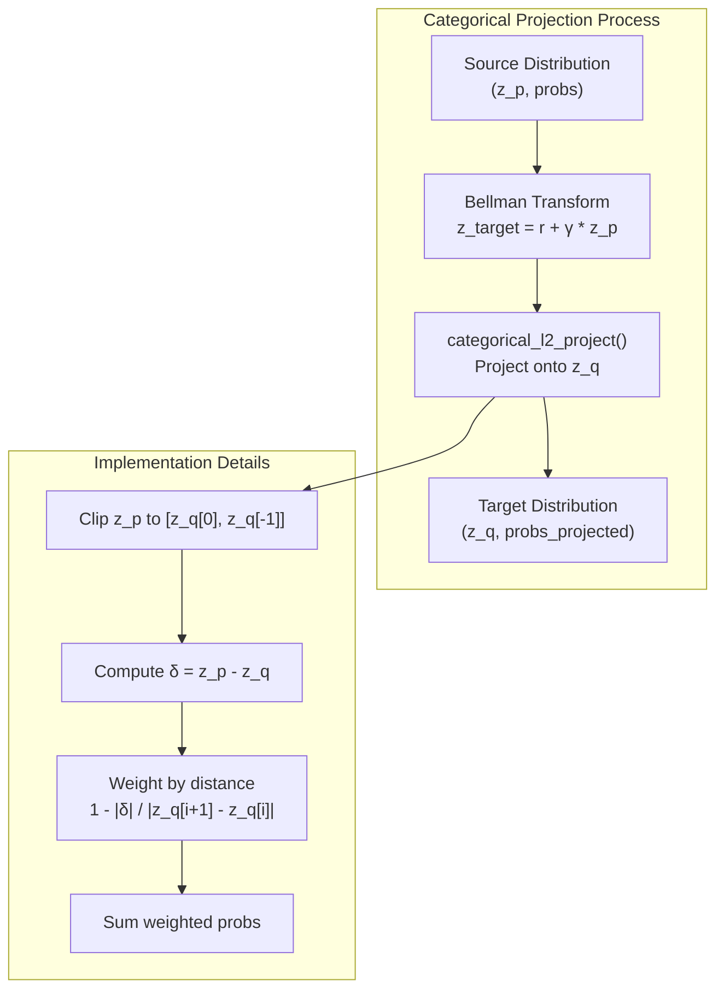
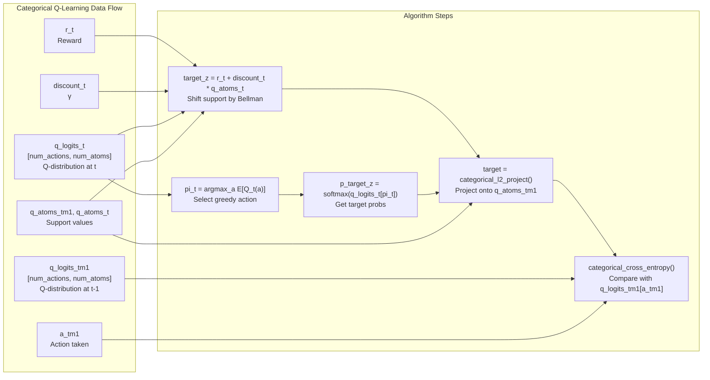
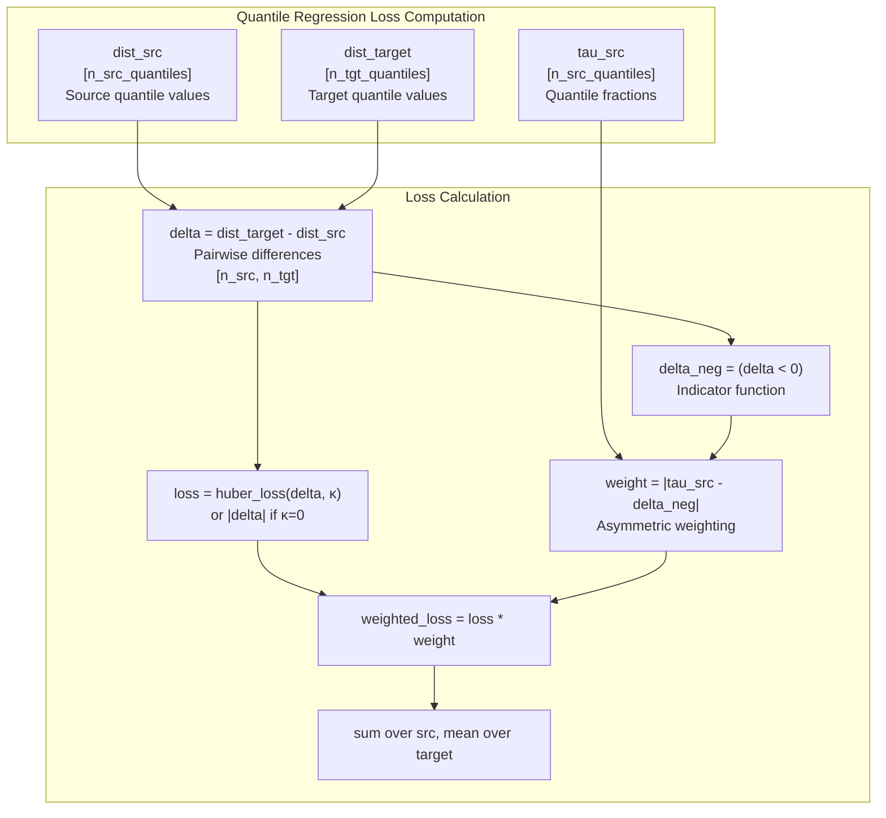
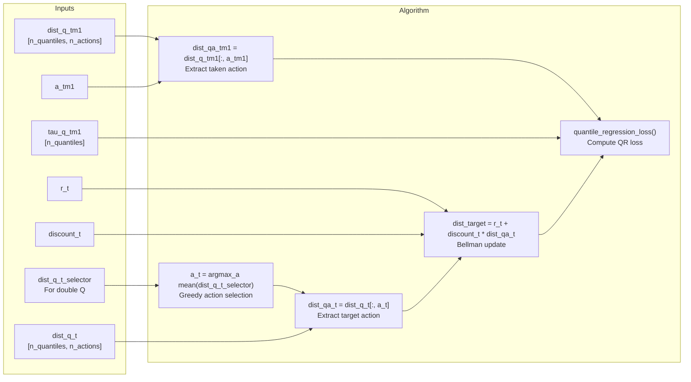
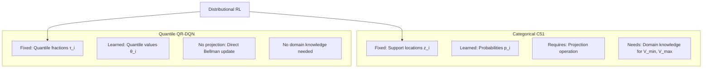
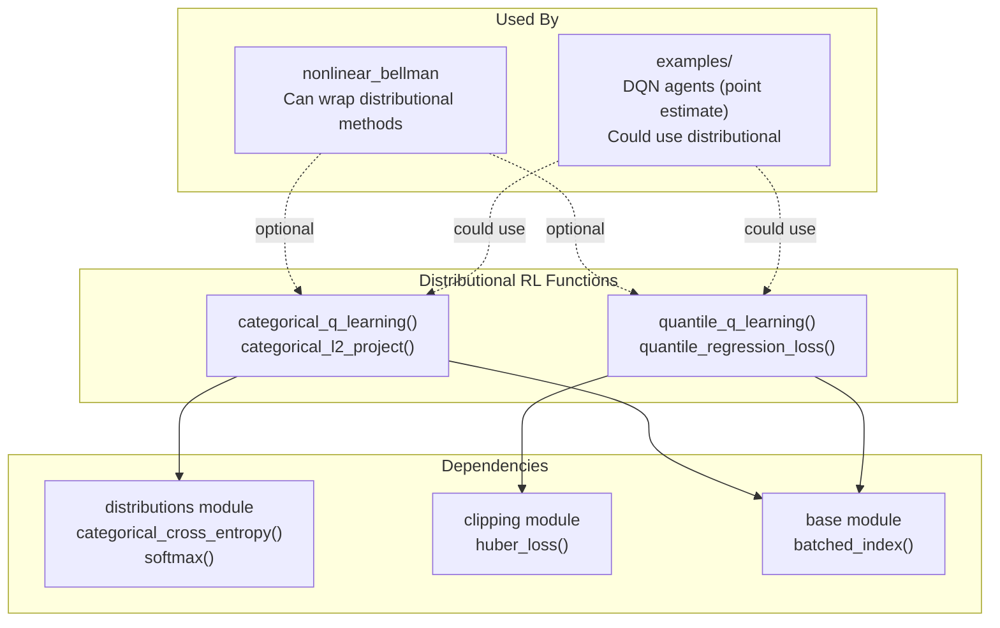

<!-- source: DeepWiki mcp.deepwiki.com · repo google-deepmind/rlax · page 2.2 Distributional Reinforcement Learning · fetched 2026-10-26 -->

# Distributional Reinforcement Learning

<details>
<summary>Relevant source files</summary>

The following files were used as context for generating this wiki page:

- [rlax/_src/value_learning.py](rlax/_src/value_learning.py)
- [rlax/_src/value_learning_test.py](rlax/_src/value_learning_test.py)

</details>


## Purpose and Scope

This document covers distributional reinforcement learning methods in RLax, which model the full return distribution rather than just its expectation. Two main approaches are implemented: **categorical distributions** (C51) and **quantile distributions** (QR-DQN, IQN). These methods provide richer representations of value uncertainty and often lead to improved performance over point-estimate methods.

For basic point-estimate value learning methods (TD, Q-learning, SARSA), see [Basic Value Learning](#2.1). For transformed value functions that can be combined with distributional methods, see [Nonlinear Bellman Equations and Value Transformations](#6.1).

---

## Distributional RL Overview

Traditional value-based RL learns a single scalar Q-value representing expected return. Distributional RL instead learns a probability distribution over returns, capturing uncertainty and multi-modality in outcomes. This provides several advantages:
- Better representation of risk and uncertainty
- Reduced approximation error through richer targets
- Improved sample efficiency in many domains
- Natural handling of stochastic environments

RLax implements two primary distributional representations:

| Representation | Description | Key Functions | Papers |
|----------------|-------------|---------------|---------|
| **Categorical** | Fixed support with learned probabilities | `categorical_q_learning`, `categorical_l2_project` | C51, Rainbow |
| **Quantile** | Fixed probabilities with learned quantiles | `quantile_q_learning`, `quantile_regression_loss` | QR-DQN, IQN |

**Sources:** [rlax/_src/value_learning.py:15-22]()

---

## Categorical Distributional RL (C51)

### Representation

Categorical methods represent the value distribution as a discrete set of atoms (support points) with associated probabilities. Given N atoms `z = [z_1, ..., z_N]` spanning `[V_min, V_max]`, the distribution is:

```
Z(s,a) = Σ_i p_i(s,a) δ_{z_i}
```

where `p_i(s,a)` are learned probabilities (modeled as softmax logits) and `δ_{z_i}` is a point mass at atom `z_i`.

### Categorical L2 Projection

The key operation in categorical distributional RL is projecting a distribution onto a different support. This is required because the Bellman operator transforms the support (via `r + γz`), necessitating re-projection onto the original fixed support.



**Function:** `categorical_l2_project(z_p, probs, z_q)`

The projection minimizes the L2 (Cramer) distance between cumulative distribution functions:

```
Φ(z_q) = argmin_Φ ||CDF_p - CDF_Φ||_2
```

This is computed efficiently by distributing probability mass proportionally to the overlap of atoms.

**Implementation:**
- Input: Source support `z_p` (shape `[kp]`), probabilities `probs` (shape `[kp]`), target support `z_q` (shape `[kq]`)
- Output: Projected probabilities on `z_q` (shape `[kq]`)
- Supports arbitrary support sizes: `kp` need not equal `kq`

**Sources:** [rlax/_src/value_learning.py:543-602]()

### Categorical Q-Learning



**Function:** `categorical_q_learning(q_atoms_tm1, q_logits_tm1, a_tm1, r_t, discount_t, q_atoms_t, q_logits_t)`

**Algorithm:**
1. Transform target support: `target_z = r_t + discount_t * q_atoms_t`
2. Select greedy action: `pi_t = argmax_a mean(Q_t(a))` where mean is computed as `Σ_i probs_i * z_i`
3. Extract target distribution: `p_target = softmax(q_logits_t[pi_t])`
4. Project onto source support: `target_probs = categorical_l2_project(target_z, p_target, q_atoms_tm1)`
5. Compute cross-entropy loss: `loss = -Σ_i target_probs[i] * log(probs_tm1[i])`

The loss is the temporal difference error expressed as a distributional distance.

**Variants:**
- `categorical_td_learning`: For state-value distributions V(s) instead of Q(s,a)
- `categorical_double_q_learning`: Uses separate selector network for action selection

**Sources:** [rlax/_src/value_learning.py:655-710](), [rlax/_src/value_learning.py:605-653](), [rlax/_src/value_learning.py:713-769]()

### Usage Example

```python
# Setup
num_actions = 4
num_atoms = 51
v_min, v_max = -10.0, 10.0
atoms = jnp.linspace(v_min, v_max, num_atoms)

# Network outputs logits over the categorical distribution
q_logits_tm1 = network(obs_tm1)  # shape: [num_actions, num_atoms]
q_logits_t = target_network(obs_t)  # shape: [num_actions, num_atoms]

# Compute loss
loss = rlax.categorical_q_learning(
    q_atoms_tm1=atoms,
    q_logits_tm1=q_logits_tm1,
    a_tm1=action,
    r_t=reward,
    discount_t=discount,
    q_atoms_t=atoms,
    q_logits_t=q_logits_t
)
```

---

## Quantile Distributional RL (QR-DQN)

### Representation

Quantile methods take a dual approach: fix the cumulative probabilities τ (quantiles) and learn the corresponding return values. Given N quantiles `τ = [τ_1, ..., τ_N]` uniformly distributed in [0,1], the distribution is represented implicitly by:

```
θ_i(s,a) = F^{-1}_{Z(s,a)}(τ_i)
```

where `θ_i` are the learned quantile values and `F^{-1}` is the inverse CDF.

This representation is particularly powerful for:
- No need for domain knowledge to set support bounds (V_min, V_max)
- Natural representation of heavy-tailed distributions
- Direct risk-sensitive policy learning by adjusting which quantiles to optimize

### Quantile Regression Loss



**Function:** `quantile_regression_loss(dist_src, tau_src, dist_target, huber_param=0.)`

The quantile regression loss is:

```
L = E_τ[ρ_τ(δ)]  where  ρ_τ(δ) = |τ - I{δ<0}| * L_κ(δ)
```

where:
- `τ` are the quantile fractions
- `δ = target - prediction` is the TD error
- `I{δ<0}` is the indicator function (1 if δ<0, else 0)
- `L_κ` is Huber loss with parameter κ (or absolute value if κ=0)

The asymmetric weighting `|τ - I{δ<0}|` ensures:
- When `δ < 0` (overestimation): weight is `|τ - 1| = 1 - τ`
- When `δ ≥ 0` (underestimation): weight is `|τ - 0| = τ`

This creates different penalties for over vs. under-estimation based on the quantile level.

**Sources:** [rlax/_src/value_learning.py:772-813]()

### Quantile Q-Learning



**Function:** `quantile_q_learning(dist_q_tm1, tau_q_tm1, a_tm1, r_t, discount_t, dist_q_t_selector, dist_q_t, huber_param=0.)`

**Algorithm:**
1. Select quantiles for taken action: `dist_qa_tm1 = dist_q_tm1[:, a_tm1]`
2. Compute mean Q-values for action selection: `q_mean = mean(dist_q_t_selector, axis=0)`
3. Select greedy action: `a_t = argmax(q_mean)`
4. Extract target quantiles: `dist_qa_t = dist_q_t[:, a_t]`
5. Apply Bellman operator: `dist_target = r_t + discount_t * dist_qa_t`
6. Compute quantile regression loss between `dist_qa_tm1` and `dist_target`

The function supports **Double Q-learning** through separate `dist_q_t_selector` and `dist_q_t` networks. For standard Q-learning, pass the same network outputs for both.

**Variants:**
- `quantile_expected_sarsa`: Uses expected value over actions weighted by policy probabilities instead of greedy selection

**Sources:** [rlax/_src/value_learning.py:816-870](), [rlax/_src/value_learning.py:873-923]()

### Usage Example

```python
# Setup
num_actions = 4
num_quantiles = 200
tau = (jnp.arange(num_quantiles) + 0.5) / num_quantiles  # Uniform quantiles

# Network outputs quantile values (no softmax needed)
dist_q_tm1 = network(obs_tm1)  # shape: [num_quantiles, num_actions]
dist_q_t = target_network(obs_t)  # shape: [num_quantiles, num_actions]

# Compute loss with Huber parameter
loss = rlax.quantile_q_learning(
    dist_q_tm1=dist_q_tm1,
    tau_q_tm1=tau,
    a_tm1=action,
    r_t=reward,
    discount_t=discount,
    dist_q_t_selector=dist_q_t,  # Can use separate network
    dist_q_t=dist_q_t,
    huber_param=1.0  # κ parameter for Huber loss
)
```

---

## Comparison: Categorical vs. Quantile Methods



| Aspect | Categorical (C51) | Quantile (QR-DQN) |
|--------|-------------------|-------------------|
| **Fixed** | Support atoms `z` | Quantile fractions `τ` |
| **Learned** | Probabilities (via logits) | Quantile values `θ` |
| **Output layer** | Softmax over atoms | Direct values (no activation) |
| **Key operation** | L2 projection onto support | Quantile regression loss |
| **Hyperparameters** | `V_min`, `V_max`, `num_atoms` | `num_quantiles`, `huber_param` |
| **Domain knowledge** | Required (value bounds) | Not required |
| **Bellman operator** | Transforms support (needs projection) | Directly updates quantiles |
| **Distributional distance** | Cross-entropy after projection | Wasserstein (via QR loss) |
| **Typical usage** | 51-201 atoms | 32-200 quantiles |

**Sources:** [rlax/_src/value_learning.py:543-923]()

---

## Function Reference

### Categorical Methods

| Function | Purpose | Input Shapes | Output |
|----------|---------|--------------|--------|
| `categorical_l2_project` | Project distribution onto new support | `z_p: [kp]`, `probs: [kp]`, `z_q: [kq]` | `[kq]` |
| `categorical_td_learning` | TD learning for V-distributions | `v_atoms: [n]`, `v_logits: [n]` | scalar |
| `categorical_q_learning` | Q-learning for Q-distributions | `q_atoms: [n]`, `q_logits: [num_actions, n]` | scalar |
| `categorical_double_q_learning` | Double Q-learning for Q-distributions | Same + `q_t_selector: [num_actions]` | scalar |

### Quantile Methods

| Function | Purpose | Input Shapes | Output |
|----------|---------|--------------|--------|
| `quantile_regression_loss` | QR loss between distributions | `dist_src: [n_src]`, `dist_target: [n_tgt]` | scalar |
| `quantile_q_learning` | Q-learning for quantile distributions | `dist_q: [n_quantiles, n_actions]` | scalar |
| `quantile_expected_sarsa` | Expected SARSA for quantile distributions | Same + `probs_a_t: [n_actions]` | scalar |

**Key Parameters:**
- `stop_target_gradients`: Whether to detach targets from computation graph (default: `True`)
- `huber_param`: Huber loss parameter κ for quantile methods (default: `0.` = no Huber loss)

**Sources:** [rlax/_src/value_learning.py:543-923]()

---

## Implementation Details

### Categorical Projection Algorithm

The projection operation [rlax/_src/value_learning.py:543-602]() implements the algorithm from Bellemare et al. (2017):

1. **Clip source support:** `z_p_clipped = clip(z_p, z_q[0], z_q[-1])`
2. **Compute intervals:** For each target atom `z_q[i]`, compute distances to neighbors
3. **Distribute mass:** For each source atom, distribute its probability to neighboring target atoms proportionally to overlap
4. **Handle edge cases:** Atoms at boundaries receive mass from all clipped source atoms

The implementation uses vectorized operations for efficiency:
- Broadcasts `z_p` and `z_q` to shape `[kq, kp]`
- Computes pairwise differences: `delta_qp = z_p - z_q`
- Uses indicator functions and linear interpolation weights
- Final reduction: `sum(clip(1 - delta_hat, 0, 1) * probs, axis=-1)`

### Quantile Loss Computation

The quantile regression loss [rlax/_src/value_learning.py:772-813]() computes:

1. **Pairwise TD errors:** `delta[i,j] = dist_target[j] - dist_src[i]` (shape `[n_src, n_tgt]`)
2. **Asymmetric weights:** `weight[i,j] = |tau_src[i] - I{delta[i,j]<0}|`
3. **Huber loss:** Apply Huber loss to `delta` if `huber_param > 0`, else use absolute value
4. **Weighted loss:** `weighted_loss = loss * weight`
5. **Reduction:** Mean over `n_tgt`, sum over `n_src`

The use of Huber loss (when `huber_param > 0`) reduces sensitivity to outliers while maintaining differentiability.

**Sources:** [rlax/_src/value_learning.py:543-813]()

---

## Relationship to Other Modules



**Integration points:**
- **distributions module:** `categorical_cross_entropy` computes the loss between target and predicted distributions
- **clipping module:** `huber_loss` provides robust loss for quantile methods
- **base module:** `batched_index` extracts action values from batched Q-arrays
- **nonlinear_bellman:** Value transformations can be applied to distributional returns (see [Nonlinear Bellman Equations](#6.1))

**Sources:** [rlax/_src/value_learning.py:24-30](), [rlax/_src/distributions.py](), [rlax/_src/clipping.py](), [rlax/_src/base.py]()

---

## Testing and Validation

The test suite [rlax/_src/value_learning_test.py]() validates:

**Categorical Methods:**
- Projection correctness: Random supports projected and verified against expected distributions
- TD learning: Various reward/discount scenarios tested
- Q-learning: Greedy action selection and target computation verified
- Double Q-learning: Equivalence to standard Q-learning when selector equals target network

**Quantile Methods:**
- QR loss computation: Explicit calculations verified for different Huber parameters
- Q-learning: Greedy action selection and Bellman updates tested
- Expected SARSA: Policy-weighted targets validated for both greedy and uniform policies

**Test patterns:**
- Batched computation via `jax.vmap` tested extensively
- Edge cases: Terminal states, zero discounts, extreme values
- Numerical stability: Small epsilon values, division by zero handling

**Sources:** [rlax/_src/value_learning_test.py:489-897]()

---

