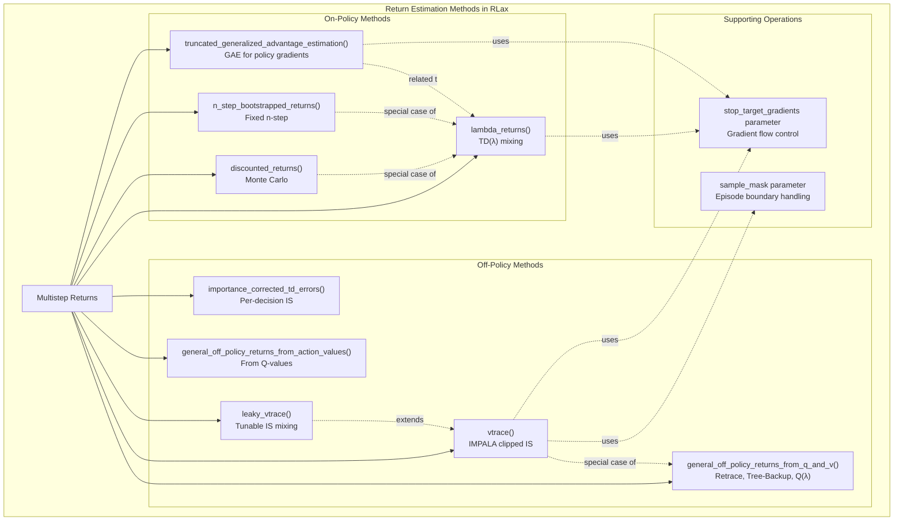
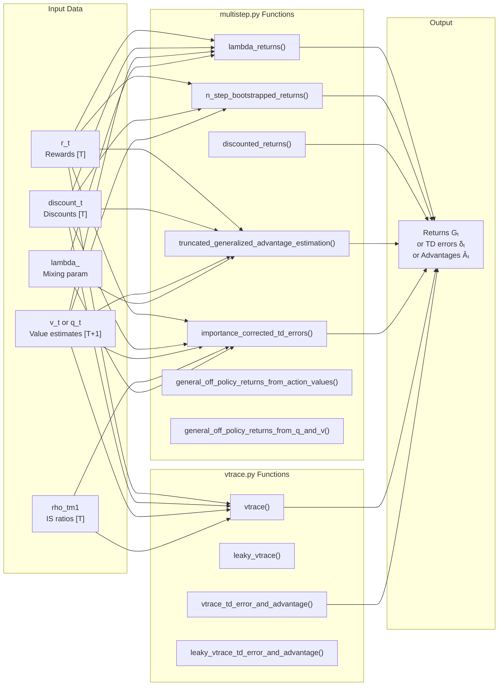
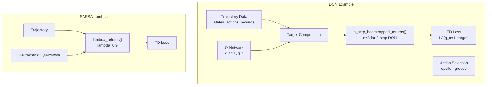
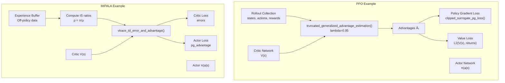
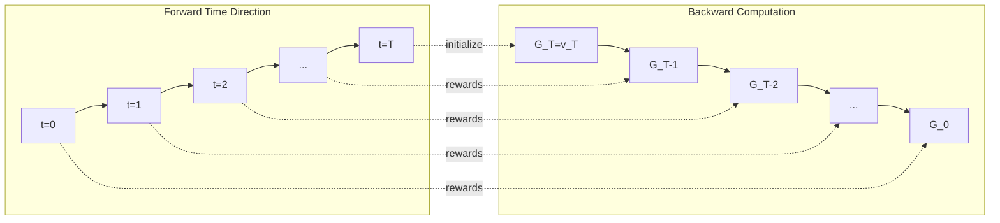

<!-- source: DeepWiki mcp.deepwiki.com · repo google-deepmind/rlax · page 3 Multistep Returns and Credit Assignment · fetched 2026-10-26 -->

# Multistep Returns and Credit Assignment

<details>
<summary>Relevant source files</summary>

The following files were used as context for generating this wiki page:

- [rlax/_src/multistep.py](rlax/_src/multistep.py)
- [rlax/_src/vtrace.py](rlax/_src/vtrace.py)

</details>


## Purpose and Scope

This page explains the multistep return computation mechanisms in RLax, which solve the fundamental **credit assignment problem** in reinforcement learning: how to propagate rewards backward in time to determine which actions were responsible for which outcomes. These functions construct target values for value-based and policy gradient algorithms by combining observed rewards with bootstrapped value estimates.

The primary implementation is in [rlax/_src/multistep.py:1-447](), which provides functions for computing lambda returns, n-step returns, generalized advantage estimation (GAE), and general off-policy return estimates. V-trace, a specialized off-policy method used in IMPALA, is implemented separately in [rlax/_src/vtrace.py:1-338]().

**Related pages:**
- For detailed coverage of lambda returns and GAE, see [Lambda Returns and GAE](#3.1)
- For V-trace and IMPALA-style off-policy learning, see [V-trace for Off-Policy Learning](#3.2)
- For how these returns are used in value learning algorithms, see [Value-Based Learning](#2)
- For policy gradient usage, see [Policy Optimization Methods](#5)

---

## The Credit Assignment Problem

In reinforcement learning, an agent receives rewards at various time steps, but the question remains: which past actions were responsible for these rewards? Multistep return methods provide different solutions to this problem by computing target values that aggregate future rewards.

The core challenge is balancing:
- **Bias**: Bootstrapping from value estimates introduces bias if those estimates are inaccurate
- **Variance**: Using many real rewards reduces bias but increases variance due to stochastic environment dynamics
- **Off-policy correction**: When learning from trajectories generated by a different policy, importance sampling corrections are needed

RLax provides a comprehensive set of functions that implement various points along these trade-offs, suitable for both on-policy and off-policy algorithms.

**Sources:** [rlax/_src/multistep.py:15-22]()

---

## Taxonomy of Multistep Return Methods



**Sources:** [rlax/_src/multistep.py:1-447](), [rlax/_src/vtrace.py:1-338]()

---

## Core Concepts

### Bootstrapping and Lambda Mixing

The fundamental equation for lambda returns is:

```
Gₜ = rₜ₊₁ + γₜ₊₁ [(1 - λₜ₊₁) vₜ₊₁ + λₜ₊₁ Gₜ₊₁]
```

Where:
- `Gₜ` is the return estimate at time t
- `rₜ₊₁` is the immediate reward
- `γₜ₊₁` is the discount factor
- `λₜ₊₁` is the mixing parameter (controls bias-variance trade-off)
- `vₜ₊₁` is the bootstrapped value estimate

The lambda parameter trades off between:
- `λ = 0`: One-step TD (high bias, low variance, fast learning)
- `λ = 1`: Monte Carlo (low bias, high variance, slow learning)
- `0 < λ < 1`: Interpolation between the extremes

**Sources:** [rlax/_src/multistep.py:34-118]()

### Importance Sampling for Off-Policy Learning

When the behavior policy μ differs from the target policy π, importance sampling ratios correct the returns:

```
ρₜ = π(aₜ|sₜ) / μ(aₜ|sₜ)
```

Different algorithms use these ratios differently:

| Method | Weighting Strategy | Implementation |
|--------|-------------------|----------------|
| **Importance Sampling** | `cₜ = ρₜ` | Full IS weight |
| **Q(λ)** | `cₜ = λ` | Fixed mixing |
| **Tree-Backup** | `cₜ = π(aₜ|sₜ)` | Policy probability |
| **Retrace** | `cₜ = λ min(1, ρₜ)` | Clipped IS |
| **V-trace** | Special clipping for critic and actor | `clip_rho_threshold`, `clip_pg_rho_threshold` |

**Sources:** [rlax/_src/multistep.py:215-277](), [rlax/_src/multistep.py:330-446](), [rlax/_src/vtrace.py:38-105]()

---

## Multistep Module API Structure



### Common Parameters

All functions share similar parameter conventions:

| Parameter | Type | Description |
|-----------|------|-------------|
| `r_t` | `Array[T]` | Rewards at times [1, ..., T] |
| `discount_t` | `Array[T]` | Discount factors γₜ at times [1, ..., T] |
| `v_t` | `Array[T+1]` | Value estimates at times [0, ..., T] (for bootstrapping) |
| `lambda_` | `Scalar` or `Array[T]` | Mixing parameter (scalar or per-timestep) |
| `stop_target_gradients` | `bool` | Whether to stop gradients through bootstrap targets |

**Sources:** [rlax/_src/multistep.py:34-118](), [rlax/_src/multistep.py:279-328]()

---

## Function Reference by Use Case

### Basic Return Computation

#### lambda_returns()

Computes the standard TD(λ) return with configurable lambda mixing.

**Function signature:** [rlax/_src/multistep.py:34-118]()

```python
lambda_returns(
    r_t: Array,
    discount_t: Array,
    v_t: Array,
    lambda_: Numeric = 1.,
    stop_target_gradients: bool = False,
) -> Array
```

**Use when:**
- Implementing on-policy value learning (TD(λ), SARSA(λ))
- Need to trade off bias vs variance with lambda parameter
- Have value estimates for bootstrapping

**Implementation details:**
- Works backward from `G_{T-1}` to `G_0` using JAX scan
- Lambda can be scalar (fixed) or per-timestep (adaptive)
- Equivalent to Monte Carlo when `lambda_=1.0`

**Sources:** [rlax/_src/multistep.py:34-118]()

---

#### n_step_bootstrapped_returns()

Computes strided n-step returns by accumulating exactly n rewards before bootstrapping.

**Function signature:** [rlax/_src/multistep.py:121-178]()

```python
n_step_bootstrapped_returns(
    r_t: Array,
    discount_t: Array,
    v_t: Array,
    n: int,
    lambda_t: Numeric = 1.,
    stop_target_gradients: bool = False,
) -> Array
```

**Use when:**
- Want fixed-horizon lookahead (e.g., n=3 for 3-step Q-learning)
- Simpler than full lambda mixing
- DQN-style algorithms with target networks

**Implementation details:**
- Pads sequences to handle trajectory boundaries
- Can include lambda mixing within the n-step window
- When `lambda_t=1.0`, reduces to pure n-step bootstrapping

**Sources:** [rlax/_src/multistep.py:121-178]()

---

#### discounted_returns()

Computes pure Monte Carlo returns without bootstrapping (lambda=1).

**Function signature:** [rlax/_src/multistep.py:181-212]()

```python
discounted_returns(
    r_t: Array,
    discount_t: Array,
    v_t: Array,
    stop_target_gradients: bool = False,
) -> Array
```

**Use when:**
- Have complete trajectories
- Want unbiased return estimates
- Policy gradient methods (REINFORCE)

**Implementation details:**
- Special case of `lambda_returns()` with `lambda_=1.0`
- `v_t` is only used for the final bootstrap value

**Sources:** [rlax/_src/multistep.py:181-212]()

---

### Advantage Estimation

#### truncated_generalized_advantage_estimation()

Computes GAE(λ) for policy gradient methods, computing advantages rather than returns.

**Function signature:** [rlax/_src/multistep.py:279-328]()

```python
truncated_generalized_advantage_estimation(
    r_t: Array,
    discount_t: Array,
    lambda_: Union[Array, Scalar],
    values: Array,
    stop_target_gradients: bool = False,
) -> Array
```

**Computes:**
```
Âₜ = δₜ + (γλ) * δₜ₊₁ + ... + (γλ)^(k-t+1) * δₖ₋₁
where δₜ = rₜ₊₁ + γₜ₊₁ * v(sₜ₊₁) - v(sₜ)
```

**Use when:**
- Implementing PPO, A2C, or other actor-critic methods
- Need advantage estimates for policy gradients
- Want variance reduction from baseline subtraction

**Sources:** [rlax/_src/multistep.py:279-328]()

---

### Off-Policy Return Estimation

#### importance_corrected_td_errors()

Computes multistep TD errors with per-decision importance sampling.

**Function signature:** [rlax/_src/multistep.py:215-277]()

```python
importance_corrected_td_errors(
    r_t: Array,
    discount_t: Array,
    rho_tm1: Array,
    lambda_: Array,
    values: Array,
    stop_target_gradients: bool = False,
) -> Array
```

**Computes:**
```
td-errorₜ = ρₜ δₜ(ρ,λ)
δₜ(ρ,λ) = δₜ + ρₜ₊₁ λₜ₊₁ γₜ₊₁ δₜ₊₁(ρ,λ)
```

**Use when:**
- Implementing off-policy actor-critic
- Have importance sampling ratios available
- Want to use per-decision IS correction

**Sources:** [rlax/_src/multistep.py:215-277]()

---

#### general_off_policy_returns_from_q_and_v()

Unified interface for multiple off-policy algorithms (Retrace, Tree-Backup, Q(λ)).

**Function signature:** [rlax/_src/multistep.py:389-446]()

```python
general_off_policy_returns_from_q_and_v(
    q_t: Array,
    v_t: Array,
    r_t: Array,
    discount_t: Array,
    c_t: Array,
    stop_target_gradients: bool = False,
) -> Array
```

**Computes:**
```
Gₜ = rₜ₊₁ + γₜ₊₁ * (vₜ₊₁ - cₜ₊₁ * q(aₜ₊₁) + cₜ₊₁ * Gₜ₊₁)
```

**Implements different algorithms via `c_t` parameter:**

| Algorithm | `c_t` Value | Reference |
|-----------|-------------|-----------|
| Importance Sampling | `π(aₜ\|sₜ) / μ(aₜ\|sₜ)` | Full IS weight |
| Q(λ) | `λ` | Harutyunyan et al. |
| Tree-Backup | `π(aₜ\|sₜ)` | Precup et al. |
| Retrace | `λ min(1, π(aₜ\|sₜ) / μ(aₜ\|sₜ))` | Munos et al. |

**Use when:**
- Need flexible off-policy correction
- Implementing Retrace, Tree-Backup, or Q(λ)
- Have Q-values and policy probabilities

**Sources:** [rlax/_src/multistep.py:389-446](), [rlax/_src/multistep.py:330-387]()

---

### V-trace Specific Functions

V-trace is covered in detail in [V-trace for Off-Policy Learning](#3.2), but the key functions are:

#### vtrace()

Core V-trace return computation with clipped importance sampling.

**Function signature:** [rlax/_src/vtrace.py:38-105]()

```python
vtrace(
    v_tm1: Array,
    v_t: Array,
    r_t: Array,
    discount_t: Array,
    rho_tm1: Array,
    lambda_: Numeric = 1.0,
    clip_rho_threshold: float = 1.0,
    stop_target_gradients: bool = True,
    sample_mask: Array | None = None,
) -> Array
```

**Key differences from standard lambda returns:**
- Clips importance ratios: `c_tm1 = min(1.0, rho_tm1) * lambda_`
- Uses separate clipping for TD errors: `clipped_rhos_tm1 = min(clip_rho_threshold, rho_tm1)`
- Supports `sample_mask` for episode boundaries

**Sources:** [rlax/_src/vtrace.py:38-105]()

---

#### vtrace_td_error_and_advantage()

Combined function for IMPALA-style actor-critic, computing both value targets and policy advantages.

**Function signature:** [rlax/_src/vtrace.py:183-254]()

```python
vtrace_td_error_and_advantage(
    v_tm1: Array,
    v_t: Array,
    r_t: Array,
    discount_t: Array,
    rho_tm1: Array,
    lambda_: Numeric = 1.0,
    clip_rho_threshold: float = 1.0,
    clip_pg_rho_threshold: float = 1.0,
    stop_target_gradients: bool = True,
    sample_mask: Array | None = None,
) -> VTraceOutput
```

**Returns:** `VTraceOutput(errors, pg_advantage, q_estimate)`
- `errors`: TD errors for critic loss
- `pg_advantage`: Clipped advantages for policy gradient
- `q_estimate`: Q-value estimates

**Key feature:** Uses separate clipping thresholds for critic (`clip_rho_threshold`) and actor (`clip_pg_rho_threshold`)

**Sources:** [rlax/_src/vtrace.py:183-254]()

---

## Usage Patterns and Integration

### Typical Usage in Value Learning



**Sources:** Based on [examples/simple_dqn.py]() usage pattern

---

### Typical Usage in Policy Gradients



**Sources:** Based on common usage patterns

---

## Implementation Details

### Backward Scan Pattern

Most functions use JAX's `lax.scan` in reverse to compute returns efficiently:



**Key implementation detail:** [rlax/_src/multistep.py:107-114]()

The scan body function accumulates returns backward:
```python
def _body(acc, xs):
    returns, discounts, values, lambda_ = xs
    acc = returns + discounts * ((1-lambda_) * values + lambda_ * acc)
    return acc, acc
```

This pattern enables efficient parallel computation on accelerators (GPU/TPU).

**Sources:** [rlax/_src/multistep.py:107-118](), [rlax/_src/vtrace.py:92-99]()

---

### Gradient Control

The `stop_target_gradients` parameter controls whether gradients flow through bootstrap targets:

- `stop_target_gradients=True`: Treats targets as constants, prevents double backpropagation
- `stop_target_gradients=False`: Allows gradients through targets (rarely used)

**Implementation:** [rlax/_src/multistep.py:116-118]()

```python
return jax.lax.select(stop_target_gradients,
                      jax.lax.stop_gradient(returns),
                      returns)
```

Most algorithms use `stop_target_gradients=True` to avoid the "deadly triad" (function approximation + bootstrapping + off-policy), as described in Sutton & Barto.

**Sources:** [rlax/_src/multistep.py:116-118](), [rlax/_src/vtrace.py:102-105]()

---

### Episode Boundary Handling

V-trace functions support `sample_mask` to handle episode boundaries in batched trajectories:

**Implementation:** [rlax/_src/vtrace.py:71-72](), [rlax/_src/vtrace.py:92-99]()

```python
def _body(acc, xs):
    td_error, discount, learnable, c = xs
    acc = learnable * (td_error + discount * c * acc) + (1.0 - learnable) * acc
    return acc, acc
```

The mask ensures that returns don't propagate across episode boundaries, which is critical for distributed training where trajectories from different episodes may be interleaved.

**Sources:** [rlax/_src/vtrace.py:66-99]()

---

## Summary Table: When to Use Each Function

| Function | On/Off-Policy | Primary Use Case | Key Parameters |
|----------|---------------|------------------|----------------|
| `lambda_returns` | On-policy | TD(λ), SARSA(λ), value learning | `lambda_` (bias-variance tradeoff) |
| `n_step_bootstrapped_returns` | On-policy | n-step DQN, fixed-horizon methods | `n` (number of steps) |
| `discounted_returns` | On-policy | Monte Carlo, REINFORCE | None (full trajectory) |
| `truncated_generalized_advantage_estimation` | On-policy | PPO, A2C, actor-critic | `lambda_` (advantage smoothing) |
| `importance_corrected_td_errors` | Off-policy | Per-decision IS methods | `rho_tm1` (IS ratios) |
| `general_off_policy_returns_from_q_and_v` | Off-policy | Retrace, Tree-Backup, Q(λ) | `c_t` (correction weights) |
| `general_off_policy_returns_from_action_values` | Off-policy | Same as above, from Q-values | `c_t`, `pi_t` (policy probs) |
| `vtrace` | Off-policy | IMPALA critic | `clip_rho_threshold` |
| `vtrace_td_error_and_advantage` | Off-policy | IMPALA actor-critic | `clip_rho_threshold`, `clip_pg_rho_threshold` |
| `leaky_vtrace` | Off-policy | Adaptive IS mixing | `alpha_` (IS vs V-trace) |

**Sources:** [rlax/_src/multistep.py:1-447](), [rlax/_src/vtrace.py:1-338]()

---

## Relationship to Other RLax Modules

The multistep module is a foundational component used throughout RLax:

| Module | How It Uses Multistep Returns |
|--------|-------------------------------|
| **value_learning** ([#2](#2)) | Uses `lambda_returns()` for TD(λ), SARSA(λ); uses `general_off_policy_returns_from_q_and_v()` for Retrace |
| **policy_gradients** ([#5](#5)) | Uses `truncated_generalized_advantage_estimation()` for advantage computation in PPO |
| **nonlinear_bellman** ([#6.1](#6.1)) | Wraps multistep returns with value transformations for MuZero |
| **vtrace** ([#3.2](#3.2)) | Extends multistep framework with IMPALA-specific importance sampling |

The module depends on:
- **base** ([#7.2](#7.2)) for `batched_index()` used in Q-value extraction
- **JAX/jax.numpy** for array operations and `lax.scan`
- **chex** for type checking and assertions

**Sources:** Based on module dependency analysis from high-level diagrams

---

