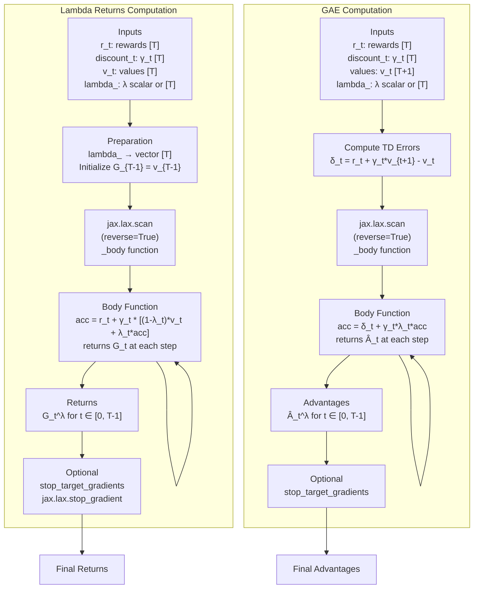
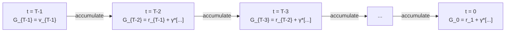
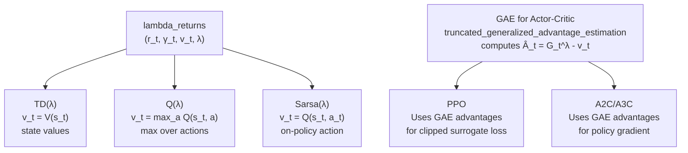
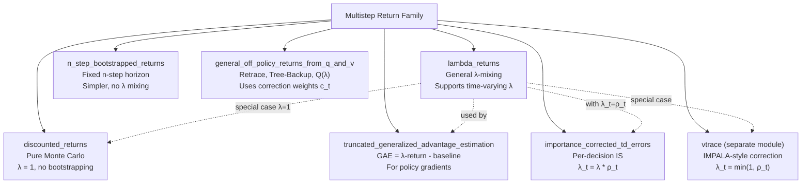
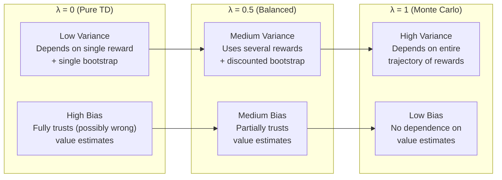
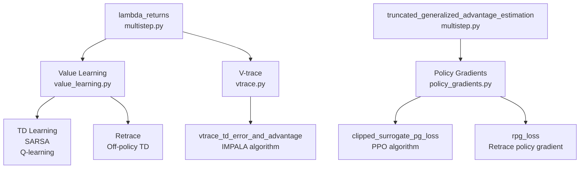

<!-- source: DeepWiki mcp.deepwiki.com · repo google-deepmind/rlax · page 3.1 Lambda Returns and GAE · fetched 2026-10-26 -->

# Lambda Returns and GAE

<details>
<summary>Relevant source files</summary>

The following files were used as context for generating this wiki page:

- [README.md](README.md)
- [examples/__init__.py](examples/__init__.py)
- [examples/experiment.py](examples/experiment.py)
- [examples/online_q_learning.py](examples/online_q_learning.py)
- [examples/pop_art.py](examples/pop_art.py)
- [examples/simple_dqn.py](examples/simple_dqn.py)
- [rlax/_src/embedding.py](rlax/_src/embedding.py)
- [rlax/_src/multistep.py](rlax/_src/multistep.py)
- [rlax/_src/vtrace.py](rlax/_src/vtrace.py)

</details>


## Purpose and Scope

This page covers **lambda returns** and **Generalized Advantage Estimation (GAE)**, two fundamental techniques for computing multistep return estimates in reinforcement learning. These methods trade off bias and variance in value estimation by mixing bootstrapped returns at different time horizons using a parameter λ (lambda).

Lambda returns are used for value learning algorithms (TD(λ), Q(λ), Sarsa(λ)), while GAE is specifically designed for computing advantage estimates in policy gradient methods. Both are implemented in the `multistep` module.

For off-policy corrections using V-trace (a special case of lambda returns), see [V-trace for Off-Policy Learning](#3.2). For general multistep bootstrapping concepts, see [Multistep Returns and Credit Assignment](#3).

---

## Mathematical Foundation

### Lambda Returns

Lambda returns combine n-step returns with different bootstrap horizons according to a mixing parameter λ ∈ [0, 1]. Given a trajectory of rewards `r_t`, discounts `γ_t`, and value estimates `v_t`, the lambda return at time t is computed recursively:

```
G_t^λ = r_{t+1} + γ_{t+1} [(1 - λ_{t+1}) v_{t+1} + λ_{t+1} G_{t+1}^λ]
```

This formula exponentially weights different n-step returns:
- **λ = 0**: Pure 1-step TD (high bias, low variance): `r_{t+1} + γ_{t+1} v_{t+1}`
- **λ = 1**: Monte Carlo return (low bias, high variance): `r_{t+1} + γ_{t+1} r_{t+2} + γ_{t+1}γ_{t+2} r_{t+3} + ...`
- **0 < λ < 1**: Weighted mixture of all n-step returns

The key insight is that λ controls the **bias-variance tradeoff**:
- Lower λ → more bootstrapping → lower variance but higher bias (depends on value accuracy)
- Higher λ → less bootstrapping → higher variance but lower bias (depends less on value accuracy)

**Sources:** [rlax/_src/multistep.py:34-118]()

### Generalized Advantage Estimation (GAE)

GAE applies the lambda return concept to compute advantage estimates for policy gradients. The advantage at time t is:

```
Â_t^λ = δ_t + (γλ) δ_{t+1} + (γλ)² δ_{t+2} + ... + (γλ)^{k-t} δ_{k-1}
```

where `δ_t = r_{t+1} + γ_{t+1} v_{t+1} - v_t` is the temporal difference (TD) error.

GAE can be expressed in terms of lambda returns as:
```
Â_t^λ = G_t^λ - v_t
```

This means GAE is simply the difference between the lambda return target and the current value estimate, making it suitable for actor-critic methods where we need advantage estimates for policy updates.

**Sources:** [rlax/_src/multistep.py:279-327]()

---

## Core Implementation Architecture



**Sources:** [rlax/_src/multistep.py:34-118](), [rlax/_src/multistep.py:279-327]()

---

## Function Signatures and Parameters

### `lambda_returns`

```python
def lambda_returns(
    r_t: Array,              # Rewards at times [1, ..., T]
    discount_t: Array,       # Discounts γ_t at times [1, ..., T]
    v_t: Array,              # Value estimates at times [1, ..., T]
    lambda_: Numeric = 1.,   # Mixing parameter (scalar or [T])
    stop_target_gradients: bool = False,
) -> Array:
```

| Parameter | Shape | Type | Description |
|-----------|-------|------|-------------|
| `r_t` | `[T]` | float | Sequence of rewards at timesteps t ∈ [1, T] |
| `discount_t` | `[T]` | float | Sequence of discount factors γ_t ∈ [1, T] |
| `v_t` | `[T]` | float | Value estimates (state or state-action values) |
| `lambda_` | `[]` or `[T]` | float | Mixing parameter (0 = TD, 1 = MC). Can vary per timestep for off-policy |
| `stop_target_gradients` | - | bool | Whether to block gradients through bootstrap targets |

**Returns:** Array of shape `[T]` containing lambda returns `G_t^λ` for t ∈ [0, T-1]

**Sources:** [rlax/_src/multistep.py:34-99]()

### `truncated_generalized_advantage_estimation`

```python
def truncated_generalized_advantage_estimation(
    r_t: Array,              # Rewards at times [1, ..., k]
    discount_t: Array,       # Discounts at times [1, ..., k]
    lambda_: Union[Array, Scalar],  # Mixing parameter
    values: Array,           # Values at times [0, ..., k]
    stop_target_gradients: bool = False,
) -> Array:
```

| Parameter | Shape | Type | Description |
|-----------|-------|------|-------------|
| `r_t` | `[k]` | float | Rewards at times [1, k] |
| `discount_t` | `[k]` | float | Discount factors at times [1, k] |
| `lambda_` | `[]` or `[k]` | float | GAE mixing parameter (typically 0.95-0.99) |
| `values` | `[k+1]` | float | Value estimates v(s_t) at times [0, k]. Note k+1 length! |
| `stop_target_gradients` | bool | Whether to block gradients |

**Returns:** Array of shape `[k]` containing advantage estimates `Â_t^λ` for t ∈ [0, k-1]

**Important:** The `values` array must have length `k+1` (one more than rewards), as it includes both the source state values and the final bootstrap value.

**Sources:** [rlax/_src/multistep.py:279-327]()

---

## Implementation Details

### Reverse Scan Pattern

Both functions use `jax.lax.scan` with `reverse=True` to compute returns efficiently in a single backward pass through the trajectory. This is more efficient than naive Python loops and enables automatic differentiation.



The `_body` function for `lambda_returns` [rlax/_src/multistep.py:108-111]():
```python
def _body(acc, xs):
    returns, discounts, values, lambda_ = xs
    acc = returns + discounts * ((1-lambda_) * values + lambda_ * acc)
    return acc, acc
```

The `_body` function for GAE [rlax/_src/multistep.py:317-320]():
```python
def _body(acc, xs):
    deltas, discounts, lambda_ = xs
    acc = deltas + discounts * lambda_ * acc
    return acc, acc
```

**Sources:** [rlax/_src/multistep.py:108-118](), [rlax/_src/multistep.py:317-323]()

### Lambda as Scalar or Vector

Both functions support `lambda_` as either:
- **Scalar**: Same λ for all timesteps (typical for on-policy learning)
- **Vector**: Different λ_t per timestep (used for off-policy corrections)

The code broadcasts scalar lambda to a vector [rlax/_src/multistep.py:105]():
```python
lambda_ = jnp.ones_like(discount_t) * lambda_
```

**Sources:** [rlax/_src/multistep.py:105](), [rlax/_src/multistep.py:312]()

### Gradient Blocking

The `stop_target_gradients` parameter controls whether gradients flow through the bootstrap targets. This is typically set to `True` to prevent value function updates from being influenced by their own predictions, which can destabilize learning.

Implementation [rlax/_src/multistep.py:116-118]():
```python
return jax.lax.select(stop_target_gradients,
                      jax.lax.stop_gradient(returns),
                      returns)
```

**Sources:** [rlax/_src/multistep.py:116-118](), [rlax/_src/multistep.py:325-327]()

---

## Use Cases and Algorithm Variants

### On-Policy Algorithms

Lambda returns can implement various on-policy temporal difference methods depending on how `v_t` is computed:



**Common λ values:**
- **TD(λ), Q(λ), Sarsa(λ)**: λ ∈ [0.9, 1.0]
- **GAE**: λ ∈ [0.95, 0.99] (slightly lower than value-based methods)

**Sources:** [rlax/_src/multistep.py:58-66](), [rlax/_src/multistep.py:292-293]()

### Off-Policy Corrections

For off-policy learning, λ can be made time-dependent to incorporate importance sampling corrections:

| Algorithm | λ_t Formula | Purpose |
|-----------|-------------|---------|
| **Per-decision IS** | λ_t = λ · ρ_t where ρ_t = π(a\|s) / μ(a\|s) | Full importance sampling correction |
| **V-trace (IMPALA)** | λ_t = min(1, ρ_t) | Clipped IS for stability in distributed learning |
| **Retrace** | λ_t = λ · min(1, ρ_t) | Combines fixed λ with clipping |

The function `importance_corrected_td_errors` [rlax/_src/multistep.py:215-276]() implements per-decision importance sampling using lambda returns with time-varying λ_t = ρ_t.

V-trace (covered in [page 3.2](#3.2)) is a special case that sets λ_t based on importance ratios.

**Sources:** [rlax/_src/multistep.py:68-82](), [rlax/_src/multistep.py:215-276]()

---

## Practical Usage Examples

### Example 1: Computing TD(λ) Targets

```python
import jax.numpy as jnp
import rlax

# Trajectory data (length T=5)
rewards = jnp.array([1.0, 0.0, 0.0, 1.0, 0.0])
discounts = jnp.array([0.99, 0.99, 0.99, 0.99, 0.99])
state_values = jnp.array([0.5, 0.6, 0.7, 0.8, 0.9])

# Compute TD(λ=0.9) returns
lambda_val = 0.9
returns = rlax.lambda_returns(
    r_t=rewards,
    discount_t=discounts,
    v_t=state_values,
    lambda_=lambda_val,
    stop_target_gradients=True
)

# Use returns as targets for value function update
td_errors = returns - state_values  # Could also get this from lambda_returns
```

### Example 2: Computing GAE for Actor-Critic

```python
import jax.numpy as jnp
import rlax

# Trajectory data (length k=5)
rewards = jnp.array([1.0, 0.0, 0.0, 1.0, 0.0])
discounts = jnp.array([0.99, 0.99, 0.99, 0.99, 0.99])
# Note: values has length k+1 (includes bootstrap value)
state_values = jnp.array([0.5, 0.6, 0.7, 0.8, 0.9, 1.0])

# Compute GAE(λ=0.95)
advantages = rlax.truncated_generalized_advantage_estimation(
    r_t=rewards,
    discount_t=discounts,
    lambda_=0.95,
    values=state_values,
    stop_target_gradients=True
)

# Use advantages in policy gradient
# policy_loss = -advantages * log_probs
```

### Example 3: Off-Policy with Time-Varying Lambda

```python
import jax.numpy as jnp
import rlax

# Trajectory with importance sampling ratios
rewards = jnp.array([1.0, 0.0, 0.0, 1.0, 0.0])
discounts = jnp.array([0.99, 0.99, 0.99, 0.99, 0.99])
state_values = jnp.array([0.5, 0.6, 0.7, 0.8, 0.9])
importance_ratios = jnp.array([1.2, 0.8, 1.5, 0.9, 1.1])

# Use per-decision importance sampling: λ_t = λ * ρ_t
base_lambda = 0.9
lambda_t = base_lambda * importance_ratios

returns = rlax.lambda_returns(
    r_t=rewards,
    discount_t=discounts,
    v_t=state_values,
    lambda_=lambda_t,  # Time-varying lambda
    stop_target_gradients=True
)
```

**Sources:** Documentation inference from [rlax/_src/multistep.py:34-327]()

---

## Relationship to Other Multistep Methods



| Function | Module | Lambda Support | Off-Policy | Use Case |
|----------|--------|----------------|------------|----------|
| `lambda_returns` | multistep | Yes (scalar or vector) | Via time-varying λ | General TD(λ), Q(λ), Sarsa(λ) |
| `truncated_generalized_advantage_estimation` | multistep | Yes | No (on-policy) | Actor-critic advantages (PPO, A2C) |
| `n_step_bootstrapped_returns` | multistep | Optional (default 1) | No | Fixed horizon n-step |
| `discounted_returns` | multistep | Implicit (λ=1) | No | Monte Carlo returns |
| `importance_corrected_td_errors` | multistep | Yes (via ρ) | Yes | Per-decision importance sampling |
| `vtrace` | vtrace | Yes | Yes | IMPALA distributed actor-critic |

**Sources:** [rlax/_src/multistep.py:1-447](), [rlax/_src/vtrace.py:1-338]()

---

## Key Design Decisions

### Why Reverse Scan?

The implementation uses `jax.lax.scan` in reverse order because returns are computed backward from the final timestep:
- Start with `G_{T-1} = v_{T-1}` (bootstrap from final value)
- Work backward: `G_t` depends on `G_{t+1}`
- This matches the mathematical definition and is cache-efficient

**Sources:** [rlax/_src/multistep.py:113-114]()

### Why Separate GAE Function?

Although GAE can be computed as `lambda_returns(...) - values[:-1]`, having a dedicated `truncated_generalized_advantage_estimation` function provides:
1. **Clarity:** Explicitly shows this is for computing advantages
2. **Efficiency:** Avoids computing full returns when only advantages are needed
3. **API consistency:** Matches the PPO/actor-critic literature

The implementation directly computes TD errors and accumulates them, which is mathematically equivalent but more direct.

**Sources:** [rlax/_src/multistep.py:279-327]()

### When to Use `stop_target_gradients`?

| Scenario | Setting | Reason |
|----------|---------|--------|
| Training value function | `True` | Prevent destabilizing gradients through bootstrap |
| Computing targets for fixed network | `False` | Gradients don't matter for targets |
| Debugging gradient flow | `False` | Allow full backpropagation for analysis |

Most standard algorithms use `stop_target_gradients=True` to implement the target network pattern from DQN and similar algorithms.

**Sources:** [rlax/_src/multistep.py:94-95](), [rlax/_src/multistep.py:304-305]()

---

## Bias-Variance Tradeoff Visualization

The choice of λ fundamentally trades off bias and variance in return estimates:



**Practical Guidelines:**
- **Good value function:** Use lower λ (0.8-0.9) to reduce variance
- **Poor value function:** Use higher λ (0.95-1.0) to reduce bias
- **Long episodes:** Use lower λ to avoid compounding errors
- **Short episodes:** Can use higher λ safely
- **GAE typically:** λ ∈ [0.95, 0.99] works well across many domains

**Sources:** [rlax/_src/multistep.py:44-86]()

---

## Common Pitfalls and Solutions

### Pitfall 1: Array Length Mismatch for GAE

**Problem:** GAE requires `values` of length `k+1` but providing length `k`.

```python
# WRONG: values has same length as rewards
rewards = jnp.array([1.0, 0.0, 0.0])      # length 3
values = jnp.array([0.5, 0.6, 0.7])       # length 3 - WRONG!

# CORRECT: values needs bootstrap value
rewards = jnp.array([1.0, 0.0, 0.0])      # length 3
values = jnp.array([0.5, 0.6, 0.7, 0.8])  # length 4 - includes v_{k}
```

**Sources:** [rlax/_src/multistep.py:300]()

### Pitfall 2: Off-Policy λ Without Importance Ratios

**Problem:** Using scalar λ for off-policy data leads to biased estimates.

**Solution:** Use time-varying λ_t that includes importance sampling ratios, or use `importance_corrected_td_errors` or `vtrace` functions.

**Sources:** [rlax/_src/multistep.py:68-82]()

### Pitfall 3: Forgetting stop_target_gradients

**Problem:** Gradients flow through bootstrap values, causing training instability.

**Solution:** Set `stop_target_gradients=True` when using returns as learning targets.

**Sources:** [rlax/_src/multistep.py:94-95]()

---

## Integration with RLax Ecosystem

Lambda returns and GAE are foundational building blocks used throughout RLax:



**Sources:** [rlax/_src/multistep.py:1-447](), [rlax/_src/vtrace.py:1-338]()

---

## References and Further Reading

The implementations follow standard formulations from reinforcement learning literature:

1. **Lambda Returns:**
   - Sutton & Barto, "Reinforcement Learning: An Introduction" - TD(λ) chapter
   - Link in docstring: http://incompleteideas.net/sutton/book/ebook/node74.html

2. **GAE:**
   - Schulman et al., "High-Dimensional Continuous Control Using Generalized Advantage Estimation"
   - Link in docstring: https://arxiv.org/abs/1506.02438
   - Also referenced in PPO paper: https://arxiv.org/abs/1707.06347

3. **Off-Policy Corrections:**
   - Sutton et al., "A new Q(λ) with interim forward view and Monte Carlo equivalence"
   - Link in docstring: http://proceedings.mlr.press/v32/sutton14.html

**Sources:** [rlax/_src/multistep.py:86-87](), [rlax/_src/multistep.py:292-297](), [rlax/_src/multistep.py:238-239]()

---

