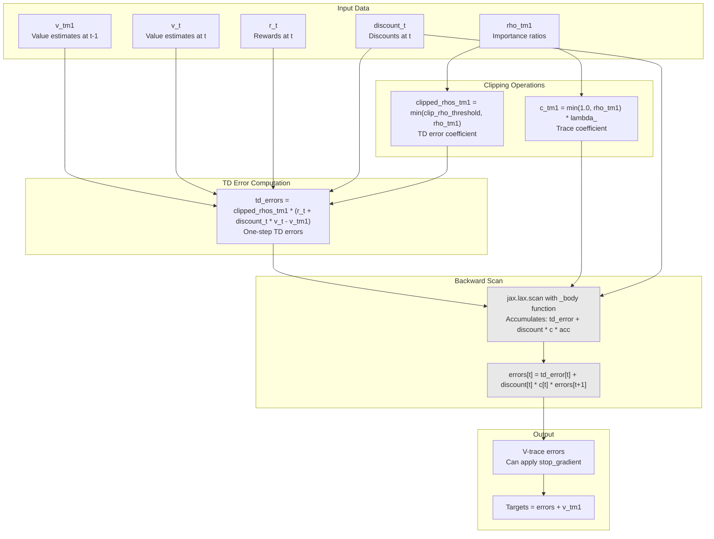
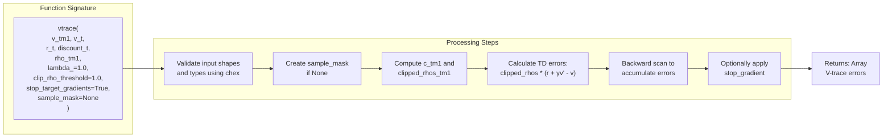
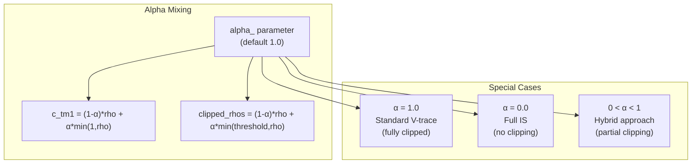
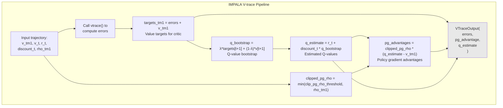
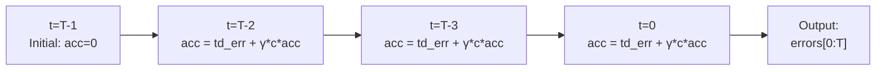
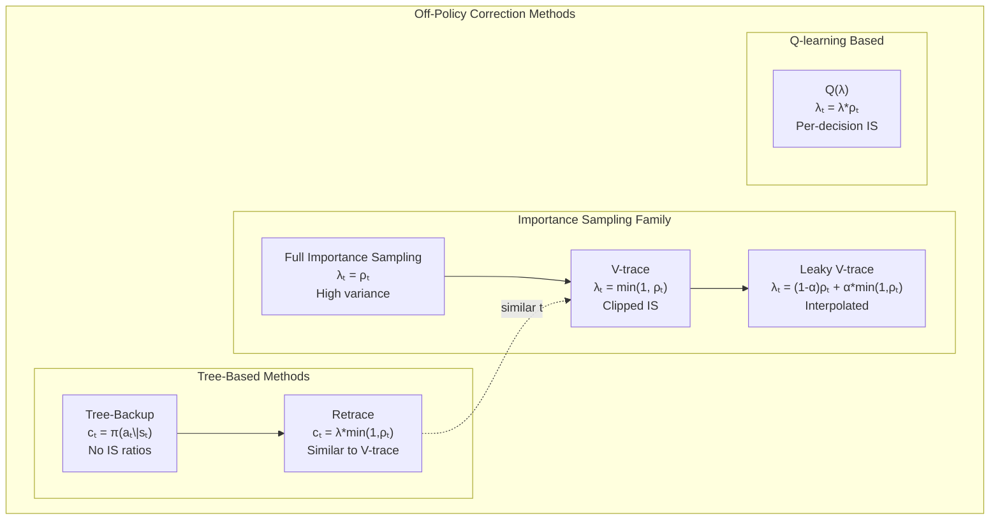
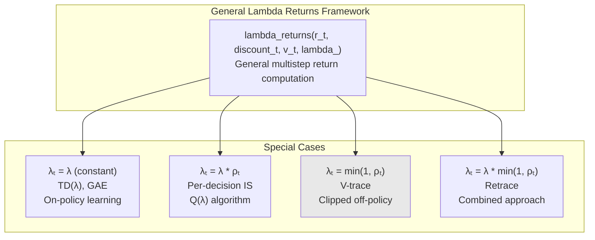

<!-- source: DeepWiki mcp.deepwiki.com · repo google-deepmind/rlax · page 3.2 V-trace for Off-Policy Learning · fetched 2026-10-26 -->

# V-trace for Off-Policy Learning

<details>
<summary>Relevant source files</summary>

The following files were used as context for generating this wiki page:

- [rlax/_src/clipping_test.py](rlax/_src/clipping_test.py)
- [rlax/_src/multistep.py](rlax/_src/multistep.py)
- [rlax/_src/vtrace.py](rlax/_src/vtrace.py)
- [rlax/_src/vtrace_test.py](rlax/_src/vtrace_test.py)

</details>


**Purpose and Scope**: This page documents the V-trace algorithm and its variants as implemented in RLax. V-trace is an off-policy correction method that uses clipped importance sampling to compute value targets and policy gradient advantages, primarily used in distributed actor-critic systems like IMPALA.

For general multistep return calculations including on-policy methods like TD(λ) and GAE, see [Lambda Returns and GAE](#3.1). For policy gradient loss functions that consume V-trace advantages, see [Policy Gradient Losses](#5.1).

## Overview

V-trace is a specialized off-policy correction algorithm that addresses the high variance problem in standard importance sampling while maintaining low bias. It achieves this through truncated importance sampling ratios with separate clipping thresholds for value learning and policy gradients. The algorithm is particularly suited for distributed learning scenarios where experience is collected by multiple actors running slightly stale policies.

**Key characteristics**:
- Clips importance sampling ratios to bound variance
- Computes lambda-weighted multistep returns with off-policy correction
- Provides both value targets (for critic updates) and advantages (for policy updates)
- Includes a "leaky" variant that interpolates between full importance sampling and V-trace

Sources: [rlax/_src/vtrace.py:16-23]()

## Theoretical Foundation

### Importance Sampling and Trace Cutting

V-trace addresses off-policy learning where trajectories are generated by a behavior policy μ but we want to evaluate/improve a target policy π. The importance sampling ratio at time t is:

```
ρₜ = π(aₜ|sₜ) / μ(aₜ|sₜ)
```

Standard importance sampling multiplies returns by these ratios, but this leads to high variance when policies differ significantly. V-trace applies two types of clipping:

| Parameter | Purpose | Typical Value |
|-----------|---------|---------------|
| `clip_rho_threshold` (c̄) | Clips ratios for value function trace | 1.0 |
| `clip_pg_rho_threshold` (ρ̄) | Clips ratios for policy gradient advantage | 1.0 - 10.0 |

The clipped ratios are:
```
c_t = min(c̄, ρₜ) * λ
clipped_ρₜ = min(ρ̄, ρₜ)
```

where λ is the usual mixing parameter for multistep returns.

Sources: [rlax/_src/vtrace.py:38-106]()

### V-trace Return Computation



**V-trace Recursive Formula**:

Starting from the final time step and working backward:
```
errors[t] = clipped_ρₜ * (rₜ₊₁ + γₜ₊₁ * vₜ₊₁ - vₜ) + γₜ₊₁ * cₜ₊₁ * errors[t+1]
```

where:
- The first term is the clipped one-step TD error
- The second term accumulates future errors weighted by trace coefficients
- The final target is `vₜ + errors[t]`

Sources: [rlax/_src/vtrace.py:38-106](), [rlax/_src/vtrace.py:88-105]()

## Core V-trace Functions

### `vtrace()` Function

The basic V-trace function computes errors from importance weights and trajectory data.



**Key parameters**:

| Parameter | Type | Description | Default |
|-----------|------|-------------|---------|
| `v_tm1` | Array | Value estimates at time t-1 | Required |
| `v_t` | Array | Value estimates at time t | Required |
| `r_t` | Array | Rewards at time t | Required |
| `discount_t` | Array | Discount factors at time t | Required |
| `rho_tm1` | Array | Importance sampling ratios π(a)/μ(a) | Required |
| `lambda_` | Numeric | Mixing parameter (scalar or per-step) | 1.0 |
| `clip_rho_threshold` | float | Clipping threshold for ρ | 1.0 |
| `stop_target_gradients` | bool | Whether to block gradients through targets | True |
| `sample_mask` | Array | Binary mask for learnable timesteps | None |

**Implementation details**:
- Uses `jax.lax.scan` with `reverse=True` for efficient backward accumulation
- Clipping is applied element-wise: `jnp.minimum(threshold, rho_tm1)`
- The trace coefficient `c_tm1` is computed separately from the TD error coefficient
- Sample mask allows excluding certain timesteps (e.g., non-learnable states)

Sources: [rlax/_src/vtrace.py:38-106]()

### `leaky_vtrace()` Function

Leaky V-trace interpolates between full importance sampling (α=0) and standard V-trace (α=1), controlled by a mixing parameter α.

**Mathematical formulation**:
```
c_tm1 = ((1 - α) * ρₜ + α * min(1.0, ρₜ)) * λ
clipped_ρₜ = (1 - α) * ρₜ + α * min(clip_rho_threshold, ρₜ)
```

When α=1, this reduces to standard V-trace. When α=0, no clipping is applied (full importance sampling).



**Use cases**:
- Meta-learning scenarios where α can be learned
- Gradual transition from IS to V-trace during training
- Environments where optimal clipping strength varies

The function signature is identical to `vtrace()` except for the additional `alpha_` parameter.

Sources: [rlax/_src/vtrace.py:108-181](), [rlax/_src/vtrace.py:156-161]()

## IMPALA Integration

### `vtrace_td_error_and_advantage()` Function

This function computes both value targets and policy gradient advantages as used in the IMPALA distributed actor-critic agent. It returns a `VTraceOutput` named tuple with three components.



**VTraceOutput structure**:

| Field | Purpose | Usage |
|-------|---------|-------|
| `errors` | V-trace TD errors | Critic loss: `(errors + v_tm1 - v_predictions)²` |
| `pg_advantage` | Policy gradient advantages | Actor loss: `-pg_advantage * log π(a\|s)` |
| `q_estimate` | Estimated Q-values | Alternative advantage: `q_estimate - v_tm1` |

**Key differences from basic `vtrace()`**:
- Returns structured output instead of just errors
- Computes separate clipping for policy gradients (`clip_pg_rho_threshold`)
- Constructs Q-value estimates with lambda-mixing
- PG advantages use clipped ratios multiplied by temporal differences

**Typical parameter values in IMPALA**:
- `clip_rho_threshold`: 1.0 (conservative clipping for critic)
- `clip_pg_rho_threshold`: 1.0 to 10.0 (less conservative for actor)
- `lambda_`: 0.9 to 1.0 (high lambda for longer bootstrapping)

Sources: [rlax/_src/vtrace.py:183-255](), [rlax/_src/vtrace.py:234-254]()

### Q-estimate Construction

The Q-estimate computation deserves special attention as it implements a mixing strategy:

```python
# From vtrace.py lines 246-250
q_bootstrap = jnp.concatenate([
    lambda_[:-1] * targets_tm1[1:] + (1 - lambda_[:-1]) * v_tm1[1:],
    v_t[-1:],
], axis=0)
q_estimate = r_t + discount_t * q_bootstrap
```

This creates a bootstrap value that mixes:
- The V-trace target at the next step (weighted by λ)
- The raw value estimate at the next step (weighted by 1-λ)

**Purpose**: This mixing allows interpolation between:
- Full V-trace returns (λ=1): `Q(s,a) ≈ r + γ * V_vtrace(s')`
- One-step TD (λ=0): `Q(s,a) ≈ r + γ * V(s')`

Sources: [rlax/_src/vtrace.py:246-254]()

## Implementation Details

### Backward Scan Mechanics

Both `vtrace()` and `leaky_vtrace()` use `jax.lax.scan` for efficient computation. The scan body accumulates errors backward through time:

```python
# From vtrace.py lines 92-95
def _body(acc, xs):
    td_error, discount, learnable, c = xs
    acc = learnable * (td_error + discount * c * acc) + (1.0 - learnable) * acc
    return acc, acc
```

**Key features**:
- `acc` is the accumulated error from future timesteps
- `learnable` mask allows skipping non-learnable states (e.g., episode boundaries)
- Returns both carry (`acc`) and output (`acc`) for scan
- Executed in reverse with `reverse=True`



Sources: [rlax/_src/vtrace.py:92-99]()

### Gradient Flow Control

The `stop_target_gradients` parameter controls whether gradients flow through the bootstrap targets:

```python
# From vtrace.py lines 102-105
return jax.lax.select(
    stop_target_gradients,
    jax.lax.stop_gradient(errors + v_tm1) - v_tm1,
    errors)
```

**When `stop_target_gradients=True`** (default):
- Gradients flow only through `v_tm1` term
- The target `errors + v_tm1` is treated as a fixed constant
- Standard practice for temporal difference learning

**When `stop_target_gradients=False`**:
- Gradients flow through the entire computation graph
- Can lead to more complex gradient dynamics
- Rarely used in practice

Sources: [rlax/_src/vtrace.py:102-105]()

## Comparison with Other Off-Policy Methods

### V-trace vs. Alternative Approaches



**Method comparison table**:

| Method | Trace Coefficient | Variance | Bias | Best Use Case |
|--------|------------------|----------|------|---------------|
| Full IS | ρₜ | Very High | None | Similar policies |
| V-trace | min(1, ρₜ) | Moderate | Some | Distributed RL, stale policies |
| Leaky V-trace | (1-α)ρₜ + α·min(1,ρₜ) | Tunable | Tunable | Meta-learning α |
| Retrace | λ·min(1, ρₜ) | Low | Some | General off-policy |
| Tree-Backup | π(aₜ\|sₜ) | Low | More | No IS needed |
| Q(λ) | λ·ρₜ | High | Less | On-policy-like |

**V-trace advantages**:
- Stable under policy lag (actors run old policies)
- Scales to distributed systems (IMPALA architecture)
- Separate clipping for critic and actor reduces variance
- Computationally efficient (single backward pass)

**When to use V-trace**:
- ✓ Distributed training with multiple actors
- ✓ Policy updates faster than experience collection
- ✓ Need for stable off-policy learning
- ✓ Large-scale environments

**When to avoid V-trace**:
- ✗ On-policy learning (use GAE instead, see [Lambda Returns and GAE](#3.1))
- ✗ Replay buffers with very old data (V-trace assumes moderate lag)
- ✗ Continuous action spaces with extreme policy differences

Sources: [rlax/_src/vtrace.py:16-23](), [rlax/_src/multistep.py:68-77]()

## Relationship to Multistep Returns

V-trace is a special case of the general lambda returns framework with specific choices for the mixing parameter:



The V-trace implementation in `vtrace.py` directly computes the errors using the scan operation, while it could alternatively be computed by calling `lambda_returns()` from the multistep module with `lambda_ = jnp.minimum(1.0, rho_tm1)`.

**Connection to multistep module**:
- Both use backward scan with `jax.lax.scan(reverse=True)`
- Share the same recursive structure for return accumulation
- V-trace adds importance sampling clipping on top
- V-trace computes "errors" while lambda_returns computes "returns"

Sources: [rlax/_src/vtrace.py:16-23](), [rlax/_src/multistep.py:34-119]()

## Usage Patterns

### Basic V-trace Usage

```python
# Compute importance sampling ratios (typically from policy networks)
# rho_tm1[t] = π(a_t|s_t) / μ(a_t|s_t)

# Call vtrace with trajectory data
errors = rlax.vtrace(
    v_tm1=values[:-1],          # Values at time t-1
    v_t=values[1:],             # Values at time t  
    r_t=rewards,                # Rewards
    discount_t=discounts,       # Discount factors
    rho_tm1=importance_ratios,  # IS ratios
    lambda_=0.95,               # Mixing parameter
    clip_rho_threshold=1.0,     # Conservative clipping
)

# Compute value loss
targets = errors + values[:-1]
value_loss = jnp.mean(jnp.square(value_predictions - targets))
```

### IMPALA Actor-Critic Pattern

```python
# Compute V-trace outputs for IMPALA-style training
vtrace_output = rlax.vtrace_td_error_and_advantage(
    v_tm1=values[:-1],
    v_t=values[1:],
    r_t=rewards,
    discount_t=discounts,
    rho_tm1=importance_ratios,
    lambda_=0.95,
    clip_rho_threshold=1.0,      # Critic clipping
    clip_pg_rho_threshold=1.0,   # Actor clipping (can be higher)
)

# Critic loss (value function)
value_targets = vtrace_output.errors + values[:-1]
critic_loss = jnp.mean(jnp.square(value_predictions - value_targets))

# Actor loss (policy gradient)
log_probs = policy_network.log_prob(actions)
policy_loss = -jnp.mean(vtrace_output.pg_advantage * log_probs)

# Optionally add entropy regularization
entropy = policy_network.entropy()
total_loss = critic_loss + policy_loss - 0.01 * entropy
```

### Handling Episode Boundaries

```python
# Create mask for valid timesteps (exclude terminal states)
is_terminal = (discounts == 0.0)
sample_mask = ~is_terminal

# V-trace respects episode boundaries through the mask
errors = rlax.vtrace(
    v_tm1=values[:-1],
    v_t=values[1:],
    r_t=rewards,
    discount_t=discounts,
    rho_tm1=importance_ratios,
    sample_mask=sample_mask,  # Exclude terminals from learning
)
```

### Batched Computation with vmap

```python
# Apply V-trace to a batch of trajectories
import jax

batch_vtrace = jax.vmap(
    functools.partial(
        rlax.vtrace_td_error_and_advantage,
        lambda_=0.95,
        clip_rho_threshold=1.0,
    )
)

# Process batch of trajectories
vtrace_outputs = batch_vtrace(
    v_tm1=batch_values[:, :-1],
    v_t=batch_values[:, 1:],
    r_t=batch_rewards,
    discount_t=batch_discounts,
    rho_tm1=batch_importance_ratios,
)

# vtrace_outputs now has batch dimension in all fields
```

Sources: [rlax/_src/vtrace.py:183-255](), [rlax/_src/vtrace_test.py:74-89]()

## Function Reference

### Main Functions

**`vtrace()`** - [rlax/_src/vtrace.py:38-106]()
- Computes V-trace TD errors from importance weights
- Returns: Array of V-trace errors

**`leaky_vtrace()`** - [rlax/_src/vtrace.py:108-181]()
- Interpolates between importance sampling and V-trace
- Additional parameter: `alpha_` (mixing coefficient)
- Returns: Array of leaky V-trace errors

**`vtrace_td_error_and_advantage()`** - [rlax/_src/vtrace.py:183-255]()
- Computes both TD errors and policy gradient advantages
- Returns: `VTraceOutput(errors, pg_advantage, q_estimate)`

**`leaky_vtrace_td_error_and_advantage()`** - [rlax/_src/vtrace.py:257-338]()
- Leaky variant of IMPALA outputs
- Additional parameter: `alpha` (mixing coefficient)
- Returns: `VTraceOutput(errors, pg_advantage, q_estimate)`

### Common Parameters

All functions share these core parameters:

- `v_tm1`: Value estimates at time t-1 (Array, shape [T])
- `v_t`: Value estimates at time t (Array, shape [T])
- `r_t`: Rewards at time t (Array, shape [T])
- `discount_t`: Discount factors at time t (Array, shape [T])
- `rho_tm1`: Importance sampling ratios at t-1 (Array, shape [T])
- `lambda_`: Mixing parameter (float or Array)
- `clip_rho_threshold`: Clipping threshold for value traces (float, default 1.0)
- `stop_target_gradients`: Block gradients through targets (bool, default True)
- `sample_mask`: Binary mask for learnable steps (Array or None)

IMPALA functions add:
- `clip_pg_rho_threshold`: Clipping for policy gradient ratios (float, default 1.0)

Leaky variants add:
- `alpha_` or `alpha`: Mixing between IS and V-trace (float, default 1.0)

Sources: [rlax/_src/vtrace.py:38-338]()

---

