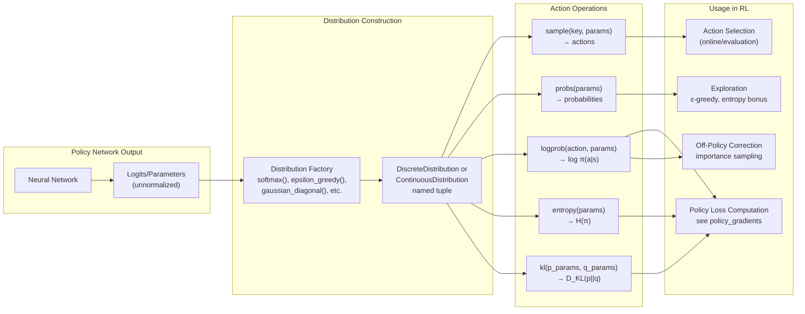
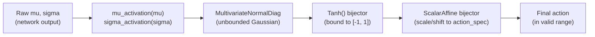

<!-- source: DeepWiki mcp.deepwiki.com · repo google-deepmind/rlax · page 4 Distributions and Action Selection · fetched 2026-10-26 -->

# Distributions and Action Selection

<details>
<summary>Relevant source files</summary>

The following files were used as context for generating this wiki page:

- [rlax/_src/distributions.py](rlax/_src/distributions.py)
- [rlax/_src/distributions_test.py](rlax/_src/distributions_test.py)

</details>


This page documents RLax's probability distribution infrastructure and action selection mechanisms. The distributions module provides a unified interface for working with both discrete and continuous action spaces, supporting common RL operations like sampling, log probability computation, entropy calculation, and KL divergence. 

**Scope**: This page covers the distribution abstractions, the relationship with the `distrax` library, and the overall architecture of action selection. For detailed information about specific distribution types, see:
- Discrete action distributions (softmax, epsilon-greedy, greedy): [Discrete Action Distributions](#4.1)
- Continuous action distributions (Gaussian, squashed Gaussian): [Continuous Action Distributions](#4.2)

For how distributions are used in policy optimization, see [Policy Optimization Methods](#5).

**Status**: The RLax distributions module is in a transitional state, with all functions showing pending deprecation warnings that recommend using `distrax` directly. The module currently serves as a compatibility wrapper over `distrax`.

---

## Distribution Abstractions

RLax defines two named tuple types that encapsulate the essential operations for discrete and continuous probability distributions.

### DiscreteDistribution

The `DiscreteDistribution` named tuple provides a standard interface for discrete action spaces:

```python
DiscreteDistribution = collections.namedtuple(
    "DiscreteDistribution", ["sample", "probs", "logprob", "entropy", "kl"])
```

**Fields**:
- `sample`: Function `(key, logits/preferences) -> action` to sample actions
- `probs`: Function `(logits/preferences) -> probabilities` to compute action probabilities
- `logprob`: Function `(action, logits/preferences) -> log_prob` to evaluate log probability
- `entropy`: Function `(logits/preferences) -> entropy` to compute distribution entropy
- `kl`: Function `(p_logits, q_logits) -> kl_div` to compute KL divergence (optional)

Sources: [rlax/_src/distributions.py:35-36]()

### ContinuousDistribution

The `ContinuousDistribution` named tuple provides the interface for continuous action spaces:

```python
ContinuousDistribution = collections.namedtuple(
    "ContinuousDistribution", ["sample", "prob", "logprob", "entropy",
                               "kl_to_standard_normal", "kl"])
```

**Fields**:
- `sample`: Function `(key, mu, sigma, ...) -> action` to sample continuous actions
- `prob`: Function `(action, mu, sigma, ...) -> probability` to compute probability density
- `logprob`: Function `(action, mu, sigma, ...) -> log_prob` to evaluate log probability
- `entropy`: Function `(mu, sigma, ...) -> entropy` to compute distribution entropy
- `kl_to_standard_normal`: Function `(mu, sigma) -> kl_div` for KL to standard normal
- `kl`: Function `(mu_0, sigma_0, mu_1, sigma_1) -> kl_div` for general KL divergence

Sources: [rlax/_src/distributions.py:37-39]()

---

## Distribution Architecture

```mermaid
graph TB
    subgraph "RLax Distribution Layer"
        RLAX_API["rlax.distributions API<br/>(Compatibility Layer)"]
        
        subgraph "Discrete Distributions"
            SOFT["softmax(temperature)<br/>→ DiscreteDistribution"]
            CLIP_SOFT["clipped_entropy_softmax()<br/>→ DiscreteDistribution"]
            GREEDY["greedy()<br/>→ DiscreteDistribution"]
            EPSG["epsilon_greedy(epsilon)<br/>→ DiscreteDistribution"]
        end
        
        subgraph "Continuous Distributions"
            GAUSS["gaussian_diagonal(sigma)<br/>→ ContinuousDistribution"]
            SQGAUSS["squashed_gaussian(sigma_min, sigma_max)<br/>→ ContinuousDistribution"]
        end
        
        subgraph "Utilities"
            CAT_SAMPLE["categorical_sample()"]
            IS_RATIOS["categorical_importance_sampling_ratios()"]
            CAT_CE["categorical_cross_entropy()"]
            CAT_KL["categorical_kl_divergence()"]
            MVN_KL["multivariate_normal_kl_divergence()"]
        end
    end
    
    subgraph "Distrax Library"
        DISTRAX_CAT["distrax.Categorical"]
        DISTRAX_SOFT["distrax.Softmax"]
        DISTRAX_GREEDY["distrax.Greedy"]
        DISTRAX_EPSG["distrax.EpsilonGreedy"]
        DISTRAX_MVN["distrax.MultivariateNormalDiag"]
        DISTRAX_TRANS["distrax.Transformed"]
        DISTRAX_CHAIN["distrax.Chain"]
        DISTRAX_TANH["distrax.Tanh"]
    end
    
    SOFT --> DISTRAX_SOFT
    CLIP_SOFT --> DISTRAX_SOFT
    GREEDY --> DISTRAX_GREEDY
    EPSG --> DISTRAX_EPSG
    GAUSS --> DISTRAX_MVN
    SQGAUSS --> DISTRAX_MVN
    SQGAUSS --> DISTRAX_TRANS
    SQGAUSS --> DISTRAX_CHAIN
    SQGAUSS --> DISTRAX_TANH
    
    CAT_SAMPLE --> DISTRAX_CAT
    IS_RATIOS --> DISTRAX_CAT
    CAT_CE --> DISTRAX_CAT
    CAT_KL --> DISTRAX_SOFT
    MVN_KL --> DISTRAX_MVN
    
    RLAX_API --> SOFT
    RLAX_API --> CLIP_SOFT
    RLAX_API --> GREEDY
    RLAX_API --> EPSG
    RLAX_API --> GAUSS
    RLAX_API --> SQGAUSS
    RLAX_API --> CAT_SAMPLE
    RLAX_API --> IS_RATIOS
    RLAX_API --> CAT_CE
    RLAX_API --> CAT_KL
    RLAX_API --> MVN_KL
```



**Figure 1: RLax Distributions as Wrappers Over Distrax**

The RLax distributions module acts as a compatibility layer that wraps `distrax` distributions. All distribution constructors in RLax return named tuples containing functions that internally delegate to corresponding `distrax` classes. This design provides a stable API while allowing users to migrate to `distrax` at their own pace.

Sources: [rlax/_src/distributions.py:1-348]()

---

## Action Selection Pipeline



**Figure 2: Action Selection and Distribution Usage Pipeline**

This diagram shows how neural network outputs are transformed into distributions, which are then used for various RL operations. The distribution named tuples provide a functional interface that separates distribution construction from its usage.

Sources: [rlax/_src/distributions.py:42-251]()

---

## Available Distributions

### Discrete Action Distributions

| Distribution | Constructor | Temperature/Epsilon | Use Case |
|-------------|-------------|---------------------|----------|
| Softmax | `softmax(temperature=1.)` | Temperature controls sharpness | Standard discrete policy |
| Clipped Entropy Softmax | `clipped_entropy_softmax(temperature=1., entropy_clip=1.)` | Clips entropy for stability | MPO/VMPO policies |
| Greedy | `greedy()` | N/A | Deterministic exploitation |
| Epsilon-Greedy | `epsilon_greedy(epsilon=None)` | Epsilon exploration rate | Value-based methods (DQN) |

**Key Properties**:
- All discrete distributions accept **logits** (unnormalized log probabilities) as input
- Temperature parameter in softmax scales the logits before softmax: `softmax(logits/temperature)`
- Higher temperature → more uniform distribution (more exploration)
- Lower temperature → sharper distribution (more exploitation)

Sources: [rlax/_src/distributions.py:52-154]()

### Continuous Action Distributions

| Distribution | Constructor | Parameters | Use Case |
|-------------|-------------|------------|----------|
| Gaussian Diagonal | `gaussian_diagonal(sigma=None)` | `mu` (mean), `sigma` (std) | Continuous control |
| Squashed Gaussian | `squashed_gaussian(sigma_min=-4, sigma_max=0.)` | `mu`, `sigma`, `action_spec` | Bounded continuous actions |

**Key Properties**:
- `gaussian_diagonal` uses a diagonal covariance matrix (independent action dimensions)
- `squashed_gaussian` applies a `tanh` transformation to bound actions to [-1, 1]
- If `action_spec` is provided to `squashed_gaussian`, actions are further scaled/shifted to match bounds
- Sigma activation: `exp(sigma_min + 0.5 * (sigma_max - sigma_min) * (tanh(sigma) + 1))`

Sources: [rlax/_src/distributions.py:157-251]()

---

## Distribution Operations

### Sampling

All distributions provide a `sample` function that takes a PRNG key and distribution parameters:

```python
# Discrete example
dist = rlax.softmax(temperature=1.0)
action = dist.sample(key, logits)  # Returns action index

# Continuous example
dist = rlax.gaussian_diagonal(sigma=0.1)
action = dist.sample(key, mu, sigma)  # Returns continuous action vector
```

Sources: [rlax/_src/distributions.py:60-61, 166-168]()

### Probability and Log Probability

Discrete distributions provide `probs` (probability mass function) and `logprob`:

```python
dist = rlax.softmax()
probs = dist.probs(logits)  # Action probabilities
log_prob = dist.logprob(action, logits)  # Log probability of action
```

Continuous distributions provide `prob` (probability density) and `logprob`:

```python
dist = rlax.gaussian_diagonal()
density = dist.prob(action, mu, sigma)
log_prob = dist.logprob(action, mu, sigma)
```

Sources: [rlax/_src/distributions.py:63-67, 170-176]()

### Entropy

Entropy measures the randomness/exploration level of a policy:

```python
dist = rlax.softmax()
H = dist.entropy(logits)  # Entropy in nats

# For clipped entropy softmax
dist = rlax.clipped_entropy_softmax(entropy_clip=0.5)
H = dist.entropy(logits)  # Clipped to 0.5 * log(num_actions)
```

**Clipped Entropy**: The `clipped_entropy_softmax` limits entropy to prevent excessive exploration:
```
H_clipped = min(H, entropy_clip * log(num_actions))
```

Sources: [rlax/_src/distributions.py:69-70, 99-102]()

### KL Divergence

KL divergence measures the difference between two distributions:

```python
# For discrete distributions
dist = rlax.softmax()
kl = dist.kl(p_logits, q_logits)  # D_KL(p || q)

# For continuous distributions
dist = rlax.gaussian_diagonal()
kl = dist.kl(mu_0, sigma_0, mu_1, sigma_1)

# KL to standard normal (useful for regularization)
kl_std = dist.kl_to_standard_normal(mu, sigma)
```

Sources: [rlax/_src/distributions.py:72-73, 188-191, 182-186]()

---

## Utility Functions

### Importance Sampling Ratios

Compute importance sampling ratios for off-policy corrections:

```python
rho = rlax.categorical_importance_sampling_ratios(
    pi_logits_t,  # Target policy logits
    mu_logits_t,  # Behavior policy logits
    a_t           # Actions taken
)
# rho[i] = π(a_t[i] | s_t) / μ(a_t[i] | s_t)
```

Used extensively in off-policy algorithms like V-trace (see [V-trace for Off-Policy Learning](#3.2)) and importance-weighted policy gradients.

Sources: [rlax/_src/distributions.py:253-272]()

### Categorical Cross Entropy

Compute cross entropy between label distribution and policy:

```python
loss = rlax.categorical_cross_entropy(
    labels,  # Target probability distribution
    logits   # Policy logits
)
# Equivalent to: sum_i(labels[i] * log_softmax(logits[i]))
```

Used in policy distillation (see [Policy Distillation and Targets](#5.3)) where you want to match a target policy.

Sources: [rlax/_src/distributions.py:275-300]()

### KL Divergence Functions

Standalone KL divergence functions for common cases:

```python
# Categorical KL
kl = rlax.categorical_kl_divergence(
    p_logits, q_logits, temperature=1.0
)

# Multivariate normal KL
kl = rlax.multivariate_normal_kl_divergence(
    mu_0, sigma_0, mu_1, sigma_1
)
```

These are used in constrained policy optimization methods like MPO (see [MPO and VMPO](#5.2)).

Sources: [rlax/_src/distributions.py:303-347]()

---

## Squashed Gaussian Details

The `squashed_gaussian` distribution is particularly important for continuous control with bounded action spaces. It chains multiple transformations:



**Figure 3: Squashed Gaussian Transformation Chain**

**Activation Functions**:
- `mu_activation(mu) = tanh(mu)` - bounds raw mu to [-1, 1]
- `sigma_activation(sigma) = exp(sigma_min + 0.5 * (sigma_max - sigma_min) * (tanh(sigma) + 1))`
  - Ensures sigma is positive and bounded

**Bijector Chain**:
1. Base distribution: `MultivariateNormalDiag(loc=mu_activation(mu), scale_diag=sigma_activation(sigma))`
2. `Tanh()`: Squashes to [-1, 1]
3. `ScalarAffine(shift=1.0)`: Shifts to [0, 2] (optional intermediate step)
4. `ScalarAffine(shift=action_spec.minimum, scale=0.5*(action_spec.maximum - action_spec.minimum))`: Final scaling

**Implementation Note**: Entropy is computed on the base Gaussian distribution (before squashing), not the transformed distribution, as computing the exact entropy of a transformed distribution is intractable.

Sources: [rlax/_src/distributions.py:197-250]()

---

## Integration with Other RLax Modules

### Policy Gradients

Distributions are central to policy gradient methods:

```python
# Policy gradient uses logprob
dist = rlax.softmax()
log_pi = dist.logprob(actions, logits)
policy_loss = -log_pi * advantages  # REINFORCE

# PPO uses ratio of probabilities
log_pi_old = dist.logprob(actions, old_logits)
ratio = jnp.exp(log_pi - log_pi_old)
```

See [Policy Gradient Losses](#5.1) for details.

### MPO/VMPO

Maximum a Posteriori Policy Optimization uses KL constraints:

```python
dist = rlax.clipped_entropy_softmax()
kl = dist.kl(p_logits, q_logits)  # KL constraint
H = dist.entropy(p_logits)  # Entropy regularization
```

See [MPO and VMPO](#5.2) for the full algorithm.

### Exploration

The exploration module may use distributions for exploration strategies:

```python
# Epsilon-greedy exploration
dist = rlax.epsilon_greedy(epsilon=0.1)
action = dist.sample(key, q_values)

# Entropy-based exploration
dist = rlax.softmax(temperature=2.0)  # Higher temp = more exploration
entropy_bonus = -entropy_coeff * dist.entropy(logits)
```

Sources: [rlax/_src/distributions.py:134-154]()

---

## Migration to Distrax

All functions in the `rlax.distributions` module emit `PendingDeprecationWarning` messages, indicating that users should migrate to `distrax` directly. The warnings provide specific migration paths:

| RLax Function | Distrax Equivalent |
|--------------|-------------------|
| `rlax.categorical_sample()` | `distrax.Categorical.sample()` |
| `rlax.softmax()` | `distrax.Softmax` |
| `rlax.greedy()` | `distrax.Greedy` |
| `rlax.epsilon_greedy()` | `distrax.EpsilonGreedy` |
| `rlax.gaussian_diagonal()` | `distrax.MultivariateNormalDiag` |
| `rlax.squashed_gaussian()` | `distrax.Transformed` with `MultivariateNormalDiag` + `Chain([ScalarAffine, Tanh])` |
| `rlax.categorical_importance_sampling_ratios()` | `distrax.importance_sampling_ratios()` |
| `rlax.categorical_cross_entropy()` | `distrax.Categorical.cross_entropy()` |
| `rlax.categorical_kl_divergence()` | `distrax.Softmax.kl_divergence()` |
| `rlax.multivariate_normal_kl_divergence()` | `distrax.MultivariateNormalDiag.kl_divergence()` |

**Migration Example**:

```python
# Old RLax API
dist = rlax.softmax(temperature=1.0)
action = dist.sample(key, logits)
log_prob = dist.logprob(action, logits)

# New Distrax API
dist = distrax.Softmax(logits, temperature=1.0)
action = dist.sample(seed=key)
log_prob = dist.log_prob(action)
```

**Key Differences**:
- Distrax distributions are objects instantiated with parameters, not factory functions returning named tuples
- Distrax uses `seed=` kwarg instead of positional `key`
- Distrax has richer functionality (more distribution types, better batching support, bijectors)

Sources: [rlax/_src/distributions.py:44-47, 54-58, 82-86, 113-117, 138-141, 160-164, 200-205, 266-270, 294-298, 319-322, 342-345]()

---

## Testing

The distributions module has comprehensive tests covering all distribution types and operations. Tests verify:

- **Correctness**: Numerical outputs match expected values from reference implementations
- **Batching**: All operations correctly handle batched inputs
- **Edge cases**: Invalid distributions, boundary conditions
- **Integration**: Compatibility with JAX transformations (vmap, jit, grad)

Test organization:
- `CategoricalSampleTest`: Tests for `categorical_sample`
- `SoftmaxTest`: Tests for `softmax` and `clipped_entropy_softmax`
- `GreedyTest`: Tests for `greedy`
- `EpsilonGreedyTest`: Tests for `epsilon_greedy`
- `GaussianDiagonalTest`: Tests for `gaussian_diagonal`
- `SquashedGaussianTest`: Tests for `squashed_gaussian`
- `ImportanceSamplingTest`: Tests for importance sampling ratios
- `CategoricalKLTest`: Tests for KL divergence
- `CategoricalCrossEntropyTest`: Tests for cross entropy
- `MultivariateNormalKLTest`: Tests for multivariate normal KL

Sources: [rlax/_src/distributions_test.py:1-605]()

---

## Summary

The RLax distributions module provides:

1. **Unified Interface**: Named tuple abstractions (`DiscreteDistribution`, `ContinuousDistribution`) that standardize distribution operations
2. **Common Distributions**: Both discrete (softmax, epsilon-greedy, greedy) and continuous (Gaussian, squashed Gaussian) action distributions
3. **RL-Specific Utilities**: Importance sampling ratios, KL divergence, cross entropy for policy optimization
4. **Compatibility Layer**: Wrappers over `distrax` that allow gradual migration
5. **Action Selection**: Complete pipeline from network outputs to sampled actions

**Current Status**: The module is stable but deprecated. Users are encouraged to migrate to `distrax` for new projects while existing code continues to work with deprecation warnings.

**Next Steps**: 
- For discrete action space details, see [Discrete Action Distributions](#4.1)
- For continuous action space details, see [Continuous Action Distributions](#4.2)
- For policy optimization using distributions, see [Policy Optimization Methods](#5)

Sources: [rlax/_src/distributions.py:1-348]()

---

