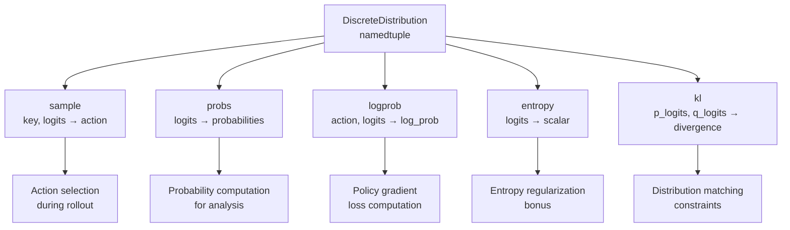
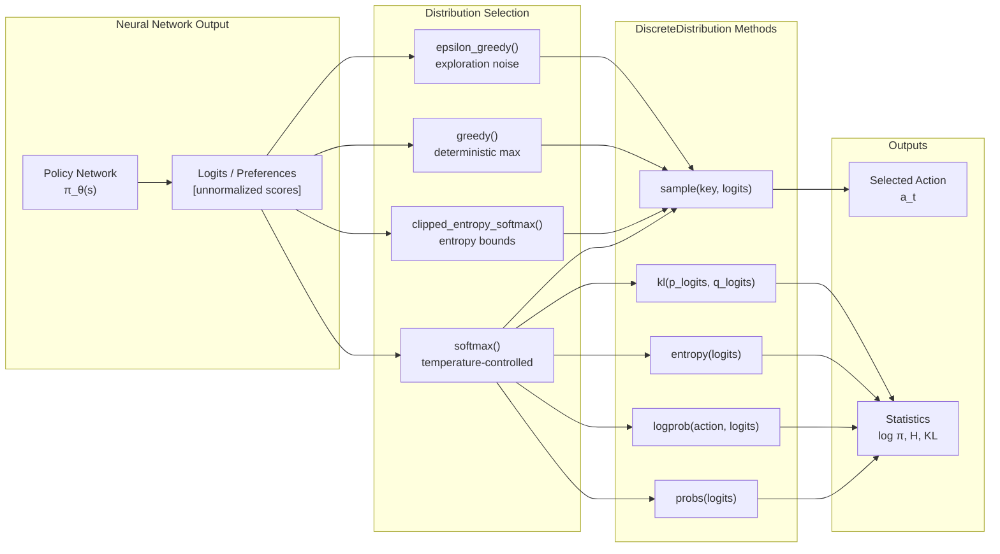
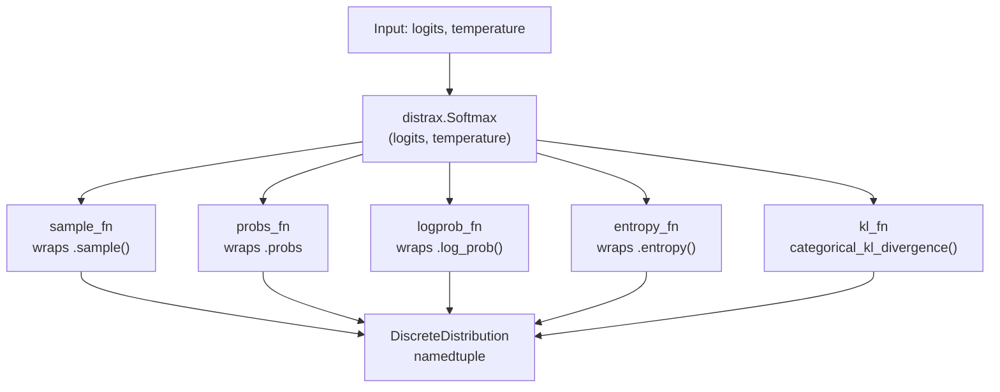
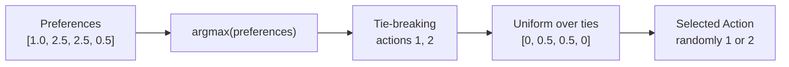
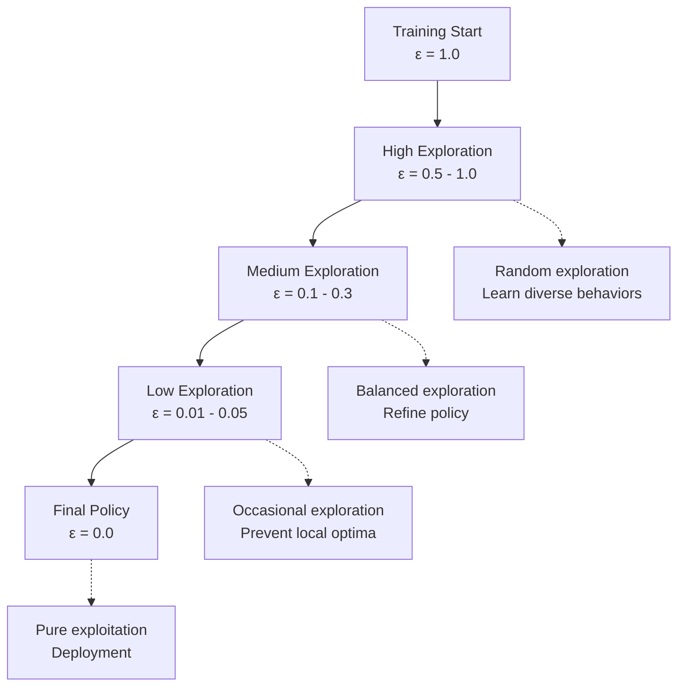
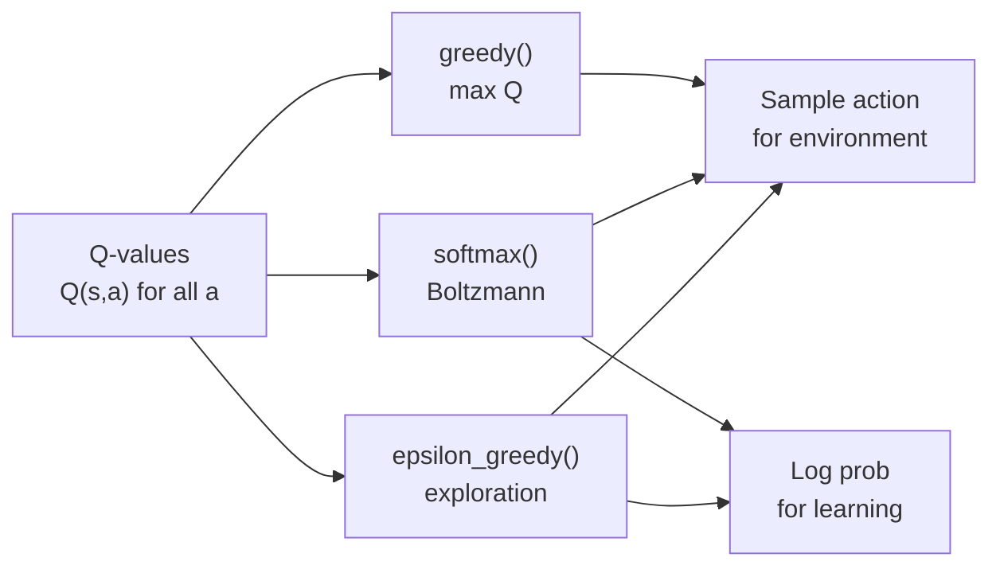

<!-- source: DeepWiki mcp.deepwiki.com · repo google-deepmind/rlax · page 4.1 Discrete Action Distributions · fetched 2026-10-26 -->

# Discrete Action Distributions

<details>
<summary>Relevant source files</summary>

The following files were used as context for generating this wiki page:

- [rlax/_src/distributions.py](rlax/_src/distributions.py)
- [rlax/_src/distributions_test.py](rlax/_src/distributions_test.py)

</details>


## Purpose and Scope

This page documents RLax's discrete action distribution implementations for environments with discrete action spaces. These distributions are used to select actions from a finite set of options, compute log probabilities for policy gradient methods, and evaluate distribution statistics like entropy and KL divergence.

The discrete distributions covered here include softmax (with temperature control), greedy, and epsilon-greedy policies. For continuous action spaces (e.g., robotic control), see [Continuous Action Distributions](#4.2). For how these distributions integrate with policy gradient algorithms, see [Policy Gradient Losses](#5.1).

**Important**: All functions in this module are wrappers around the `distrax` library and are marked for deprecation. Users are encouraged to use `distrax` directly for new code, though RLax continues to provide these wrappers for backward compatibility.

Sources: [rlax/_src/distributions.py:15-22](), [rlax/_src/distributions.py:35-39]()

---

## DiscreteDistribution Structure

All discrete distributions in RLax follow a common interface defined by the `DiscreteDistribution` namedtuple, which packages five core operations:



| Method | Input | Output | Purpose |
|--------|-------|--------|---------|
| `sample` | `key: Array, logits: Array` | `action: Array` | Sample action from distribution using JAX random key |
| `probs` | `logits: Array` | `probs: Array` | Convert unnormalized logits to probability distribution |
| `logprob` | `sample: Array, logits: Array` | `log_prob: Array` | Compute log probability of given action |
| `entropy` | `logits: Array` | `entropy: Array` | Compute Shannon entropy of distribution |
| `kl` | `p_logits: Array, q_logits: Array` | `kl_div: Array` | Compute KL divergence between two distributions |

**Note**: The `kl` method may be `None` for distributions that don't support KL divergence computation (e.g., `greedy` and `epsilon_greedy`).

Sources: [rlax/_src/distributions.py:35-36]()

---

## Distribution Types and Action Selection Flow



Sources: [rlax/_src/distributions.py:52-154]()

---

## Softmax Distribution

The `softmax` function creates a temperature-controlled categorical distribution over discrete actions. The temperature parameter controls the sharpness of the probability distribution.

### Function Signature

```python
softmax(temperature=1.) -> DiscreteDistribution
```

### Mathematical Formulation

Given logits $z = [z_1, z_2, ..., z_n]$, the softmax distribution computes:

$$\pi(a_i | z) = \frac{\exp(z_i / \tau)}{\sum_{j=1}^{n} \exp(z_j / \tau)}$$

where $\tau$ is the temperature parameter.

### Temperature Effects

| Temperature ($\tau$) | Effect | Use Case |
|---------------------|--------|----------|
| $\tau \to 0$ | Sharp, near-deterministic | Exploitation, testing |
| $\tau = 1$ | Standard softmax | Default behavior |
| $\tau > 1$ | Smoother, more exploration | Early training, high entropy |
| $\tau \to \infty$ | Uniform distribution | Maximum exploration |

### Implementation Details



**Deprecation Note**: This function wraps `distrax.Softmax`. Users should migrate to using `distrax.Softmax` directly.

Sources: [rlax/_src/distributions.py:52-76]()

### Entropy Computation

The entropy of a softmax distribution measures the uncertainty in action selection:

$$H(\pi) = -\sum_{i=1}^{n} \pi(a_i) \log \pi(a_i)$$

Higher entropy indicates more exploration, while lower entropy indicates more deterministic behavior.

Sources: [rlax/_src/distributions.py:69-70](), [rlax/_src/distributions_test.py:136-167]()

---

## Clipped Entropy Softmax

The `clipped_entropy_softmax` function extends the standard softmax with an entropy clipping mechanism to prevent the distribution from becoming too uniform.

### Function Signature

```python
clipped_entropy_softmax(temperature=1., entropy_clip=1.) -> DiscreteDistribution
```

### Entropy Clipping Formula

The entropy is clipped according to:

$$H_{\text{clipped}} = \min(H(\pi), \ \text{entropy\_clip} \times \log(n))$$

where $n$ is the number of actions and $\log(n)$ is the maximum possible entropy for a uniform distribution.

### Clipping Behavior

| `entropy_clip` | Maximum Entropy | Interpretation |
|----------------|-----------------|----------------|
| `1.0` | $\log(n)$ | No clipping (full uniform allowed) |
| `0.5` | $0.5 \times \log(n)$ | Prevents excessive uniformity |
| `0.9` | $0.9 \times \log(n)$ | Mild clipping |

Sources: [rlax/_src/distributions.py:79-108](), [rlax/_src/distributions_test.py:147-155]()

---

## Greedy Policy

The `greedy` function creates a deterministic policy that always selects the action with the highest preference score. When multiple actions have the same maximum value, it breaks ties uniformly.

### Function Signature

```python
greedy() -> DiscreteDistribution
```

### Behavior



### Properties

- **Deterministic (usually)**: Selects the maximum-valued action
- **Tie-breaking**: Uniform random selection among tied maxima
- **Zero entropy**: $H = 0$ when no ties exist, $H = -\log(k)$ when $k$ actions are tied
- **No KL support**: The `kl` method returns `None`

### Example Outputs

| Preferences | Probabilities | Entropy |
|-------------|---------------|---------|
| `[1, 2, 0]` | `[0, 1, 0]` | `0` |
| `[1, 1, 0]` | `[0.5, 0.5, 0]` | `0.693` |
| `[1, 1, 1]` | `[0.33, 0.33, 0.33]` | `1.099` |

Sources: [rlax/_src/distributions.py:111-131](), [rlax/_src/distributions_test.py:170-244]()

---

## Epsilon-Greedy Policy

The `epsilon_greedy` function creates a policy that selects the greedy action with probability $(1-\epsilon)$ and a random action with probability $\epsilon$. This is a classic exploration strategy in reinforcement learning.

### Function Signature

```python
epsilon_greedy(epsilon=None) -> DiscreteDistribution
```

### Probability Distribution

Given preferences $z$ with greedy action $a^* = \arg\max_a z_a$:

$$\pi(a | z, \epsilon) = \begin{cases}
1 - \epsilon + \frac{\epsilon}{n} & \text{if } a = a^* \\
\frac{\epsilon}{n} & \text{otherwise}
\end{cases}$$

where $n$ is the number of actions.

### Exploration Scheduling



### Example Behavior

With `epsilon=0.2` and 4 actions, preferences `[1, 2, 0, 0]`:

| Action | Is Greedy | Probability | Calculation |
|--------|-----------|-------------|-------------|
| 0 | No | 0.05 | $\epsilon / 4 = 0.2 / 4$ |
| 1 | Yes | 0.85 | $1 - \epsilon + \epsilon / 4 = 0.8 + 0.05$ |
| 2 | No | 0.05 | $\epsilon / 4$ |
| 3 | No | 0.05 | $\epsilon / 4$ |

Sources: [rlax/_src/distributions.py:134-154](), [rlax/_src/distributions_test.py:247-322]()

---

## Statistical Operations

### KL Divergence

The `categorical_kl_divergence` function computes the KL divergence between two categorical distributions specified by their logits:

$$\text{KL}(P \| Q) = \sum_i P(i) \log \frac{P(i)}{Q(i)}$$

**Function**: `categorical_kl_divergence(p_logits, q_logits, temperature=1.)`

This is used for:
- Policy distillation (matching a student policy to a teacher)
- MPO/VMPO KL constraints (see [MPO and VMPO](#5.2))
- Trust region optimization

Sources: [rlax/_src/distributions.py:303-324](), [rlax/_src/distributions_test.py:537-560]()

### Cross-Entropy

The `categorical_cross_entropy` function computes the cross-entropy loss between label probabilities and predicted logits:

$$H(P, Q) = -\sum_i P(i) \log Q(i)$$

**Function**: `categorical_cross_entropy(labels, logits)`

**Use cases**:
- Supervised learning of policies from demonstrations
- Policy distillation losses
- Classification-style auxiliary tasks

Sources: [rlax/_src/distributions.py:275-300](), [rlax/_src/distributions_test.py:563-580]()

### Importance Sampling Ratios

The `categorical_importance_sampling_ratios` function computes the importance sampling ratio for off-policy correction:

$$\rho_t = \frac{\pi(a_t | s_t)}{\mu(a_t | s_t)}$$

**Function**: `categorical_importance_sampling_ratios(pi_logits_t, mu_logits_t, a_t)`

This ratio is critical for:
- V-trace off-policy correction (see [V-trace for Off-Policy Learning](#3.2))
- Importance-weighted policy gradients
- Off-policy evaluation

Sources: [rlax/_src/distributions.py:253-272](), [rlax/_src/distributions_test.py:513-534]()

---

## Integration with RLax Algorithms

### Value-Based Learning

Discrete distributions are used in value-based methods for action selection:



Sources: [rlax/_src/distributions.py:111-154]()

### Policy Gradient Methods

For policy gradient algorithms, the discrete distributions provide:

1. **Action sampling**: During environment interaction
2. **Log probability**: For computing $\nabla \log \pi(a|s)$ in REINFORCE
3. **Entropy**: For entropy regularization bonus
4. **KL divergence**: For trust region constraints

**Example integration** (conceptual):

```
logits = policy_network(state)
distribution = rlax.softmax(temperature=1.0)

# During rollout
action = distribution.sample(rng_key, logits)

# During learning
log_prob = distribution.logprob(action, logits)
entropy = distribution.entropy(logits)
pg_loss = -log_prob * advantage - entropy_coef * entropy
```

See [Policy Gradient Losses](#5.1) for detailed usage in policy optimization.

Sources: [rlax/_src/distributions.py:52-76]()

---

## Comparison Table

| Distribution | Exploration | Entropy | Temperature | KL Support | Typical Use |
|--------------|-------------|---------|-------------|------------|-------------|
| `softmax` | Continuous | Variable | Yes | Yes | Policy gradients, Boltzmann exploration |
| `clipped_entropy_softmax` | Controlled | Bounded | Yes | Yes | Preventing collapse to uniform |
| `greedy` | None | 0 (or small) | No | No | Evaluation, deterministic policies |
| `epsilon_greedy` | Binary | Medium | No | No | DQN, Q-learning exploration |

---

## Deprecation and Migration

All functions in `rlax._src.distributions` are deprecated wrappers around `distrax`. To migrate:

| RLax (deprecated) | Distrax (recommended) |
|-------------------|----------------------|
| `rlax.softmax(temp)` | `distrax.Softmax(logits, temp)` |
| `rlax.greedy()` | `distrax.Greedy(preferences)` |
| `rlax.epsilon_greedy(eps)` | `distrax.EpsilonGreedy(preferences, eps)` |
| `rlax.categorical_sample(key, probs)` | `distrax.Categorical(probs).sample(seed=key)` |
| `rlax.categorical_kl_divergence(p, q, temp)` | `distrax.Softmax(p, temp).kl_divergence(distrax.Softmax(q, temp))` |

**Migration example**:

```python
# Old RLax code
dist = rlax.softmax(temperature=0.5)
action = dist.sample(key, logits)
log_prob = dist.logprob(action, logits)

# New distrax code
dist = distrax.Softmax(logits, temperature=0.5)
action = dist.sample(seed=key)
log_prob = dist.log_prob(action)
```

Sources: [rlax/_src/distributions.py:44-48](), [rlax/_src/distributions.py:54-58](), [rlax/_src/distributions.py:113-117](), [rlax/_src/distributions.py:136-141]()

---

## Summary

Discrete action distributions in RLax provide a unified interface for action selection in finite action spaces. The key distributions are:

- **Softmax**: Temperature-controlled stochastic policies for policy gradients
- **Epsilon-greedy**: Classic exploration strategy for Q-learning
- **Greedy**: Deterministic exploitation for evaluation

All distributions return a `DiscreteDistribution` namedtuple with methods for sampling, probability computation, log probabilities, entropy, and KL divergence. These primitives integrate with RLax's value learning (see [Basic Value Learning](#2.1)) and policy optimization modules (see [Policy Gradient Losses](#5.1)).

Users should prefer `distrax` directly for new code, as RLax's distribution wrappers are deprecated.

Sources: [rlax/_src/distributions.py:1-348]()

---

