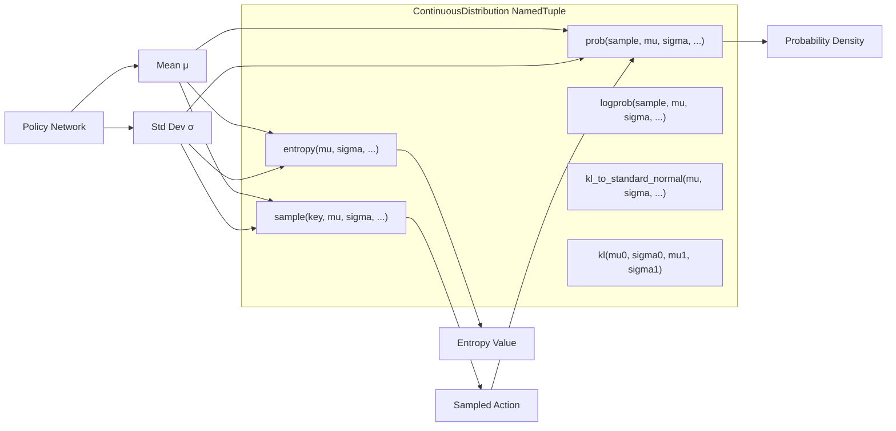
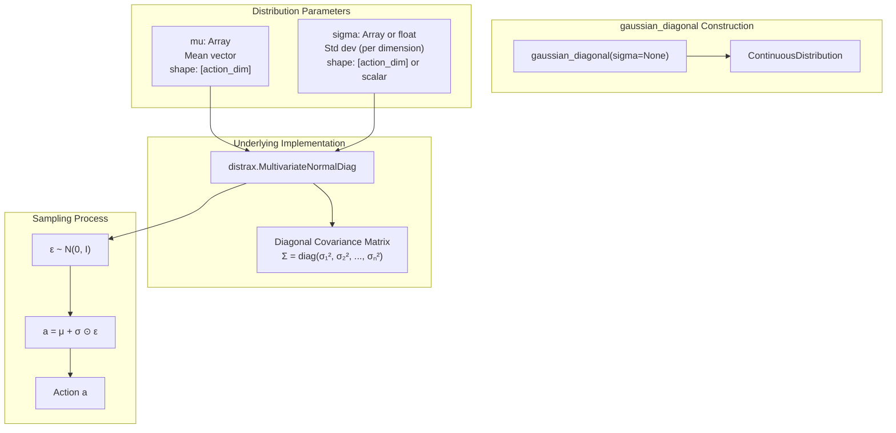
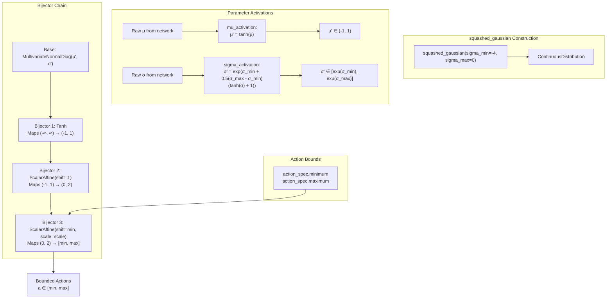
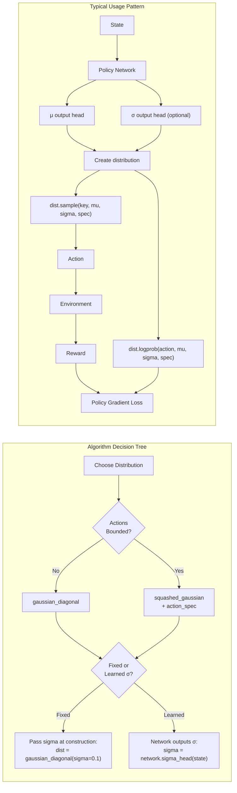

<!-- source: DeepWiki mcp.deepwiki.com · repo google-deepmind/rlax · page 4.2 Continuous Action Distributions · fetched 2026-10-26 -->

# Continuous Action Distributions

<details>
<summary>Relevant source files</summary>

The following files were used as context for generating this wiki page:

- [rlax/_src/distributions.py](rlax/_src/distributions.py)
- [rlax/_src/distributions_test.py](rlax/_src/distributions_test.py)

</details>


This page documents RLax's support for continuous action distributions used in continuous control tasks. These distributions are essential for policy gradient methods in robotics, physics simulation, and other domains with continuous action spaces.

**Scope**: This page covers `gaussian_diagonal` and `squashed_gaussian` distributions, their parameter representations, sampling procedures, and probability computations. For discrete action distributions (softmax, epsilon-greedy), see [Discrete Action Distributions](#4.1). For policy gradient algorithms that use these distributions, see [Policy Optimization Methods](#5).

## Overview

RLax provides two primary continuous action distributions through wrapper functions over the `distrax` library:

| Distribution | Use Case | Action Bounds | Key Features |
|--------------|----------|---------------|--------------|
| `gaussian_diagonal` | Unbounded actions | None | Simple multivariate normal with diagonal covariance |
| `squashed_gaussian` | Bounded actions | Via action_spec | Transformed distribution with tanh squashing |

Both distributions return a `ContinuousDistribution` namedtuple providing a consistent interface for sampling, probability evaluation, entropy computation, and KL divergence calculation.

**Deprecation Notice**: These functions are wrappers over `distrax` and will be deprecated in future versions. Users are encouraged to migrate to `distrax.MultivariateNormalDiag` and `distrax.Transformed` directly.

Sources: [rlax/_src/distributions.py:37-39](), [rlax/_src/distributions.py:157-250]()

## Continuous Distribution Interface



**ContinuousDistribution Interface**

The `ContinuousDistribution` namedtuple [rlax/_src/distributions.py:37-39]() provides six functions:

1. **sample(key, mu, sigma, ...)**: Sample actions from the distribution
2. **prob(sample, mu, sigma, ...)**: Compute probability density at a sample
3. **logprob(sample, mu, sigma, ...)**: Compute log probability density
4. **entropy(mu, sigma, ...)**: Compute distribution entropy
5. **kl_to_standard_normal(mu, sigma, ...)**: KL divergence to standard normal N(0, I)
6. **kl(mu_0, sigma_0, mu_1, sigma_1)**: KL divergence between two distributions

All functions accept distribution parameters (mean `mu` and standard deviation `sigma`) as arrays. The `sigma` parameter can be specified at construction time as a default or passed at call time.

Sources: [rlax/_src/distributions.py:37-39]()

## Gaussian Diagonal Distribution



**Purpose and Use Cases**

The `gaussian_diagonal` function [rlax/_src/distributions.py:157-194]() creates a multivariate Gaussian distribution with a diagonal covariance matrix. This distribution is suitable for:

- Continuous control tasks with unbounded action spaces
- Environments where actions can take any real value (e.g., joint torques)
- Algorithms like DDPG, TD3, or SAC (when not using bounded actions)

**Diagonal Covariance**: The distribution assumes independence between action dimensions, meaning each action component has its own variance but no correlation with other components. This simplifies computation and reduces parameter count from O(n²) to O(n) for n-dimensional actions.

**Implementation Details**

The function creates a distribution using `distrax.MultivariateNormalDiag` [rlax/_src/distributions.py:167-191]():

- **Mean (mu)**: Direct output from the policy network, representing the expected action
- **Standard Deviation (sigma)**: Either fixed at construction time or parameterized per-dimension
  - Can be a scalar (same std dev for all dimensions)
  - Can be a vector (independent std dev per dimension)
  - Typically `jnp.ones_like(mu) * sigma` to create diagonal covariance

**Key Functions**:

1. **sample_fn** [rlax/_src/distributions.py:166-168](): Samples from N(mu, sigma²I)
2. **prob_fn** [rlax/_src/distributions.py:170-172](): Computes probability density p(a|mu, sigma)
3. **logprob_fn** [rlax/_src/distributions.py:174-176](): Computes log p(a|mu, sigma)
4. **entropy_fn** [rlax/_src/distributions.py:178-180](): Computes H[p] = ½log((2πe)ⁿ|Σ|)
5. **kl_to_standard_normal_fn** [rlax/_src/distributions.py:182-186](): KL[N(mu,sigma²I) || N(0,I)]
6. **kl_fn** [rlax/_src/distributions.py:188-191](): KL[N(mu₀,sigma₀²I) || N(mu₁,sigma₁²I)]

Sources: [rlax/_src/distributions.py:157-194]()

## Squashed Gaussian Distribution



**Purpose and Use Cases**

The `squashed_gaussian` function [rlax/_src/distributions.py:197-250]() creates a transformed Gaussian distribution that produces bounded actions. This is essential for:

- Environments with explicit action bounds (e.g., robot joint angles, motor speeds)
- SAC (Soft Actor-Critic) and similar algorithms that require bounded action spaces
- Preventing actions from causing environment errors or physical violations

**Parameter Activations**

The distribution applies non-linear transformations to the raw network outputs [rlax/_src/distributions.py:207-212]():

1. **sigma_activation** [rlax/_src/distributions.py:207-209]():
   ```
   σ' = exp(σ_min + 0.5 * (σ_max - σ_min) * (tanh(σ) + 1))
   ```
   - Maps raw sigma to (exp(sigma_min), exp(sigma_max))
   - Default: sigma_min=-4, sigma_max=0 gives range (0.018, 1.0)
   - Prevents degenerate distributions (too small sigma) or excessive variance

2. **mu_activation** [rlax/_src/distributions.py:211-212]():
   ```
   μ' = tanh(μ)
   ```
   - Squashes mean to (-1, 1) before applying bijectors
   - Base distribution operates in pre-squashed space

**Bijector Composition**

The distribution uses `distrax.Transformed` with a chain of bijectors [rlax/_src/distributions.py:214-226]():

| Bijector | Purpose | Transformation |
|----------|---------|----------------|
| `Tanh()` | Squash to (-1, 1) | y = tanh(x) |
| `ScalarAffine(shift=1.0)` | Shift to (0, 2) | y = x + 1 |
| `ScalarAffine(shift=min, scale=scale)` | Scale to [min, max] | y = shift + scale * x |

When `action_spec` is provided [rlax/_src/distributions.py:215-220]():
- `scale = 0.5 * (action_spec.maximum - action_spec.minimum)`
- `shift = action_spec.minimum`
- Final range: [action_spec.minimum, action_spec.maximum]

When `action_spec` is None [rlax/_src/distributions.py:221-222](), only `Tanh()` is applied, keeping actions in (-1, 1).

**Probability Correction**

The bijector automatically applies the change-of-variables formula for probability densities:
```
log p(a) = log p_base(f⁻¹(a)) - log|det(∂f⁻¹/∂a)|
```

This ensures that `logprob_fn` correctly computes the density in the transformed (bounded) space.

Sources: [rlax/_src/distributions.py:197-250]()

## Comparison and Usage Patterns



**Choosing Between Distributions**

| Criterion | gaussian_diagonal | squashed_gaussian |
|-----------|-------------------|-------------------|
| Action bounds | None (unbounded) | Required via action_spec |
| Algorithms | DDPG, TD3, PPO (unbounded) | SAC, TD3 (bounded variant) |
| Parameter activation | None | tanh(mu), exp-bounded(sigma) |
| Complexity | Simple | More complex (bijectors) |
| Probability computation | Direct | Includes Jacobian correction |

**Common Usage Pattern**

1. **Construction**: Create distribution function once
   ```python
   # Example (not actual code, for illustration):
   dist = rlax.gaussian_diagonal(sigma=0.1)  # Fixed sigma
   # or
   dist = rlax.squashed_gaussian()  # For bounded actions
   ```

2. **Per-step sampling**: Call sample with network outputs
   ```python
   # Network produces mu (and optionally sigma)
   action = dist.sample(key, mu, sigma, action_spec)
   ```

3. **Loss computation**: Evaluate log probability for policy gradients
   ```python
   log_prob = dist.logprob(action, mu, sigma, action_spec)
   loss = -log_prob * advantage  # Policy gradient
   ```

4. **Regularization**: Add entropy bonus
   ```python
   entropy = dist.entropy(mu, sigma)
   loss = policy_loss - entropy_coeff * entropy
   ```

Sources: [rlax/_src/distributions.py:157-250](), [rlax/_src/distributions_test.py:325-511]()

## Implementation Examples from Tests

The test suite [rlax/_src/distributions_test.py:325-511]() demonstrates typical usage patterns:

**Gaussian Diagonal Test Setup** [rlax/_src/distributions_test.py:327-348]():
- Uses batch of means: `mu = [[1., -1], [0.1, -0.1]]`
- Tests with different sigma per dimension: `sigma = [[0.1, 0.1], [0.2, 0.3]]`
- Validates probability, log probability, entropy against TensorFlow Probability

**Squashed Gaussian Test Setup** [rlax/_src/distributions_test.py:434-458]():
- Defines action_spec with bounds: `minimum=[-1.0]`, `maximum=[2.0]`
- Configures sigma range: `sigma_min=0.0`, `sigma_max=2.0`
- Tests bounded sampling and probability computations with Jacobian corrections

**KL Divergence Tests**:
- **kl_to_standard_normal** [rlax/_src/distributions_test.py:422-429](): Measures divergence from N(0, I), useful for regularization
- **kl between distributions** [rlax/_src/distributions_test.py:413-419](): Compares two policies, used in trust region methods

Sources: [rlax/_src/distributions_test.py:325-511]()

## Migration to Distrax

All functions in this module emit deprecation warnings [rlax/_src/distributions.py:160-163, 200-204]() and are thin wrappers over `distrax`:

**Direct Distrax Equivalents**:

| RLax Function | Distrax Equivalent |
|---------------|-------------------|
| `gaussian_diagonal(sigma)` | `distrax.MultivariateNormalDiag(mu, ones_like(mu) * sigma)` |
| `squashed_gaussian()` | `distrax.Transformed(MultivariateNormalDiag(...), Chain([Tanh(), ScalarAffine(...)]))` |

The transition involves:
1. Import `distrax` instead of using `rlax.gaussian_diagonal` / `rlax.squashed_gaussian`
2. Create distributions directly using `distrax` classes
3. Use `distrax` distribution methods (`.sample()`, `.log_prob()`, etc.) instead of calling namedtuple functions

**Benefits of Direct Distrax Usage**:
- More distributions available (Beta, Gamma, Student-t, etc.)
- Richer bijector library for custom transformations
- Better integration with JAX ecosystem
- Ongoing maintenance and feature additions

Sources: [rlax/_src/distributions.py:160-163](), [rlax/_src/distributions.py:200-204]()

## Key Takeaways

1. **ContinuousDistribution Interface**: Provides uniform API for sample, prob, logprob, entropy, and KL computations
2. **gaussian_diagonal**: Simple unbounded Gaussian with diagonal covariance, suitable for unconstrained action spaces
3. **squashed_gaussian**: Transformed Gaussian for bounded actions, uses tanh and affine bijectors with proper Jacobian corrections
4. **Diagonal Covariance**: Assumes independent action dimensions to reduce parameters from O(n²) to O(n)
5. **Parameter Activations**: squashed_gaussian applies tanh to mu and bounded-exp to sigma for numerical stability
6. **Migration Path**: These are deprecated wrappers; migrate to `distrax.MultivariateNormalDiag` and `distrax.Transformed`

Sources: [rlax/_src/distributions.py:37-250]()

---

