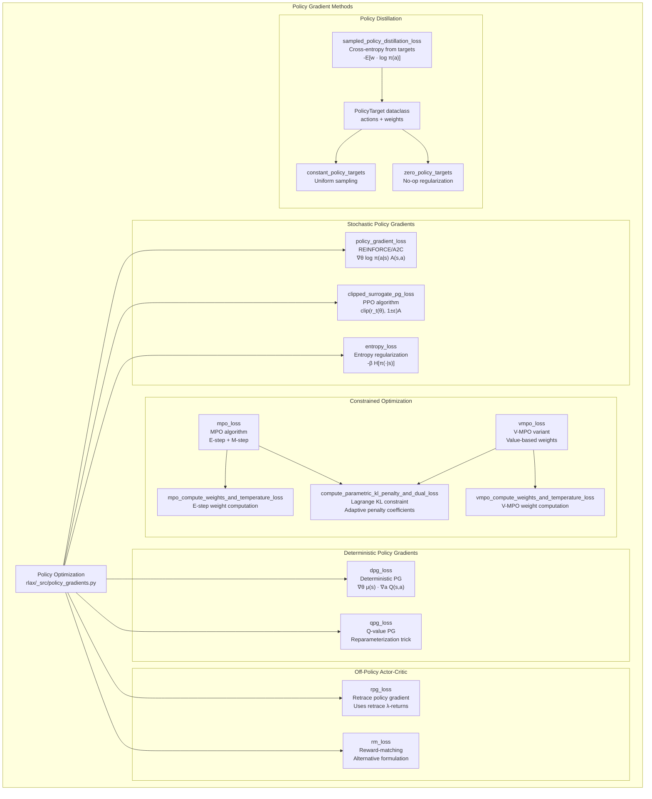
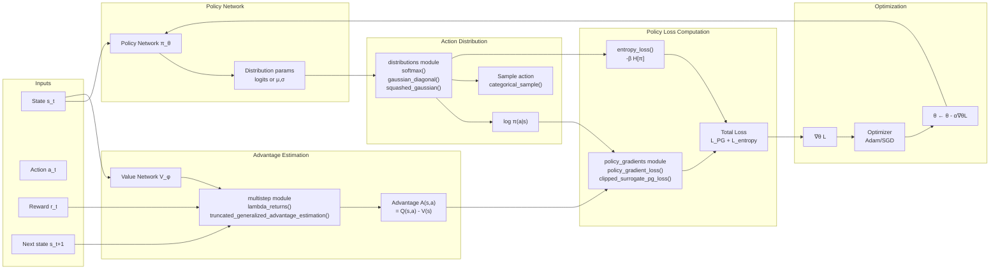
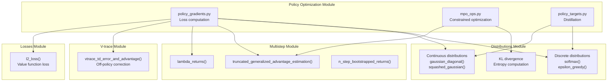

<!-- source: DeepWiki mcp.deepwiki.com · repo google-deepmind/rlax · page 5 Policy Optimization Methods · fetched 2026-10-26 -->

# Policy Optimization Methods

<details>
<summary>Relevant source files</summary>

The following files were used as context for generating this wiki page:

- [docs/api.rst](docs/api.rst)
- [rlax/__init__.py](rlax/__init__.py)
- [rlax/_src/policy_targets.py](rlax/_src/policy_targets.py)
- [rlax/_src/policy_targets_test.py](rlax/_src/policy_targets_test.py)

</details>


## Purpose and Scope

This page provides an overview of policy optimization methods available in RLax, covering algorithms that directly optimize policy parameters through gradient-based updates. These methods form one of the two main branches of reinforcement learning (the other being value-based methods covered in [Value-Based Learning](#2)).

**Coverage:**
- Basic policy gradient losses (REINFORCE, PPO, entropy regularization)
- Deterministic policy gradients (DPG, QPG)
- Advanced constrained optimization (MPO, VMPO)
- Policy distillation and target policies

**Related Pages:**
- For detailed explanation of policy gradient loss functions, see [Policy Gradient Losses](#5.1)
- For MPO and VMPO algorithms, see [MPO and VMPO](#5.2)
- For policy distillation techniques, see [Policy Distillation and Targets](#5.3)
- For action distributions used with policy gradients, see [Distributions and Action Selection](#4)
- For advantage estimation (GAE) used in actor-critic methods, see [Lambda Returns and GAE](#3.1)

## Overview

Policy optimization methods in RLax directly parameterize and optimize policies π(a|s) using gradient ascent on expected return. Unlike value-based methods that learn Q(s,a) and derive policies implicitly, policy gradient algorithms maintain an explicit policy network and update it based on trajectory data.

RLax provides modular building blocks for policy optimization organized into three main categories:

| Category | Functions | Use Cases |
|----------|-----------|-----------|
| **Basic Policy Gradients** | `policy_gradient_loss`, `clipped_surrogate_pg_loss`, `entropy_loss` | REINFORCE, A2C, PPO |
| **Deterministic Gradients** | `dpg_loss`, `qpg_loss` | Continuous control (DDPG, TD3) |
| **Constrained Optimization** | `mpo_loss`, `vmpo_loss`, `compute_parametric_kl_penalty_and_dual_loss` | Sample-efficient learning with KL constraints |
| **Policy Distillation** | `sampled_policy_distillation_loss`, `PolicyTarget`, `constant_policy_targets` | Transfer learning, regularization |
| **Retrace-based** | `rpg_loss`, `rm_loss` | Off-policy actor-critic |

These functions are designed to compose with other RLax modules: they consume action distributions from [rlax/_src/distributions.py]() and advantage estimates from [rlax/_src/multistep.py]() to produce differentiable loss values suitable for optimization.

Sources: [rlax/__init__.py:84-94](), [docs/api.rst:224-320]()

## Policy Gradient Algorithm Taxonomy

The following diagram maps conceptual algorithm categories to specific RLax functions, showing how different policy optimization methods are organized in the codebase:



**Key observations:**
- **Stochastic methods** (`policy_gradient_loss`, `clipped_surrogate_pg_loss`) work with probability distributions over actions
- **Deterministic methods** (`dpg_loss`, `qpg_loss`) optimize deterministic policies μ(s) for continuous control
- **Constrained methods** (MPO/VMPO) add explicit KL constraints to prevent policy collapse
- **Distillation** provides a separate mechanism for learning from target action distributions

Sources: [rlax/__init__.py:84-94](), [rlax/_src/policy_gradients.py](), [rlax/_src/mpo_ops.py](), [rlax/_src/policy_targets.py:1-109]()

## Policy Gradient Computation Flow

This diagram shows the data flow through a typical policy gradient update, highlighting how RLax components interact:



**Key components:**
1. **Policy Network** produces distribution parameters (logits for discrete, μ/σ for continuous)
2. **Distribution Module** ([rlax/_src/distributions.py]()) converts parameters to probability distributions
3. **Multistep Module** ([rlax/_src/multistep.py]()) computes advantages using GAE or lambda returns
4. **Policy Gradient Loss** ([rlax/_src/policy_gradients.py]()) combines log probabilities with advantages
5. **Entropy Loss** optionally adds exploration bonus

Sources: [rlax/_src/policy_gradients.py](), [rlax/_src/distributions.py](), [rlax/_src/multistep.py]()

## Core Policy Gradient Loss Functions

### Basic Policy Gradient Loss

The `policy_gradient_loss` function implements the REINFORCE algorithm and basic actor-critic methods:

```
L_PG = -E[log π_θ(a|s) · A(s,a)]
```

**Usage pattern:**
```python
# Given policy distribution and advantages
loss = rlax.policy_gradient_loss(
    logits_t=policy_logits,
    actions_t=actions,
    advantages_t=advantages
)
```

This loss drives the policy to increase probabilities of actions with positive advantages and decrease probabilities of actions with negative advantages.

Sources: [rlax/__init__.py:87](), [docs/api.rst:276-279]()

### Clipped Surrogate Loss (PPO)

The `clipped_surrogate_pg_loss` implements the Proximal Policy Optimization algorithm, which constrains policy updates to prevent destructively large changes:

```
L_PPO = -E[min(r_t(θ)A, clip(r_t(θ), 1-ε, 1+ε)A)]
```

where `r_t(θ) = π_θ(a|s) / π_θ_old(a|s)` is the importance sampling ratio.

The clipping mechanism ensures that policy updates remain within a trust region defined by ε (typically 0.1 or 0.2).

Sources: [rlax/__init__.py:84](), [docs/api.rst:244-247]()

### Entropy Regularization

The `entropy_loss` function adds an exploration bonus by maximizing policy entropy:

```
L_entropy = -β · H[π(·|s)] = β · E[log π(a|s)]
```

Higher entropy encourages exploration by preventing premature convergence to deterministic policies. The coefficient β controls the strength of regularization.

Sources: [rlax/__init__.py:86](), [docs/api.rst:260-263]()

### Deterministic Policy Gradients

For continuous control, RLax provides deterministic policy gradient methods:

- **`dpg_loss`**: Standard deterministic policy gradient ∇_θ μ_θ(s) · ∇_a Q(s,a)|_{a=μ(s)}
- **`qpg_loss`**: Q-value policy gradient using the reparameterization trick

These methods are used in algorithms like DDPG and TD3 where the policy outputs deterministic actions rather than probability distributions.

Sources: [rlax/__init__.py:85,88](), [docs/api.rst:255-258,281-284]()

## MPO/VMPO Constrained Optimization

Maximum a Posteriori Policy Optimization (MPO) and V-MPO represent advanced policy optimization methods that incorporate explicit KL divergence constraints. These algorithms solve a two-phase optimization problem:

**E-step:** Compute importance weights for sampled actions based on their Q-values or advantages
**M-step:** Update policy to match the weighted action distribution while satisfying KL constraints

The key functions are:

| Function | Purpose |
|----------|---------|
| `mpo_loss` / `vmpo_loss` | Complete MPO/V-MPO loss computation |
| `mpo_compute_weights_and_temperature_loss` | E-step weight computation for MPO |
| `vmpo_compute_weights_and_temperature_loss` | E-step weight computation for V-MPO |
| `compute_parametric_kl_penalty_and_dual_loss` | Adaptive Lagrange multiplier updates |

The `LagrangePenalty` dataclass tracks the dual variables (Lagrange multipliers) that adaptively adjust constraint strength during training.

**Detailed coverage:** See [MPO and VMPO](#5.2) for in-depth explanation of the E-M optimization process and constraint handling.

Sources: [rlax/__init__.py:54-59](), [rlax/_src/mpo_ops.py](), [docs/api.rst:266-319]()

## Policy Distillation Framework

Policy distillation provides a mechanism for learning from target action distributions rather than from environment rewards. The framework consists of three components:

### PolicyTarget Dataclass

The `PolicyTarget` dataclass ([rlax/_src/policy_targets.py:25-34]()) holds sampled target actions and their associated weights:

```python
@chex.dataclass(frozen=True)
class PolicyTarget:
    actions: chex.Array      # Shape: [N_targets, ...]
    weights: chex.Array      # Shape: matches log_prob(actions).shape
```

### Target Generation Functions

- **`constant_policy_targets`**: Samples actions from a distribution with constant weights. Used to push policies toward uniform distributions or other fixed target distributions.
  
- **`zero_policy_targets`**: Special case with `weights_scale=0.0`, effectively creating a no-op regularization term.

### Distillation Loss

The `sampled_policy_distillation_loss` function computes a weighted cross-entropy loss:

```
L_distill = -E[w_i · log π(a_i)]
```

where `a_i` and `w_i` come from a `PolicyTarget` object. This loss drives the policy to match the target action distribution weighted by the provided importance weights.

**Use cases:**
- Knowledge transfer between policies
- Regularization toward specific behavior patterns
- Multi-task learning with shared policy representations

**Detailed coverage:** See [Policy Distillation and Targets](#5.3) for implementation details and usage patterns.

Sources: [rlax/_src/policy_targets.py:1-109](), [rlax/_src/policy_targets_test.py:1-61](), [docs/api.rst:296-309]()

## Integration with Other RLax Modules

Policy optimization methods integrate tightly with other RLax components:



**Key dependencies:**
- **Action distributions** ([#4]()) provide `log_prob()` and `entropy()` methods consumed by policy gradient losses
- **Advantage estimation** ([#3](), [#3.1]()) provides the advantage signals A(s,a) that weight policy updates
- **V-trace** ([#3.2]()) enables off-policy policy gradient updates in distributed settings (IMPALA)
- **Value transforms** ([#6.1]()) can be applied to returns before computing advantages

Sources: [rlax/_src/policy_gradients.py](), [rlax/_src/mpo_ops.py](), [rlax/_src/policy_targets.py]()

## Comparison: Policy Optimization vs Value-Based Methods

| Aspect | Policy Optimization | Value-Based Methods |
|--------|---------------------|---------------------|
| **What's learned** | Policy π(a\|s) directly | Value function Q(s,a) or V(s) |
| **Action selection** | Sample from π(a\|s) | Derive policy from argmax Q(s,a) |
| **Continuous actions** | Natural via Gaussian policies | Difficult (requires discretization) |
| **Exploration** | Stochastic by nature | Requires explicit ε-greedy |
| **Convergence** | Can be unstable | More stable with fixed targets |
| **Sample efficiency** | Generally less efficient | Can be more efficient (replay) |
| **RLax modules** | `policy_gradients`, `mpo_ops` | `value_learning`, `multistep` |

**When to use policy optimization:**
- Continuous action spaces (robotics, control)
- Stochastic optimal policies (competitive games)
- Direct policy constraints needed (safety, conventions)

**When to use value-based methods:**
- Discrete action spaces
- Sample efficiency is critical
- Off-policy learning from replay buffers

Sources: [rlax/_src/policy_gradients.py](), [rlax/_src/value_learning.py]()

## Usage Example: PPO with RLax

A typical PPO implementation combines multiple RLax components:

```python
import rlax
import jax.numpy as jnp

# 1. Get action distribution from policy network
logits = policy_network(states)
distribution = rlax.softmax(temperature=1.0)

# 2. Compute advantages using GAE
advantages = rlax.truncated_generalized_advantage_estimation(
    r_t=rewards,
    discount_t=discounts,
    lambda_=0.95,
    values=state_values,
    stop_target_gradients=True
)

# 3. Compute PPO loss
policy_loss = rlax.clipped_surrogate_pg_loss(
    prob_ratios_t=new_probs / old_probs,
    adv_t=advantages,
    epsilon=0.2
)

# 4. Add entropy regularization
entropy_loss = rlax.entropy_loss(distribution, logits)

# 5. Combine losses
total_loss = policy_loss + 0.01 * entropy_loss
```

For complete working examples, see:
- [examples/simple_dqn.py]() for value-based methods
- [DQN Example](#9.1) for replay buffer integration
- [PopArt Normalization Example](#9.3) for reward normalization with policy gradients

Sources: [rlax/__init__.py:84-94](), [docs/api.rst:224-320]()

---

