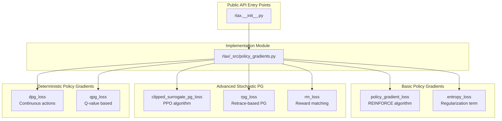
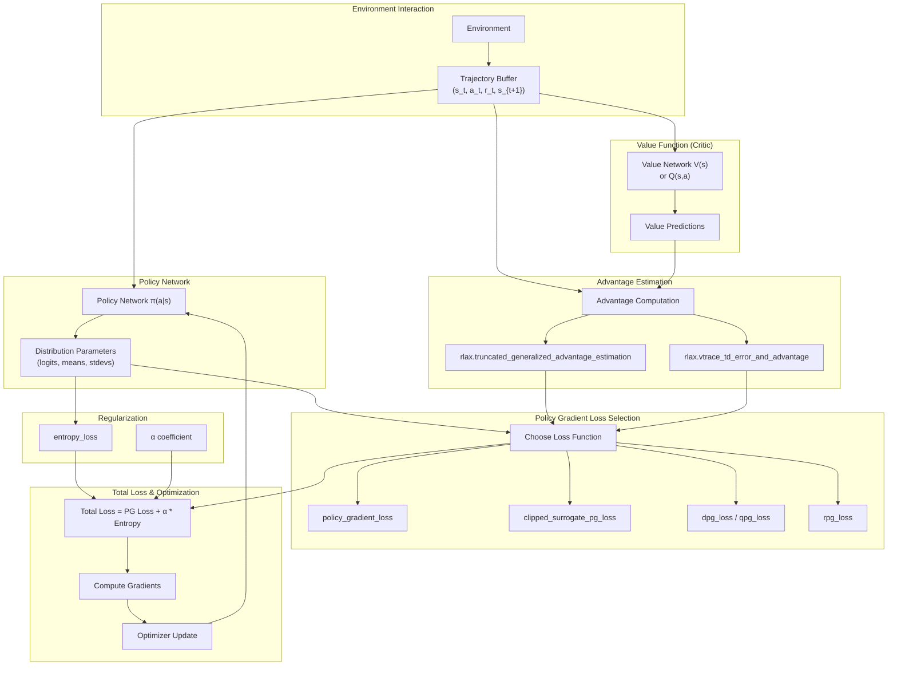
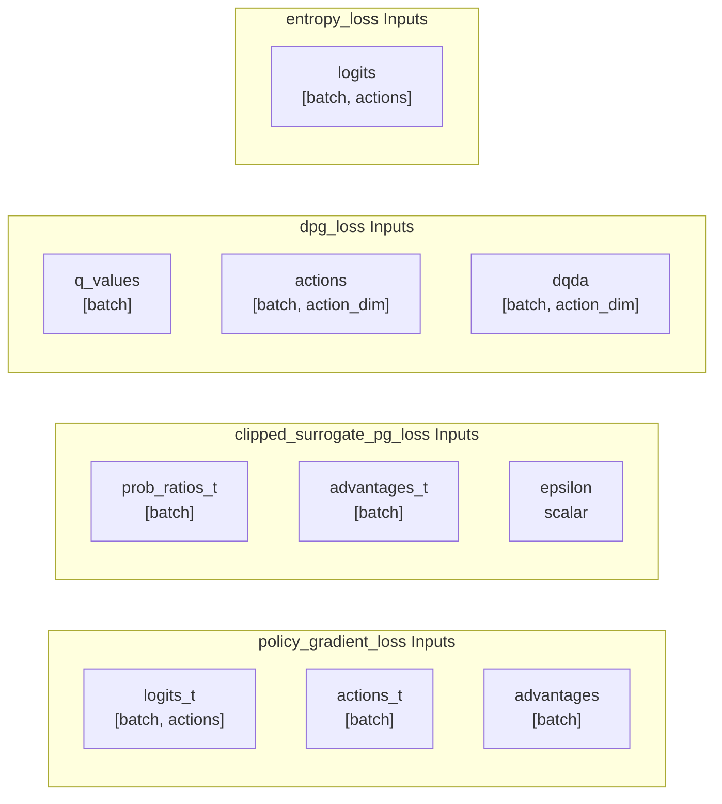
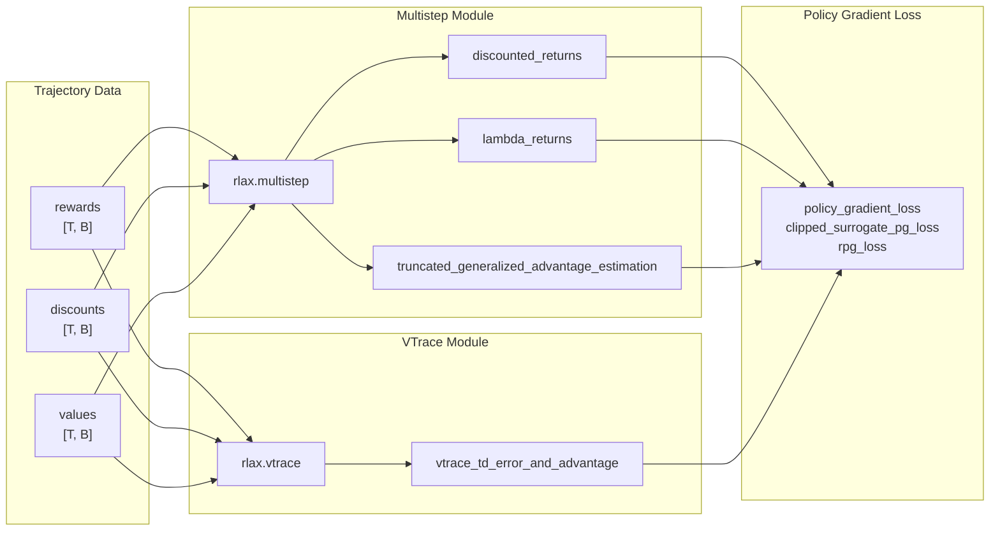
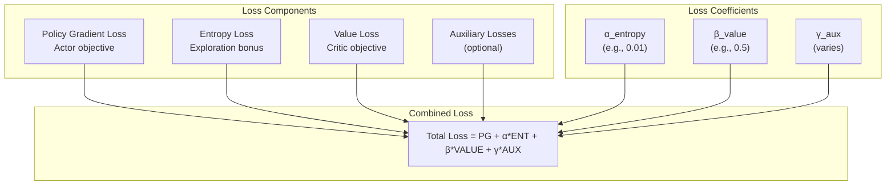

<!-- source: DeepWiki mcp.deepwiki.com · repo google-deepmind/rlax · page 5.1 Policy Gradient Losses · fetched 2026-10-26 -->

# Policy Gradient Losses

<details>
<summary>Relevant source files</summary>

The following files were used as context for generating this wiki page:

- [docs/api.rst](docs/api.rst)
- [rlax/__init__.py](rlax/__init__.py)
- [rlax/_src/policy_targets.py](rlax/_src/policy_targets.py)
- [rlax/_src/policy_targets_test.py](rlax/_src/policy_targets_test.py)

</details>


## Purpose and Scope

This page documents the policy gradient loss functions provided by RLax for training policy-based reinforcement learning agents. These functions compute losses that enable learning policies through gradient ascent on expected returns.

**Coverage:**
- Basic policy gradient loss (REINFORCE)
- Clipped surrogate policy gradient loss (PPO)
- Deterministic policy gradients (DPG/QPG)
- Retrace-based policy gradients (RPG)
- Entropy regularization

**Related Pages:**
- For constrained policy optimization methods (MPO/VMPO), see [MPO and VMPO](#5.2)
- For policy distillation and knowledge transfer, see [Policy Distillation and Targets](#5.3)
- For action distributions and sampling, see [Distributions and Action Selection](#4)
- For advantage estimation methods, see [Multistep Returns and Credit Assignment](#3)

## Policy Gradient Loss Functions

RLax provides seven policy gradient loss functions in [rlax/_src/policy_gradients.py](), all exported through [rlax/__init__.py:84-90]().

### Function Mapping



**Sources:** [rlax/__init__.py:84-90](), [docs/api.rst:224-320]()

### Loss Function Characteristics

| Function | Algorithm | Action Space | Key Features | Typical Use Case |
|----------|-----------|--------------|--------------|------------------|
| `policy_gradient_loss` | REINFORCE | Discrete/Continuous | Simple, high variance | Basic PG, baseline for comparisons |
| `clipped_surrogate_pg_loss` | PPO | Discrete/Continuous | Clipped importance ratio | Stable on-policy learning |
| `dpg_loss` | DPG | Continuous | Deterministic gradients | Continuous control |
| `qpg_loss` | QPG | Discrete | Q-value weighted | Discrete action spaces with Q-function |
| `rpg_loss` | Retrace PG | Discrete/Continuous | Off-policy correction | Off-policy actor-critic |
| `rm_loss` | Reward Matching | Discrete/Continuous | Direct reward optimization | Specialized applications |
| `entropy_loss` | Entropy Regularization | Discrete/Continuous | Exploration bonus | Combined with other losses |

**Sources:** [rlax/__init__.py:84-90](), [docs/api.rst:276-294]()

## Core Loss Functions

### policy_gradient_loss

The basic policy gradient loss implements the REINFORCE algorithm. It computes:

```
Loss = -mean(advantages * log π(a|s))
```

This function expects:
- `logits_t` or distribution parameters
- `actions_t`: the actions taken
- `advantages`: estimated advantages (e.g., from GAE)

The negative sign converts the gradient ascent objective into a minimization problem for standard optimizers.

**Usage Pattern:**
```python
# Compute advantages using multistep returns (see section 3.1)
advantages = rlax.truncated_generalized_advantage_estimation(...)

# Compute policy gradient loss
pg_loss = rlax.policy_gradient_loss(
    logits_t=policy_logits,
    actions_t=actions,
    advantages=advantages
)
```

**Sources:** [rlax/__init__.py:87](), [docs/api.rst:276-279]()

### clipped_surrogate_pg_loss

Implements the Proximal Policy Optimization (PPO) loss with importance ratio clipping. The loss prevents large policy updates by clipping the importance ratio `ρ = π_new(a|s) / π_old(a|s)` within `[1-ε, 1+ε]`:

```
Loss = -mean(min(ρ * A, clip(ρ, 1-ε, 1+ε) * A))
```

**Parameters:**
- `prob_ratios_t`: importance sampling ratios `π_new / π_old`
- `advantages_t`: advantage estimates
- `epsilon`: clipping parameter (typically 0.1-0.2)

This function provides stable policy updates by limiting how much the policy can change in a single update.

**Sources:** [rlax/__init__.py:84](), [docs/api.rst:244-247]()

### dpg_loss and qpg_loss

Deterministic Policy Gradient (DPG) methods compute gradients through the critic's Q-value function:

**`dpg_loss`**: For continuous actions, computes gradients of Q(s, μ(s)) with respect to policy parameters:
```
Loss = -mean(Q(s, μ(s)))
```

**`qpg_loss`**: For discrete actions, weights policy probabilities by Q-values:
```
Loss = -mean(Σ_a π(a|s) * Q(s,a))
```

These methods are useful when a differentiable critic is available and you want to directly optimize for high-value actions.

**Sources:** [rlax/__init__.py:85,88](), [docs/api.rst:255-284]()

### rpg_loss

Retrace-based Policy Gradient (RPG) combines policy gradients with off-policy corrections using the Retrace algorithm. It applies importance sampling corrections similar to V-trace but for policy gradient estimation.

This is particularly useful in distributed settings with off-policy data, providing variance reduction compared to uncorrected off-policy PG.

**Sources:** [rlax/__init__.py:90](), [docs/api.rst:291-294]()

### entropy_loss

Computes the negative entropy of a policy distribution to encourage exploration:

```
Loss = mean(Σ_a π(a|s) * log π(a|s))
```

The entropy loss is typically added to other policy gradient losses with a coefficient `α`:

```
Total Loss = PG Loss + α * Entropy Loss
```

Higher entropy means more stochastic policies (more exploration), while lower entropy means more deterministic policies (more exploitation).

**Sources:** [rlax/__init__.py:86](), [docs/api.rst:260-263]()

## Policy Gradient Computation Pipeline

The following diagram shows how policy gradient losses integrate with other RLax components:



**Sources:** [rlax/__init__.py:84-90](), [rlax/__init__.py:63-65](), [rlax/__init__.py:142-143]()

## Mathematical Foundations

### Basic Policy Gradient Theorem

The policy gradient theorem states that the gradient of expected return with respect to policy parameters θ is:

```
∇_θ J(θ) = E[∇_θ log π_θ(a|s) * Q^π(s,a)]
```

In practice, we replace `Q^π(s,a)` with an advantage estimate `A(s,a)` for variance reduction:

```
∇_θ J(θ) ≈ E[∇_θ log π_θ(a|s) * A(s,a)]
```

The `policy_gradient_loss` implements this directly as `-mean(log_prob * advantages)`.

### Importance Sampling for Off-Policy Learning

When learning from data collected by a different policy μ (behavior policy), we use importance sampling:

```
ρ_t = π_θ(a_t|s_t) / μ(a_t|s_t)
```

The `clipped_surrogate_pg_loss` uses these ratios with clipping:

```
L^CLIP(θ) = E[min(ρ_t A_t, clip(ρ_t, 1-ε, 1+ε) A_t)]
```

This prevents excessively large policy updates that could destabilize training.

### Deterministic Policy Gradients

For deterministic policies μ_θ(s), the policy gradient becomes:

```
∇_θ J(θ) = E[∇_a Q(s,a)|_{a=μ_θ(s)} * ∇_θ μ_θ(s)]
```

The `dpg_loss` computes `-mean(Q(s, μ(s)))` and relies on automatic differentiation to compute the gradient chain.

**Sources:** [rlax/_src/policy_gradients.py]()

## Implementation Details

### Input Requirements



**Sources:** [rlax/_src/policy_gradients.py]()

### Working with Distributions

Policy gradient losses work with distributions from the `rlax.distributions` module (see [Distributions and Action Selection](#4)):

```python
# Discrete actions with softmax
logits = policy_network(state)
action = rlax.softmax().sample(rng, logits)
log_prob = rlax.softmax().log_prob(logits, action)

# Continuous actions with Gaussian
mean, stddev = policy_network(state)
distribution = rlax.gaussian_diagonal(mean, stddev)
action = distribution.sample(rng)
log_prob = distribution.log_prob(action)
```

The policy gradient loss can then use these log probabilities or work directly with logits/parameters.

**Sources:** [rlax/__init__.py:24-34]()

## Usage Patterns

### Basic REINFORCE Agent

```python
# 1. Collect trajectory
states, actions, rewards = collect_episode(policy, env)

# 2. Compute returns (no critic needed)
returns = rlax.discounted_returns(rewards, discount)

# 3. Compute policy gradient loss
loss = rlax.policy_gradient_loss(
    logits_t=policy(states),
    actions_t=actions,
    advantages=returns  # Using returns as advantages
)
```

### PPO Agent with GAE

```python
# 1. Collect trajectories with old policy
states, actions, rewards, old_log_probs = collect_trajectories(old_policy, env)

# 2. Compute advantages using GAE
values = critic(states)
advantages = rlax.truncated_generalized_advantage_estimation(
    r_t=rewards,
    discount_t=discounts,
    lambda_=0.95,
    values=values
)

# 3. Compute importance ratios
new_log_probs = new_policy(states).log_prob(actions)
prob_ratios = jnp.exp(new_log_probs - old_log_probs)

# 4. Compute clipped surrogate loss
pg_loss = rlax.clipped_surrogate_pg_loss(
    prob_ratios_t=prob_ratios,
    advantages_t=advantages,
    epsilon=0.2
)

# 5. Add entropy bonus
entropy = rlax.entropy_loss(new_policy(states).logits)
total_loss = pg_loss + 0.01 * entropy
```

### DDPG-style Continuous Control

```python
# 1. Sample transitions from replay buffer
states, actions, rewards, next_states = replay_buffer.sample(batch_size)

# 2. Compute Q-values from critic
q_values = critic(states, actions)

# 3. Compute deterministic policy gradient
policy_actions = actor(states)
dpg = rlax.dpg_loss(
    q_values=critic(states, policy_actions),
    actions=policy_actions,
    dqda=jax.grad(lambda a: critic(states, a).sum())(policy_actions)
)
```

**Sources:** [rlax/__init__.py:84-90](), [rlax/__init__.py:63-65]()

## Integration with Multistep Methods

Policy gradient losses rely heavily on advantage estimation from the multistep module (see [Multistep Returns and Credit Assignment](#3)):

### Advantage Estimation Options

| Method | Function | When to Use |
|--------|----------|-------------|
| Monte Carlo | `discounted_returns` | Episodic tasks, high bias tolerance |
| TD(λ) | `lambda_returns` | Balance bias-variance |
| GAE | `truncated_generalized_advantage_estimation` | Most on-policy algorithms (PPO, A3C) |
| V-trace | `vtrace_td_error_and_advantage` | Off-policy distributed learning (IMPALA) |

**Dataflow:**



**Sources:** [rlax/__init__.py:60-65](), [rlax/__init__.py:140-143](), [rlax/__init__.py:84-90]()

## Combining Multiple Loss Terms

Most practical policy optimization algorithms combine multiple loss terms:



**Example:**
```python
# PPO-style combined loss
pg_loss = rlax.clipped_surrogate_pg_loss(prob_ratios, advantages, epsilon=0.2)
value_loss = rlax.l2_loss(value_predictions, value_targets)
entropy_loss = rlax.entropy_loss(policy_logits)

total_loss = pg_loss + 0.5 * value_loss + 0.01 * entropy_loss
```

**Sources:** [rlax/__init__.py:84-86](), [rlax/__init__.py:45]()

## Comparison with MPO Methods

While this page covers direct policy gradient methods, RLax also provides Maximum a Posteriori Policy Optimization (MPO) methods in [MPO and VMPO](#5.2):

| Aspect | Policy Gradient (this page) | MPO/VMPO (section 5.2) |
|--------|----------------------------|------------------------|
| **Approach** | Direct gradient through log probability | Two-phase E-M optimization |
| **Constraints** | None or implicit (PPO clipping) | Explicit KL constraints |
| **Functions** | `policy_gradient_loss`, `clipped_surrogate_pg_loss` | `mpo_loss`, `vmpo_loss` |
| **Complexity** | Simpler to implement | More complex, needs dual optimization |
| **Use Cases** | Standard RL tasks | Sample-efficient learning, robotics |

The choice between methods depends on:
- **Simplicity**: Use policy gradients for straightforward implementations
- **Sample efficiency**: Use MPO for expensive simulations
- **Constraint satisfaction**: Use MPO for hard constraint requirements

**Sources:** [rlax/__init__.py:54-59](), [docs/api.rst:266-319]()

## Common Patterns and Best Practices

### Normalizing Advantages

Many implementations normalize advantages to have zero mean and unit variance:

```python
advantages = (advantages - advantages.mean()) / (advantages.std() + 1e-8)
```

This improves training stability by keeping gradient magnitudes consistent across different scales of rewards.

### Gradient Clipping

Policy gradient methods often benefit from gradient clipping:

```python
gradients = jax.grad(loss_fn)(params)
clipped_gradients = rlax.clip_gradient(gradients, max_norm=0.5)
```

See [Parameter Updates and Clipping](#7.3) for more details.

### Stop Gradients on Advantages

Advantages should not propagate gradients to the critic:

```python
advantages = jax.lax.stop_gradient(advantages)
pg_loss = rlax.policy_gradient_loss(logits, actions, advantages)
```

This prevents feedback loops where the policy gradient affects the advantage estimates.

**Sources:** [rlax/__init__.py:22](), [rlax/_src/policy_gradients.py]()

## Summary

RLax provides a comprehensive suite of policy gradient loss functions:

1. **`policy_gradient_loss`**: Basic REINFORCE algorithm for all action spaces
2. **`clipped_surrogate_pg_loss`**: PPO's stable trust-region optimization  
3. **`dpg_loss` / `qpg_loss`**: Deterministic policy gradients for continuous/discrete actions
4. **`rpg_loss`**: Off-policy correction with Retrace
5. **`entropy_loss`**: Exploration regularization

These functions compose with:
- Distribution utilities ([section 4](#4)) for action sampling
- Multistep methods ([section 3](#3)) for advantage estimation
- Value learning ([section 2](#2)) for critic training
- MPO methods ([section 5.2](#5.2)) for advanced optimization

The modular design enables building a wide variety of policy optimization algorithms from DQN-style actor-critics to modern PPO variants.

**Sources:** [rlax/__init__.py:84-90](), [docs/api.rst:224-320]()

---

