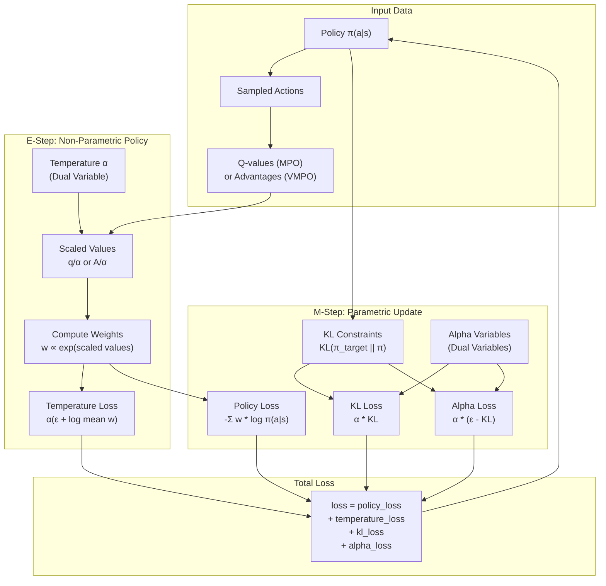
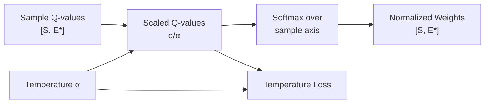
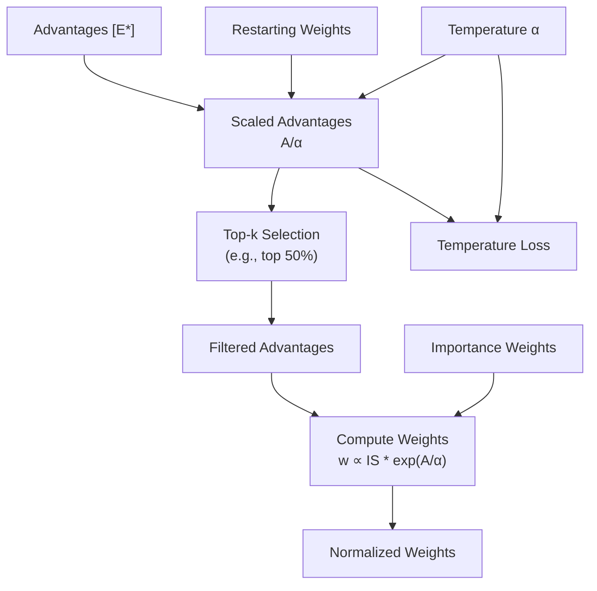
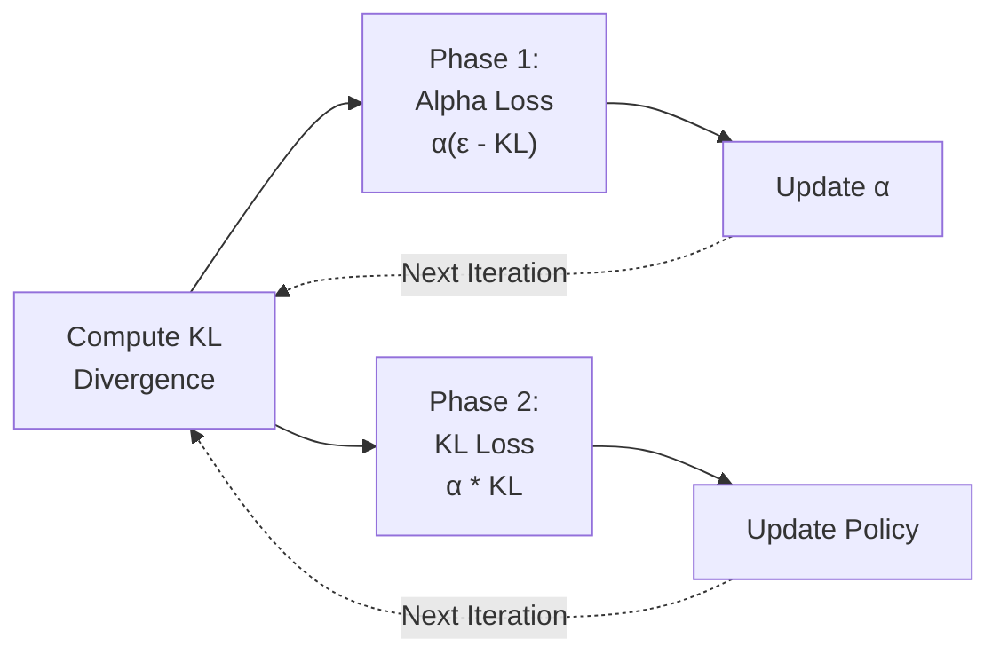
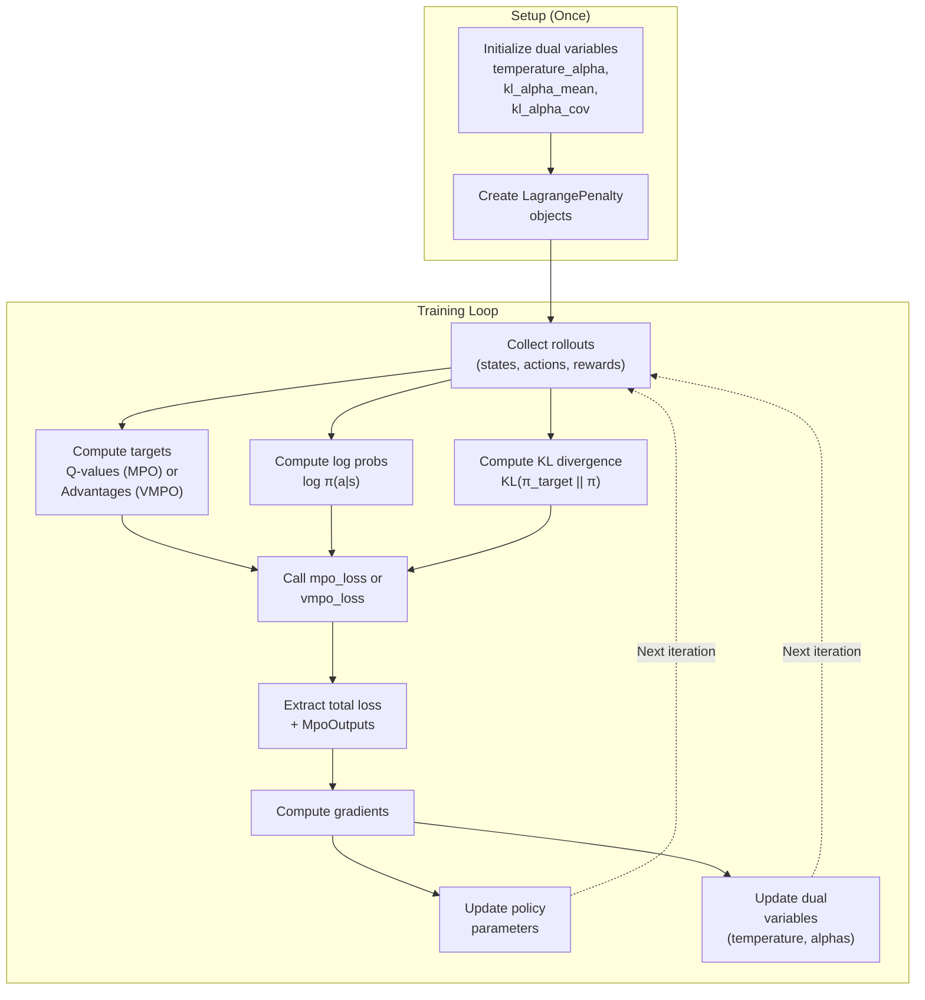

<!-- source: DeepWiki mcp.deepwiki.com · repo google-deepmind/rlax · page 5.2 MPO and VMPO · fetched 2026-10-26 -->

# MPO and VMPO

<details>
<summary>Relevant source files</summary>

The following files were used as context for generating this wiki page:

- [rlax/_src/episodic_memory.py](rlax/_src/episodic_memory.py)
- [rlax/_src/mpo_ops.py](rlax/_src/mpo_ops.py)
- [rlax/_src/mpo_ops_test.py](rlax/_src/mpo_ops_test.py)

</details>


This page documents the Maximum a Posteriori Policy Optimization (MPO) and its on-policy variant V-MPO (VMPO) algorithms implemented in RLax. These are advanced policy gradient methods that use constrained optimization with KL divergence bounds and Lagrange multipliers to ensure stable policy updates.

For basic policy gradient methods like REINFORCE and PPO, see [Policy Gradient Losses](#5.1). For policy distillation techniques, see [Policy Distillation and Targets](#5.3).

**Scope**: This page covers the E-step/M-step optimization framework, temperature parameter learning, hard KL constraints, and the differences between off-policy MPO and on-policy VMPO.

## Overview

MPO and VMPO are policy optimization algorithms that decompose the policy improvement problem into two phases:

1. **E-Step (Non-parametric)**: Compute a target distribution by reweighting samples according to their state-action values or advantages, with a temperature parameter that bounds the KL divergence from the previous policy.

2. **M-Step (Parametric)**: Update the parametric policy via supervised learning to match the non-parametric target, subject to additional KL constraints.

The key innovation is the use of dual variables (Lagrange multipliers) to automatically adapt constraint bounds during training, ensuring stable policy updates.

**Sources**: [rlax/_src/mpo_ops.py:15-33]()

## Core Data Structures

### LagrangePenalty

The `LagrangePenalty` structure encapsulates a constraint and its dual variable:

```python
class LagrangePenalty(NamedTuple):
  alpha: Array          # Dual variable (Lagrange multiplier)
  epsilon: Scalar       # Constraint bound
  per_dimension: bool   # Whether to constrain each dimension separately
```

- **alpha**: The learnable dual variable that modulates the penalty strength
- **epsilon**: The hard constraint bound (e.g., maximum allowed KL divergence)
- **per_dimension**: When `True`, applies separate constraints to each action dimension (useful for continuous control)

**Sources**: [rlax/_src/mpo_ops.py:49-56]()

### MpoOutputs

The `MpoOutputs` structure contains all loss components and diagnostic information:

```python
class MpoOutputs(NamedTuple):
  temperature_loss: Numeric    # E-step temperature loss
  policy_loss: Array           # M-step policy loss
  kl_loss: Array              # KL constraint loss
  alpha_loss: Array           # Dual variable loss
  normalized_weights: Array   # Computed sample weights
  num_samples: Numeric        # Number of samples used
```

**Sources**: [rlax/_src/mpo_ops.py:58-70]()

## Algorithm Flow Diagram



**Sources**: [rlax/_src/mpo_ops.py:75-176](), [rlax/_src/mpo_ops.py:266-375]()

## MPO: Off-Policy Maximum a Posteriori Policy Optimization

MPO is designed for off-policy learning where actions are sampled from a behavior policy (often the target policy from a previous iteration). It uses Q-values to evaluate the sampled actions.

### Function Signature

```python
def mpo_loss(
    sample_log_probs: Array,      # [S, E*] log π(a|s) for sampled actions
    sample_q_values: Array,       # [S, E*] Q-values for sampled actions
    temperature_constraint: LagrangePenalty,
    kl_constraints: Sequence[Tuple[Array, LagrangePenalty]],
    projection_operator: ProjectionOperatorFn = ...,
    policy_loss_weight: float = 1.0,
    temperature_loss_weight: float = 1.0,
    kl_loss_weight: float = 1.0,
    alpha_loss_weight: float = 1.0,
    sample_axis: int = 0,
    use_stop_gradient: bool = True,
) -> Tuple[Array, MpoOutputs]
```

**Key Parameters**:
- **sample_log_probs**: Log probabilities of sampled actions under current policy, shape `[S, E*]` where S is the sample dimension
- **sample_q_values**: Q-values for the sampled actions, same shape
- **sample_axis**: Which axis contains the action samples (default 0)
- **kl_constraints**: List of `(KL, LagrangePenalty)` tuples for constraining policy changes

**Sources**: [rlax/_src/mpo_ops.py:75-176]()

### MPO E-Step: Weight Computation

The E-step computes normalized weights for each sampled action based on its Q-value:



The weight computation uses a softmax over the scaled Q-values:

$$w_i \propto \exp(Q_i / \alpha)$$

The temperature loss encourages the weighted policy to stay within KL bound `ε` from the previous policy:

$$L_{temp} = \alpha \cdot (\epsilon + \log \frac{1}{N}\sum_i \exp(Q_i/\alpha))$$

**Sources**: [rlax/_src/mpo_ops.py:178-244]()

### MPO M-Step: Policy Update

The M-step performs supervised learning on the weighted samples:

| Component | Formula | Purpose |
|-----------|---------|---------|
| Policy Loss | $-\sum_i w_i \log \pi(a_i\|s)$ | Maximize likelihood of high-Q actions |
| KL Loss | $\alpha_{KL} \cdot KL(\pi_{target} \|\| \pi)$ | Penalize excessive policy change |
| Alpha Loss | $\alpha_{KL} \cdot (\epsilon_{KL} - KL)$ | Update dual variable |

**Sources**: [rlax/_src/mpo_ops.py:160-176]()

### MPO Usage Example

```python
# From test file showing typical usage
temperature_constraint = mpo_ops.LagrangePenalty(
    alpha=jnp.array(0.2),        # Initial temperature
    epsilon=0.01                  # KL bound
)

kl_mean_constraint = mpo_ops.LagrangePenalty(
    alpha=jnp.array(0.001),       # Initial alpha for mean KL
    epsilon=10.0,                 # Mean KL bound
    per_dimension=False
)

kl_cov_constraint = mpo_ops.LagrangePenalty(
    alpha=jnp.array(1e6),         # Initial alpha for covariance KL  
    epsilon=1e-12,                # Covariance KL bound
    per_dimension=False
)

loss, outputs = mpo_ops.mpo_loss(
    sample_log_probs=log_probs,   # [num_samples, time, batch]
    sample_q_values=q_values,     # [num_samples, time, batch]
    temperature_constraint=temperature_constraint,
    kl_constraints=[
        (kl_mean, kl_mean_constraint),
        (kl_cov, kl_cov_constraint)
    ],
    sample_axis=0  # First axis is sample dimension
)
```

**Sources**: [rlax/_src/mpo_ops_test.py:150-161](), [rlax/_src/mpo_ops_test.py:197-215]()

## VMPO: On-Policy V-MPO

VMPO is the on-policy variant that uses advantages instead of Q-values and supports additional features for on-policy learning:

1. **Advantages instead of Q-values**: No sample dimension needed
2. **Top-k fraction**: Only use the top fraction of advantages
3. **Restarting weights**: Mask out episode boundaries
4. **Importance weights**: Support off-policy corrections

### Function Signature

```python
def vmpo_loss(
    sample_log_probs: Array,            # [E*] log π(a|s)
    advantages: Array,                  # [E*] advantage values
    temperature_constraint: LagrangePenalty,
    kl_constraints: Sequence[Tuple[Array, LagrangePenalty]],
    projection_operator: ProjectionOperatorFn = ...,
    restarting_weights: Optional[Array] = None,  # [E*] episode boundaries
    importance_weights: Optional[Array] = None,  # [E*] IS weights
    top_k_fraction: float = 0.5,                # Use top 50% by default
    policy_loss_weight: float = 1.0,
    temperature_loss_weight: float = 1.0,
    kl_loss_weight: float = 1.0,
    alpha_loss_weight: float = 1.0,
    axis_name: Optional[str] = None,            # For distributed training
    use_stop_gradient: bool = True,
) -> Tuple[Array, MpoOutputs]
```

**Key Differences from MPO**:
- No `sample_axis` parameter (advantages are per-example, not per-sample)
- `top_k_fraction`: Fraction of samples to use in E-step (0.5 = top 50%)
- `restarting_weights`: 0 at episode start, 1 otherwise (masks invalid transitions)
- `importance_weights`: Off-policy correction weights
- `axis_name`: For `pmap` distributed training

**Sources**: [rlax/_src/mpo_ops.py:266-375]()

### VMPO E-Step with Top-K Selection



The top-k selection filters advantages to only use the best `top_k_fraction`:

```python
# Pseudo-code from implementation
top_k = int(top_k_fraction * num_advantages)
top_k_min = jnp.sort(advantages)[-top_k]
top_k_weights = (advantages >= top_k_min).astype(float)
```

This focuses learning on the most promising actions while ignoring poor experiences.

**Sources**: [rlax/_src/mpo_ops.py:377-435](), [rlax/_src/mpo_ops.py:437-519]()

### VMPO Temperature Loss Computation

The VMPO temperature loss accounts for importance sampling and top-k filtering:

$$L_{temp} = \alpha \cdot (\epsilon + \log \frac{\sum_i IS_i \cdot \mathbb{1}_{top\text{-}k}(i) \cdot \exp(A_i/\alpha)}{\sum_i \mathbb{1}_{top\text{-}k}(i)})$$

where:
- $IS_i$ are importance sampling weights
- $\mathbb{1}_{top\text{-}k}(i)$ is 1 if advantage $i$ is in top-k, 0 otherwise
- $A_i$ are advantages

**Sources**: [rlax/_src/mpo_ops.py:513-517]()

### Restarting Weights Example

Restarting weights mask out the first step of each episode since the agent cannot influence the initial state:

```python
# Example trajectory with episode boundaries
# Episode 1: steps 0-2, Episode 2: steps 3-5
restarting_weights = jnp.array([
    0.0,  # Episode 1 start - masked
    1.0,  # Episode 1 continuation
    1.0,  # Episode 1 continuation
    0.0,  # Episode 2 start - masked
    1.0,  # Episode 2 continuation
    1.0,  # Episode 2 continuation
])

loss, outputs = mpo_ops.vmpo_loss(
    sample_log_probs=log_probs,
    advantages=advantages,
    temperature_constraint=temperature_constraint,
    kl_constraints=kl_constraints,
    restarting_weights=restarting_weights,  # Mask episode starts
    top_k_fraction=0.5
)
```

**Sources**: [rlax/_src/mpo_ops_test.py:485-494]()

## KL Constraints and Dual Variables

### Hard KL Constraint Optimization

Both MPO and VMPO enforce hard KL constraints using Lagrange multipliers (dual variables). The constraint optimization alternates between two phases:

**Phase 1: Optimize α (dual variable) with fixed KL**
$$L_{\alpha} = \alpha \cdot (\epsilon - KL)$$

**Phase 2: Optimize policy with fixed α**
$$L_{KL} = \alpha \cdot KL$$

This coordinate ascent drives KL toward the bound ε:
- If $KL < \epsilon$: $L_{\alpha}$ pushes α down, allowing more policy change
- If $KL > \epsilon$: $L_{\alpha}$ pushes α up, restricting policy change



**Sources**: [rlax/_src/mpo_ops.py:521-575]()

### Coupled vs Decoupled KL Constraints

For multivariate Gaussian policies, KL divergence can be decomposed:

$$KL(\mathcal{N}(\mu_0, \Sigma_0) || \mathcal{N}(\mu_1, \Sigma_1)) = KL_{mean} + KL_{cov}$$

where:
- $KL_{mean} = \frac{1}{2}(\mu_1 - \mu_0)^T \Sigma_1^{-1} (\mu_1 - \mu_0)$
- $KL_{cov} = \frac{1}{2}(tr(\Sigma_1^{-1}\Sigma_0) - d + \log\frac{|\Sigma_1|}{|\Sigma_0|})$

**Decoupled Constraints** (recommended): Separate bounds for mean and covariance
```python
kl_constraints = [
    (kl_mean, LagrangePenalty(alpha_mean, epsilon_mean)),
    (kl_cov, LagrangePenalty(alpha_cov, epsilon_cov))
]
```

**Coupled Constraints**: Single bound for total KL
```python
kl_constraints = [
    (kl_mean + kl_cov, LagrangePenalty(alpha, epsilon_total))
]
```

**Sources**: [rlax/_src/mpo_ops_test.py:163-195](), [rlax/_src/mpo_ops_test.py:197-231]()

### Per-Dimension KL Constraints

For continuous control, you can apply separate KL constraints to each action dimension:

```python
# kl has shape [time, batch, action_dim]
kl_constraint = LagrangePenalty(
    alpha=jnp.ones([time, batch, action_dim]),  # Per-dimension alphas
    epsilon=0.1,                                 # Same bound per dimension
    per_dimension=True
)

# Loss sums over action_dim internally
loss, outputs = mpo_ops.mpo_loss(
    sample_log_probs=log_probs,
    sample_q_values=q_values,
    temperature_constraint=temp_constraint,
    kl_constraints=[(kl, kl_constraint)]
)
```

When `per_dimension=True`, the KL loss is computed as:
$$L_{KL} = \sum_d \alpha_d \cdot KL_d$$

**Sources**: [rlax/_src/mpo_ops.py:568-573]()

## Implementation Details

### Projection Operator

The projection operator ensures dual variables remain positive:

```python
# Default projection
projection_operator = functools.partial(jnp.clip, a_min=1e-10)

# Can be customized
def custom_projection(x: Array) -> Array:
    return jnp.clip(x, min=1e-8, max=1e3)  # Upper bound too
```

This is applied to both temperature and alpha variables.

**Sources**: [rlax/_src/mpo_ops.py:80-81](), [rlax/_src/mpo_ops_test.py:66-67]()

### Stop Gradients

The `use_stop_gradient` parameter controls gradient flow:

- **E-step weights**: Stop gradients by default to prevent feedback loops
- **Temperature/Alpha**: Allow gradients for dual variable learning
- **KL values**: Stop gradients when optimizing alpha, allow when optimizing policy

This implements the two-phase optimization correctly.

**Sources**: [rlax/_src/mpo_ops.py:156-158](), [rlax/_src/mpo_ops_test.py:370-393]()

### Axis Name for Distributed Training

The `axis_name` parameter enables distributed training with `pmap`:

```python
# In a pmap context
loss_fn = jax.pmap(
    lambda data: mpo_ops.vmpo_loss(
        advantages=data['advantages'],
        ...,
        axis_name='devices'  # Sum/max across devices
    ),
    axis_name='devices'
)
```

This causes operations like sum and max to aggregate across devices when computing:
- Number of samples
- Top-k thresholds
- Weight normalization

**Sources**: [rlax/_src/mpo_ops.py:308-309](), [rlax/_src/mpo_ops.py:499-500]()

## Shape Flexibility

MPO/VMPO functions work with arbitrary example shapes `E*`:

| Shape Notation | Example | Description |
|----------------|---------|-------------|
| `[T, B]` | `[128, 32]` | Time-first batches |
| `[B, T]` | `[32, 128]` | Batch-first sequences |
| `[B]` | `[1024]` | Single timestep batch |
| `[S, T, B]` (MPO) | `[10, 128, 32]` | With sample dimension |

The `sample_axis` parameter for MPO specifies which axis contains action samples:
- `sample_axis=0`: `[S, E*]` (default)
- `sample_axis=1`: `[E1, S, E2...]`
- `sample_axis=-1`: `[E*, S]`

**Sources**: [rlax/_src/mpo_ops.py:27-33](), [rlax/_src/mpo_ops.py:94-100]()

## Complete MPO vs VMPO Comparison

| Feature | MPO | VMPO |
|---------|-----|------|
| **Learning Mode** | Off-policy | On-policy |
| **Target Values** | Q-values (critic) | Advantages (actor-critic) |
| **Sample Dimension** | Yes (multiple actions per state) | No (one action per state) |
| **Top-k Selection** | No | Yes (configurable fraction) |
| **Restarting Weights** | No | Yes (episode boundaries) |
| **Importance Weights** | No | Yes (off-policy correction) |
| **Distributed Support** | No | Yes (via `axis_name`) |
| **Typical Use Case** | Model-based, planning | Model-free actor-critic |

**Sources**: [rlax/_src/mpo_ops.py:75-176](), [rlax/_src/mpo_ops.py:266-375]()

## Complete Usage Flow



**Sources**: [rlax/_src/mpo_ops_test.py:278-315]()

## References

The MPO/VMPO algorithms are based on the following papers:

1. **MPO**: "Maximum a Posteriori Policy Optimisation" - https://openreview.net/forum?id=S1ANxQW0b
2. **Relative Entropy**: "Relative Entropy Regularized Policy Iteration" - https://arxiv.org/abs/1812.02256
3. **V-MPO**: "V-MPO: On-Policy Maximum a Posteriori Policy Optimization for Discrete and Continuous Control" - https://openreview.net/forum?id=SylOlp4FvH

**Sources**: [rlax/_src/mpo_ops.py:17-26]()

---

