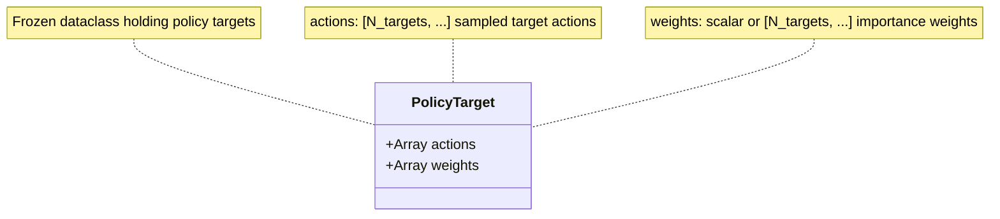
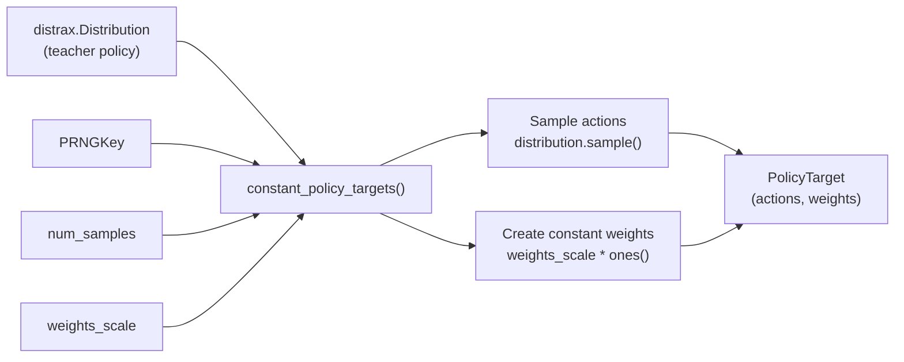
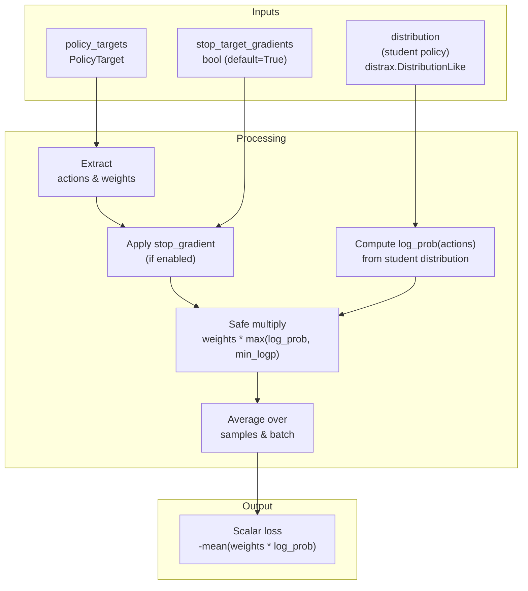
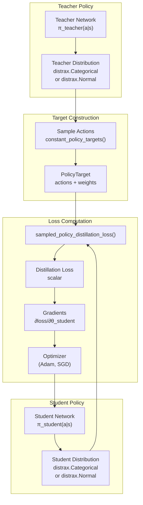
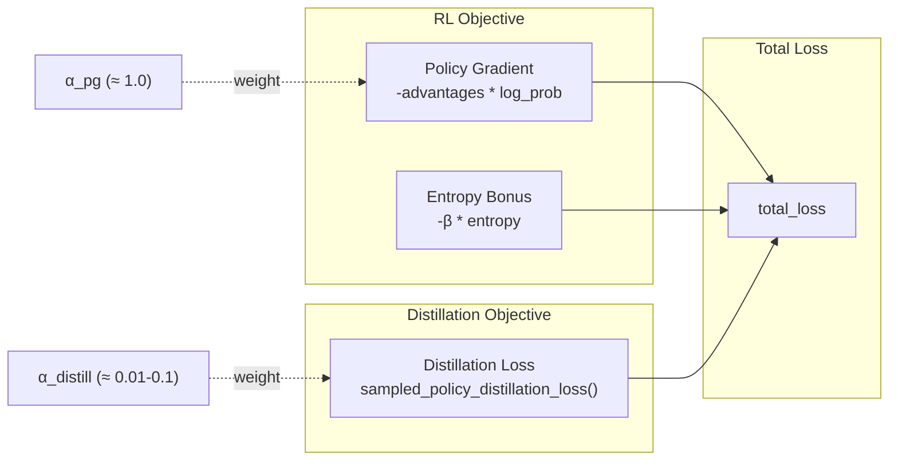
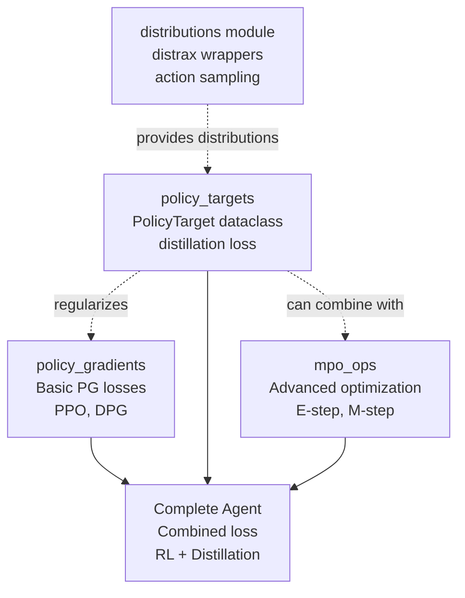

<!-- source: DeepWiki mcp.deepwiki.com · repo google-deepmind/rlax · page 5.3 Policy Distillation and Targets · fetched 2026-10-26 -->

# Policy Distillation and Targets

<details>
<summary>Relevant source files</summary>

The following files were used as context for generating this wiki page:

- [docs/api.rst](docs/api.rst)
- [rlax/_src/policy_targets.py](rlax/_src/policy_targets.py)
- [rlax/_src/policy_targets_test.py](rlax/_src/policy_targets_test.py)

</details>


## Purpose and Scope

This document describes RLax's policy distillation functionality, which enables knowledge transfer between policies by defining target action distributions and computing losses to match them. Policy distillation is used for imitation learning, curriculum learning, and regularization by distilling knowledge from one policy (teacher) into another (student).

For basic policy gradient losses like REINFORCE and PPO, see [Policy Gradient Losses](#5.1). For advanced constrained optimization methods, see [MPO and VMPO](#5.2).

## Overview

Policy distillation trains a policy network to match a target distribution over actions. This is accomplished through two key components:

1. **PolicyTarget**: A data structure holding sampled actions and their associated weights
2. **Distillation Loss**: A cross-entropy-like loss that penalizes deviation from the target distribution

The system supports both discrete and continuous action spaces and allows flexible weighting schemes for different regularization strategies.

**Sources:** [rlax/_src/policy_targets.py:1-109]()

## Core Data Structure

### PolicyTarget Dataclass



The `PolicyTarget` dataclass is a frozen (immutable) container that holds:

| Field | Shape | Description |
|-------|-------|-------------|
| `actions` | `[N_targets, ...]` | Sampled target actions (discrete indices or continuous vectors) |
| `weights` | Same as `log_prob(actions).shape` | Probabilities or importance weights for corresponding actions |

The weights can represent:
- Constant values for uniform regularization
- Importance sampling ratios for off-policy correction
- Teacher policy probabilities for distillation
- Zero values to disable distillation

**Sources:** [rlax/_src/policy_targets.py:25-34]()

## Creating Policy Targets

### Constant Policy Targets



The `constant_policy_targets` function creates policy targets with uniform weights:

```python
def constant_policy_targets(
    distribution: distrax.DistributionLike,
    rng_key: chex.PRNGKey,
    num_samples: int,
    weights_scale: float = 1.) -> PolicyTarget
```

**Parameters:**
- `distribution`: A `distrax` or TFP distribution to sample actions from (teacher policy)
- `rng_key`: JAX PRNG key for reproducible sampling
- `num_samples`: Number of actions to sample (typically 1-100)
- `weights_scale`: Constant weight multiplier (controls regularization strength)

**Behavior:**
1. Samples `num_samples` actions from the provided distribution
2. Assigns constant weight of `weights_scale` to each action
3. Returns a `PolicyTarget` with shape `[num_samples, ...] + batch_shape`

**Use Case:** When `distribution` is uniform, this pushes the student policy toward maximum entropy. When `weights_scale=0`, distillation has no effect.

**Sources:** [rlax/_src/policy_targets.py:36-65]()

### Zero Policy Targets

```python
zero_policy_targets = functools.partial(
    constant_policy_targets, weights_scale=0.0)
```

This convenience function creates policy targets with zero weights, effectively disabling the distillation loss. Useful for conditional distillation or as a placeholder.

**Sources:** [rlax/_src/policy_targets.py:67-68]()

## Distillation Loss Computation

### Sampled Policy Distillation Loss



The `sampled_policy_distillation_loss` function computes a cross-entropy-like loss between a student policy and target actions:

```python
def sampled_policy_distillation_loss(
    distribution: distrax.DistributionLike,
    policy_targets: PolicyTarget,
    stop_target_gradients: bool = True,
) -> chex.Numeric
```

**Loss Formula:**

```
loss = -mean(weights * log_prob(actions))
```

where the mean is computed over:
- N samples in the `PolicyTarget`
- Batch dimensions
- Action dimensions (for continuous action vectors)

**Parameters:**
- `distribution`: Student policy distribution to train
- `policy_targets`: `PolicyTarget` containing teacher actions and weights
- `stop_target_gradients`: Whether to block gradients through targets (default `True`)

**Implementation Details:**

1. **Gradient Stopping** [rlax/_src/policy_targets.py:94-99](): Uses `jax.lax.select` and `jax.lax.stop_gradient` to conditionally block gradients from flowing into weights and actions

2. **Numerical Stability** [rlax/_src/policy_targets.py:104-106](): Handles `0 * (-inf)` cases by replacing with `0 * min_logp` to avoid NaN propagation

3. **Shape Validation** [rlax/_src/policy_targets.py:102-103](): Asserts that weights and log_probs have matching shapes

**Sources:** [rlax/_src/policy_targets.py:71-109]()

## Data Flow Pipeline



**Sources:** [rlax/_src/policy_targets.py:1-109]()

## Use Cases and Patterns

### Pattern 1: Entropy Regularization

Push policy toward uniform distribution for maximum exploration:

```python
# Create uniform distribution over actions
uniform_dist = distrax.Categorical(probs=jnp.ones(num_actions) / num_actions)

# Sample targets with moderate weight
targets = rlax.constant_policy_targets(
    distribution=uniform_dist,
    rng_key=rng,
    num_samples=10,
    weights_scale=0.1  # Weak regularization
)

# Compute loss
entropy_loss = rlax.sampled_policy_distillation_loss(student_policy, targets)
```

### Pattern 2: Teacher-Student Distillation

Transfer knowledge from a trained teacher to a smaller student:

```python
# Teacher policy (pre-trained)
teacher_actions = teacher_policy.sample(seed=rng, sample_shape=(num_samples,))
teacher_probs = teacher_policy.prob(teacher_actions)

# Create weighted targets
targets = PolicyTarget(
    actions=teacher_actions,
    weights=teacher_probs  # Weight by teacher confidence
)

# Train student to match teacher
distill_loss = rlax.sampled_policy_distillation_loss(student_policy, targets)
```

### Pattern 3: Conditional Distillation

Apply distillation only under certain conditions:

```python
# Use zero targets when condition is False
def conditional_targets(condition, distribution, rng_key):
    return jax.lax.cond(
        condition,
        lambda: rlax.constant_policy_targets(distribution, rng_key, 10, 1.0),
        lambda: rlax.zero_policy_targets(distribution, rng_key, 10)
    )
```

**Sources:** [rlax/_src/policy_targets.py:36-109](), [rlax/_src/policy_targets_test.py:28-56]()

## Action Space Support

### Discrete Actions

For discrete action spaces (e.g., Atari, board games):

| Component | Type | Example |
|-----------|------|---------|
| Distribution | `distrax.Categorical` | `Categorical(logits=policy_logits)` |
| Actions shape | `[N_samples,] + batch_shape` | `[10, 32]` for 10 samples, batch 32 |
| Weights shape | `[N_samples,] + batch_shape` | `[10, 32]` |
| log_prob output | `[N_samples,] + batch_shape` | `[10, 32]` |

### Continuous Actions

For continuous action spaces (e.g., robotics, continuous control):

| Component | Type | Example |
|-----------|------|---------|
| Distribution | `distrax.MultivariateNormalDiag` | `MultivariateNormalDiag(loc, scale)` |
| Actions shape | `[N_samples, action_dim] + batch` | `[10, 6, 32]` for 10 samples, 6-dim actions, batch 32 |
| Weights shape | `[N_samples,] + batch_shape` | `[10, 32]` |
| log_prob output | `[N_samples,] + batch_shape` | `[10, 32]` |

**Note:** The loss averages over all dimensions, including action dimensions for continuous vectors.

**Sources:** [rlax/_src/policy_targets.py:71-109]()

## Mathematical Foundation

### Cross-Entropy Perspective

The distillation loss can be viewed as a sampled approximation of cross-entropy:

```
H(P_target, P_student) = -𝔼_{a ~ P_target}[log P_student(a)]
```

With sampled targets:
```
loss ≈ -(1/N) Σᵢ wᵢ log P_student(aᵢ)
```

where:
- `N` is the number of samples
- `aᵢ` are sampled actions from `PolicyTarget`
- `wᵢ` are the associated weights
- `P_student` is the student policy distribution

### KL Divergence Connection

When weights are normalized probabilities from a teacher policy:
```
weights[i] = P_teacher(actions[i])
```

The loss approximates the KL divergence:
```
loss ≈ KL(P_teacher || P_student) + constant
```

This makes it suitable for policy distillation where we want to minimize divergence from the teacher.

**Sources:** [rlax/_src/policy_targets.py:76-82]()

## Integration with Policy Gradients

Policy distillation is typically combined with standard policy gradient objectives:



Combined loss:
```
total_loss = α_pg * pg_loss + α_distill * distillation_loss + α_ent * entropy_loss
```

where:
- `α_pg ≈ 1.0`: Primary RL objective
- `α_distill ≈ 0.01-0.1`: Regularization/knowledge transfer
- `α_ent ≈ 0.001-0.01`: Exploration bonus

**Sources:** [rlax/_src/policy_targets.py:71-109]()

## API Reference Summary

### Functions

| Function | Purpose | Input | Output |
|----------|---------|-------|--------|
| `constant_policy_targets` | Create uniform-weighted targets | `distribution`, `rng_key`, `num_samples`, `weights_scale` | `PolicyTarget` |
| `zero_policy_targets` | Create zero-weighted targets | Same as above | `PolicyTarget` |
| `sampled_policy_distillation_loss` | Compute cross-entropy loss | `distribution`, `policy_targets`, `stop_target_gradients` | Scalar loss |

### Data Structures

| Type | Fields | Purpose |
|------|--------|---------|
| `PolicyTarget` | `actions: Array`, `weights: Array` | Container for target actions and their weights |

**Sources:** [rlax/_src/policy_targets.py:1-109](), [docs/api.rst:232-242, 296-309]()

## Testing and Validation

The implementation includes comprehensive tests validating:

1. **Loss Computation Correctness** [rlax/_src/policy_targets_test.py:28-38](): Verifies numerical accuracy of loss calculation against expected values

2. **Target Construction** [rlax/_src/policy_targets_test.py:40-56](): Validates that `constant_policy_targets` produces correct shapes and values

3. **Gradient Flow**: Ensures `stop_target_gradients` correctly blocks gradient propagation

**Sources:** [rlax/_src/policy_targets_test.py:1-61]()

## Relationship to Other Modules



**Related Pages:**
- [Policy Gradient Losses](#5.1): Basic policy optimization methods
- [MPO and VMPO](#5.2): Advanced constrained optimization
- [Discrete Action Distributions](#4.1): Categorical distributions for discrete actions
- [Continuous Action Distributions](#4.2): Gaussian distributions for continuous actions

**Sources:** [rlax/_src/policy_targets.py:1-109](), [docs/api.rst:224-320]()

---

