<!-- source: DeepWiki mcp.deepwiki.com · repo google-deepmind/rlax · page 6 Advanced Topics · fetched 2026-10-26 -->

# Advanced Topics

<details>
<summary>Relevant source files</summary>

The following files were used as context for generating this wiki page:

- [rlax/_src/nonlinear_bellman.py](rlax/_src/nonlinear_bellman.py)
- [rlax/_src/transforms.py](rlax/_src/transforms.py)

</details>


## Purpose and Scope

This page covers advanced reinforcement learning techniques implemented in RLax that go beyond standard value learning and policy gradient methods. The primary focus is on **nonlinear Bellman equations** and **value transformations**, which enable learning in transformed value spaces for improved stability and representational capacity.

For basic value learning methods (TD, Q-learning, SARSA), see [Value-Based Learning](#2). For policy optimization methods, see [Policy Optimization Methods](#5). For multistep return calculations that these transformations wrap, see [Multistep Returns and Credit Assignment](#3).

The advanced topics covered here include:

- **Value function transformations** using the `TxPair` abstraction
- **Nonlinear Bellman equations** that operate in transformed value spaces
- **Specialized transformation functions** (signed hyperbolic, 2-hot encoding)
- **MuZero-style transformations** combining squashing and discretization
- **Transformed variants** of core RL algorithms (Q-learning, Retrace, etc.)

These techniques are particularly useful when dealing with unbounded or highly variable value ranges, as seen in algorithms like MuZero and R2D2.

---

## Overview of Value Transformations

Traditional value-based RL assumes that value functions are the fixed points of linear Bellman equations. However, learning can be improved by working in a **transformed value space**, where the Bellman equation becomes nonlinear. The key insight is that we can:

1. Transform values before computing bootstrapped returns
2. Compute targets in the transformed space
3. Learn to predict transformed values
4. Invert the transformation when needed for action selection

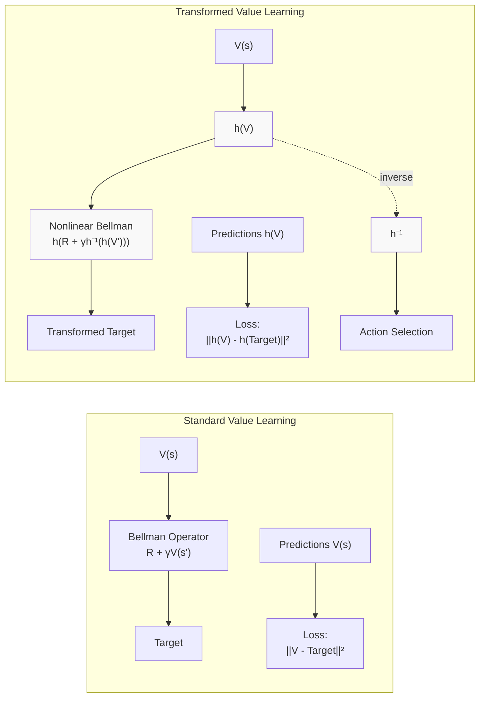

**Diagram: Standard vs Transformed Value Learning**

The transformation `h(·)` and its inverse `h⁻¹(·)` form what RLax calls a `TxPair`.

**Sources:** [rlax/_src/nonlinear_bellman.py:15-24]()

---

## The TxPair Abstraction

The core abstraction for value transformations is the `TxPair` named tuple, defined in [rlax/_src/nonlinear_bellman.py:37]():

```python
TxPair = collections.namedtuple('TxPair', ['apply', 'apply_inv'])
```

A `TxPair` consists of:
- **`apply`**: The forward transformation function `h(x)`
- **`apply_inv`**: The inverse transformation function `h⁻¹(x)`

These are typically monotonically increasing functions to preserve value orderings.

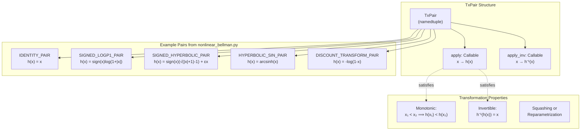

**Diagram: TxPair Abstraction and Built-in Pairs**

**Sources:** [rlax/_src/nonlinear_bellman.py:37-53]()

### Pre-defined Transformation Pairs

RLax provides several pre-built transformation pairs:

| Constant | Forward Transform `apply` | Inverse Transform `apply_inv` | Use Case |
|----------|--------------------------|-------------------------------|----------|
| `IDENTITY_PAIR` | `identity(x)` | `identity(x)` | No transformation (baseline) |
| `SIGNED_LOGP1_PAIR` | `signed_logp1(x)` | `signed_expm1(x)` | Logarithmic squashing |
| `SIGNED_HYPERBOLIC_PAIR` | `signed_hyperbolic(x)` | `signed_parabolic(x)` | MuZero-style squashing |
| `HYPERBOLIC_SIN_PAIR` | `hyperbolic_arcsin(x)` | `hyperbolic_sin(x)` | Smooth squashing |
| `DISCOUNT_TRANSFORM_PAIR` | `-log(1-x)` | `1-exp(-x)` | Discount factor transforms |

**Sources:** [rlax/_src/nonlinear_bellman.py:43-53]()

---

## Transformation Functions

The actual transformation functions are implemented in `rlax/_src/transforms.py`. These are element-wise operations that can be applied to arrays of values.

### Squashing Transformations

**Signed Logarithmic Transform** [rlax/_src/transforms.py:48-57]():
```
h(x) = sign(x) · log(1 + |x|)
h⁻¹(x) = sign(x) · (exp(|x|) - 1)
```

This transformation compresses large values logarithmically while preserving sign and being smooth at zero.

**Signed Hyperbolic Transform** [rlax/_src/transforms.py:60-82]():
```
h(x) = sign(x) · (√(|x| + 1) - 1) + εx
h⁻¹(x) = sign(x) · (z² - 1), where z = √(1 + 4ε(ε + 1 + |x|)) / 2ε - 1 / 2ε
```

This is the transformation used in MuZero, providing mild squashing for small values and stronger squashing for large values. The `ε` parameter (default 0.001) ensures the derivative doesn't vanish at zero.

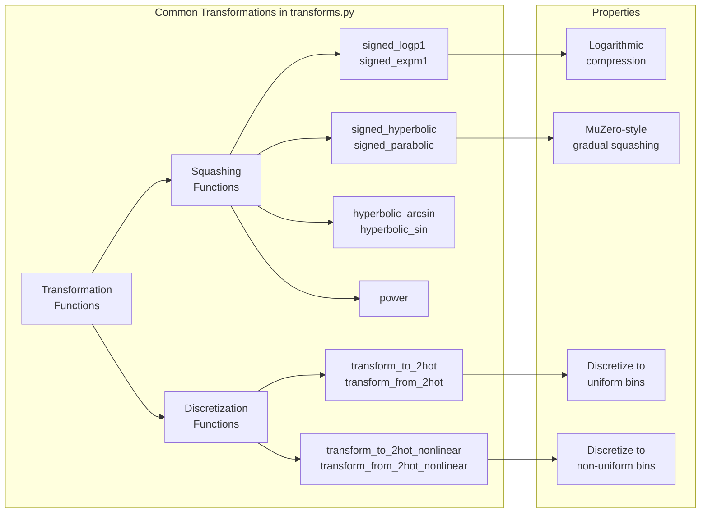

**Diagram: Transformation Functions in transforms.py**

**Sources:** [rlax/_src/transforms.py:48-89](), [rlax/_src/transforms.py:92-144]()

### 2-Hot Encoding

A **2-hot representation** discretizes a scalar value over a fixed support by distributing probability mass across two adjacent bins. This is particularly useful for representing value distributions.

**Forward Transformation** [rlax/_src/transforms.py:92-109]():
1. Clip scalar to `[min_value, max_value]`
2. Map to bin index in `[0, num_bins-1]`
3. Compute floor and ceiling bins
4. Distribute probability inversely proportional to distance

**Inverse Transformation** [rlax/_src/transforms.py:112-121]():
1. Compute weighted average over support space
2. Returns expected value under the categorical distribution

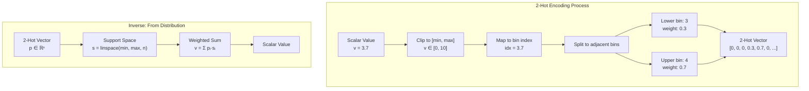

**Diagram: 2-Hot Encoding and Decoding**

**Sources:** [rlax/_src/transforms.py:92-121]()

---

## Composing Transformations

Transformation pairs can be composed using the `compose_tx` function [rlax/_src/nonlinear_bellman.py:74-99]().

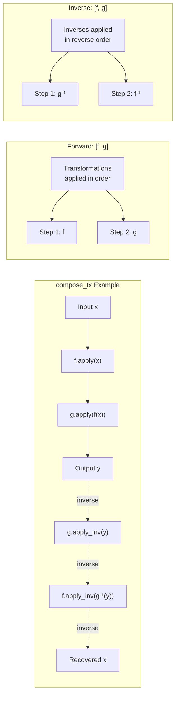

**Diagram: Transformation Composition**

The `compose_tx(*tx_list)` function creates a new `TxPair` where:
- **Forward**: Applies transformations in order `g(f(x))`
- **Inverse**: Applies inverses in reverse order `f⁻¹(g⁻¹(x))`

**Sources:** [rlax/_src/nonlinear_bellman.py:74-99]()

---

## MuZero Transformation Pair

The **MuZero transformation pair** [rlax/_src/nonlinear_bellman.py:102-124]() combines squashing with discretization, as introduced in the MuZero paper (Schrittwieser et al., 2019).

```python
def muzero_pair(min_value, max_value, num_bins, tx) -> TxPair:
    """Combines a monotonic squashing function with 2-hot encoding."""
    return compose_tx(tx, twohot_pair(min_value, max_value, num_bins))
```

This composition:
1. First applies a nonlinear squashing function (typically `SIGNED_HYPERBOLIC_PAIR`)
2. Then applies 2-hot encoding to discretize over a fixed support

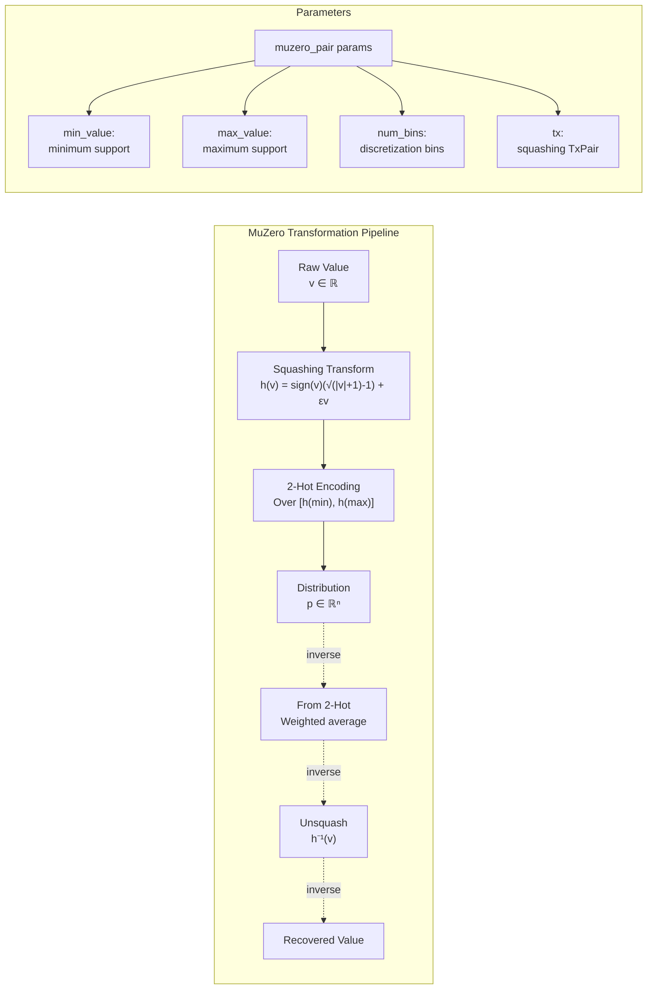

**Diagram: MuZero Transformation Pipeline**

**Example usage:**
```python
# Create a MuZero pair with signed hyperbolic squashing
muzero_tx = muzero_pair(
    min_value=-300.0,
    max_value=300.0,
    num_bins=601,
    tx=SIGNED_HYPERBOLIC_PAIR
)
```

**Sources:** [rlax/_src/nonlinear_bellman.py:102-124]()

---

## Unbiased Transformation Pair

The **unbiased transformation pair** [rlax/_src/nonlinear_bellman.py:127-155]() is an alternative to `muzero_pair` where the nonlinearity is applied to the bin locations rather than the scalar value.

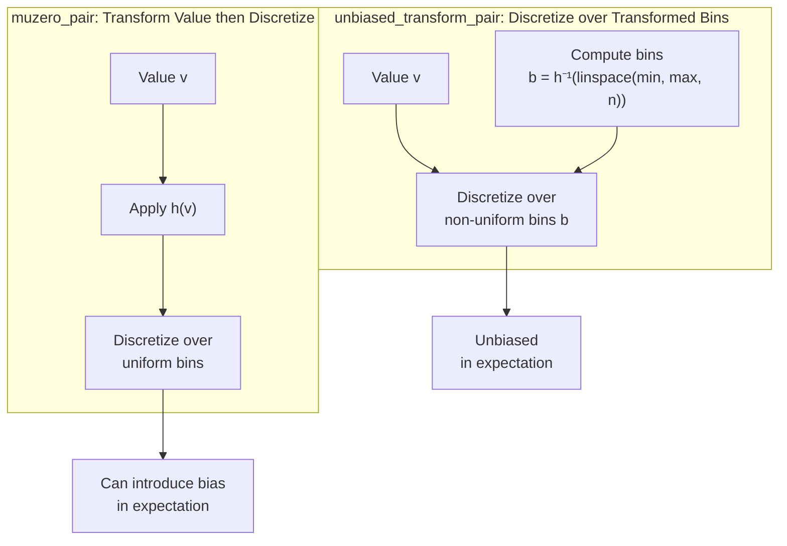

**Diagram: MuZero Pair vs Unbiased Transform Pair**

The key difference:
- **`muzero_pair`**: Transforms the value, then discretizes uniformly
- **`unbiased_transform_pair`**: Discretizes over non-uniform bins defined by the inverse transformation

The unbiased version uses `transform_to_2hot_nonlinear` [rlax/_src/transforms.py:124-136]() and `transform_from_2hot_nonlinear` [rlax/_src/transforms.py:139-144](), which work with arbitrary bin locations.

**Sources:** [rlax/_src/nonlinear_bellman.py:127-155](), [rlax/_src/transforms.py:124-144]()

---

## Transformed Value Learning Algorithms

The `transform_values` decorator [rlax/_src/nonlinear_bellman.py:158-169]() wraps existing return calculation functions to operate in transformed space.

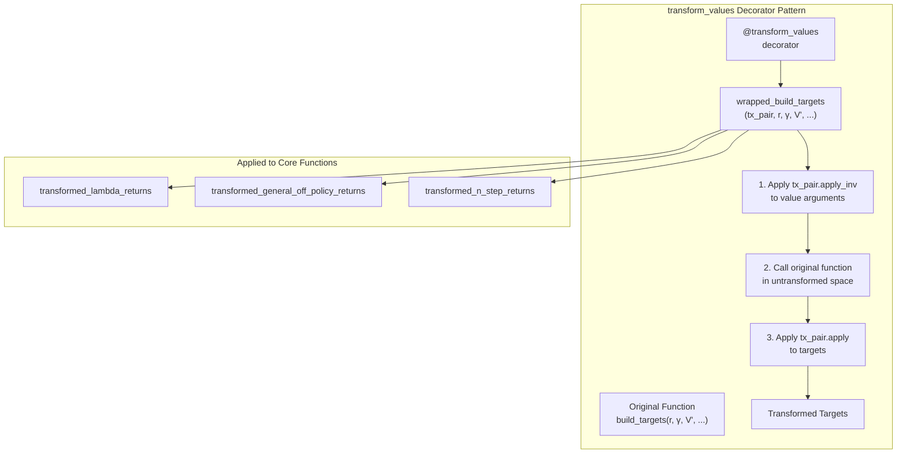

**Diagram: transform_values Decorator Mechanics**

**Sources:** [rlax/_src/nonlinear_bellman.py:158-169]()

### Transformed Lambda Returns

[rlax/_src/nonlinear_bellman.py:172]() wraps `multistep.lambda_returns`:

```python
transformed_lambda_returns = transform_values(multistep.lambda_returns, 2)
```

The `2` indicates that the value argument (position 2) should be inverse-transformed before computing returns.

### Transformed Q(λ)

The `transformed_q_lambda` function [rlax/_src/nonlinear_bellman.py:179-218]() computes Q(λ) TD errors with value transformations:

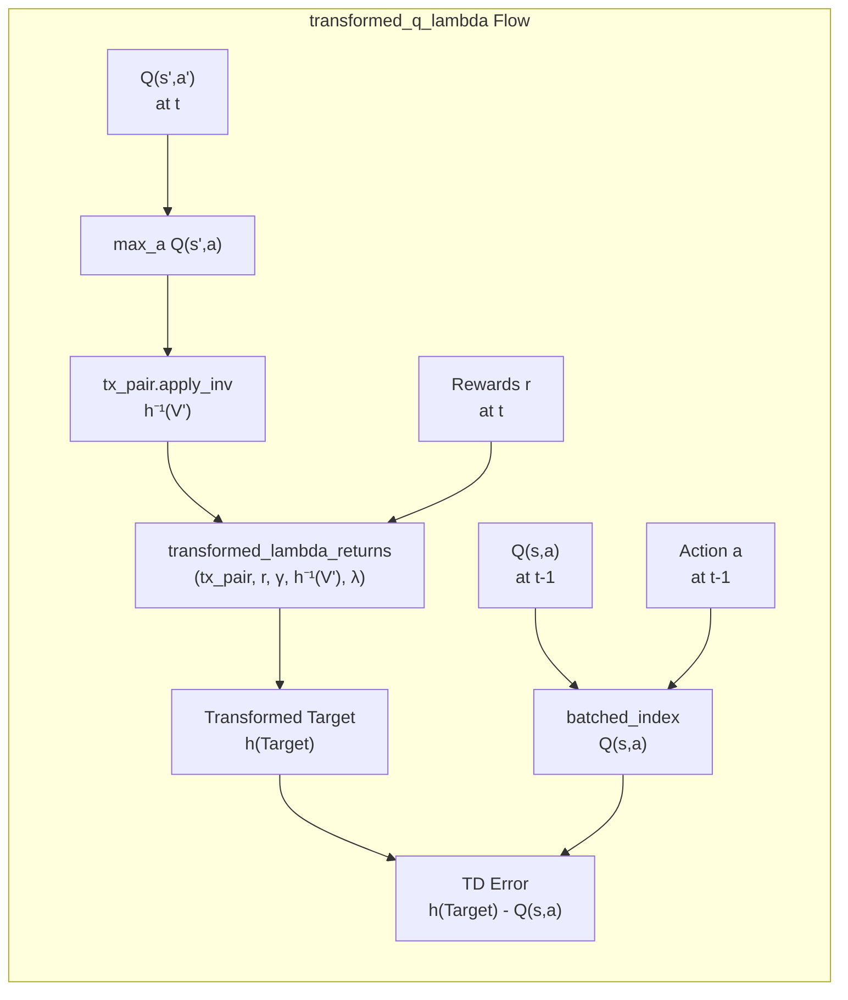

**Diagram: Transformed Q(λ) Calculation**

**Sources:** [rlax/_src/nonlinear_bellman.py:179-218]()

### Transformed Retrace

The `transformed_retrace` function [rlax/_src/nonlinear_bellman.py:221-268]() implements Retrace with value transformations for off-policy learning:

**Key features:**
- Supports importance sampling with policy ratio `π_t / μ_t`
- Computes trace cutting coefficients `c_t = min(1, π_a / μ) · λ`
- Uses `transformed_general_off_policy_returns_from_action_values`
- Suitable for experience replay and distributed training (as in R2D2)

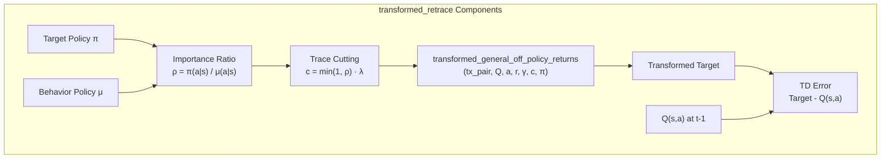

**Diagram: Transformed Retrace Algorithm**

**Sources:** [rlax/_src/nonlinear_bellman.py:221-268]()

### Transformed N-Step Q-Learning

The `transformed_n_step_q_learning` function [rlax/_src/nonlinear_bellman.py:271-314]() implements n-step TD with transformations:

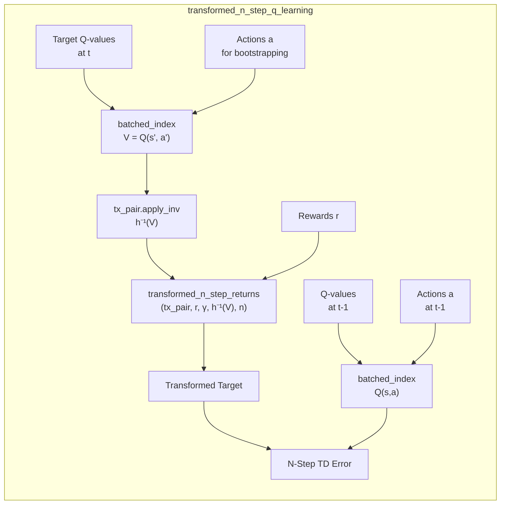

**Diagram: Transformed N-Step Q-Learning**

**Parameters:**
- `n`: Number of steps for reward accumulation
- Supports double Q-learning when `a_t` comes from online network
- Compatible with target network updates

**Sources:** [rlax/_src/nonlinear_bellman.py:271-314]()

---

## Usage Patterns

### Basic Transformation Example

```python
import rlax

# Define a transformation pair
tx_pair = rlax.SIGNED_HYPERBOLIC_PAIR

# Transform a value
raw_value = 100.0
transformed = tx_pair.apply(raw_value)  # Squashed value
recovered = tx_pair.apply_inv(transformed)  # Should equal raw_value

# Use in learning
q_values = network(state)
target_q = target_network(next_state)

td_error = rlax.transformed_q_lambda(
    q_tm1=q_values,
    a_tm1=actions,
    r_t=rewards,
    discount_t=discounts,
    q_t=target_q,
    lambda_=0.9,
    tx_pair=tx_pair
)
```

### MuZero-Style Transformation

```python
# Create MuZero transformation
muzero_tx = rlax.muzero_pair(
    min_value=-300.0,
    max_value=300.0,
    num_bins=601,
    tx=rlax.SIGNED_HYPERBOLIC_PAIR
)

# Value predictions are now distributions over bins
value_logits = network(state)  # Shape: [..., 601]
value_probs = jax.nn.softmax(value_logits)

# To get scalar value for action selection
scalar_value = muzero_tx.apply_inv(value_probs)

# Compute targets
targets = rlax.transformed_n_step_returns(
    muzero_tx,
    rewards,
    discounts,
    bootstrap_values,
    n=5
)

# Loss is cross-entropy between predicted and target distributions
loss = jax.nn.softmax_cross_entropy_with_logits(value_logits, targets)
```

---

## Relationship to Other RLax Components

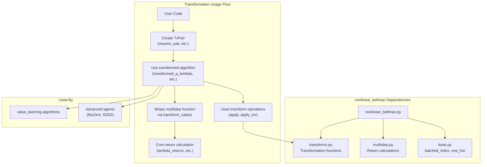

**Diagram: Nonlinear Bellman in RLax Architecture**

The nonlinear Bellman module:
- **Depends on**: `transforms.py` for transformation functions, `multistep.py` for base return calculations, `base.py` for array utilities
- **Used by**: Advanced value learning algorithms, agents that require value transformations
- **Provides**: TxPair abstraction, pre-built transformation pairs, transformed versions of core algorithms

**Sources:** [rlax/_src/nonlinear_bellman.py:1-315]()

---

## When to Use Value Transformations

| Scenario | Recommended Transformation | Rationale |
|----------|---------------------------|-----------|
| Unbounded value ranges | `SIGNED_HYPERBOLIC_PAIR` | Provides bounded gradients while preserving ordering |
| Large value magnitudes | `SIGNED_LOGP1_PAIR` | Logarithmic compression prevents overflow |
| Discrete value predictions | `muzero_pair` | Combines squashing with categorical representation |
| Unbiased discrete values | `unbiased_transform_pair` | Removes bias from discretization |
| Stable baseline | `IDENTITY_PAIR` | No transformation (useful for comparison) |
| Custom needs | Compose via `compose_tx` | Chain multiple transformations |

**Guidelines:**
1. Start with `IDENTITY_PAIR` as a baseline
2. If training is unstable due to large values, try `SIGNED_HYPERBOLIC_PAIR`
3. For distributional RL with fixed support, use `muzero_pair`
4. For off-policy learning with replay, combine transformations with `transformed_retrace`
5. Always verify that `tx_pair.apply_inv(tx_pair.apply(x))` recovers `x` accurately

---

## Summary

Value transformations in RLax enable learning in transformed spaces through:

1. **TxPair abstraction**: Clean interface for transformation/inverse pairs
2. **Pre-built transformations**: Ready-to-use squashing and discretization functions
3. **Transformed algorithms**: Drop-in replacements for core RL algorithms
4. **Composition utilities**: Combine transformations for complex behaviors
5. **MuZero support**: Complete implementation of MuZero-style value representations

The key advantage is improved stability and representational capacity when dealing with unbounded or highly variable value estimates, as demonstrated in state-of-the-art algorithms like MuZero and R2D2.

For the actual transformation mathematics, see [Value Transformations](#6.1). For specialized utilities beyond value transformations, see [Specialized Utilities](#6.2).

**Sources:** [rlax/_src/nonlinear_bellman.py:1-315](), [rlax/_src/transforms.py:1-145]()

---

