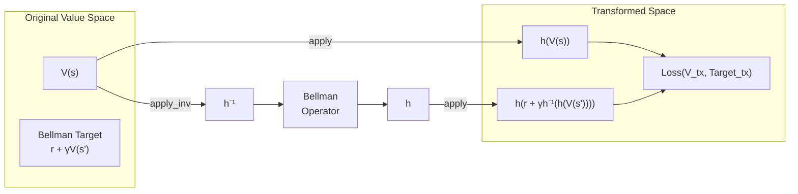
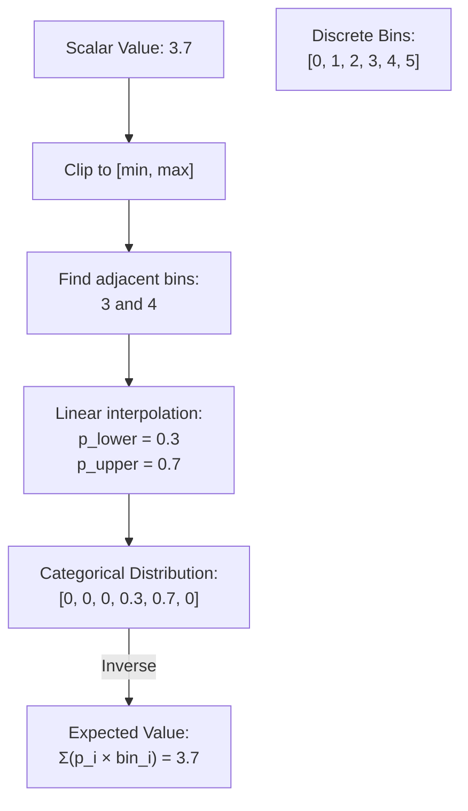
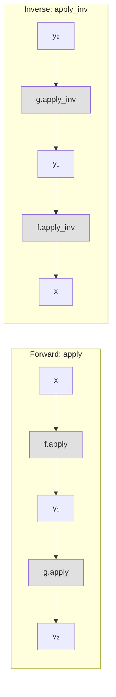
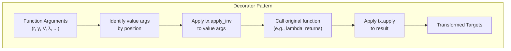
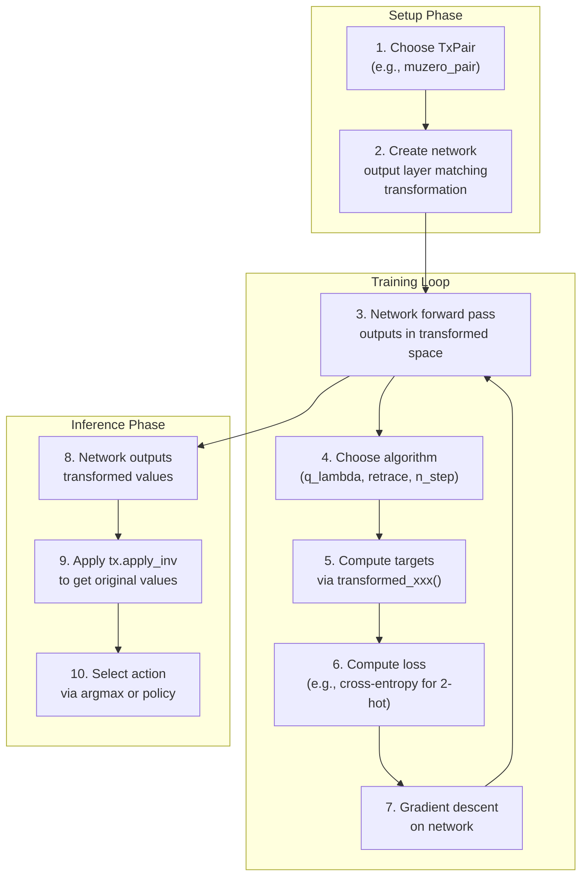
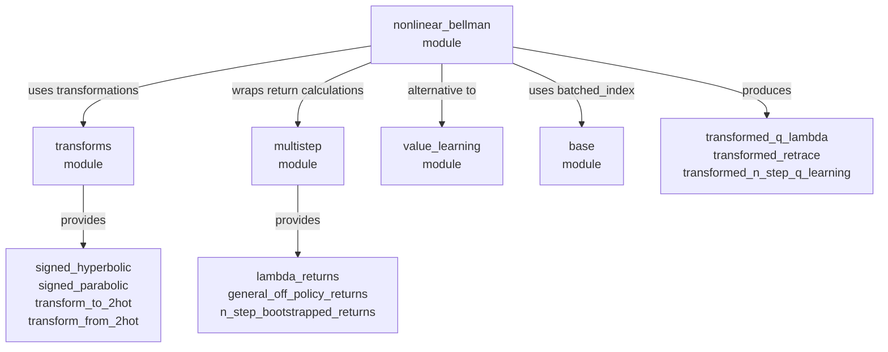

<!-- source: DeepWiki mcp.deepwiki.com · repo google-deepmind/rlax · page 6.1 Nonlinear Bellman Equations and Value Transformations · fetched 2026-10-26 -->

# Nonlinear Bellman Equations and Value Transformations

<details>
<summary>Relevant source files</summary>

The following files were used as context for generating this wiki page:

- [rlax/_src/nonlinear_bellman.py](rlax/_src/nonlinear_bellman.py)
- [rlax/_src/transforms.py](rlax/_src/transforms.py)

</details>


## Purpose and Scope

This page documents RLax's support for **nonlinear Bellman equations** and **value function transformations**. Standard reinforcement learning algorithms solve linear Bellman equations where value functions are fixed points of recursive relations. This module provides utilities to instead learn **transformed value functions** that solve nonlinear generalizations of Bellman equations.

The key abstraction is `TxPair`, which encapsulates a transformation and its inverse. These pairs can be applied to wrap standard temporal difference algorithms, enabling techniques from papers like MuZero (Schrittwieser et al., 2019) and "General non-linear Bellman equations" (van Hasselt et al., 2019).

**Scope:** This page covers the `nonlinear_bellman` module and related transformations from the `transforms` module. For standard (untransformed) value learning algorithms, see [Basic Value Learning](#2.1). For multistep return calculations that these transformations wrap, see [Multistep Returns and Credit Assignment](#3).

**Sources:** [rlax/_src/nonlinear_bellman.py:1-24]()

---

## Core Concepts

### The TxPair Abstraction

The fundamental building block is the `TxPair` named tuple, which pairs a transformation with its inverse:

```python
TxPair = collections.namedtuple('TxPair', ['apply', 'apply_inv'])
```

- **`apply`**: Forward transformation function `h(x)` that maps values to transformed space
- **`apply_inv`**: Inverse transformation function `h^{-1}(y)` that maps back to original space

This abstraction enables a general pattern: transform values before computing Bellman targets, then apply the inverse transformation to bring predictions into the same space for regression.



**Sources:** [rlax/_src/nonlinear_bellman.py:37-38]()

---

### Why Transform Values?

Nonlinear transformations serve several purposes:

1. **Stability**: Squashing functions like `signed_hyperbolic` bound the range of value estimates, preventing divergence
2. **Improved representations**: Transform value space to match the actual distribution of returns (e.g., heavy-tailed distributions)
3. **Discretization**: Represent continuous values as categorical distributions over discrete bins (2-hot encoding)
4. **Faster learning**: Some transformations can improve credit propagation by changing the geometry of the value space

**Key insight**: The transformation must preserve the ordering of values (monotonic) to maintain the correctness of greedy action selection.

**Sources:** [rlax/_src/nonlinear_bellman.py:15-24]()

---

## Predefined Transformations

### Scalar Transformations

RLax provides several predefined `TxPair` instances for common scalar transformations:

| Transform Pair | Forward Function | Inverse Function | Use Case |
|----------------|------------------|------------------|----------|
| `IDENTITY_PAIR` | `identity(x)` | `identity(x)` | No transformation (baseline) |
| `SIGNED_LOGP1_PAIR` | `signed_logp1(x)` | `signed_expm1(x)` | Logarithmic compression |
| `SIGNED_HYPERBOLIC_PAIR` | `signed_hyperbolic(x)` | `signed_parabolic(x)` | Gentle squashing (MuZero) |
| `HYPERBOLIC_SIN_PAIR` | `hyperbolic_arcsin(x)` | `hyperbolic_sin(x)` | Symmetric squashing |
| `DISCOUNT_TRANSFORM_PAIR` | `-log(1-x)` | `1-exp(-x)` | Transform discounts |

The **signed hyperbolic** transformation is particularly important, used in MuZero:

```
h(x) = sign(x) * (√(|x| + 1) - 1) + εx
h⁻¹(x) = sign(x) * (z² - 1)  where z = √(1 + 4ε(ε + 1 + |x|)) / 2ε - 1/2ε
```

This provides gentle squashing while preserving gradients near zero (via the εx term).

**Sources:** [rlax/_src/nonlinear_bellman.py:40-53](), [rlax/_src/transforms.py:60-83]()

---

### Discretization Transformations (2-Hot Encoding)

The **2-hot encoding** discretizes scalar values into categorical distributions over a fixed support:



The `twohot_pair` function creates a transformation pair:

```python
def twohot_pair(min_value: float, max_value: float, num_bins: int) -> TxPair
```

- **Forward** (`transform_to_2hot`): Maps scalar → categorical distribution with at most 2 non-zero probabilities
- **Inverse** (`transform_from_2hot`): Maps categorical → scalar via expected value

This representation has advantages for neural networks learning value functions:
- Provides richer gradient signal (classification over bins vs. regression)
- Naturally handles multi-modal distributions
- Used in C51, Rainbow DQN, and MuZero

**Sources:** [rlax/_src/nonlinear_bellman.py:56-71](), [rlax/_src/transforms.py:92-122]()

---

## Composing Transformations

### The compose_tx Utility

Multiple transformations can be chained using `compose_tx`:

```python
def compose_tx(*tx_list) -> TxPair
```

Transformations are applied **in order** during forward pass and **reverse order** during inverse:



Example:
```python
# Compose log transform then hyperbolic transform
composed = compose_tx(SIGNED_LOGP1_PAIR, SIGNED_HYPERBOLIC_PAIR)
# Forward: y = hyperbolic(log(x))
# Inverse: x = exp(parabolic(y))
```

**Sources:** [rlax/_src/nonlinear_bellman.py:74-99]()

---

### MuZero Pair

The **MuZero transformation** combines a scalar squashing function with 2-hot discretization:

```python
def muzero_pair(
    min_value: float,
    max_value: float,
    num_bins: int,
    tx: TxPair
) -> TxPair
```

This creates: `compose_tx(tx, twohot_pair(min_value, max_value, num_bins))`

**Typical usage** (as in MuZero paper):
```python
muzero_tx = muzero_pair(
    min_value=-300.0,
    max_value=300.0,
    num_bins=601,
    tx=SIGNED_HYPERBOLIC_PAIR
)
```

The pipeline:
1. Apply scalar transformation (e.g., `signed_hyperbolic`) to value
2. Apply 2-hot encoding to transformed value
3. Network outputs categorical distribution
4. To get scalar prediction: inverse 2-hot → inverse scalar transform

**Sources:** [rlax/_src/nonlinear_bellman.py:102-124]()

---

### Unbiased Transform Pair

The **unbiased transformation** applies the nonlinearity to the **bin locations** rather than the scalar values:

```python
def unbiased_transform_pair(
    min_value: float,
    max_value: float,
    num_bins: int,
    tx: TxPair
) -> TxPair
```

**Key difference from MuZero pair:**

| Aspect | MuZero Pair | Unbiased Pair |
|--------|-------------|---------------|
| Bin spacing | Uniform in transformed space | Nonlinear (transformed from uniform) |
| Scalar transform | Applied to values | Applied to bin locations |
| Bias | Can introduce bias from discretization | Reduces discretization bias |

The unbiased version:
1. Creates bins by inverse-transforming uniformly-spaced points: `bins = tx.apply_inv(linspace(min, max, num_bins))`
2. Uses `transform_to_2hot_nonlinear` with these non-uniform bins
3. Results in more accurate representation of the original (untransformed) values

**Sources:** [rlax/_src/nonlinear_bellman.py:127-155](), [rlax/_src/transforms.py:124-144]()

---

## Transformed Learning Algorithms

### The transform_values Decorator

The core utility for wrapping return calculations is `transform_values`:

```python
def transform_values(build_targets, *value_argnums) -> Callable
```

This decorator:
1. Applies `tx_pair.apply_inv` to specified value arguments (positions in `value_argnums`)
2. Calls the original target construction function
3. Applies `tx_pair.apply` to the resulting targets



**Predefined wrapped functions:**
- `transformed_lambda_returns` - wraps `multistep.lambda_returns`
- `transformed_general_off_policy_returns_from_action_values` - wraps `multistep.general_off_policy_returns_from_action_values`
- `transformed_n_step_returns` - wraps `multistep.n_step_bootstrapped_returns`

**Sources:** [rlax/_src/nonlinear_bellman.py:158-177]()

---

### Transformed Q-Lambda

The `transformed_q_lambda` function computes temporal difference errors for Peng's or Watkins' Q(λ) with value transformations:

```python
def transformed_q_lambda(
    q_tm1: Array,      # Q-values at t-1
    a_tm1: Array,      # Actions at t-1
    r_t: Array,        # Rewards at t
    discount_t: Array, # Discounts at t
    q_t: Array,        # Q-values at t
    lambda_: Array,    # Mixing parameter
    stop_target_gradients: bool = True,
    tx_pair: TxPair = IDENTITY_PAIR,
) -> Array
```

**Algorithm:**
1. Extract Q(s_{t-1}, a_{t-1}) from q_tm1
2. Compute V(s_t) = max_a Q(s_t, a)
3. Compute transformed lambda returns: `target = h(r + γh^{-1}(h(V)) + λγh^{-1}(h(V)) + ...)`
4. Return TD error: `target - Q(s_{t-1}, a_{t-1})`

The transformation is applied through `transformed_lambda_returns`, which handles the complex multistep bootstrapping in transformed space.

**Sources:** [rlax/_src/nonlinear_bellman.py:179-218]()

---

### Transformed Retrace

The `transformed_retrace` function extends Retrace (off-policy actor-critic) to transformed values:

```python
def transformed_retrace(
    q_tm1: Array,      # Q-values at t-1
    q_t: Array,        # Q-values at t
    a_tm1: Array,      # Actions at t-1
    a_t: Array,        # Actions at t
    r_t: Array,        # Rewards at t
    discount_t: Array, # Discounts at t
    pi_t: Array,       # Target policy probs at t
    mu_t: Array,       # Behavior policy probs at t
    lambda_: float,    # Mixing parameter
    eps: float = 1e-8,
    stop_target_gradients: bool = True,
    tx_pair: TxPair = IDENTITY_PAIR,
) -> Array
```

**Key steps:**
1. Compute importance sampling weights: `c_t = min(1, π(a_t|s_t) / μ(a_t|s_t)) × λ`
2. Use `transformed_general_off_policy_returns_from_action_values` to compute targets with trace cutting
3. Return TD error in original space

This is used in R2D2 (Kapturowski et al., 2019) with `SIGNED_HYPERBOLIC_PAIR` or `muzero_pair`.

**Sources:** [rlax/_src/nonlinear_bellman.py:221-268]()

---

### Transformed N-Step Q-Learning

The `transformed_n_step_q_learning` function handles n-step TD with transformations:

```python
def transformed_n_step_q_learning(
    q_tm1: Array,        # Q-values at t-1
    a_tm1: Array,        # Actions at t-1
    target_q_t: Array,   # Target Q-values at t
    a_t: Array,          # Actions at t (for bootstrapping)
    r_t: Array,          # Rewards at t
    discount_t: Array,   # Discounts at t
    n: int,              # Number of steps
    stop_target_gradients: bool = True,
    tx_pair: TxPair = IDENTITY_PAIR,
) -> Array
```

**Algorithm:**
1. Select bootstrap values: `V(s_t) = Q_target(s_t, a_t)`
2. Compute n-step returns in transformed space: `target = h(Σ_{k=0}^{n-1} γ^k r_{t+k} + γ^n h^{-1}(h(V_{t+n})))`
3. Return TD error: `target - Q(s_{t-1}, a_{t-1})`

The `a_t` argument allows for double Q-learning (use argmax from online network, evaluate with target network).

**Sources:** [rlax/_src/nonlinear_bellman.py:271-314]()

---

## Code Entity Reference

The following table maps conceptual entities to their code locations:

| Concept | Code Entity | File | Purpose |
|---------|-------------|------|---------|
| Transform pair abstraction | `TxPair` | [nonlinear_bellman.py:37]() | Named tuple with `apply` and `apply_inv` |
| Identity (no-op) | `IDENTITY_PAIR` | [nonlinear_bellman.py:43-44]() | Baseline for comparison |
| Log transform | `SIGNED_LOGP1_PAIR` | [nonlinear_bellman.py:45-46]() | Logarithmic compression |
| Hyperbolic squashing | `SIGNED_HYPERBOLIC_PAIR` | [nonlinear_bellman.py:47-48]() | Used in MuZero |
| Hyperbolic sine | `HYPERBOLIC_SIN_PAIR` | [nonlinear_bellman.py:49-50]() | Symmetric squashing |
| Discount transform | `DISCOUNT_TRANSFORM_PAIR` | [nonlinear_bellman.py:51-53]() | For discount factors |
| 2-hot encoding | `twohot_pair()` | [nonlinear_bellman.py:56-71]() | Discretization transform |
| Composition | `compose_tx()` | [nonlinear_bellman.py:74-99]() | Chain multiple transforms |
| MuZero transform | `muzero_pair()` | [nonlinear_bellman.py:102-124]() | Squashing + discretization |
| Unbiased transform | `unbiased_transform_pair()` | [nonlinear_bellman.py:127-155]() | Nonlinear bins |
| Wrapping decorator | `transform_values()` | [nonlinear_bellman.py:158-169]() | Apply transforms to targets |
| Q-lambda | `transformed_q_lambda()` | [nonlinear_bellman.py:179-218]() | Transformed Q(λ) |
| Retrace | `transformed_retrace()` | [nonlinear_bellman.py:221-268]() | Transformed off-policy |
| N-step Q | `transformed_n_step_q_learning()` | [nonlinear_bellman.py:271-314]() | Transformed n-step TD |

**Sources:** [rlax/_src/nonlinear_bellman.py:1-314]()

---

## Implementation Details and Usage Pattern

### Typical Workflow



### Example: MuZero-style Value Learning

```python
# 1. Define transformation
tx_pair = rlax.muzero_pair(
    min_value=-300.0,
    max_value=300.0,
    num_bins=601,
    tx=rlax.SIGNED_HYPERBOLIC_PAIR
)

# 2. Network outputs 601-dimensional categorical distribution
network_output = network(state)  # Shape: [batch, 601]

# 3. Compute transformed targets
transformed_targets = rlax.transformed_n_step_q_learning(
    q_tm1=q_values_tm1,
    a_tm1=actions_tm1,
    target_q_t=target_q_values_t,
    a_t=actions_t,
    r_t=rewards_t,
    discount_t=discounts_t,
    n=5,
    tx_pair=tx_pair
)

# 4. Loss is cross-entropy (classification over bins)
loss = cross_entropy_loss(network_output, transformed_targets)

# 5. For action selection, invert the transformation
scalar_values = tx_pair.apply_inv(network_output)  # [batch, num_actions]
actions = jnp.argmax(scalar_values, axis=-1)
```

**Sources:** [rlax/_src/nonlinear_bellman.py:102-314]()

---

## Relationship to Other Modules



- **transforms module**: Provides the low-level transformation functions
- **multistep module**: Provides the return calculation functions that get wrapped
- **value_learning module**: Provides untransformed versions of the same algorithms
- **base module**: Provides utilities like `batched_index` for selecting action values

**Sources:** [rlax/_src/nonlinear_bellman.py:32-34](), [rlax/_src/nonlinear_bellman.py:158-177]()

---

## Performance Considerations

**When to use transformations:**
- ✓ Large value scales (> 100): Use `SIGNED_HYPERBOLIC_PAIR` to bound values
- ✓ Multi-modal value distributions: Use 2-hot encoding
- ✓ Difficulty with value prediction stability: Try transformations to change loss landscape
- ✓ Replicating papers (MuZero, R2D2): Use the specific transformation from the paper

**When NOT to use transformations:**
- ✗ Small-scale problems (CartPole, simple gridworlds): Overhead not worth it
- ✗ When interpretability is critical: Transformed values harder to debug
- ✗ Very fast inference required: Inverse transformations add computation

**Computational cost:**
- Scalar transformations: Minimal overhead (few FLOPs per value)
- 2-hot encoding: Moderate overhead (requires one-hot conversion and summation)
- MuZero pair: Higher overhead (both scalar transform and 2-hot encoding)

**Sources:** [rlax/_src/nonlinear_bellman.py:15-24]()

---

