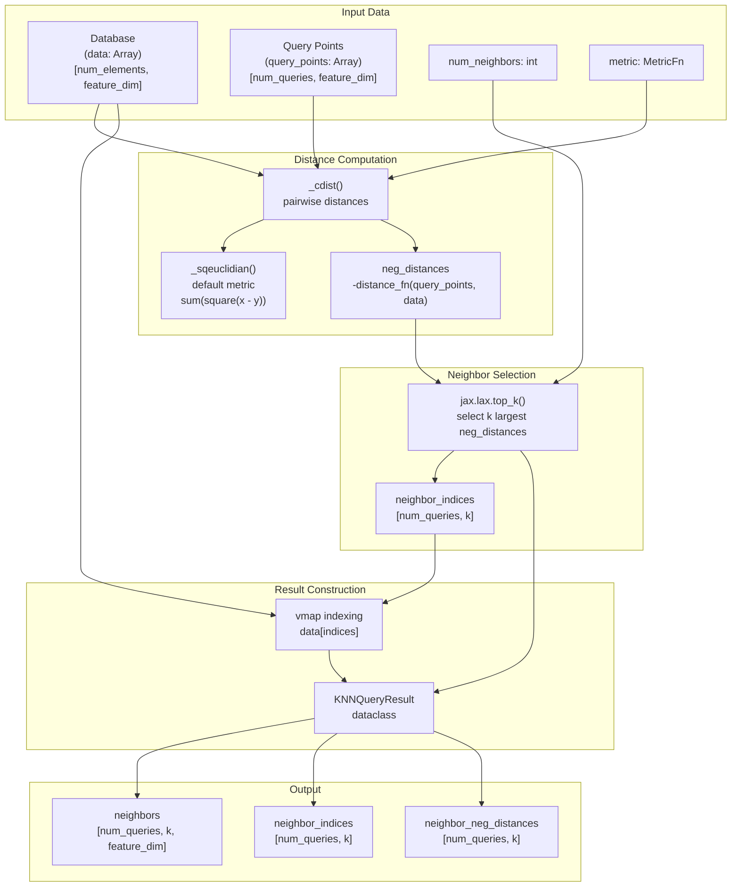
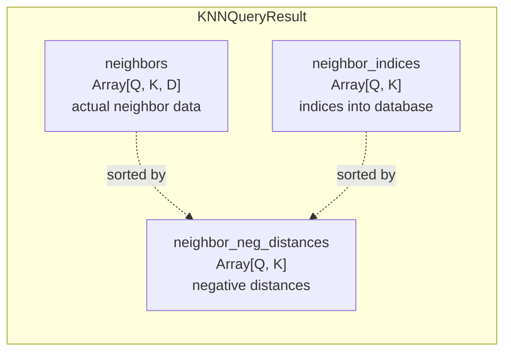
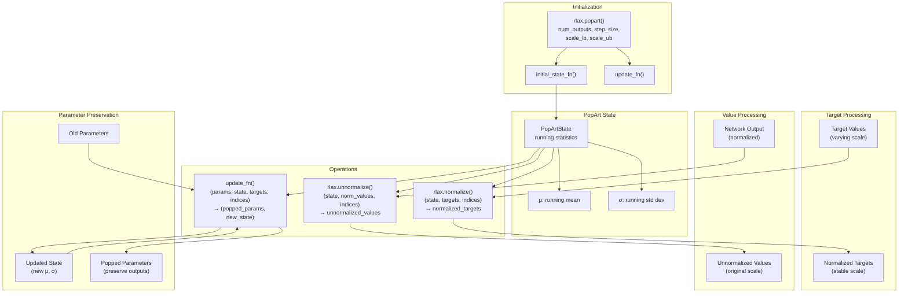
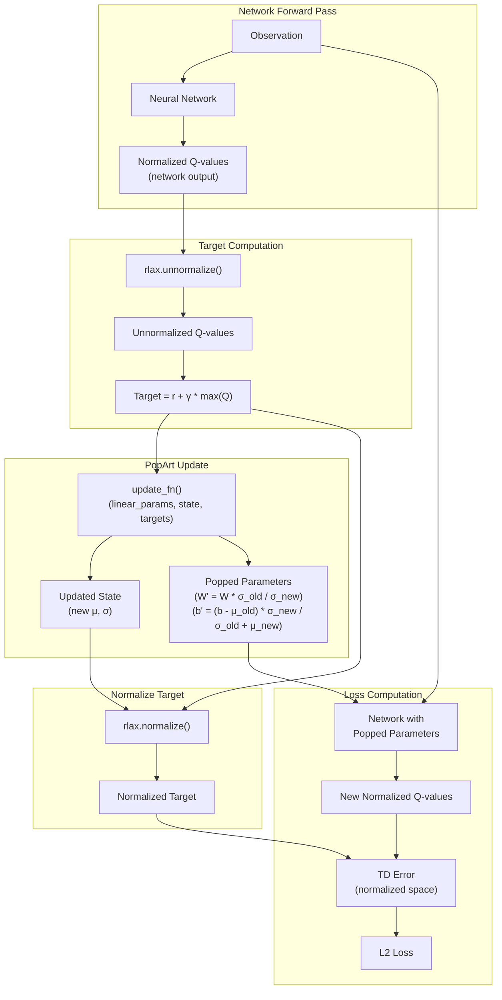
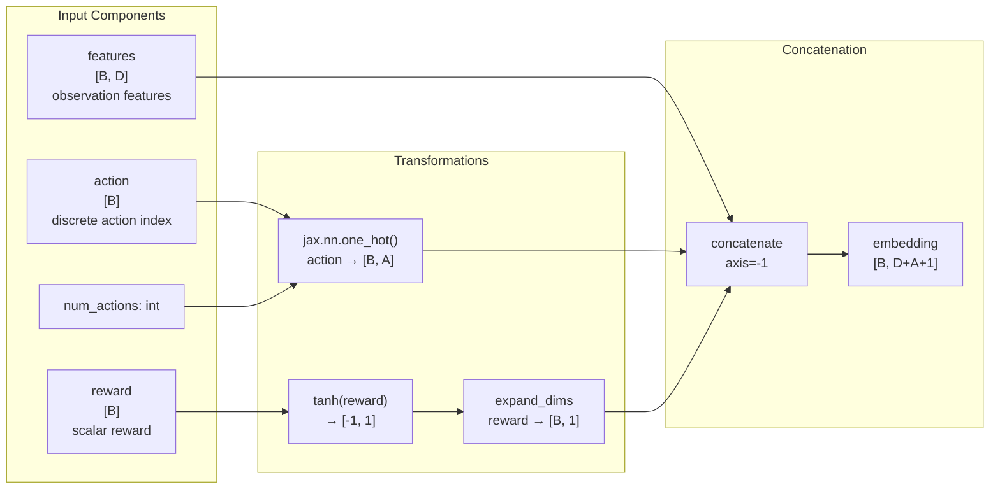

<!-- source: DeepWiki mcp.deepwiki.com · repo google-deepmind/rlax · page 6.2 Specialized Utilities · fetched 2026-10-26 -->

# Specialized Utilities

<details>
<summary>Relevant source files</summary>

The following files were used as context for generating this wiki page:

- [README.md](README.md)
- [examples/__init__.py](examples/__init__.py)
- [examples/experiment.py](examples/experiment.py)
- [examples/online_q_learning.py](examples/online_q_learning.py)
- [examples/pop_art.py](examples/pop_art.py)
- [examples/simple_dqn.py](examples/simple_dqn.py)
- [rlax/_src/embedding.py](rlax/_src/embedding.py)
- [rlax/_src/episodic_memory.py](rlax/_src/episodic_memory.py)
- [rlax/_src/mpo_ops.py](rlax/_src/mpo_ops.py)
- [rlax/_src/mpo_ops_test.py](rlax/_src/mpo_ops_test.py)

</details>


This page documents specialized utility functions in RLax that support specific reinforcement learning techniques beyond the core algorithmic building blocks. These utilities include episodic memory for exploration, PopArt normalization for handling non-stationary reward distributions, and embedding functions for combining observations, actions, and rewards.

For basic array operations and PyTree utilities, see [Base Array Operations](#7.2) and [PyTree Utilities](#7.1). For value transformations used in Bellman operators, see [Nonlinear Bellman Equations and Value Transformations](#6.1).

---

## Episodic Memory for Exploration

Episodic memory provides a mechanism for agents to compute exploration bonuses based on novelty. The agent maintains a database of previously visited states (or state embeddings) and queries this memory to determine how novel the current state is. Novel states receive higher exploration bonuses, encouraging the agent to explore under-visited regions of the state space.

### KNN Query Interface

The episodic memory system centers around a k-nearest neighbors (KNN) query operation that finds the closest neighbors in a database to given query points.

**Diagram: Episodic Memory KNN Query Flow**



Sources: [rlax/_src/episodic_memory.py:49-85]()

### Core Functions

| Function | Purpose | Signature |
|----------|---------|-----------|
| `knn_query()` | Find k-nearest neighbors | `(data, query_points, num_neighbors, metric) -> KNNQueryResult` |
| `_cdist()` | Compute pairwise distances | `(a, b, metric) -> Array` |
| `_sqeuclidian()` | Default squared Euclidean metric | `(x, y) -> Array` |

The `knn_query()` function is the main entry point. It takes a database of embeddings and query points, then returns the closest neighbors along with their indices and (negative) distances. The function uses negative distances internally so that `jax.lax.top_k` can select the nearest neighbors (highest negative distance = smallest positive distance).

**Important Implementation Detail**: To make `knn_query()` jittable, you must pass `static_argnums=[2,]` to `jax.jit()` because `num_neighbors` must be known at compile time for the internal `jax.lax.top_k()` operation.

```python
# Example usage pattern
jit_knn_query = jax.jit(
    rlax.knn_query, 
    static_argnums=[2,]  # num_neighbors must be static
)
result = jit_knn_query(database, queries, k=5)
```

Sources: [rlax/_src/episodic_memory.py:49-85]()

### Data Structures

**KNNQueryResult Dataclass**



Where:
- `Q` = number of query points
- `K` = number of neighbors requested
- `D` = feature dimension

Sources: [rlax/_src/episodic_memory.py:33-37]()

### Metric Functions

Custom distance metrics can be provided to `knn_query()`. A metric function has signature `MetricFn = Callable[[Array, Array], Array]` and should compute a scalar distance between two feature vectors.

The default metric is squared Euclidean distance: `sum(square(x - y))`. To use a different metric (e.g., cosine distance, Manhattan distance), implement a function matching this signature and pass it as the `metric` argument.

Sources: [rlax/_src/episodic_memory.py:40-46]()

### Usage in Exploration

Episodic memory is typically used to compute intrinsic rewards based on state novelty:

1. **Maintain a database**: Store embeddings of visited states
2. **Query at each step**: Find k-nearest neighbors to current state
3. **Compute bonus**: Use inverse distance or kernel function on neighbors to compute exploration bonus
4. **Update database**: Periodically add new state embeddings to memory

The exploration bonus encourages the agent to visit states that are far from previously seen states, promoting exploration of novel areas.

Sources: [rlax/_src/episodic_memory.py:15-20]()

---

## PopArt Normalization

PopArt (Preserving Outputs Precisely while Adaptively Rescaling Targets) is a technique for handling non-stationary reward distributions in reinforcement learning. It normalizes value targets while preserving the network's output semantics, allowing agents to handle rewards that change scale over time or across different tasks.

### PopArt Operations

**Diagram: PopArt State and Operations**



Sources: [examples/pop_art.py:100-159]()

### Core Operations

| Operation | Purpose | Key Behavior |
|-----------|---------|--------------|
| `rlax.popart()` | Initialize PopArt system | Returns `(initial_state_fn, update_fn)` |
| `rlax.normalize()` | Normalize targets | `(target - μ) / σ` |
| `rlax.unnormalize()` | Unnormalize values | `value * σ + μ` |
| `update_fn()` | Update statistics and POP parameters | Updates μ, σ and adjusts network weights to preserve outputs |

The key insight is the "POP" (Preserve Outputs Precisely) operation: when PopArt statistics update, the final layer parameters are adjusted so the network's outputs remain unchanged despite the shift in normalization statistics.

Sources: [examples/pop_art.py:100-101]()

### PopArt Workflow

**Diagram: PopArt Training Loop**



Sources: [examples/pop_art.py:130-159]()

### Implementation Example

The PopArt example demonstrates the typical usage pattern:

1. **Initialize PopArt** with number of outputs (typically 1 for value functions):
   ```python
   initial_state, pop_art_update = rlax.popart(
       num_outputs=1, 
       step_size=3e-3,
       scale_lb=1e-5, 
       scale_ub=1e5
   )
   ```

2. **In loss computation**:
   - Unnormalize network outputs to compute targets in original scale
   - Update PopArt statistics and POP network parameters
   - Normalize targets with updated statistics
   - Compute loss in normalized space

3. **Parameter update**: The POP operation modifies the final linear layer's weights and biases to preserve outputs:
   ```
   W' = W * (σ_old / σ_new)
   b' = ((b - μ_old) / σ_old) * σ_new + μ_new
   ```

Sources: [examples/pop_art.py:100-159]()

### When to Use PopArt

PopArt is beneficial when:

- **Reward scales vary**: Across different tasks or over time within a task
- **Non-stationary environments**: Where reward distributions shift
- **Multi-task learning**: When training on tasks with different reward magnitudes

The example shows learning on Catch with rewards scaled by 10,000x. With PopArt, the agent learns faster because the normalized targets remain in a stable range regardless of the large reward scale.

Sources: [examples/pop_art.py:15-18](), [examples/pop_art.py:39-39]()

---

## Embedding Utilities

Embedding utilities provide functions for combining different types of inputs (observations, actions, rewards) into unified representations suitable for neural network processing.

### OAR Embedding

**Diagram: OAR Embedding Structure**



Sources: [rlax/_src/embedding.py:24-35]()

### embed_oar Function

The `embed_oar()` function creates a combined embedding from observations, actions, and rewards:

**Function Signature**:
```python
def embed_oar(
    features: Array,      # [B, D] - observation features
    action: Array,        # [B] - action indices
    reward: Array,        # [B] - scalar rewards
    num_actions: int      # number of possible actions
) -> Array:               # [B, D+A+1] - combined embedding
```

**Processing Steps**:

1. **One-hot encode actions**: Converts discrete action indices to one-hot vectors `[B, A]`
2. **Squash rewards**: Applies `tanh()` to bound rewards to `[-1, 1]`
3. **Expand reward dimensions**: Reshapes `[B]` to `[B, 1]` for concatenation
4. **Concatenate all components**: Joins features, one-hot actions, and squashed rewards along feature dimension

The resulting embedding has shape `[B, D+A+1]` where:
- `B` = batch size
- `D` = observation feature dimension
- `A` = number of actions
- `1` = scalar reward dimension

Sources: [rlax/_src/embedding.py:24-35]()

### Use Cases

The OAR embedding is useful for:

- **Recurrent architectures**: LSTMs/GRUs that process sequences of (observation, action, reward) tuples
- **Model-based learning**: World models that predict next states given (s, a, r)
- **Meta-learning**: Tasks requiring awareness of action-reward history
- **Auxiliary tasks**: Predicting rewards or actions from observation sequences

This embedding pattern is common in recurrent RL agents where the hidden state must track not just observations but also the agent's recent action-reward history.

Sources: [rlax/_src/embedding.py:15-15]()

---

## Summary

The specialized utilities covered in this section provide targeted functionality for specific RL techniques:

| Utility | Module | Primary Use Case |
|---------|--------|-----------------|
| Episodic Memory | `episodic_memory` | Exploration bonuses via state novelty detection |
| PopArt | Main API (examples) | Handling non-stationary reward distributions |
| OAR Embedding | `embedding` | Combining observations, actions, rewards for recurrent models |

These utilities complement the core algorithmic building blocks (value learning, policy gradients, multistep returns) by enabling advanced techniques like curiosity-driven exploration and adaptive normalization.

**Key Constraints to Remember**:
- `knn_query()` requires `static_argnums=[2,]` for jitting
- PopArt update must be applied to the final linear layer parameters
- OAR embedding expects discrete actions (uses one-hot encoding)

Sources: [rlax/_src/episodic_memory.py:1-86](), [examples/pop_art.py:1-189](), [rlax/_src/embedding.py:1-36]()

---

