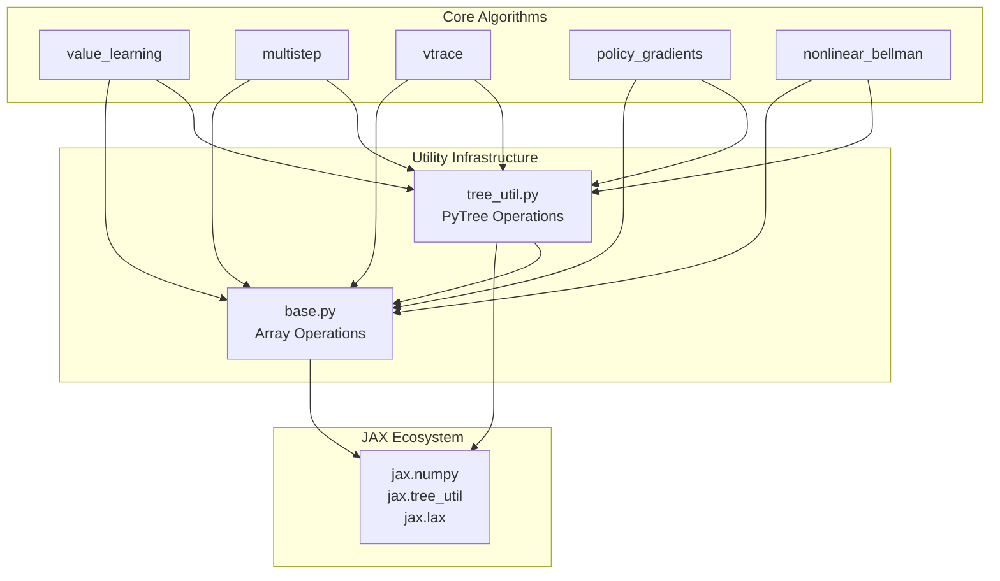
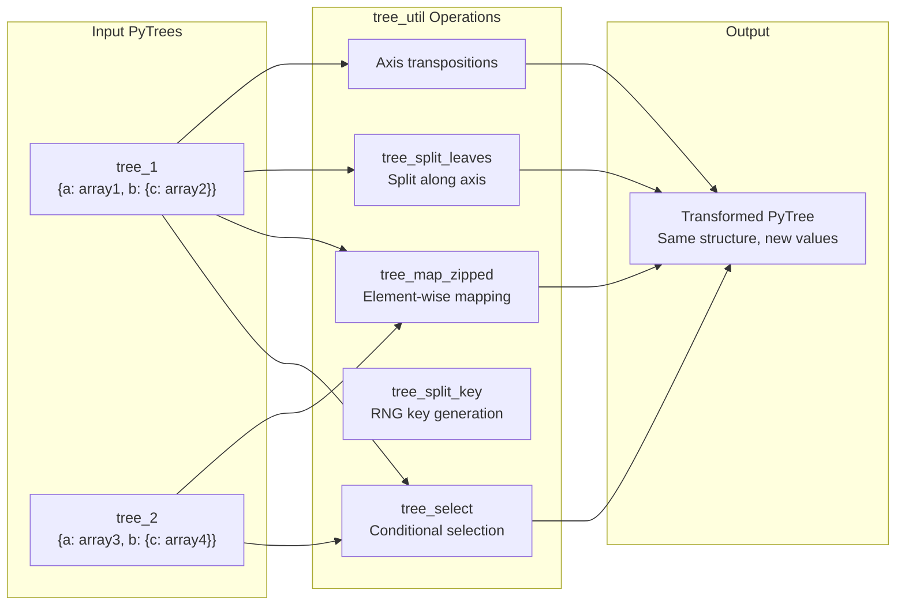
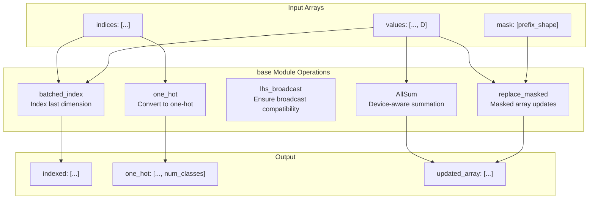
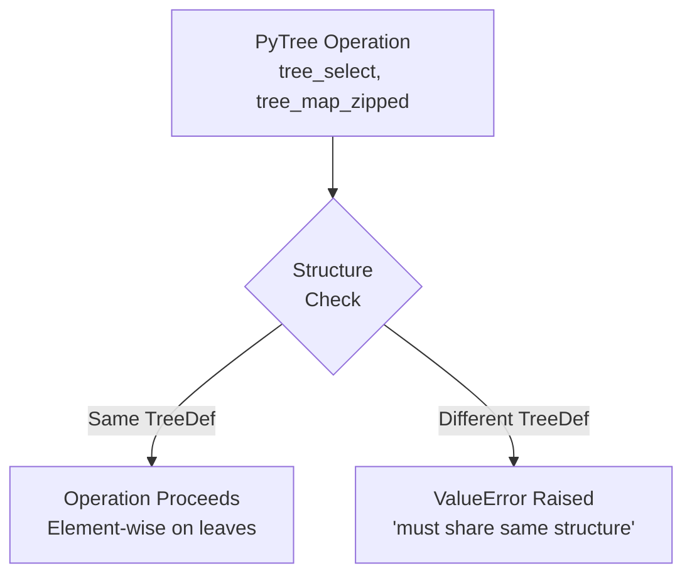

<!-- source: DeepWiki mcp.deepwiki.com · repo google-deepmind/rlax · page 7 Utility Functions and Infrastructure · fetched 2026-10-26 -->

# Utility Functions and Infrastructure

<details>
<summary>Relevant source files</summary>

The following files were used as context for generating this wiki page:

- [rlax/_src/base.py](rlax/_src/base.py)
- [rlax/_src/base_test.py](rlax/_src/base_test.py)
- [rlax/_src/tree_util.py](rlax/_src/tree_util.py)
- [rlax/_src/tree_util_test.py](rlax/_src/tree_util_test.py)

</details>


This document covers the foundational utility functions that support all RLax algorithms. These utilities provide low-level operations for manipulating arrays, nested structures (PyTrees), and orchestrating distributed computations. They form the base layer of the RLax architecture and are used extensively by higher-level algorithmic modules.

For detailed documentation of specific utility categories, see:
- PyTree manipulation functions: [PyTree Utilities](#7.1)
- Basic array operations: [Base Array Operations](#7.2)
- Parameter update mechanisms: [Parameter Updates and Clipping](#7.3)

For value transformation utilities (signed hyperbolic, 2-hot encoding), see [Nonlinear Bellman Equations and Value Transformations](#6.1).

## Architectural Role

The utility modules form the foundation of RLax's layered architecture. All algorithmic modules depend on these utilities for their core operations.



**Diagram: Utility modules provide the foundation for all algorithmic components**

Sources: [rlax/_src/tree_util.py:1-184](), [rlax/_src/base.py:1-111]()

## Module Organization

RLax's utility infrastructure consists of two primary modules:

| Module | Location | Primary Purpose | Key Operations |
|--------|----------|-----------------|----------------|
| `tree_util` | [rlax/_src/tree_util.py]() | PyTree manipulation and nested structure operations | `tree_select`, `tree_map_zipped`, `tree_split_key`, `tree_split_leaves`, transpositions |
| `base` | [rlax/_src/base.py]() | Array indexing, broadcasting, and masking | `batched_index`, `one_hot`, `lhs_broadcast`, `replace_masked`, `AllSum` |

Both modules are designed to work seamlessly with JAX's functional programming model and support JIT compilation, automatic differentiation, and distributed computation.

Sources: [rlax/_src/tree_util.py:1-184](), [rlax/_src/base.py:1-111]()

## PyTree Operations

PyTrees are nested structures (dicts, tuples, lists) containing arrays at their leaves. RLax provides utilities for operating on these structures element-wise while preserving their hierarchical organization.



**Diagram: PyTree operations preserve nested structure while transforming leaf arrays**

### Core PyTree Functions

**`tree_select(pred, on_true, on_false)`** - Conditionally selects between two PyTrees based on a boolean predicate. Applies `jax.lax.select` to each corresponding pair of leaves.

[rlax/_src/tree_util.py:30-45]()

**`tree_map_zipped(fn, nests)`** - Maps a function over a list of identically-structured PyTrees. More efficient than nested `tree_map` calls when processing multiple trees.

[rlax/_src/tree_util.py:48-64]()

**`tree_split_key(rng_key, tree_like)`** - Generates a separate JAX PRNG key for each leaf in a PyTree structure. Essential for stochastic operations that need independent randomness.

[rlax/_src/tree_util.py:67-79]()

**`tree_split_leaves(tree_like, axis, keepdim)`** - Splits a PyTree of arrays along a specified axis into a tuple of PyTrees. Avoids data copying for NumPy arrays.

[rlax/_src/tree_util.py:82-106]()

For detailed documentation of these functions, see [PyTree Utilities](#7.1).

Sources: [rlax/_src/tree_util.py:30-106]()

## Array Operations

The `base` module provides fundamental array manipulation operations used throughout RLax algorithms.



**Diagram: Base array operations provide indexing, encoding, and masking primitives**

### Core Array Functions

**`batched_index(values, indices, keepdims)`** - Indexes into the last dimension of a tensor while preserving all other dimensions. Uses `jnp.take_along_axis` internally.

[rlax/_src/base.py:26-42]()

**`one_hot(indices, num_classes, dtype)`** - Converts integer indices to one-hot encoded vectors. Adds a new dimension of size `num_classes` at the end.

[rlax/_src/base.py:45-61]()

**`lhs_broadcast(source, target)`** - Ensures a source array is compatible with a target array for left-hand-side broadcasting by adding trailing dimensions.

[rlax/_src/base.py:64-73]()

**`replace_masked(data, replacement, mask)`** - Replaces elements in an array according to a binary mask. The mask shape must be a prefix of the data shape.

[rlax/_src/base.py:76-94]()

**`AllSum`** - Helper class for summing over array elements and across distributed devices using `jax.lax.psum`. Supports multi-device training scenarios.

[rlax/_src/base.py:97-110]()

For detailed documentation and usage examples, see [Base Array Operations](#7.2).

Sources: [rlax/_src/base.py:26-110]()

## Common Usage Patterns

### Pattern 1: Conditional Updates with PyTrees

When implementing algorithms that conditionally update parameters based on a boolean condition:

```python
# Select between updated and old parameters based on step condition
new_params = tree_select(should_update, updated_params, old_params)
```

This pattern is used in algorithms like Periodic Q-learning where target networks update periodically.

Sources: [rlax/_src/tree_util.py:30-45]()

### Pattern 2: Batched Q-Value Indexing

Value-based algorithms frequently need to extract Q-values for specific actions:

```python
# Extract Q-values for chosen actions from Q-table of shape [batch, num_actions]
q_values = batched_index(q_table, actions, keepdims=False)  # Returns [batch]
```

This avoids manual indexing and handles batched operations correctly.

Sources: [rlax/_src/base.py:26-42]()

### Pattern 3: Masked Episode Boundaries

Many RL algorithms need to handle episode termination by masking values:

```python
# Zero out bootstrap values at episode boundaries
bootstrapped_values = replace_masked(target_values, None, is_terminal)
```

The `None` replacement automatically inserts zeros.

Sources: [rlax/_src/base.py:76-94]()

### Pattern 4: Distributed Summation

For multi-device training, use `AllSum` to aggregate statistics across devices:

```python
# Create device-aware summer
all_sum = AllSum(axis_name='devices')

# Sum loss across batch and devices
total_loss = all_sum(losses, axis=0)
```

Sources: [rlax/_src/base.py:97-110]()

## Integration with JAX

All utility functions are designed to be compatible with JAX's transformation system:

| JAX Feature | Utility Support | Notes |
|-------------|-----------------|-------|
| **JIT Compilation** | Full support | All functions compile with `jax.jit` |
| **Automatic Differentiation** | Full support | Gradients flow through all operations |
| **Vectorization (vmap)** | Full support | Functions handle additional batch dimensions |
| **Parallelization (pmap)** | Full support | `AllSum` explicitly supports device axes |

### Tree Structure Constraints

PyTree operations require structural compatibility:



**Diagram: PyTree operations validate structural compatibility before execution**

All PyTree operations in `tree_util` verify that input structures match using `jax.tree_util.tree_structure` comparisons. Mismatched structures raise `ValueError` with descriptive error messages.

Sources: [rlax/_src/tree_util.py:41-42](), [rlax/_src/tree_util.py:61-62]()

## Testing Infrastructure

The utility modules include comprehensive test suites:

| Test File | Coverage | Key Test Cases |
|-----------|----------|----------------|
| [rlax/_src/tree_util_test.py]() | PyTree operations | Structure validation, splitting, selection, transposition |
| [rlax/_src/base_test.py]() | Array operations | One-hot encoding, broadcasting, masked replacement |

Tests verify correctness for:
- Various PyTree structures (nested dicts, tuples, mixed)
- Edge cases (empty structures, single elements)
- Broadcasting compatibility
- Masking behavior with binary masks
- Array shape transformations

Sources: [rlax/_src/tree_util_test.py:1-162](), [rlax/_src/base_test.py:1-95]()

## Performance Considerations

### PyTree Operations

- **`tree_split_leaves`** avoids data copying for NumPy arrays but copies JAX DeviceArrays [rlax/_src/tree_util.py:87]()
- **`tree_map_zipped`** is more efficient than nested `tree_map` calls when processing multiple trees [rlax/_src/tree_util.py:48-64]()

### Array Operations

- **`batched_index`** uses `jnp.take_along_axis` which is optimized for GPU execution [rlax/_src/base.py:39]()
- **`lhs_broadcast`** only reshapes arrays without copying data [rlax/_src/base.py:70]()
- **`AllSum`** uses `jax.lax.psum` for efficient cross-device communication [rlax/_src/base.py:109]()

## Relationship to Other Modules

Utility functions are consumed by all higher-level modules:

- **Value Learning** ([page 2](#2)): Uses `batched_index` for Q-value extraction, `replace_masked` for terminal state handling
- **Multistep Returns** ([page 3](#3)): Uses `tree_replace_masked` for episode boundary handling
- **V-trace** ([page 3.2](#3.2)): Uses `tree_util` operations for off-policy correction calculations
- **Distributions** ([page 4](#4)): Uses `one_hot` for discrete action encoding
- **Policy Gradients** ([page 5](#5)): Uses `tree_select` for conditional parameter updates

Sources: [rlax/_src/tree_util.py:1-184](), [rlax/_src/base.py:1-111]()

---

