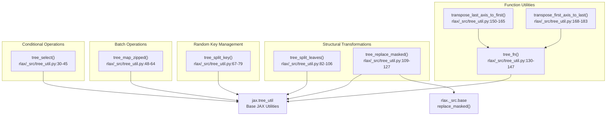
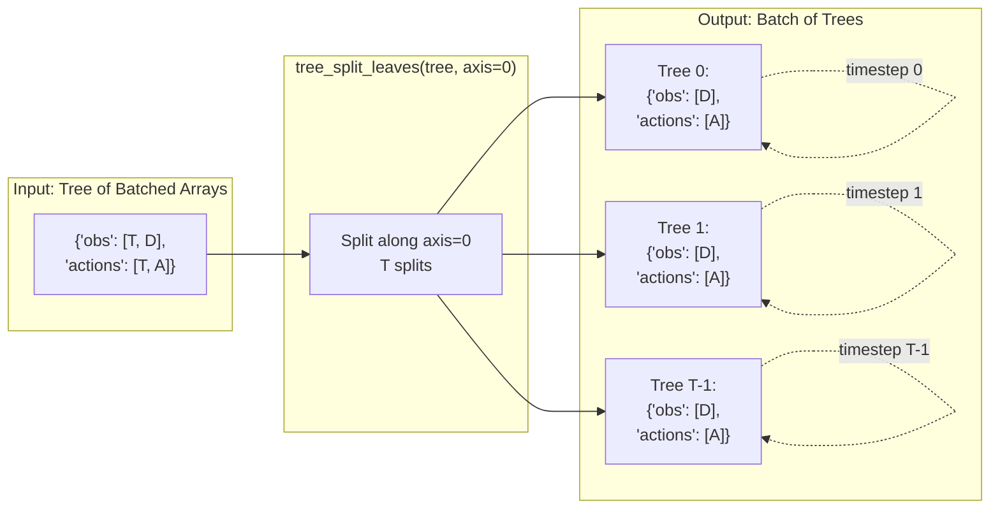
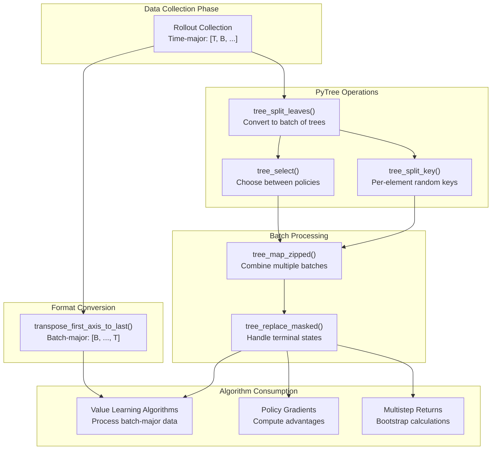

<!-- source: DeepWiki mcp.deepwiki.com · repo google-deepmind/rlax · page 7.1 PyTree Utilities · fetched 2026-10-26 -->

# PyTree Utilities

<details>
<summary>Relevant source files</summary>

The following files were used as context for generating this wiki page:

- [rlax/_src/tree_util.py](rlax/_src/tree_util.py)
- [rlax/_src/tree_util_test.py](rlax/_src/tree_util_test.py)

</details>


## Purpose and Scope

This document covers the PyTree manipulation utilities provided by the `tree_util` module. PyTrees (Python trees) are nested data structures composed of dictionaries, tuples, lists, and arrays—the fundamental data structure pattern used throughout RLax for representing agent states, network parameters, batched experiences, and other hierarchical data. The utilities in this module enable efficient operations on entire PyTree structures without manual recursion.

For basic array operations on individual tensors, see [Base Array Operations](#7.2). For parameter update mechanisms, see [Parameter Updates and Clipping](#7.3).

**Sources:** [rlax/_src/tree_util.py:1-184]()

## PyTree Fundamentals

A PyTree is any nested combination of containers (dict, tuple, list, NamedTuple) with array leaves. JAX's `tree_util` provides basic operations like `tree_map`, `tree_flatten`, and `tree_unflatten`. RLax extends these with domain-specific utilities for RL workflows.

**Common PyTree Patterns in RLax:**

| Pattern | Example Structure | Usage Context |
|---------|------------------|---------------|
| Network Parameters | `{'encoder': {'w': array, 'b': array}, 'head': {...}}` | Policy/value function weights |
| Agent State | `{'policy_params': {...}, 'value_params': {...}, 'optimizer_state': {...}}` | Full agent checkpoint |
| Trajectory Batch | `{'observations': array[T, B, ...], 'actions': array[T, B, ...], ...}` | Experience replay or rollout data |
| Multi-head Outputs | `{'q_values': array, 'advantages': array, 'log_probs': array}` | Network forward pass results |

**Sources:** [rlax/_src/tree_util.py:15-28]()

## Core Functions Overview



**Diagram: Function Organization and Dependencies**

**Sources:** [rlax/_src/tree_util.py:1-184]()

## Conditional Selection

### tree_select

The `tree_select` function performs element-wise conditional selection on PyTrees, analogous to `jax.lax.select` but operating on entire nested structures.

**Function Signature:**
```python
tree_select(pred: Array, on_true: Any, on_false: Any) -> Any
```

**Parameters:**
- `pred`: Boolean scalar array determining which branch to select
- `on_true`: PyTree to return when `pred` is True
- `on_false`: PyTree to return when `pred` is False (must have identical structure to `on_true`)

**Behavior:**
- Validates that both input PyTrees have identical structure [rlax/_src/tree_util.py:41-42]()
- Applies `jax.lax.select` to corresponding leaves [rlax/_src/tree_util.py:43-45]()
- Returns a PyTree where each leaf is conditionally selected

**Example Use Cases:**
- Target network selection: Choose between online and target parameters based on update step
- Exploration vs exploitation: Switch between exploratory and greedy policies
- Episode boundary handling: Select initial state vs continued state

**Implementation Detail:**
```python
# From rlax/_src/tree_util.py:43-44
return jax.tree_util.tree_map(
    lambda x, y: jax.lax.select(pred, x, y), on_true, on_false
)
```

**Sources:** [rlax/_src/tree_util.py:30-45](), [rlax/_src/tree_util_test.py:55-65]()

## Batch Operations

### tree_map_zipped

The `tree_map_zipped` function applies a function across multiple PyTrees simultaneously, combining corresponding leaves. This is particularly useful for aggregating batches or ensembles.

**Function Signature:**
```python
tree_map_zipped(fn: Callable[..., Any], nests: Sequence[Any]) -> Any
```

**Parameters:**
- `fn`: Function to apply; arity must equal `len(nests)`
- `nests`: List of PyTrees with identical structure

**Behavior:**
- Returns empty sequence if input is empty [rlax/_src/tree_util.py:58-59]()
- Validates all PyTrees share the same structure [rlax/_src/tree_util.py:60-62]()
- Flattens all trees, zips corresponding leaves, applies `fn`, and reconstructs tree [rlax/_src/tree_util.py:63-64]()

**Common Usage Pattern:**
```python
# Concatenating multiple trajectory batches
batches = [batch1, batch2, batch3]  # Each has structure {'obs': array, 'actions': array}
combined = tree_map_zipped(lambda *arrays: jnp.concatenate(arrays), batches)
# Result: {'obs': concatenated_obs, 'actions': concatenated_actions}
```

**Comparison with JAX's tree_map:**

| Operation | tree_map | tree_map_zipped |
|-----------|----------|-----------------|
| Input | Multiple PyTrees as *args | List of PyTrees |
| Function Application | Elementwise across trees | Across list elements at each leaf |
| Typical Use | Pointwise operations (add, multiply) | Aggregation (concat, stack, mean) |

**Sources:** [rlax/_src/tree_util.py:48-64](), [rlax/_src/tree_util_test.py:35-53]()

## Random Key Management

### tree_split_key

The `tree_split_key` function generates independent random keys for each leaf in a PyTree, enabling parallel stochastic operations while maintaining proper PRNG semantics.

**Function Signature:**
```python
tree_split_key(rng_key: Array, tree_like: Any) -> Tuple[Array, Any]
```

**Parameters:**
- `rng_key`: JAX PRNGKey to split
- `tree_like`: PyTree template defining the structure

**Returns:**
- New root key (for subsequent splits)
- PyTree of keys with same structure as `tree_like`

**Behavior:**
- Counts leaves in the input PyTree [rlax/_src/tree_util.py:77]()
- Splits `rng_key` into `num_leaves + 1` keys [rlax/_src/tree_util.py:78]()
- Returns first key and reconstructs remaining keys into PyTree [rlax/_src/tree_util.py:79]()

**Usage in RL Context:**
```python
# Initialize network parameters with per-layer random keys
key = jax.random.PRNGKey(42)
param_template = {'encoder': None, 'policy_head': None, 'value_head': None}
key, keys = tree_split_key(key, param_template)
# keys = {'encoder': PRNGKey, 'policy_head': PRNGKey, 'value_head': PRNGKey}
```

**Why This Matters:**
JAX requires explicit key management (no global RNG state). When initializing complex nested structures, manually splitting keys for each component is error-prone. This function automates the process while maintaining the PyTree structure.

**Sources:** [rlax/_src/tree_util.py:67-79](), [rlax/_src/tree_util_test.py:29-33]()

## Structural Transformations

### tree_split_leaves

The `tree_split_leaves` function converts a PyTree of batched arrays into a batch of PyTrees, effectively transposing the batch dimension from inside the arrays to outside the tree structure. This avoids data copying for NumPy arrays.

**Function Signature:**
```python
tree_split_leaves(tree_like: Any, axis: int = 0, keepdim: bool = False) -> Tuple[Any, ...]
```

**Parameters:**
- `tree_like`: PyTree with arrays to split
- `axis`: Axis along which to split (default: 0)
- `keepdim`: Whether to preserve the split axis with size 1

**Returns:**
- Tuple of `size(axis)` PyTrees, each containing one slice

**Data Flow Example:**



**Diagram: tree_split_leaves Data Transformation**

**Implementation Strategy:**
- Uses `np.split` to partition each leaf [rlax/_src/tree_util.py:103]()
- Optionally squeezes the split axis [rlax/_src/tree_util.py:104]()
- Reconstructs PyTrees from transposed leaf sequences [rlax/_src/tree_util.py:106]()

**Performance Note:**
The function avoids copying data for `np.ndarray` but may copy `jax.numpy.DeviceArray` [rlax/_src/tree_util.py:87]().

**Sources:** [rlax/_src/tree_util.py:82-106](), [rlax/_src/tree_util_test.py:67-90]()

### tree_replace_masked

The `tree_replace_masked` function selectively replaces elements in PyTree leaves based on a boolean mask, useful for masked updates or handling variable-length sequences.

**Function Signature:**
```python
tree_replace_masked(tree_data: Any, tree_replacement: Any, mask: Array) -> Any
```

**Parameters:**
- `tree_data`: PyTree containing data to potentially modify
- `tree_replacement`: PyTree with replacement values (same structure as `tree_data`), or None for zeros
- `mask`: Boolean/binary mask array; shape is prefix of leaf shapes

**Behavior:**
- If `tree_replacement` is None, uses zeros [rlax/_src/tree_util.py:123-124]()
- Applies `base.replace_masked` to each corresponding leaf pair [rlax/_src/tree_util.py:125-127]()

**Use Cases:**
- Episode termination: Zero out terminal state features
- Padding handling: Replace padding positions with zeros or special values
- Partial updates: Modify only selected batch elements

**Example:**
```python
# Mask out terminal transitions in a trajectory
trajectory = {'observations': obs_array, 'rewards': reward_array}
done_mask = jnp.array([0, 0, 1, 0, 1])  # Terminal flags
# Zero out terminal transitions
masked_traj = tree_replace_masked(trajectory, None, done_mask)
```

**Sources:** [rlax/_src/tree_util.py:109-127](), [rlax/_src/tree_util_test.py:113-131]()

## Function Wrapping Utilities

### tree_fn

The `tree_fn` function wraps a scalar function to automatically apply via `jax.tree.map`, enabling concise PyTree operations. Supports partial application to exclude specific arguments from mapping.

**Function Signature:**
```python
tree_fn(fn: Callable, **unmapped_kwargs) -> Callable
```

**Parameters:**
- `fn`: Function to wrap
- `**unmapped_kwargs`: Named arguments to fix via `functools.partial` (not mapped)

**Returns:**
- Wrapped function that applies `jax.tree.map` to its arguments

**Usage Patterns:**

| Pattern | Without tree_fn | With tree_fn |
|---------|-----------------|--------------|
| Add scalar | `jax.tree.map(lambda x: x + 1, tree)` | `tree_fn(lambda x: x + 1)(tree)` |
| Clip values | `jax.tree.map(lambda x: jnp.clip(x, 0, 1), tree)` | `tree_fn(jnp.clip, a_min=0, a_max=1)(tree)` |
| Normalize | `jax.tree.map(lambda x: x / scale, tree)` | `tree_fn(lambda x, s: x / s, s=scale)(tree)` |

**Implementation:**
```python
# From rlax/_src/tree_util.py:144-146
pfn = functools.partial(fn, **unmapped_kwargs)
def _wrapped(*args):
    return jax.tree.map(pfn, *args)
```

**Sources:** [rlax/_src/tree_util.py:130-147](), [rlax/_src/tree_util_test.py:92-111]()

## Axis Transposition

### transpose_last_axis_to_first

Transposes the last axis to the first position for all leaves in a PyTree, converting arrays with shape `[D_1, ..., D_{n-1}, D_n]` to `[D_n, D_1, ..., D_{n-1}]`.

**Function Signature:**
```python
transpose_last_axis_to_first(tree: chex.ArrayTree) -> chex.ArrayTree
```

**Common Use Case:**
Converting time-major format `[T, B, ...]` to batch-major format `[..., T]` by first moving the last dimension to front, particularly when the last dimension represents time steps accumulated during rollout.

**Implementation:**
Uses `tree_fn` wrapper around `jnp.transpose` with axis permutation `[ndim-1, 0, 1, ..., ndim-2]` [rlax/_src/tree_util.py:163-165]().

**Sources:** [rlax/_src/tree_util.py:150-165](), [rlax/_src/tree_util_test.py:133-144]()

### transpose_first_axis_to_last

Transposes the first axis to the last position for all leaves in a PyTree, converting arrays with shape `[D_1, D_2, ..., D_n]` to `[D_2, ..., D_n, D_1]`.

**Function Signature:**
```python
transpose_first_axis_to_last(tree: chex.ArrayTree) -> chex.ArrayTree
```

**Common Use Case:**
Converting time-major rollout data `[T, B, ...]` to batch-major format `[B, ..., T]` for processing algorithms that expect batch-first layout.

**Implementation:**
Uses `tree_fn` wrapper around `jnp.transpose` with axis permutation `[1, 2, ..., ndim-1, 0]` [rlax/_src/tree_util.py:181-183]().

**Sources:** [rlax/_src/tree_util.py:168-183](), [rlax/_src/tree_util_test.py:146-157]()

## Usage Patterns in RLax



**Diagram: PyTree Utilities in Typical RL Pipeline**

**Sources:** [rlax/_src/tree_util.py:1-184]()

## Function Reference Summary

| Function | Primary Use | Input/Output | Key Feature |
|----------|-------------|--------------|-------------|
| `tree_select` | Conditional branching | (pred, tree1, tree2) → tree | Structure-preserving select |
| `tree_map_zipped` | Batch aggregation | (fn, [tree1, tree2, ...]) → tree | Combine multiple PyTrees |
| `tree_split_key` | PRNG key generation | (key, template) → (key, tree_of_keys) | Parallel random operations |
| `tree_split_leaves` | Batch → sequence | tree[T, ...] → (tree[...], ...) | Zero-copy splitting |
| `tree_replace_masked` | Masked updates | (data, replacement, mask) → data | Episode boundaries |
| `tree_fn` | Function lifting | fn → tree_mapped_fn | Automatic PyTree mapping |
| `transpose_last_axis_to_first` | Axis reordering | tree[..., D] → tree[D, ...] | Last to first |
| `transpose_first_axis_to_last` | Axis reordering | tree[D, ...] → tree[..., D] | First to last |

**Sources:** [rlax/_src/tree_util.py:1-184]()

## Design Principles

The `tree_util` module follows these design principles:

1. **Structure Preservation**: All functions maintain PyTree structure unless explicitly transforming it (e.g., `tree_split_leaves`)
2. **JAX Integration**: Built on `jax.tree_util` primitives for compatibility with JAX transformations (jit, grad, vmap)
3. **Type Agnostic**: Works with any valid PyTree (dicts, tuples, NamedTuples, lists)
4. **Composability**: Functions compose naturally for complex transformations
5. **Performance**: Avoids unnecessary copies, particularly for NumPy arrays in `tree_split_leaves`

These utilities form the foundation for higher-level RLax operations, enabling clean, functional-style code for complex nested data manipulations common in reinforcement learning workflows.

**Sources:** [rlax/_src/tree_util.py:1-184]()

---

