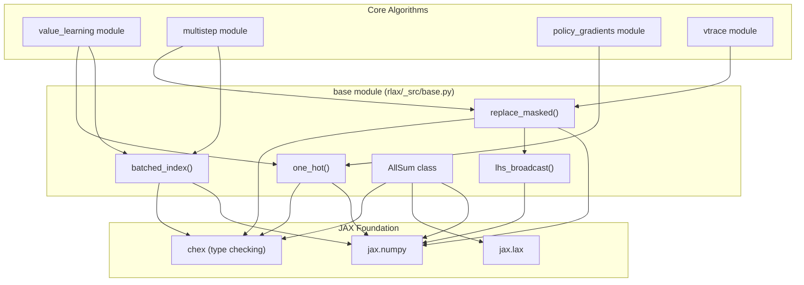
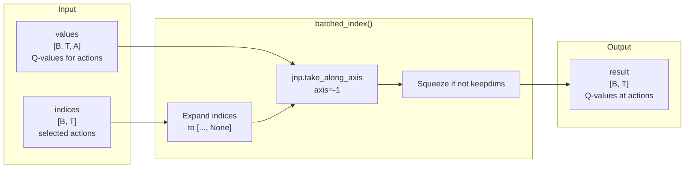
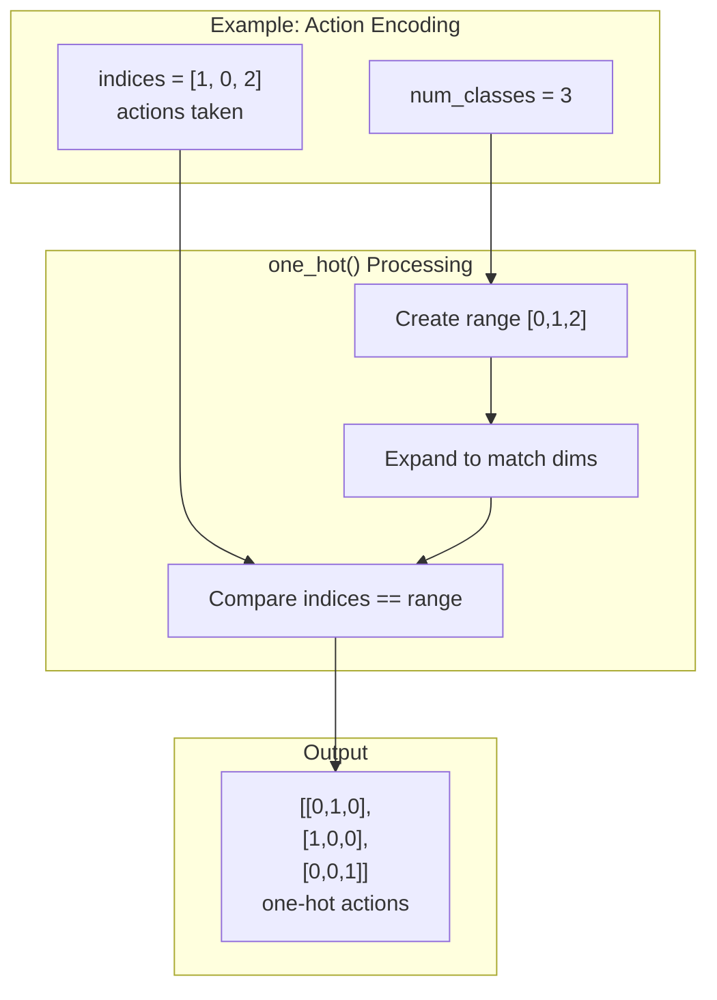
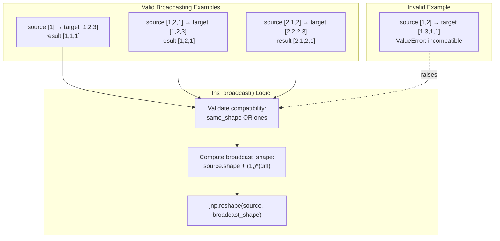
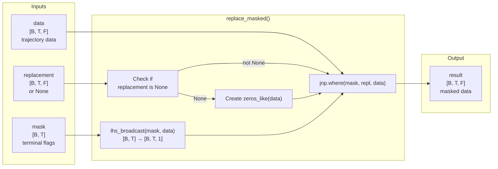
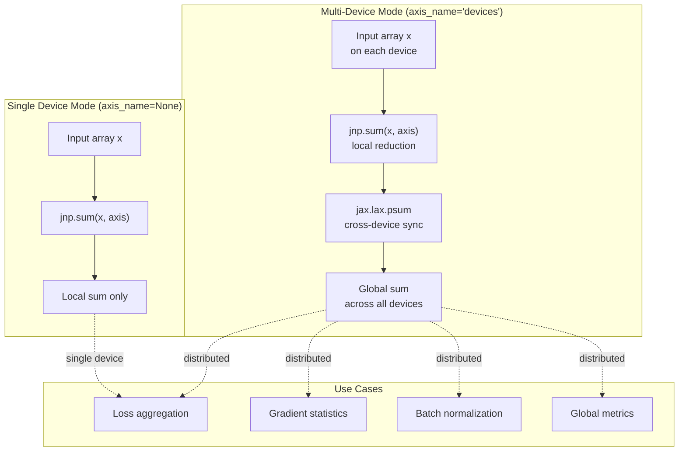
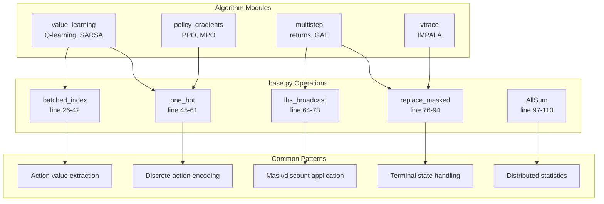

<!-- source: DeepWiki mcp.deepwiki.com · repo google-deepmind/rlax · page 7.2 Base Array Operations · fetched 2026-10-26 -->

# Base Array Operations

<details>
<summary>Relevant source files</summary>

The following files were used as context for generating this wiki page:

- [rlax/_src/base.py](rlax/_src/base.py)
- [rlax/_src/base_test.py](rlax/_src/base_test.py)

</details>


## Purpose and Scope

This page documents the fundamental array operations provided by the `base` module in RLax. These utilities form the foundation for array manipulation across all RL algorithms in the library. The module provides five core operations: indexing into batched tensors, creating one-hot encodings, broadcasting compatibility checks, masked array replacement, and distributed summation.

For higher-level array transformations involving PyTrees, see [PyTree Utilities](#7.1). For value-space transformations like signed hyperbolic encoding, see [Nonlinear Bellman Equations and Value Transformations](#6.1).

Sources: [rlax/_src/base.py:1-111]()

---

## Module Architecture

The `base` module sits at the bottom of the RLax utility stack, providing JAX-compatible array operations that are used throughout value learning, policy gradient, and multistep algorithms. All functions are pure, stateless transformations designed for JIT compilation and automatic differentiation.



**Diagram: Base Module Dependencies and Usage**

The diagram shows how core RL algorithm modules depend on `base` operations, which in turn build on JAX primitives. The `replace_masked` function internally uses `lhs_broadcast` for shape compatibility, while `AllSum` leverages `jax.lax.psum` for multi-device aggregation.

Sources: [rlax/_src/base.py:1-111](), high-level system diagrams

---

## Indexing Operations

### batched_index

The `batched_index` function extracts values from the last dimension of a tensor using integer indices, while preserving all other dimensions. This is a fundamental operation for gathering Q-values at selected actions or extracting specific predictions from model outputs.

**Function Signature:**
```python
def batched_index(
    values: Array, 
    indices: Array, 
    keepdims: bool = False
) -> Array
```

**Parameters:**

| Parameter | Type | Description |
|-----------|------|-------------|
| `values` | `Array` | Tensor of shape `[..., D]` to index into |
| `indices` | `Array` | Integer indices of shape `[...]` |
| `keepdims` | `bool` | Whether to preserve the final dimension (default: `False`) |

**Returns:** Tensor of shape `[...]` if `keepdims=False`, or `[..., 1]` if `keepdims=True`

**Implementation Details:**

The function uses `jnp.take_along_axis` with the indices expanded to match the value tensor's dimensionality [rlax/_src/base.py:39](). This ensures efficient indexing along the last axis while broadcasting correctly over all preceding dimensions.



**Diagram: batched_index Data Flow**

**Common Use Cases:**

1. **Q-Learning**: Extract Q-values for actions taken during episode
   - Input: `Q_values` shape `[batch, num_actions]`, `actions` shape `[batch]`
   - Output: `Q_at_actions` shape `[batch]`

2. **Policy Gradient**: Select log probabilities of sampled actions
   - Input: `log_probs` shape `[batch, time, num_actions]`, `actions` shape `[batch, time]`
   - Output: `selected_log_probs` shape `[batch, time]`

3. **Distributional RL**: Extract specific atoms from categorical distributions
   - Input: `atom_values` shape `[batch, num_atoms]`, `atom_indices` shape `[batch]`
   - Output: `selected_atoms` shape `[batch]`

Sources: [rlax/_src/base.py:26-42](), [rlax/_src/base_test.py:1-95]()

---

## Encoding Operations

### one_hot

The `one_hot` function converts integer indices into one-hot encoded vectors, commonly used for representing discrete actions or states in neural network inputs.

**Function Signature:**
```python
def one_hot(
    indices: Array, 
    num_classes: int, 
    dtype=jnp.float32
) -> Array
```

**Parameters:**

| Parameter | Type | Description |
|-----------|------|-------------|
| `indices` | `Array` | Integer tensor of any shape |
| `num_classes` | `int` | Size of the one-hot dimension |
| `dtype` | `dtype` | Output data type (default: `jnp.float32`) |

**Returns:** One-hot tensor with shape `[*indices.shape, num_classes]`

**Implementation Details:**

The function creates a range array `[0, 1, ..., num_classes-1]`, expands it to match the input dimensionality, and performs element-wise equality comparison [rlax/_src/base.py:57-61](). This approach is JAX-friendly and efficient for JIT compilation.



**Diagram: one_hot Encoding Process**

**Use Cases in RLax:**

1. **Action Representation**: Convert discrete action indices to one-hot vectors for neural network processing
2. **State Features**: Encode categorical state variables as input features
3. **Policy Targets**: Create target distributions for policy distillation
4. **Attention Masks**: Generate masks for specific positions in sequences

**Example from Tests:**

```python
# Input: indices with shape [1, 2, 3]
indices = jnp.array([[[1., 2., 3.], [1., 2., 2.]]])
num_classes = 3

# Output: one-hot with shape [1, 2, 3, 3]
result = base.one_hot(indices, num_classes)
# result[0, 0, 0] = [0., 1., 0.] (index 1)
# result[0, 0, 1] = [0., 0., 1.] (index 2)
```

Sources: [rlax/_src/base.py:45-61](), [rlax/_src/base_test.py:26-36]()

---

## Broadcasting Operations

### lhs_broadcast

The `lhs_broadcast` function reshapes a source array to be compatible with a target array for broadcasting, ensuring that the source's shape is a valid left-hand-side prefix of the target's shape.

**Function Signature:**
```python
def lhs_broadcast(source: Array, target: Array) -> Array
```

**Parameters:**

| Parameter | Type | Description |
|-----------|------|-------------|
| `source` | `Array` | Array to reshape for broadcasting |
| `target` | `Array` | Target array defining the broadcast shape |

**Returns:** Reshaped source array with trailing singleton dimensions

**Broadcasting Rules:**

The function validates that each dimension in `source` either:
1. Matches the corresponding dimension in `target`, OR
2. Has size 1 (broadcast dimension)

If valid, it appends `(target.ndim - source.ndim)` trailing dimensions of size 1.



**Diagram: lhs_broadcast Shape Transformation**

**Validation Logic:**

The function checks compatibility using NumPy array comparisons [rlax/_src/base.py:66-73]():

```python
same_shape = np.array(source.shape) == np.array(target.shape[:source.ndim])
ones = np.array(source.shape) == np.ones((source.ndim,))
if np.all(same_shape + ones):
    # Valid: either dimensions match or source dimension is 1
    broadcast_shape = source.shape + (1,) * (target.ndim - source.ndim)
    return jnp.reshape(source, broadcast_shape)
else:
    raise ValueError(...)
```

**Common Use Cases:**

1. **Discount Factor Broadcasting**: Broadcast scalar or per-timestep discounts to match value tensors
2. **Mask Application**: Reshape boolean masks to match data dimensions
3. **Coefficient Scaling**: Apply per-batch coefficients to batched, multi-dimensional data

Sources: [rlax/_src/base.py:64-73](), [rlax/_src/base_test.py:39-59]()

---

## Masked Operations

### replace_masked

The `replace_masked` function selectively replaces elements in an array based on a boolean mask, commonly used for handling episode boundaries, terminal states, and conditional updates.

**Function Signature:**
```python
def replace_masked(
    data: chex.Array,
    replacement: Optional[chex.Array],
    mask: chex.Array
) -> chex.Array
```

**Parameters:**

| Parameter | Type | Description |
|-----------|------|-------------|
| `data` | `Array` | Original array to modify |
| `replacement` | `Optional[Array]` | Replacement values (or `None` for zeros) |
| `mask` | `Array` | Boolean mask (0/1) indicating positions to replace |

**Returns:** Modified array with masked positions replaced

**Implementation:**

The function uses `lhs_broadcast` to ensure the mask shape is compatible with the data, then applies `jnp.where` for conditional selection [rlax/_src/base.py:92-94]():

```python
if replacement is None:
    replacement = jnp.zeros_like(data)
return jnp.where(lhs_broadcast(mask, data), replacement, data)
```



**Diagram: replace_masked Operation Flow**

**Use Cases in RL:**

1. **Terminal State Handling**: Zero out bootstrapped values at episode boundaries
   ```python
   # Zero out Q-values for terminal states
   next_q_values = replace_masked(
       data=q_values,
       replacement=None,  # zeros
       mask=is_terminal
   )
   ```

2. **Off-Policy Correction**: Replace importance weights that exceed thresholds
3. **Advantage Masking**: Apply masks for valid timesteps in variable-length episodes
4. **Value Function Updates**: Conditionally update value estimates based on validity flags

**Test Example:**

From [rlax/_src/base_test.py:64-89]():

```python
data = jnp.array([[1, 2, 3, 4, 5, 6],
                  [-1, -2, -3, -4, -5, -6]])
replacement = data * 10
mask = jnp.array([0, 1])  # Replace second batch element

output = base.replace_masked(data, replacement, mask)
# Result: [[1, 2, 3, 4, 5, 6],         # mask=0, keep original
#          [-10, -20, -30, -40, -50, -60]]  # mask=1, use replacement
```

Sources: [rlax/_src/base.py:76-94](), [rlax/_src/base_test.py:62-89]()

---

## Distributed Computation

### AllSum Class

The `AllSum` class provides a unified interface for summing array elements both locally and across multiple devices in distributed training setups. This is critical for computing global statistics in data-parallel RL training.

**Class Definition:**
```python
class AllSum:
    def __init__(self, axis_name: Optional[str] = None):
        """Sums locally and then over devices with the axis name provided."""
        self._axis_name = axis_name
    
    def __call__(
        self, 
        x: Array, 
        axis: Optional[Union[int, Sequence[int]]] = None
    ) -> Array:
        s = jnp.sum(x, axis=axis)
        if self._axis_name:
            s = jax.lax.psum(s, axis_name=self._axis_name)
        return s
```

**Parameters:**

| Parameter | Type | Description |
|-----------|------|-------------|
| `axis_name` | `Optional[str]` | JAX pmap axis name for device synchronization |
| `x` | `Array` | Input array to sum |
| `axis` | `Optional[Union[int, Sequence[int]]]` | Local axes to sum over before cross-device reduction |

**Returns:** Summed result (scalar or reduced array)



**Diagram: AllSum Operation Modes**

**Usage Patterns:**

**1. Single-Device Training (No Axis Name):**
```python
# Create AllSum without axis_name
all_sum = AllSum(axis_name=None)

# Behaves like regular jnp.sum
losses = jnp.array([0.5, 0.3, 0.2])
total_loss = all_sum(losses)  # Returns 1.0
```

**2. Multi-Device Training (With Axis Name):**
```python
# Create AllSum with pmap axis name
all_sum = AllSum(axis_name='devices')

# Use inside pmapped function
@jax.pmap(axis_name='devices')
def distributed_loss(batch_data):
    # Each device computes local loss
    local_loss = compute_loss(batch_data)
    
    # Sum across all devices
    global_loss = all_sum(local_loss, axis=None)
    return global_loss
```

**3. Partial Reduction with Cross-Device Sum:**
```python
all_sum = AllSum(axis_name='batch')

# Sum over specific axes, then across devices
batch_rewards = jnp.array([[1, 2], [3, 4]])  # Shape: [batch, time]
total_reward = all_sum(batch_rewards, axis=0)  # Sum over batch locally
# Then sum across devices if pmapped
```

**Integration with RLax Algorithms:**

The `AllSum` class is designed for composability with RLax's functional API:

| Algorithm Type | AllSum Usage |
|----------------|--------------|
| Value Learning | Aggregate TD errors across devices |
| Policy Gradients | Sum policy loss over distributed actors |
| Multistep Returns | Compute global return statistics |
| V-trace | Aggregate importance sampling ratios |

**Implementation Notes:**

- The class uses `jax.lax.psum` [rlax/_src/base.py:109]() which requires JAX's `pmap` context
- When `axis_name=None`, it degrades gracefully to local summation only
- The callable interface makes it compatible with JAX transformations (jit, grad, vmap)
- Can be used with nested pmaps by providing different axis names for each level

Sources: [rlax/_src/base.py:97-110]()

---

## Function Summary and API Overview

The following table summarizes all base array operations and their typical use cases within RLax:

| Function | Input Shape | Output Shape | Primary Use Case | JAX Operations |
|----------|-------------|--------------|------------------|----------------|
| `batched_index` | `values: [..., D]`<br/>`indices: [...]` | `[...]` or `[..., 1]` | Extract action Q-values | `take_along_axis`, `squeeze` |
| `one_hot` | `indices: [...]` | `[..., num_classes]` | Encode discrete actions | `arange`, `expand_dims`, equality |
| `lhs_broadcast` | `source: [...]`<br/>`target: [...]` | `[..., 1, ...]` | Mask/discount broadcasting | `reshape` |
| `replace_masked` | `data: [...]`<br/>`mask: [prefix]` | `[...]` | Zero terminal states | `where`, `lhs_broadcast` |
| `AllSum.__call__` | `x: [...]` | `[]` or reduced | Distributed aggregation | `sum`, `lax.psum` |



**Diagram: Base Operations Usage Across RLax**

---

## Integration Examples

### Value Learning Integration

Value-based algorithms frequently use `batched_index` to extract Q-values for selected actions:

```python
# From Q-learning update
q_tm1 = network.apply(params, states_tm1)  # Shape: [batch, num_actions]
actions = jnp.array([2, 0, 1])  # Shape: [batch]

# Extract Q-values for taken actions
q_tm1_selected = batched_index(q_tm1, actions)  # Shape: [batch]

# Compute TD error
td_error = rewards + discount * q_t_max - q_tm1_selected
```

### Multistep Returns Integration

Multistep algorithms use `replace_masked` for handling episode boundaries:

```python
# Lambda returns with terminal state masking
bootstrap_values = v_t  # Next state values
is_terminal = jnp.array([0, 0, 1, 0])  # Third state is terminal

# Zero out bootstrap values at terminals
masked_bootstrap = replace_masked(
    data=bootstrap_values,
    replacement=None,  # Use zeros
    mask=is_terminal
)

# Now compute lambda returns safely
lambda_returns = compute_lambda_returns(rewards, masked_bootstrap, lambda_)
```

### Policy Gradient Integration

Policy gradients use `one_hot` for discrete action spaces:

```python
# Convert discrete actions to one-hot for policy evaluation
actions = jnp.array([1, 0, 2])  # Shape: [batch]
num_actions = 3

# Create one-hot action vectors
action_one_hot = one_hot(actions, num_actions)  # Shape: [batch, 3]

# Use in policy distillation or as network input
policy_logits = policy_network(states, action_one_hot)
```

### Distributed Training Integration

Distributed RL uses `AllSum` for global loss aggregation:

```python
# Setup for multi-device training
all_sum = AllSum(axis_name='learner_devices')

@jax.pmap(axis_name='learner_devices')
def distributed_update(batch_per_device):
    # Each device processes its batch
    local_loss = compute_loss(batch_per_device)
    
    # Aggregate across all devices
    global_loss = all_sum(local_loss, axis=None)
    
    # Compute gradients on global loss
    grads = jax.grad(lambda p: global_loss)(params)
    return grads
```

Sources: [rlax/_src/base.py:1-111]()

---

## Performance Considerations

### JIT Compilation

All base operations are designed for efficient JIT compilation:

- **Static Shapes**: Operations preserve static shape information for optimal compilation
- **No Python Loops**: All implementations use vectorized JAX operations
- **Minimal Conditionals**: Branch-free where possible (e.g., `replace_masked` uses `jnp.where`)

### Memory Efficiency

| Operation | Memory Overhead | Notes |
|-----------|----------------|-------|
| `batched_index` | Minimal | Uses `take_along_axis`, no intermediate copies |
| `one_hot` | O(num_classes) | Creates full one-hot matrix, consider sparse alternatives for large vocabularies |
| `lhs_broadcast` | Zero | Just reshapes view, no data copy |
| `replace_masked` | O(data_size) | Creates `zeros_like` if replacement is None |
| `AllSum` | Zero | In-place reduction with optional cross-device sync |

### Autodiff Compatibility

All operations support JAX's automatic differentiation:

- `batched_index`: Differentiable with respect to `values` (not `indices`)
- `one_hot`: Non-differentiable (discrete operation), but output is differentiable
- `lhs_broadcast`: Transparent to autodiff (reshape operation)
- `replace_masked`: Differentiable with respect to both `data` and `replacement`
- `AllSum`: Fully differentiable, gradients correctly distributed in reverse pass

Sources: [rlax/_src/base.py:1-111]()

---

## Type Safety and Validation

The module uses `chex` for runtime type checking and shape validation:

```python
import chex

# Type aliases used throughout
Array = chex.Array
Numeric = chex.Numeric
```

**Runtime Checks:**

- `lhs_broadcast` raises `ValueError` for incompatible shapes [rlax/_src/base.py:71-73]()
- All operations expect NumPy/JAX arrays (not Python lists)
- Shape mismatches are caught at JIT compilation or runtime

**Recommended Validation Pattern:**

```python
# In production code, add explicit shape checks
chex.assert_shape(values, [..., num_actions])
chex.assert_shape(indices, [...])
q_selected = batched_index(values, indices)
```

Sources: [rlax/_src/base.py:17-23]()

---

