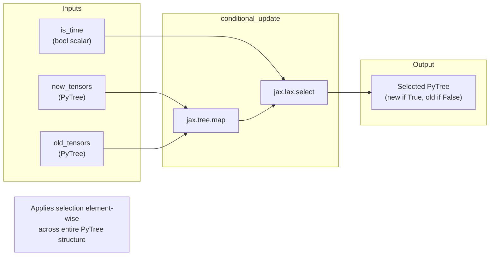
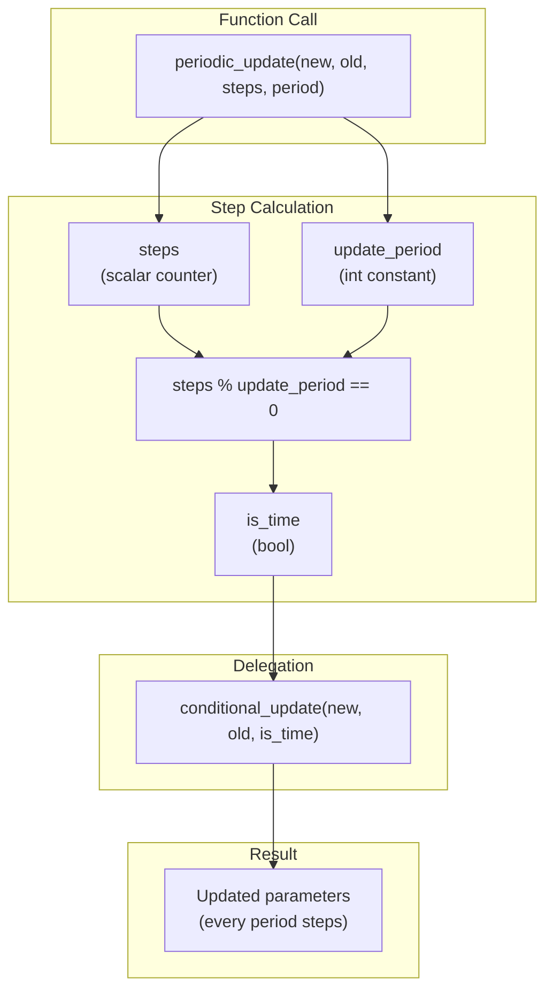
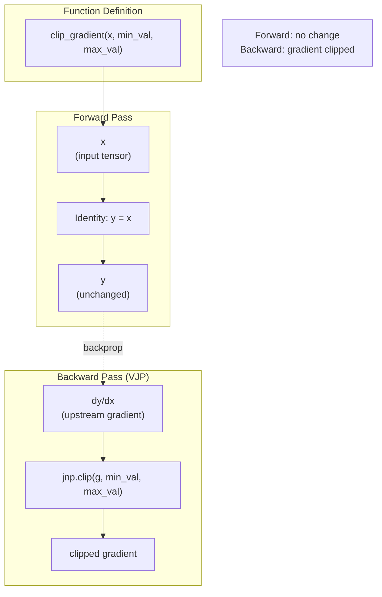
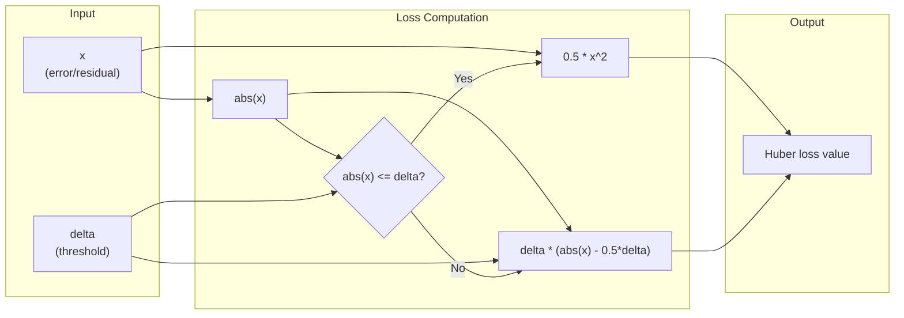
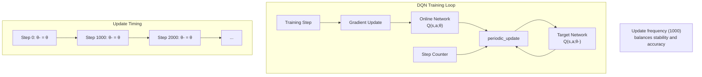
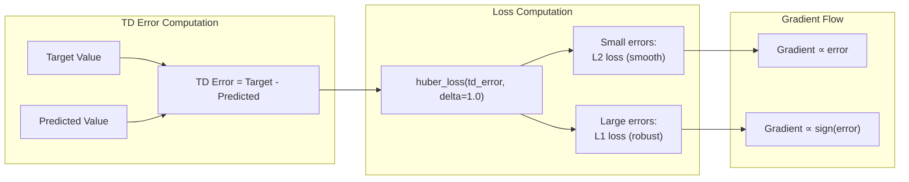
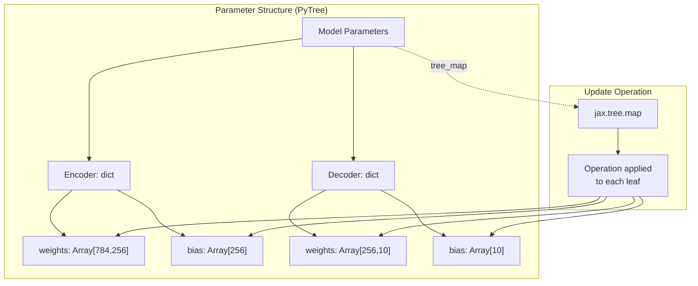

<!-- source: DeepWiki mcp.deepwiki.com · repo google-deepmind/rlax · page 7.3 Parameter Updates and Clipping · fetched 2026-10-26 -->

# Parameter Updates and Clipping

<details>
<summary>Relevant source files</summary>

The following files were used as context for generating this wiki page:

- [rlax/_src/clipping_test.py](rlax/_src/clipping_test.py)
- [rlax/_src/nested_updates.py](rlax/_src/nested_updates.py)
- [rlax/_src/nested_updates_test.py](rlax/_src/nested_updates_test.py)
- [rlax/_src/vtrace_test.py](rlax/_src/vtrace_test.py)

</details>


This page documents the foundational utilities for conditional parameter updates and gradient/value clipping in RLax. These functions are used throughout the library to implement target network updates, periodic synchronization, and robust loss functions.

**Scope**: This page covers low-level parameter manipulation utilities (`nested_updates` module) and clipping operations (gradient clipping and Huber loss). For higher-level optimization methods like policy gradient losses, see [Policy Gradient Losses](#5.1). For general array operations, see [Base Array Operations](#7.2).

## Overview

The parameter update and clipping utilities provide three main capabilities:

1. **Conditional Updates**: Switch between old and new parameter sets based on boolean conditions
2. **Periodic Updates**: Synchronize parameters at fixed intervals (e.g., target network updates in DQN)
3. **Clipping Operations**: Gradient clipping and Huber loss for robust optimization

These utilities operate on arbitrary PyTree structures, allowing them to work with nested parameter dictionaries, lists, and tuples.

Sources: [rlax/_src/nested_updates.py:1-47]()

## Nested Parameter Updates

### Conditional Update

The `conditional_update` function provides conditional switching between two parameter sets based on a boolean scalar. This is the fundamental building block for periodic updates and other conditional parameter selection operations.



**Diagram: Conditional Update Data Flow**

The function signature is:

```python
conditional_update(new_tensors: Any, old_tensors: Any, is_time: Numeric) -> Any
```

**Implementation Details**:
- Uses `jax.tree.map` to apply selection across nested structures [rlax/_src/nested_updates.py:32-34]()
- Each leaf node uses `jax.lax.select(is_time, new, old)` for efficient conditional selection
- Returns `new_tensors` when `is_time` is True, `old_tensors` when False
- **Deprecation**: This function is being deprecated in favor of optax equivalents [rlax/_src/nested_updates.py:28-31]()

**Typical Use Cases**:
- Target network updates in DQN and DDPG
- Conditional model selection during training
- Switching between exploration and exploitation policies

Sources: [rlax/_src/nested_updates.py:26-34](), [rlax/_src/nested_updates_test.py:35-55]()

### Periodic Update

The `periodic_update` function extends conditional updates to support periodic synchronization based on step counts. This is the standard approach for updating target networks at fixed intervals.



**Diagram: Periodic Update Control Flow**

The function signature is:

```python
periodic_update(
    new_tensors: Any, 
    old_tensors: Any,
    steps: chex.Array, 
    update_period: int
) -> Any
```

**Implementation Details**:
- Computes `is_time = steps % update_period == 0` [rlax/_src/nested_updates.py:45-46]()
- Delegates to `conditional_update` with the computed boolean
- Parameters update every `update_period` steps
- **Deprecation**: Like `conditional_update`, this is being deprecated in favor of optax [rlax/_src/nested_updates.py:41-43]()

**Common Patterns**:

| Algorithm | Update Period | Purpose |
|-----------|---------------|---------|
| DQN | 1000-10000 | Target network synchronization |
| DDPG | 1-10 (soft update) | Actor-critic target updates |
| Rainbow | 8000 | Target network refresh |
| A3C | Variable | Async parameter sharing |

**Example Usage Pattern**:
```python
# In a training loop
target_params = periodic_update(
    online_params,      # new_tensors
    target_params,      # old_tensors  
    step_counter,       # steps
    target_update_freq  # update_period
)
```

Sources: [rlax/_src/nested_updates.py:37-46]()

## Clipping Operations

### Gradient Clipping

Gradient clipping constrains gradients to a specified range during backpropagation. The `clip_gradient` function uses a custom VJP (vector-Jacobian product) to clip gradients while preserving forward pass values.



**Diagram: Gradient Clipping Forward and Backward Behavior**

**Key Properties**:
- Forward pass returns input unchanged
- Backward pass clips gradients element-wise to `[min_val, max_val]`
- Implemented using custom JAX VJP transformation
- Commonly used with delta values like `[-1.0, 1.0]` for DQN

**Typical Applications**:
- DQN TD error clipping (gradients clipped to [-1, 1])
- PPO value function clipping
- Gradient explosion prevention in recurrent networks
- Outlier handling in distributional RL

Sources: [rlax/_src/clipping_test.py:65-86]()

### Huber Loss

The Huber loss is a robust loss function that combines the benefits of L2 loss (smooth gradients near zero) and L1 loss (resistance to outliers). It is quadratic for small errors and linear for large errors.



**Diagram: Huber Loss Function Behavior**

**Mathematical Definition**:
```
huber_loss(x, delta) = 
    0.5 * x^2                        if |x| <= delta
    delta * (|x| - 0.5 * delta)      if |x| > delta
```

**Gradient Properties**:
```
d/dx huber_loss(x, delta) = 
    x              if |x| <= delta
    delta * sgn(x) if |x| > delta
```

The gradient is continuous at the transition point `|x| = delta`, making it differentiable everywhere.

**Relationship to Gradient Clipping**:

The Huber loss is mathematically equivalent to using squared error with gradient clipping. The following two approaches produce identical gradients:

```python
# Approach 1: Huber loss
loss = huber_loss(td_error, delta)

# Approach 2: Squared error with clipped gradients
loss = 0.5 * jnp.square(clip_gradient(td_error, -delta, delta))
```

This equivalence is verified in the test suite [rlax/_src/clipping_test.py:88-114]().

**Delta Parameter Selection**:

| Algorithm | Typical Delta | Purpose |
|-----------|---------------|---------|
| DQN | 1.0 | Standard TD error clipping |
| Rainbow | 1.0 | Distributional Bellman operator |
| DDPG | 1.0 | Critic loss robustness |
| Large-scale RL | 5.0-10.0 | High variance environments |

Sources: [rlax/_src/clipping_test.py:27-63](), [rlax/_src/clipping_test.py:88-114]()

## Integration with RLax Algorithms

### Target Network Updates

The nested update utilities are primarily used for target network synchronization in value-based algorithms:



**Diagram: Target Network Update Pattern in DQN**

**Implementation Pattern**:
```python
# After each optimization step
if step % target_update_period == 0:
    target_params = online_params  # Copy online to target
    
# Using periodic_update (deprecated)
target_params = periodic_update(
    online_params, target_params, step, target_update_period
)
```

Sources: [rlax/_src/nested_updates.py:37-46]()

### Robust Value Learning

Clipping operations are integral to robust value function approximation:



**Diagram: Huber Loss in Value Learning Pipeline**

**Code Entity Mapping**:

| Natural Language Concept | RLax Function | Module |
|-------------------------|---------------|---------|
| "Target network update" | `periodic_update` | `nested_updates` |
| "Conditional param switch" | `conditional_update` | `nested_updates` |
| "Robust TD loss" | `huber_loss` | `clipping` |
| "Gradient clipping" | `clip_gradient` | `clipping` |
| "DQN target sync" | `periodic_update` | `nested_updates` |

Sources: [rlax/_src/clipping_test.py:27-63](), [rlax/_src/nested_updates.py:26-46]()

## PyTree Compatibility

All update and clipping functions are fully compatible with JAX PyTrees, enabling them to work with arbitrarily nested parameter structures.



**Diagram: PyTree Structure Processing**

**Supported Structures**:
- Dictionaries: `{'encoder': params1, 'decoder': params2}`
- Tuples: `((weights, bias), (weights2, bias2))`
- Lists: `[layer1_params, layer2_params, layer3_params]`
- Nested combinations: `{'network': {'layers': [dict, dict, dict]}}`

**Tree Operation Details**:
- `conditional_update` uses `jax.tree.map` to apply selection to every leaf [rlax/_src/nested_updates.py:32-34]()
- All leaves must have the same structure in both `new_tensors` and `old_tensors`
- Boolean condition is broadcast to all leaves
- Operations preserve PyTree structure exactly

Sources: [rlax/_src/nested_updates.py:26-34](), [rlax/_src/nested_updates_test.py:28-55]()

## Migration to Optax

**Important**: The `conditional_update` and `periodic_update` functions in RLax are marked for deprecation. Users should migrate to optax for parameter update utilities.

**Migration Guide**:

| RLax (Deprecated) | Optax Equivalent | Notes |
|-------------------|------------------|-------|
| `conditional_update` | Custom logic with optax transformations | Use masking or conditional in optimizer |
| `periodic_update` | `optax.periodic_update` wrapper | Newer implementations available |
| Target network updates | `optax.incremental_update` | Supports both hard and soft updates |

**Optax Alternative for Target Updates**:
```python
# Instead of rlax.periodic_update
# Use optax for soft or hard target updates
import optax

# Soft update (polyak averaging)
target_params = optax.incremental_update(
    online_params, target_params, step_size=0.001
)

# Hard update (conditional)
if step % period == 0:
    target_params = online_params
```

**Deprecation Warnings**: Both functions emit `PendingDeprecationWarning` when called [rlax/_src/nested_updates.py:28-31](), [rlax/_src/nested_updates.py:41-43]().

Sources: [rlax/_src/nested_updates.py:28-31](), [rlax/_src/nested_updates.py:41-43]()

## Summary

This page documented the parameter update and clipping utilities that form the infrastructure for robust RL training:

**Parameter Updates**:
- `conditional_update`: Element-wise conditional selection between parameter sets
- `periodic_update`: Scheduled parameter synchronization for target networks
- Both marked for deprecation in favor of optax

**Clipping Operations**:
- `clip_gradient`: Custom VJP for gradient clipping during backpropagation
- `huber_loss`: Robust loss function combining L2 and L1 properties
- Equivalent approaches for handling outliers in TD learning

**Key Characteristics**:
- Full PyTree support for nested parameter structures
- JAX-native implementations with JIT and vmap compatibility
- Used throughout RLax for value learning and policy optimization
- Integration points with value_learning, policy_gradients, and multistep modules

For loss computation details, see [Policy Gradient Losses](#5.1). For array manipulation primitives, see [Base Array Operations](#7.2).

Sources: [rlax/_src/nested_updates.py:1-47](), [rlax/_src/clipping_test.py:1-120](), [rlax/_src/nested_updates_test.py:1-60]()

---

