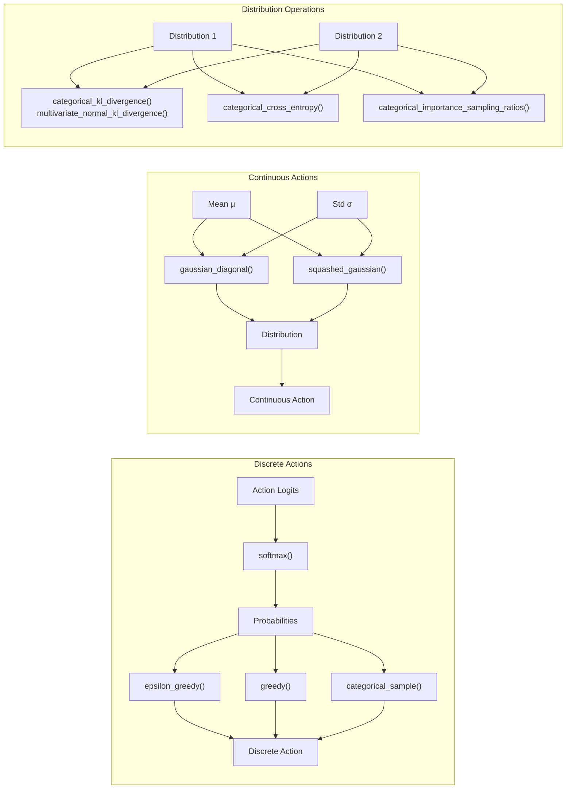
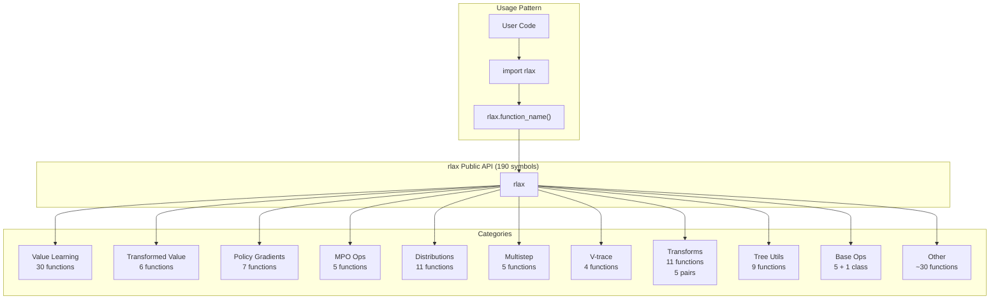

<!-- source: DeepWiki mcp.deepwiki.com · repo google-deepmind/rlax · page 8 Complete API Reference · fetched 2026-10-26 -->

# Complete API Reference

<details>
<summary>Relevant source files</summary>

The following files were used as context for generating this wiki page:

- [docs/api.rst](docs/api.rst)
- [rlax/__init__.py](rlax/__init__.py)
- [rlax/_src/policy_targets.py](rlax/_src/policy_targets.py)
- [rlax/_src/policy_targets_test.py](rlax/_src/policy_targets_test.py)

</details>


## Purpose and Scope

This page provides a comprehensive reference to all public functions, classes, and constants exported by RLax. The library exposes approximately 190 symbols through its main entry point [`rlax/__init__.py`](). These are organized into distinct functional categories covering value learning, policy optimization, distributions, utilities, and specialized algorithms.

For detailed explanations of specific algorithmic families, see:
- Value-based methods: [Basic Value Learning](#2.1), [Distributional RL](#2.2)
- Credit assignment: [Lambda Returns and GAE](#3.1), [V-trace](#3.2)
- Policy methods: [Policy Gradient Losses](#5.1), [MPO and VMPO](#5.2)
- Advanced features: [Nonlinear Bellman Equations](#6.1)

This reference focuses on the complete API surface and import patterns rather than algorithmic details.

**Sources:** [rlax/__init__.py:1-284]()

---

## API Organization and Import Structure

RLax uses a single public entry point that exports all functions from internal modules. Users should always import from `rlax` directly, never from `rlax._src.*` which are private implementation details.

```mermaid
graph TB
    subgraph "Public API Surface"
        INIT["rlax/__init__.py<br/>190 exported symbols"]
    end
    
    subgraph "Internal Source Modules"
        VL["_src/value_learning.py<br/>~30 functions"]
        PG["_src/policy_gradients.py<br/>~7 functions"]
        MS["_src/multistep.py<br/>~5 functions"]
        VT["_src/vtrace.py<br/>~4 functions"]
        DIST["_src/distributions.py<br/>~11 functions"]
        MPO["_src/mpo_ops.py<br/>~5 functions"]
        NB["_src/nonlinear_bellman.py<br/>~14 functions + 5 pairs"]
        TRANS["_src/transforms.py<br/>~11 functions"]
        TREE["_src/tree_util.py<br/>~9 functions"]
        BASE["_src/base.py<br/>~5 functions + AllSum"]
        CLIP["_src/clipping.py<br/>~2 functions"]
        EXPL["_src/exploration.py<br/>~4 functions"]
        LOSS["_src/losses.py<br/>~5 functions"]
        POPART["_src/pop_art.py<br/>~6 functions"]
        TARGETS["_src/policy_targets.py<br/>~3 functions + PolicyTarget"]
        EMBED["_src/embedding.py<br/>~1 function"]
        GVF["_src/general_value_functions.py<br/>~2 functions"]
        MEMORY["_src/episodic_memory.py<br/>~1 function"]
        UPDATES["_src/nested_updates.py<br/>~2 functions"]
        MOVAVG["_src/moving_averages.py<br/>~3 items"]
        MODEL["_src/model_learning.py<br/>~2 functions"]
        INTR["_src/interruptions.py<br/>~1 function"]
    end
    
    INIT --> VL
    INIT --> PG
    INIT --> MS
    INIT --> VT
    INIT --> DIST
    INIT --> MPO
    INIT --> NB
    INIT --> TRANS
    INIT --> TREE
    INIT --> BASE
    INIT --> CLIP
    INIT --> EXPL
    INIT --> LOSS
    INIT --> POPART
    INIT --> TARGETS
    INIT --> EMBED
    INIT --> GVF
    INIT --> MEMORY
    INIT --> UPDATES
    INIT --> MOVAVG
    INIT --> MODEL
    INIT --> INTR
```



**Import Pattern:**
```python
import rlax

# Correct usage - import from rlax directly
td_error = rlax.td_learning(v_tm1, r_t, discount_t, v_t)
loss = rlax.q_learning(q_tm1, a_tm1, r_t, discount_t, q_t)

# INCORRECT - never import from _src
# from rlax._src.value_learning import q_learning  # DO NOT DO THIS
```

**Sources:** [rlax/__init__.py:15-272]()

---

## API Categories and Function Counts

The following table summarizes the complete API organized by functional category:

| Category | Function Count | Primary Use Case | Key Modules |
|----------|---------------|------------------|-------------|
| **Value Learning** | 30 | TD methods, Q-learning, SARSA, distributional RL | `value_learning`, `multistep` |
| **Transformed Value Learning** | 6 | Nonlinear Bellman equations (MuZero, R2D2) | `nonlinear_bellman` |
| **Policy Gradients** | 7 | REINFORCE, PPO, DPG, MPO | `policy_gradients` |
| **MPO Operations** | 5 | Constrained policy optimization | `mpo_ops` |
| **Policy Targets** | 3 | Policy distillation | `policy_targets` |
| **Distributions** | 11 | Action selection, sampling, KL divergence | `distributions` |
| **Multistep Returns** | 5 | Lambda returns, GAE, n-step | `multistep` |
| **V-trace** | 4 | Off-policy correction for IMPALA | `vtrace` |
| **Transforms** | 11 | Value space transformations | `transforms` |
| **Transform Pairs** | 5 | Composed transform pairs for Bellman ops | `nonlinear_bellman` |
| **Tree Utilities** | 9 | PyTree manipulation | `tree_util` |
| **Base Operations** | 5 + class | Array indexing, broadcasting, one-hot | `base` |
| **Clipping** | 2 | Gradient clipping, Huber loss | `clipping` |
| **Exploration** | 4 | Noise injection, episodic memory | `exploration`, `episodic_memory` |
| **Losses** | 5 | L2, log loss, expectile, likelihood | `losses` |
| **PopArt** | 6 | Adaptive normalization | `pop_art` |
| **GVF** | 2 | General value functions | `general_value_functions` |
| **Nested Updates** | 2 | Conditional/periodic parameter updates | `nested_updates` |
| **Moving Averages** | 3 | EMA state management | `moving_averages` |
| **Model Learning** | 2 | Subsequence extraction for world models | `model_learning` |
| **Misc Utilities** | 3 | Embeddings, interruptions | `embedding`, `interruptions` |

**Sources:** [rlax/__init__.py:17-143](), [docs/api.rst:1-778]()

---

## Value Learning Functions

This category contains temporal difference methods, Q-learning variants, and distributional RL algorithms.

### Point-Estimate Methods

| Function | Description | Module |
|----------|-------------|--------|
| `td_learning` | Basic temporal difference learning | `value_learning` |
| `q_learning` | Off-policy Q-learning with max Q-target | `value_learning` |
| `double_q_learning` | Double Q-learning to reduce maximization bias | `value_learning` |
| `persistent_q_learning` | Q-learning with persistent targets | `value_learning` |
| `sarsa` | On-policy SARSA algorithm | `value_learning` |
| `expected_sarsa` | Expected SARSA with policy-weighted target | `value_learning` |
| `sarsa_lambda` | SARSA(λ) with eligibility traces | `value_learning` |
| `td_lambda` | TD(λ) for state values | `value_learning` |
| `q_lambda` | Q(λ) with eligibility traces | `value_learning` |
| `retrace` | Safe off-policy algorithm with trace cutting | `value_learning` |
| `retrace_continuous` | Retrace for continuous actions | `value_learning` |
| `qv_learning` | Combined Q-V learning | `value_learning` |
| `qv_max` | Max operation for QV learning | `value_learning` |

### Distributional Methods

| Function | Description | Module |
|----------|-------------|--------|
| `categorical_td_learning` | TD learning over categorical distribution | `value_learning` |
| `categorical_q_learning` | Categorical DQN (C51) | `value_learning` |
| `categorical_double_q_learning` | Double Q-learning for categorical values | `value_learning` |
| `categorical_l2_project` | Project distribution onto support | `value_learning` |
| `quantile_q_learning` | Quantile regression DQN | `value_learning` |
| `quantile_expected_sarsa` | Quantile-based expected SARSA | `value_learning` |
| `quantile_regression_loss` | Loss for quantile regression | `value_learning` |

### Multistep and Off-Policy Returns

| Function | Description | Module |
|----------|-------------|--------|
| `discounted_returns` | Simple discounted returns | `multistep` |
| `n_step_bootstrapped_returns` | N-step bootstrapped targets | `multistep` |
| `lambda_returns` | TD(λ) returns, used for GAE | `multistep` |
| `general_off_policy_returns_from_action_values` | General off-policy returns (TB(λ), Retrace(λ)) | `multistep` |
| `general_off_policy_returns_from_q_and_v` | Off-policy returns using both Q and V | `multistep` |
| `truncated_generalized_advantage_estimation` | GAE for advantage estimation | `multistep` |

### V-trace Functions

| Function | Description | Module |
|----------|-------------|--------|
| `vtrace` | V-trace for value estimates | `vtrace` |
| `vtrace_td_error_and_advantage` | V-trace TD error and advantage for actor-critic | `vtrace` |
| `leaky_vtrace` | Leaky V-trace variant | `vtrace` |
| `leaky_vtrace_td_error_and_advantage` | Leaky V-trace for actor-critic | `vtrace` |

**Sources:** [rlax/__init__.py:120-143](), [docs/api.rst:7-223]()

---

## Transformed Value Learning Functions

These functions apply value transformations to Bellman operations, useful for algorithms like MuZero and R2D2.

| Function | Description | Module |
|----------|-------------|--------|
| `transformed_n_step_q_learning` | N-step Q-learning with value transformation | `nonlinear_bellman` |
| `transformed_n_step_returns` | N-step returns with transformation | `nonlinear_bellman` |
| `transformed_lambda_returns` | Lambda returns with transformation | `nonlinear_bellman` |
| `transformed_q_lambda` | Q(λ) with transformation | `nonlinear_bellman` |
| `transformed_retrace` | Retrace with transformation | `nonlinear_bellman` |
| `transformed_general_off_policy_returns_from_action_values` | General off-policy returns with transformation | `nonlinear_bellman` |

**Transform Pairs** (used with transformed functions):

| Constant | Description | Module |
|----------|-------------|--------|
| `IDENTITY_PAIR` | No transformation (identity) | `nonlinear_bellman` |
| `SIGNED_HYPERBOLIC_PAIR` | Signed hyperbolic transformation | `nonlinear_bellman` |
| `SIGNED_LOGP1_PAIR` | Signed log(1+x) transformation | `nonlinear_bellman` |
| `HYPERBOLIC_SIN_PAIR` | Hyperbolic sine transformation | `nonlinear_bellman` |
| `DISCOUNT_TRANSFORM_PAIR` | Discount-only transformation | `nonlinear_bellman` |

**Functions to create transform pairs:**

| Function | Description | Module |
|----------|-------------|--------|
| `muzero_pair` | Create MuZero-style transform pair | `nonlinear_bellman` |
| `twohot_pair` | Create 2-hot encoding pair | `nonlinear_bellman` |
| `unbiased_transform_pair` | Create unbiased transform pair | `nonlinear_bellman` |
| `compose_tx` | Compose multiple transformations | `nonlinear_bellman` |

**Types:**

- `TxPair`: Named tuple containing `apply_tx` and `apply_inv_tx` functions

**Sources:** [rlax/__init__.py:68-83](), [docs/api.rst:182-211]()

---

## Policy Optimization Functions

### Policy Gradient Losses

| Function | Description | Module |
|----------|-------------|--------|
| `policy_gradient_loss` | Basic REINFORCE policy gradient | `policy_gradients` |
| `clipped_surrogate_pg_loss` | PPO clipped surrogate objective | `policy_gradients` |
| `dpg_loss` | Deterministic policy gradient | `policy_gradients` |
| `qpg_loss` | Q-based policy gradient | `policy_gradients` |
| `rpg_loss` | Retrace-based policy gradient | `policy_gradients` |
| `rm_loss` | Reward maximization loss | `policy_gradients` |
| `entropy_loss` | Entropy regularization loss | `policy_gradients` |

### MPO Operations

| Function | Description | Module |
|----------|-------------|--------|
| `mpo_loss` | Maximum a Posteriori Policy Optimization loss | `mpo_ops` |
| `vmpo_loss` | V-MPO (value-based MPO) loss | `mpo_ops` |
| `mpo_compute_weights_and_temperature_loss` | E-step computation for MPO | `mpo_ops` |
| `vmpo_compute_weights_and_temperature_loss` | E-step computation for V-MPO | `mpo_ops` |
| `compute_parametric_kl_penalty_and_dual_loss` | KL constraint and Lagrange dual | `mpo_ops` |

**Types:**

- `LagrangePenalty`: State for Lagrange penalty optimization

### Policy Targets and Distillation

| Function | Description | Module |
|----------|-------------|--------|
| `constant_policy_targets` | Create targets with constant weights | `policy_targets` |
| `zero_policy_targets` | Create zero-weight targets | `policy_targets` |
| `sampled_policy_distillation_loss` | Cross-entropy loss for policy distillation | `policy_targets` |

**Types:**

- `PolicyTarget`: Dataclass holding sampled actions and weights

**Sources:** [rlax/__init__.py:84-94](), [rlax/_src/policy_targets.py:25-108](), [docs/api.rst:224-320]()

---

## Distribution and Action Selection Functions

These functions handle probability distributions for action selection in both discrete and continuous action spaces.

### Discrete Action Distributions

| Function | Description | Module |
|----------|-------------|--------|
| `softmax` | Softmax distribution with temperature | `distributions` |
| `greedy` | Greedy action selection (argmax) | `distributions` |
| `epsilon_greedy` | ε-greedy exploration | `distributions` |
| `categorical_sample` | Sample from categorical distribution | `distributions` |
| `categorical_cross_entropy` | Cross-entropy between categoricals | `distributions` |
| `categorical_kl_divergence` | KL divergence between categoricals | `distributions` |
| `categorical_importance_sampling_ratios` | Importance sampling ratios | `distributions` |
| `clipped_entropy_softmax` | Softmax with entropy clipping | `distributions` |

### Continuous Action Distributions

| Function | Description | Module |
|----------|-------------|--------|
| `gaussian_diagonal` | Diagonal Gaussian distribution | `distributions` |
| `squashed_gaussian` | Gaussian with tanh squashing | `distributions` |
| `multivariate_normal_kl_divergence` | KL divergence for Gaussians | `distributions` |



**Sources:** [rlax/__init__.py:24-34](), [docs/api.rst:702-777]()

---

## Value Transformation Functions

Scalar transformations applied to value functions before and after Bellman operations.

| Function | Description | Module |
|----------|-------------|--------|
| `identity` | Identity transformation (no-op) | `transforms` |
| `sigmoid` | Sigmoid function | `transforms` |
| `logit` | Inverse sigmoid | `transforms` |
| `power` | Power transformation | `transforms` |
| `signed_hyperbolic` | sign(x) * (√(|x|+1) - 1) | `transforms` |
| `signed_logp1` | sign(x) * log(1 + |x|) | `transforms` |
| `signed_expm1` | sign(x) * (exp(|x|) - 1) | `transforms` |
| `signed_parabolic` | Parabolic transformation | `transforms` |
| `transform_to_2hot` | Encode scalar as 2-hot vector | `transforms` |
| `transform_from_2hot` | Decode 2-hot vector to scalar | `transforms` |

**Sources:** [rlax/__init__.py:102-111](), [docs/api.rst:572-659]()

---

## Tree Utilities (PyTree Operations)

Functions for manipulating nested JAX pytrees.

| Function | Description | Module |
|----------|-------------|--------|
| `tree_map_zipped` | Map function over multiple zipped trees | `tree_util` |
| `tree_select` | Select elements from trees based on condition | `tree_util` |
| `tree_replace_masked` | Replace masked elements in tree | `tree_util` |
| `tree_split_key` | Split PRNG key for each tree leaf | `tree_util` |
| `tree_split_leaves` | Split each leaf into multiple sub-leaves | `tree_util` |
| `tree_fn` | Apply function to tree structure | `tree_util` |
| `transpose_last_axis_to_first` | Transpose time and batch axes | `tree_util` |
| `transpose_first_axis_to_first` | Transpose batch and time axes | `tree_util` |

**Sources:** [rlax/__init__.py:112-119](), [docs/api.rst:381-481]()

---

## Base Array Operations

Fundamental array manipulation functions.

| Function/Class | Description | Module |
|----------------|-------------|--------|
| `batched_index` | Index into batched arrays | `base` |
| `one_hot` | Create one-hot encoded vectors | `base` |
| `lhs_broadcast` | Broadcast left-hand side to match shapes | `base` |
| `replace_masked` | Replace values where mask is True | `base` |
| `AllSum` | All-reduce sum for distributed computation | `base` |

**Sources:** [rlax/__init__.py:17-21](), [docs/api.rst:370-446]()

---

## Clipping and Loss Functions

### Clipping

| Function | Description | Module |
|----------|-------------|--------|
| `clip_gradient` | Clip gradients by global norm | `clipping` |
| `huber_loss` | Huber loss (smooth L1) | `clipping` |

### General Loss Functions

| Function | Description | Module |
|----------|-------------|--------|
| `l2_loss` | L2 regression loss | `losses` |
| `log_loss` | Logarithmic loss | `losses` |
| `likelihood` | Log-likelihood | `losses` |
| `expectile_loss` | Asymmetric least squares loss | `losses` |
| `pixel_control_loss` | Loss for pixel control auxiliary task | `losses` |

**Sources:** [rlax/__init__.py:22-23,44-48](), [docs/api.rst:402-699]()

---

## Exploration Functions

Functions for adding exploration noise and computing intrinsic rewards.

| Function | Description | Module |
|----------|-------------|--------|
| `add_gaussian_noise` | Add Gaussian noise to actions | `exploration` |
| `add_ornstein_uhlenbeck_noise` | Add OU process noise | `exploration` |
| `add_dirichlet_noise` | Add Dirichlet noise to policy | `exploration` |
| `episodic_memory_intrinsic_rewards` | Intrinsic rewards from episodic memory | `exploration` |
| `knn_query` | K-nearest neighbors query | `episodic_memory` |

**Sources:** [rlax/__init__.py:37-40,36](), [docs/api.rst:322-360]()

---

## PopArt Normalization

Adaptive normalization for handling non-stationary reward scales.

| Function | Description | Module |
|----------|-------------|--------|
| `normalize` | Normalize values using PopArt statistics | `pop_art` |
| `unnormalize` | Unnormalize values | `pop_art` |
| `unnormalize_linear` | Unnormalize linear layer parameters | `pop_art` |
| `pop` | Update PopArt statistics (preserve outputs) | `pop_art` |
| `art` | Adapt parameters (preserve outputs) | `pop_art` |
| `popart` | Combined pop and art update | `pop_art` |

**Types:**

- `PopArtState`: State containing mean, std, and step count

**Sources:** [rlax/__init__.py:95-101](), [docs/api.rst:525-569]()

---

## General Value Functions

Auxiliary tasks for learning additional value functions.

| Function | Description | Module |
|----------|-------------|--------|
| `pixel_control_rewards` | Pseudo-rewards from pixel changes | `general_value_functions` |
| `feature_control_rewards` | Pseudo-rewards from feature changes | `general_value_functions` |

**Sources:** [rlax/__init__.py:41-42](), [docs/api.rst:483-504]()

---

## Nested Parameter Updates

Conditional parameter update utilities.

| Function | Description | Module |
|----------|-------------|--------|
| `conditional_update` | Update parameters if condition is True | `nested_updates` |
| `periodic_update` | Update parameters periodically | `nested_updates` |

**Sources:** [rlax/__init__.py:66-67](), [docs/api.rst:472-481]()

---

## Moving Averages

Exponential moving average utilities.

| Function/Class | Description | Module |
|----------------|-------------|--------|
| `create_ema` | Create EMA update function | `moving_averages` |
| `EmaState` | State for EMA computation | `moving_averages` |
| `EmaMoments` | Moments (mean, variance) state | `moving_averages` |

**Sources:** [rlax/__init__.py:51-53]()

---

## Model Learning Utilities

Functions for extracting training data for world models.

| Function | Description | Module |
|----------|-------------|--------|
| `extract_subsequences` | Extract overlapping subsequences from trajectories | `model_learning` |
| `sample_start_indices` | Sample random start indices for subsequences | `model_learning` |

**Sources:** [rlax/__init__.py:49-50](), [docs/api.rst:506-523]()

---

## Miscellaneous Utilities

| Function | Description | Module |
|----------|-------------|--------|
| `embed_oar` | Embed observation-action-reward tuples | `embedding` |
| `fix_step_type_on_interruptions` | Fix episode boundaries on interruptions | `interruptions` |

**Sources:** [rlax/__init__.py:35,43](), [docs/api.rst:422-430]()

---

## Complete Function Listing with Import Paths

The following table provides a complete alphabetical listing of all exported symbols:



### Alphabetical Reference

| Symbol | Type | Category | Source Module |
|--------|------|----------|---------------|
| `add_dirichlet_noise` | function | Exploration | `exploration` |
| `add_gaussian_noise` | function | Exploration | `exploration` |
| `add_ornstein_uhlenbeck_noise` | function | Exploration | `exploration` |
| `AllSum` | class | Base | `base` |
| `art` | function | PopArt | `pop_art` |
| `batched_index` | function | Base | `base` |
| `categorical_cross_entropy` | function | Distributions | `distributions` |
| `categorical_double_q_learning` | function | Value Learning | `value_learning` |
| `categorical_importance_sampling_ratios` | function | Distributions | `distributions` |
| `categorical_kl_divergence` | function | Distributions | `distributions` |
| `categorical_l2_project` | function | Value Learning | `value_learning` |
| `categorical_q_learning` | function | Value Learning | `value_learning` |
| `categorical_sample` | function | Distributions | `distributions` |
| `categorical_td_learning` | function | Value Learning | `value_learning` |
| `clip_gradient` | function | Clipping | `clipping` |
| `clipped_entropy_softmax` | function | Distributions | `distributions` |
| `clipped_surrogate_pg_loss` | function | Policy Gradients | `policy_gradients` |
| `compose_tx` | function | Transforms | `nonlinear_bellman` |
| `compute_parametric_kl_penalty_and_dual_loss` | function | MPO | `mpo_ops` |
| `conditional_update` | function | Updates | `nested_updates` |
| `constant_policy_targets` | function | Policy Targets | `policy_targets` |
| `create_ema` | function | Moving Averages | `moving_averages` |
| `discounted_returns` | function | Multistep | `multistep` |
| `DISCOUNT_TRANSFORM_PAIR` | constant | Transforms | `nonlinear_bellman` |
| `double_q_learning` | function | Value Learning | `value_learning` |
| `dpg_loss` | function | Policy Gradients | `policy_gradients` |
| `embed_oar` | function | Embedding | `embedding` |
| `EmaMoments` | class | Moving Averages | `moving_averages` |
| `EmaState` | class | Moving Averages | `moving_averages` |
| `entropy_loss` | function | Policy Gradients | `policy_gradients` |
| `episodic_memory_intrinsic_rewards` | function | Exploration | `exploration` |
| `epsilon_greedy` | function | Distributions | `distributions` |
| `expectile_loss` | function | Losses | `losses` |
| `expected_sarsa` | function | Value Learning | `value_learning` |
| `extract_subsequences` | function | Model Learning | `model_learning` |
| `feature_control_rewards` | function | GVF | `general_value_functions` |
| `fix_step_type_on_interruptions` | function | Interruptions | `interruptions` |
| `gaussian_diagonal` | function | Distributions | `distributions` |
| `general_off_policy_returns_from_action_values` | function | Multistep | `multistep` |
| `general_off_policy_returns_from_q_and_v` | function | Multistep | `multistep` |
| `greedy` | function | Distributions | `distributions` |
| `huber_loss` | function | Clipping | `clipping` |
| `HYPERBOLIC_SIN_PAIR` | constant | Transforms | `nonlinear_bellman` |
| `identity` | function | Transforms | `transforms` |
| `IDENTITY_PAIR` | constant | Transforms | `nonlinear_bellman` |
| `knn_query` | function | Episodic Memory | `episodic_memory` |
| `l2_loss` | function | Losses | `losses` |
| `LagrangePenalty` | class | MPO | `mpo_ops` |
| `lambda_returns` | function | Multistep | `multistep` |
| `leaky_vtrace` | function | V-trace | `vtrace` |
| `leaky_vtrace_td_error_and_advantage` | function | V-trace | `vtrace` |
| `lhs_broadcast` | function | Base | `base` |
| `likelihood` | function | Losses | `losses` |
| `log_loss` | function | Losses | `losses` |
| `logit` | function | Transforms | `transforms` |
| `mpo_compute_weights_and_temperature_loss` | function | MPO | `mpo_ops` |
| `mpo_loss` | function | MPO | `mpo_ops` |
| `multivariate_normal_kl_divergence` | function | Distributions | `distributions` |
| `muzero_pair` | function | Transforms | `nonlinear_bellman` |
| `normalize` | function | PopArt | `pop_art` |
| `n_step_bootstrapped_returns` | function | Multistep | `multistep` |
| `one_hot` | function | Base | `base` |
| `periodic_update` | function | Updates | `nested_updates` |
| `persistent_q_learning` | function | Value Learning | `value_learning` |
| `pixel_control_loss` | function | Losses | `losses` |
| `pixel_control_rewards` | function | GVF | `general_value_functions` |
| `policy_gradient_loss` | function | Policy Gradients | `policy_gradients` |
| `PolicyTarget` | class | Policy Targets | `policy_targets` |
| `pop` | function | PopArt | `pop_art` |
| `popart` | function | PopArt | `pop_art` |
| `PopArtState` | class | PopArt | `pop_art` |
| `power` | function | Transforms | `transforms` |
| `qpg_loss` | function | Policy Gradients | `policy_gradients` |
| `q_lambda` | function | Value Learning | `value_learning` |
| `q_learning` | function | Value Learning | `value_learning` |
| `quantile_expected_sarsa` | function | Value Learning | `value_learning` |
| `quantile_q_learning` | function | Value Learning | `value_learning` |
| `quantile_regression_loss` | function | Value Learning | `value_learning` |
| `qv_learning` | function | Value Learning | `value_learning` |
| `qv_max` | function | Value Learning | `value_learning` |
| `replace_masked` | function | Base | `base` |
| `retrace` | function | Value Learning | `value_learning` |
| `retrace_continuous` | function | Value Learning | `value_learning` |
| `rm_loss` | function | Policy Gradients | `policy_gradients` |
| `rpg_loss` | function | Policy Gradients | `policy_gradients` |
| `sample_start_indices` | function | Model Learning | `model_learning` |
| `sampled_policy_distillation_loss` | function | Policy Targets | `policy_targets` |
| `sarsa` | function | Value Learning | `value_learning` |
| `sarsa_lambda` | function | Value Learning | `value_learning` |
| `sigmoid` | function | Transforms | `transforms` |
| `signed_expm1` | function | Transforms | `transforms` |
| `signed_hyperbolic` | function | Transforms | `transforms` |
| `SIGNED_HYPERBOLIC_PAIR` | constant | Transforms | `nonlinear_bellman` |
| `signed_logp1` | function | Transforms | `transforms` |
| `SIGNED_LOGP1_PAIR` | constant | Transforms | `nonlinear_bellman` |
| `signed_parabolic` | function | Transforms | `transforms` |
| `softmax` | function | Distributions | `distributions` |
| `squashed_gaussian` | function | Distributions | `distributions` |
| `td_lambda` | function | Value Learning | `value_learning` |
| `td_learning` | function | Value Learning | `value_learning` |
| `transformed_general_off_policy_returns_from_action_values` | function | Transformed Value | `nonlinear_bellman` |
| `transformed_lambda_returns` | function | Transformed Value | `nonlinear_bellman` |
| `transformed_n_step_q_learning` | function | Transformed Value | `nonlinear_bellman` |
| `transformed_n_step_returns` | function | Transformed Value | `nonlinear_bellman` |
| `transformed_q_lambda` | function | Transformed Value | `nonlinear_bellman` |
| `transformed_retrace` | function | Transformed Value | `nonlinear_bellman` |
| `transform_from_2hot` | function | Transforms | `transforms` |
| `transform_to_2hot` | function | Transforms | `transforms` |
| `transpose_first_axis_to_last` | function | Tree Utils | `tree_util` |
| `transpose_last_axis_to_first` | function | Tree Utils | `tree_util` |
| `tree_fn` | function | Tree Utils | `tree_util` |
| `tree_map_zipped` | function | Tree Utils | `tree_util` |
| `tree_replace_masked` | function | Tree Utils | `tree_util` |
| `tree_select` | function | Tree Utils | `tree_util` |
| `tree_split_key` | function | Tree Utils | `tree_util` |
| `tree_split_leaves` | function | Tree Utils | `tree_util` |
| `truncated_generalized_advantage_estimation` | function | Multistep | `multistep` |
| `twohot_pair` | function | Transforms | `nonlinear_bellman` |
| `TxPair` | class | Transforms | `nonlinear_bellman` |
| `unbiased_transform_pair` | function | Transforms | `nonlinear_bellman` |
| `unnormalize` | function | PopArt | `pop_art` |
| `unnormalize_linear` | function | PopArt | `pop_art` |
| `vmpo_compute_weights_and_temperature_loss` | function | MPO | `mpo_ops` |
| `vmpo_loss` | function | MPO | `mpo_ops` |
| `vtrace` | function | V-trace | `vtrace` |
| `vtrace_td_error_and_advantage` | function | V-trace | `vtrace` |
| `zero_policy_targets` | function | Policy Targets | `policy_targets` |

**Sources:** [rlax/__init__.py:147-272]()

---

## Type Annotations and Data Structures

RLax uses several custom types and data structures:

### Dataclasses

| Type | Module | Fields | Purpose |
|------|--------|--------|---------|
| `PolicyTarget` | `policy_targets` | `actions`, `weights` | Hold sampled policy targets for distillation |
| `PopArtState` | `pop_art` | Statistics | Track adaptive normalization state |
| `EmaState` | `moving_averages` | EMA state | Exponential moving average |
| `EmaMoments` | `moving_averages` | Mean, variance | First/second moment tracking |
| `LagrangePenalty` | `mpo_ops` | Multipliers | Lagrange constraint state for MPO |

### Named Tuples

| Type | Module | Fields | Purpose |
|------|--------|--------|---------|
| `TxPair` | `nonlinear_bellman` | `apply_tx`, `apply_inv_tx` | Pair of forward/inverse transforms |

### Common Array Types

All functions use JAX arrays (`jax.Array` / `jnp.ndarray`) and are compatible with:
- Scalar values
- Batched arrays (typically with leading batch dimension)
- Sequence arrays (time dimension followed by batch dimension)
- Nested pytrees of arrays

**Sources:** [rlax/_src/policy_targets.py:25-34](), [rlax/__init__.py:52-55,82,92,99,194]()

---

## Version Information

The current version is exposed as:

```python
import rlax
print(rlax.__version__)  # "0.1.8"
```

**Sources:** [rlax/__init__.py:145]()

---

## API Stability and Private Modules

All symbols in `rlax._src.*` are **private implementation details** and should never be imported directly. The public API contract is solely through `rlax.__init__.py`.

From [rlax/__init__.py:274-283]():

```
 _________________________________________
/ Please don't use symbols in `_src` they \
\ are not part of the RLax public API.    /
 -----------------------------------------
        \   ^__^
         \  (oo)\_______
            (__)\       )\/\
                ||----w |
                ||     ||
```

Only the symbols listed in `__all__` at [rlax/__init__.py:147-272]() are guaranteed to be stable across versions.

**Sources:** [rlax/__init__.py:274-283]()

---

