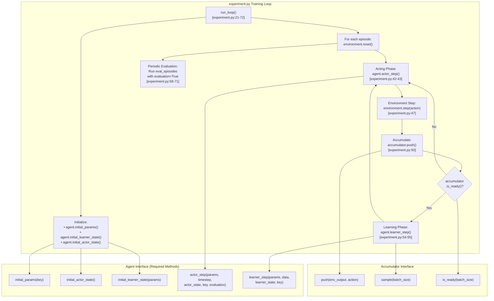
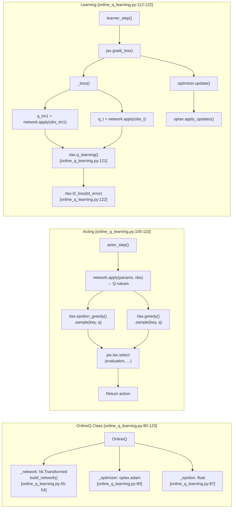
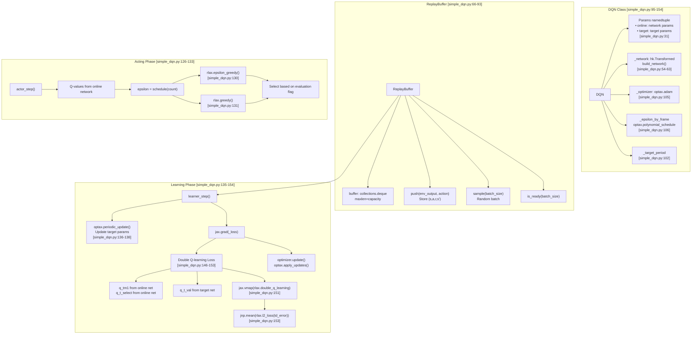
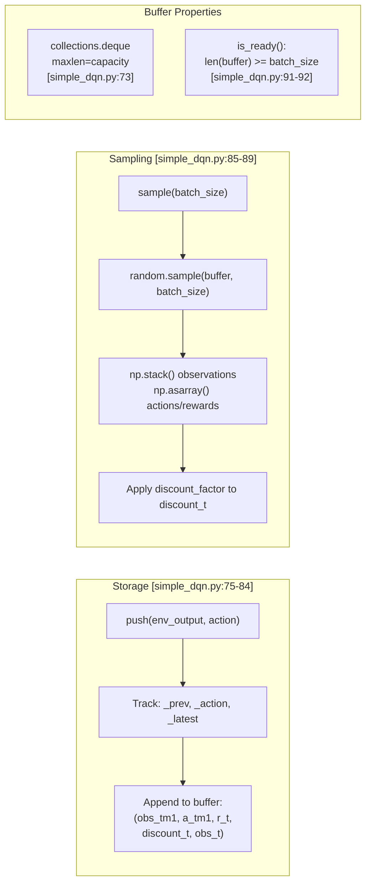
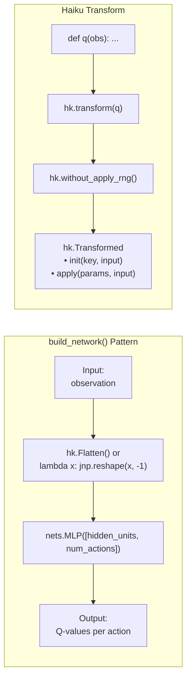

<!-- source: DeepWiki mcp.deepwiki.com · repo google-deepmind/rlax · page 9 Examples and Tutorials · fetched 2026-10-26 -->

# Examples and Tutorials

<details>
<summary>Relevant source files</summary>

The following files were used as context for generating this wiki page:

- [README.md](README.md)
- [examples/__init__.py](examples/__init__.py)
- [examples/experiment.py](examples/experiment.py)
- [examples/online_q_learning.py](examples/online_q_learning.py)
- [examples/pop_art.py](examples/pop_art.py)
- [examples/simple_dqn.py](examples/simple_dqn.py)
- [rlax/_src/embedding.py](rlax/_src/embedding.py)

</details>


This page provides a detailed walkthrough of the example implementations in the RLax repository. The examples demonstrate how to compose RLax's building blocks into complete reinforcement learning agents that learn in the Catch environment from BSuite.

The examples cover three progressively sophisticated agents:
- **Online Q-learning**: Simplest value-based learning with single-step updates
- **DQN**: Off-policy learning with experience replay and target networks
- **PopArt**: Adaptive normalization for handling non-stationary reward scales

For detailed documentation of the individual RLax functions used in these examples, see [Complete API Reference](#8). For algorithm theory, see [Value-Based Learning](#2) and [Policy Optimization Methods](#5).

Sources: [README.md:54-61](), [examples/simple_dqn.py:1-186](), [examples/online_q_learning.py:1-150](), [examples/pop_art.py:1-189]()

---

## Examples Directory Structure

All examples share a common structure and use the same training loop orchestration. The `examples/` directory contains:

```
examples/
├── __init__.py           # Empty package marker
├── experiment.py         # Shared run_loop function
├── simple_dqn.py        # DQN with replay buffer
├── online_q_learning.py # Single-step Q-learning
└── pop_art.py           # PopArt normalization demo
```

### Common Training Loop Infrastructure

All examples use `experiment.run_loop()` as the central training orchestrator. This function implements the standard RL interaction loop: act in the environment, accumulate experience, and perform learning updates.

**Diagram: Shared Training Infrastructure**



The `run_loop` function requires agents to implement five methods:
- `initial_params(key)`: Initialize network parameters
- `initial_actor_state()`: Initialize actor state (e.g., step counter)
- `initial_learner_state(params)`: Initialize optimizer state
- `actor_step(...)`: Select actions given observations
- `learner_step(...)`: Update parameters from experience

Sources: [examples/experiment.py:21-72]()

---

## Online Q-Learning Example

The simplest example demonstrates single-step Q-learning without replay buffer or target network. This is the most straightforward way to use RLax's value learning functions.

### Agent Architecture

**Diagram: OnlineQ Agent Component Mapping**



Sources: [examples/online_q_learning.py:80-123]()

### TransitionAccumulator

The `TransitionAccumulator` stores only the most recent transition (s_t-1, a_t-1, r_t, s_t), enabling single-step learning:

| Method | Purpose | Line Reference |
|--------|---------|----------------|
| `push(env_output, action)` | Store latest observation and action | [online_q_learning.py:65-68]() |
| `sample(batch_size)` | Return current transition (batch_size must be 1) | [online_q_learning.py:70-73]() |
| `is_ready(batch_size)` | Check if previous observation exists | [online_q_learning.py:75-77]() |

The accumulator returns a `Transition` namedtuple: `(obs_tm1, a_tm1, r_t, discount_t, obs_t)`.

Sources: [examples/online_q_learning.py:57-77]()

### RLax Functions Used

The OnlineQ agent uses three core RLax functions:

1. **`rlax.epsilon_greedy(epsilon)`** - Creates an epsilon-greedy policy
   - During training, selects random action with probability `epsilon`
   - Used in [online_q_learning.py:107]()

2. **`rlax.greedy()`** - Creates a greedy policy
   - Always selects action with highest Q-value
   - Used during evaluation in [online_q_learning.py:108]()

3. **`rlax.q_learning(q_tm1, a_tm1, r_t, discount_t, q_t)`** - Computes TD error
   - Implements: `δ = r_t + γ * max(q_t) - q_tm1[a_tm1]`
   - Used in [online_q_learning.py:121]()

4. **`rlax.l2_loss(td_error)`** - Converts TD error to L2 loss
   - Implements: `0.5 * δ²`
   - Used in [online_q_learning.py:122]()

Sources: [examples/online_q_learning.py:105-122]()

### Running the Example

```bash
# From repository root with dependencies installed
python -m examples.online_q_learning \
  --train_episodes=500 \
  --epsilon=0.01 \
  --learning_rate=0.005 \
  --discount_factor=0.99
```

Key hyperparameters (defined in [online_q_learning.py:33-42]()):
- `train_episodes`: Number of training episodes (default: 500)
- `epsilon`: Exploration probability (default: 0.01)
- `learning_rate`: Adam optimizer step size (default: 0.005)
- `discount_factor`: Discount γ applied to next-state values (default: 0.99)

Sources: [examples/online_q_learning.py:33-149]()

---

## DQN Example

The DQN example demonstrates off-policy learning with experience replay and target networks, implementing the classic Deep Q-Network algorithm with double Q-learning.

### DQN Agent Architecture

**Diagram: DQN Components and Data Flow**



Sources: [examples/simple_dqn.py:31-154]()

### Key Differences from Online Q-Learning

| Feature | Online Q-Learning | DQN |
|---------|------------------|-----|
| **Experience Storage** | Single transition (`TransitionAccumulator`) | Replay buffer with capacity 2000 (`ReplayBuffer`) |
| **Batch Size** | 1 | 32 (configurable) |
| **Learning Updates** | Every step | When buffer has enough samples |
| **Target Network** | None (same network for targets) | Separate target network, updated periodically |
| **Q-Learning Variant** | `rlax.q_learning()` | `rlax.double_q_learning()` |
| **Exploration** | Fixed epsilon | Annealed epsilon (1.0 → 0.01 over 1000 steps) |
| **Actor State** | Empty tuple | Step counter for epsilon scheduling |

Sources: [examples/simple_dqn.py:95-154](), [examples/online_q_learning.py:80-123]()

### ReplayBuffer Implementation

The `ReplayBuffer` stores transitions in a circular buffer using `collections.deque`:

**Diagram: ReplayBuffer Operation**



The buffer applies the discount factor γ when sampling: `discount_t * FLAGS.discount_factor` [simple_dqn.py:89]().

Sources: [examples/simple_dqn.py:66-93]()

### Double Q-Learning with Target Networks

The DQN loss function demonstrates how RLax functions compose to implement double Q-learning:

**Loss computation flow** [simple_dqn.py:146-153]():

1. **Forward passes**:
   - `q_tm1 = network.apply(online_params, obs_tm1)` - Q-values at previous state
   - `q_t_val = network.apply(target_params, obs_t)` - Target net Q-values (for evaluation)
   - `q_t_select = network.apply(online_params, obs_t)` - Online net Q-values (for action selection)

2. **Batched TD error**:
   ```python
   batched_loss = jax.vmap(rlax.double_q_learning)
   td_error = batched_loss(q_tm1, a_tm1, r_t, discount_t, q_t_val, q_t_select)
   ```
   
   The `double_q_learning` function computes: `r_t + γ * q_t_val[argmax(q_t_select)] - q_tm1[a_tm1]`

3. **Mean squared error**:
   ```python
   return jnp.mean(rlax.l2_loss(td_error))
   ```

**Target network updates** [simple_dqn.py:136-138]():
```python
target_params = optax.periodic_update(
    params.online, params.target,
    learner_state.count, self._target_period)
```
This copies `online` parameters to `target` every `target_period` steps (default: 50).

Sources: [examples/simple_dqn.py:135-154]()

### Epsilon Scheduling

DQN uses an annealing epsilon schedule for exploration:

```python
epsilon_cfg = dict(
    init_value=FLAGS.epsilon_begin,  # 1.0
    end_value=FLAGS.epsilon_end,      # 0.01
    transition_steps=FLAGS.epsilon_steps,  # 1000
    power=1.)
self._epsilon_by_frame = optax.polynomial_schedule(**epsilon_cfg)
```

The epsilon value decreases linearly from 1.0 to 0.01 over 1000 environment steps. During acting:
```python
epsilon = self._epsilon_by_frame(actor_state.count)
train_a = rlax.epsilon_greedy(epsilon).sample(key, q)
```

Sources: [examples/simple_dqn.py:106](), [examples/simple_dqn.py:129-130](), [examples/simple_dqn.py:158-162]()

### Running the DQN Example

```bash
python -m examples.simple_dqn \
  --train_episodes=301 \
  --batch_size=32 \
  --replay_capacity=2000 \
  --target_period=50 \
  --epsilon_begin=1.0 \
  --epsilon_end=0.01 \
  --epsilon_steps=1000
```

Key hyperparameters (defined in [simple_dqn.py:38-51]()):
- `batch_size`: Mini-batch size for learning (default: 32)
- `replay_capacity`: Maximum transitions in buffer (default: 2000)
- `target_period`: Steps between target network updates (default: 50)
- `epsilon_begin/end/steps`: Exploration annealing schedule

Sources: [examples/simple_dqn.py:37-185]()

---

## PopArt Normalization Example

The PopArt example demonstrates adaptive normalization for handling non-stationary reward scales. PopArt (Preserving Outputs Precisely while Adaptively Rescaling Targets) maintains running statistics of targets and normalizes them during learning.

### PopArt Motivation

The Catch environment is modified to scale rewards by 10,000x [pop_art.py:39]():
```python
env = wrappers.RewardScale(env, reward_scale=FLAGS.reward_scale)  # 10,000
```

Without normalization, large reward magnitudes make learning unstable. PopArt solves this by:
1. Normalizing targets to have zero mean and unit variance
2. Adjusting network parameters to preserve outputs after normalization updates

### PopArt Agent Architecture

**Diagram: PopArt Components and Normalization Flow**

```mermaid
graph TB
    subgraph "PopArtAgent [pop_art.py:86-160]"
        AGENT["PopArtAgent"]
        
        AGENT --> NET["_network: hk.Transformed<br/>[pop_art.py:95]"]
        AGENT --> OPT["_optimizer: optax.adam<br/>[pop_art.py:96]"]
        AGENT --> POPART_INIT["_initial_pop_art_state<br/>rlax.popart()<br/>[pop_art.py:100-101]"]
        AGENT --> POPART_UPDATE["_pop_art_update"]
    end
    
    subgraph "PopArt State"
        STATE["PopArtState contains:<br/>• mean: running mean<br/>• variance: running variance<br/>• scale: sqrt(variance)<br/>• shift: mean"]
    end
    
    subgraph "Loss Computation [pop_art.py:130-160]"
        LOSS["_loss(params, pop_art_state, ...)"]
        
        LOSS --> UNNORM["1. Unnormalize Q-values<br/>q_t = rlax.unnormalize(state, norm_q_t)<br/>[pop_art.py:137]"]
        
        UNNORM --> TARGET["2. Compute target<br/>target = r_t + γ * max(q_t)<br/>[pop_art.py:138]"]
        
        TARGET --> POP["3. Update PopArt state & POP params<br/>rlax.popart update<br/>[pop_art.py:144-150]"]
        
        POP --> POP_PARAMS["Returns:<br/>• popped_linear_params<br/>• new_pop_art_state"]
        
        POP_PARAMS --> NORM_TARGET["4. Normalize target<br/>norm_target = rlax.normalize(new_state, target)<br/>[pop_art.py:153]"]
        
        NORM_TARGET --> TD["5. Compute TD error<br/>on normalized values<br/>[pop_art.py:156-158]"]
        
        TD --> L2_FINAL["6. L2 loss<br/>[pop_art.py:159]"]
    end
    
    subgraph "PopArt Update Details [pop_art.py:146-150]"
        UPDATE["_pop_art_update(params, state, targets, indices)"]
        UPDATE --> ART["ART: Update statistics<br/>running mean/variance"]
        UPDATE --> POP_OP["POP: Adjust weights/biases<br/>to preserve outputs"]
    end
```



Sources: [examples/pop_art.py:86-160]()

### PopArt Functions Used

The agent uses four key RLax PopArt functions:

1. **`rlax.popart(num_outputs, step_size, scale_lb, scale_ub)`** - Initialize PopArt
   - Returns `(initial_state_fn, update_fn)` [pop_art.py:100-101]()
   - `step_size`: Learning rate for statistics (default: 3e-3)
   - `scale_lb/ub`: Bounds on scale to prevent instability (1e-5, 1e5)

2. **`rlax.unnormalize(pop_art_state, normalized_values, indices)`** - Denormalize
   - Computes: `values = normalized_values * scale + shift` [pop_art.py:137]()

3. **PopArt update** - Update statistics and preserve outputs
   - Returns `(popped_params, new_state)` [pop_art.py:146-148]()
   - Updates running mean/variance from targets
   - Adjusts final layer weights/biases to preserve network outputs

4. **`rlax.normalize(pop_art_state, values, indices)`** - Normalize
   - Computes: `normalized = (values - shift) / scale` [pop_art.py:153]()

Sources: [examples/pop_art.py:100-101](), [examples/pop_art.py:130-160]()

### Parameter Update Flow

The PopArt update modifies the **final linear layer** parameters to preserve outputs:

**Detailed update sequence** [pop_art.py:143-159]():

1. Access final layer parameters:
   ```python
   final_linear_module_name = "mlp/~/linear_1"
   mutable_params = hk.data_structures.to_mutable_dict(params)
   linear_params = mutable_params[final_linear_module_name]
   ```

2. POP and ART:
   ```python
   popped_linear_params, new_pop_art_state = self._pop_art_update(
       params=linear_params, state=pop_art_state, targets=target_tm1, indices=indices)
   ```
   This updates both statistics (ART) and parameters (POP).

3. Reconstruct parameters:
   ```python
   mutable_params[final_linear_module_name] = popped_linear_params
   popped_params = hk.data_structures.to_immutable_dict(mutable_params)
   ```

4. Continue with normalized loss using `popped_params` and `new_pop_art_state`.

The key insight: gradients are computed on `popped_params` with normalized targets, ensuring stability.

Sources: [examples/pop_art.py:143-159]()

### Comparison: With vs Without PopArt

| Aspect | Without PopArt | With PopArt |
|--------|----------------|-------------|
| **Target values** | Raw rewards (scaled 10,000x) | Normalized to ~N(0,1) |
| **Network outputs** | Predicts large Q-values directly | Predicts normalized Q-values |
| **Learning stability** | Unstable with large rewards | Stable across reward scales |
| **Parameter updates** | Standard gradient descent | Adjusted after statistics update (POP) |
| **Convergence** | Slower or fails | Faster, more reliable |

The example trains faster with PopArt because normalized targets lead to more stable gradients.

Sources: [examples/pop_art.py:15-18]()

### Running the PopArt Example

```bash
python -m examples.pop_art \
  --train_episodes=1000 \
  --reward_scale=10000 \
  --pop_art_step_size=0.003 \
  --learning_rate=0.005
```

Key hyperparameters (defined in [pop_art.py:38-48]()):
- `reward_scale`: Multiplier for Catch rewards (default: 10,000)
- `pop_art_step_size`: Statistics update rate (default: 3e-3)
- `learning_rate`: Network parameter learning rate (default: 0.005)

Compare performance with/without PopArt by modifying the loss function to skip normalization.

Sources: [examples/pop_art.py:37-188]()

---

## Common Patterns Across Examples

All three examples follow consistent design patterns that demonstrate RLax best practices:

### Agent Interface Contract

Every agent implements the same five-method interface required by `experiment.run_loop`:

| Method | Purpose | Returns | DQN | OnlineQ | PopArt |
|--------|---------|---------|-----|---------|--------|
| `initial_params(key)` | Initialize network | Params | `Params(online, target)` | Network params | Network params |
| `initial_actor_state()` | Initialize actor | State | `ActorState(count)` | `()` | `()` |
| `initial_learner_state(params)` | Initialize optimizer | State | `LearnerState(count, opt_state)` | `opt_state` | `(opt_state, pop_art_state)` |
| `actor_step(...)` | Select action | `(ActorOutput, state)` | ε-greedy + count | ε-greedy | ε-greedy |
| `learner_step(...)` | Update params | `(params, state)` | Grad update + target | Grad update | Grad + PopArt |

Sources: [examples/simple_dqn.py:95-154](), [examples/online_q_learning.py:80-123](), [examples/pop_art.py:86-160]()

### JAX JIT Compilation

All agents JIT-compile their core functions for performance:

```python
# In __init__:
self.actor_step = jax.jit(self.actor_step)
self.learner_step = jax.jit(self.learner_step)
```

This appears in:
- [simple_dqn.py:108-109]()
- [online_q_learning.py:92-93]()
- [pop_art.py:98-99]()

JIT compilation traces the function once and generates optimized XLA code for subsequent calls.

### Network Architecture

All examples use Haiku to define simple MLP Q-networks:

**Diagram: Shared Network Pattern**



Sources: [examples/simple_dqn.py:54-63](), [examples/online_q_learning.py:45-54](), [examples/pop_art.py:51-60]()

### Gradient-Based Learning

All agents use the same pattern for parameter updates:

1. Define a loss function that takes `params` as first argument
2. Compute gradients: `dloss_dtheta = jax.grad(self._loss)(params, ...)`
3. Update with optimizer: `updates, opt_state = optimizer.update(dloss_dtheta, opt_state)`
4. Apply updates: `params = optax.apply_updates(params, updates)`

This pattern appears in:
- [simple_dqn.py:139-142]() (DQN)
- [online_q_learning.py:113-115]() (OnlineQ)
- [pop_art.py:124-127]() (PopArt)

### RLax Function Composition

The examples demonstrate how RLax functions compose:

**Value-based learning pipeline**:
```
Q-network → rlax.{epsilon_greedy, greedy} → action
                           ↓
               environment interaction
                           ↓
          rlax.{q_learning, double_q_learning} → TD error
                           ↓
                  rlax.l2_loss → loss
                           ↓
                  jax.grad → gradients
```

**Optional transformations**:
- PopArt: wrap Q-values with `normalize`/`unnormalize`
- Batching: wrap TD functions with `jax.vmap`

Sources: [examples/simple_dqn.py:146-153](), [examples/online_q_learning.py:118-122](), [examples/pop_art.py:130-159]()

---

## Additional Examples

For more sophisticated agent implementations using RLax, see the [BSuite baselines](https://github.com/deepmind/bsuite/tree/master/bsuite/baselines), which include:

- **Actor-Critic** agents using policy gradient functions
- **Distributional RL** agents using categorical Q-learning
- **Model-based** agents with planning components

These external examples demonstrate advanced RLax features not covered in the simple examples.

Sources: [README.md:60-61]()

---

## Summary: What Each Example Teaches

| Example | Key Concepts | RLax Functions | Complexity |
|---------|--------------|----------------|------------|
| **Online Q-learning** | Single-step TD learning, basic exploration | `q_learning`, `epsilon_greedy`, `greedy`, `l2_loss` | Beginner |
| **DQN** | Experience replay, target networks, double Q-learning, batching | `double_q_learning`, `epsilon_greedy` with scheduling | Intermediate |
| **PopArt** | Adaptive normalization, non-stationary rewards, parameter adjustment | `popart`, `normalize`, `unnormalize`, PopArt update | Advanced |

Start with **online_q_learning.py** to understand basic RLax usage, then progress to **simple_dqn.py** for off-policy learning, and finally **pop_art.py** for advanced normalization techniques.

Sources: [examples/online_q_learning.py:1-150](), [examples/simple_dqn.py:1-186](), [examples/pop_art.py:1-189]()

---

