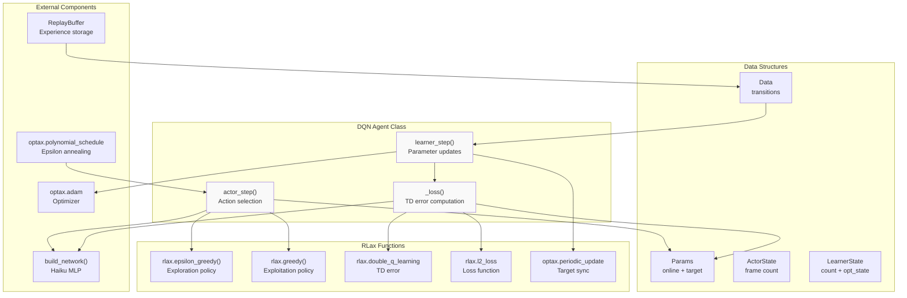
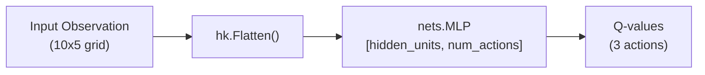
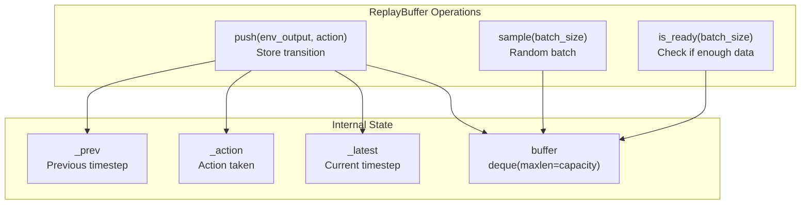
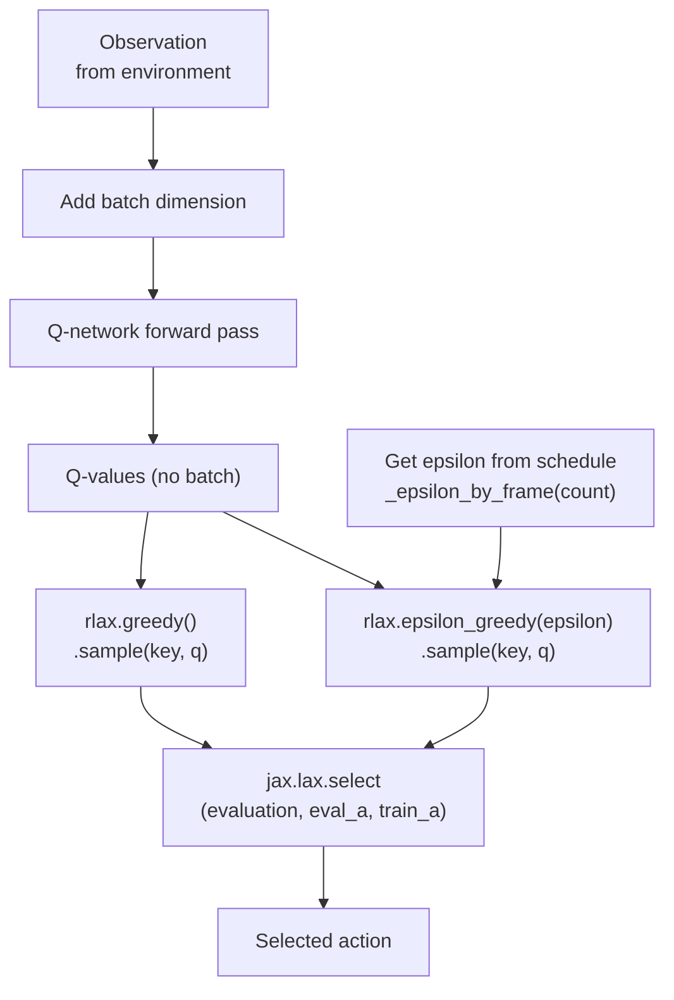
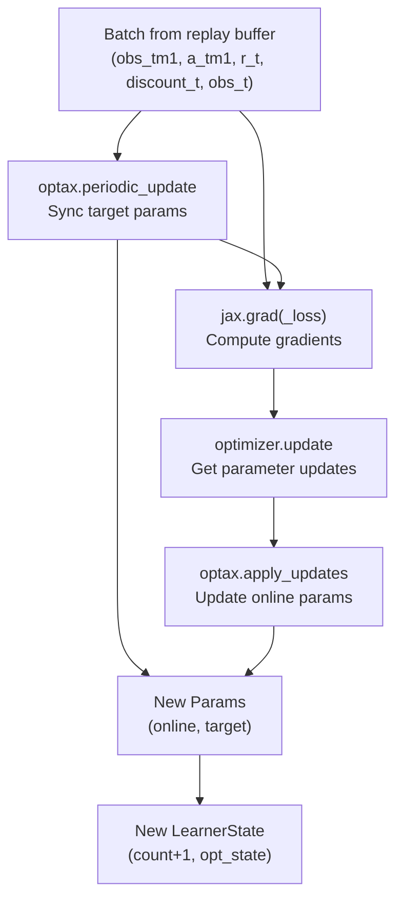
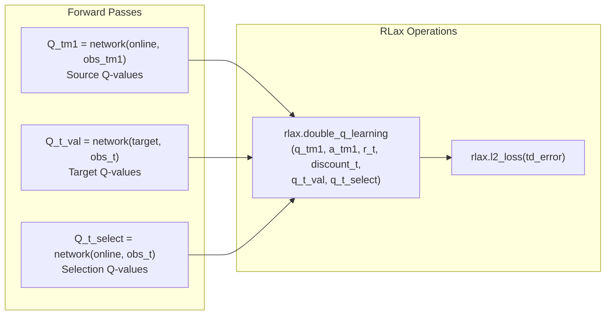
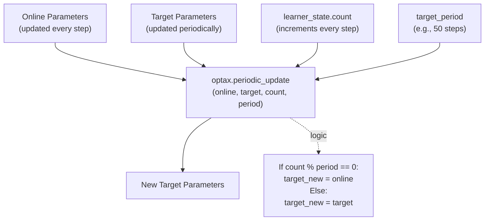
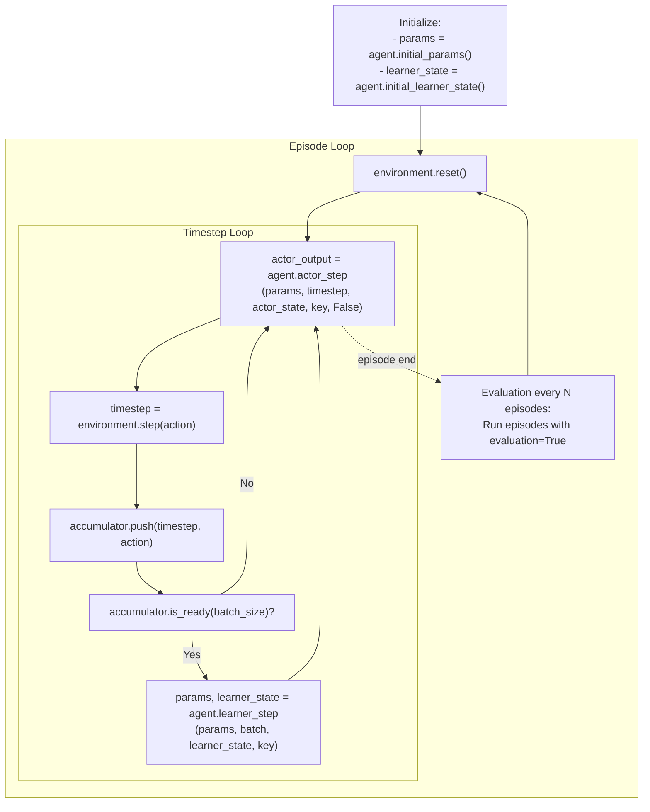

<!-- source: DeepWiki mcp.deepwiki.com · repo google-deepmind/rlax · page 9.1 DQN Example · fetched 2026-10-26 -->

# DQN Example

<details>
<summary>Relevant source files</summary>

The following files were used as context for generating this wiki page:

- [README.md](README.md)
- [examples/__init__.py](examples/__init__.py)
- [examples/experiment.py](examples/experiment.py)
- [examples/online_q_learning.py](examples/online_q_learning.py)
- [examples/pop_art.py](examples/pop_art.py)
- [examples/simple_dqn.py](examples/simple_dqn.py)
- [rlax/_src/embedding.py](rlax/_src/embedding.py)

</details>


This page provides a detailed explanation of the DQN (Deep Q-Network) implementation in [examples/simple_dqn.py](). The example demonstrates how to compose RLax building blocks to create a complete value-based reinforcement learning agent. This implementation features double Q-learning, experience replay, target networks, and epsilon-greedy exploration with annealing.

For basic Q-learning concepts, see [Basic Value Learning (TD, Q-learning, SARSA)](#2.1). For information about policy-based methods, see [Policy Optimization Methods](#5). For a simpler online Q-learning example without replay, see [Online Q-Learning Example](#9.2).

## System Overview

The DQN example implements a complete RL agent with the following components:



**Sources:** [examples/simple_dqn.py:95-154]()

## Data Structures

The DQN agent uses several named tuples to organize state and data:

| Named Tuple | Fields | Purpose |
|-------------|--------|---------|
| `Params` | `online`, `target` | Holds both online and target network parameters |
| `ActorState` | `count` | Tracks frame count for epsilon annealing |
| `ActorOutput` | `actions`, `q_values` | Output from actor step |
| `LearnerState` | `count`, `opt_state` | Tracks learner steps and optimizer state |
| `Data` | `obs_tm1`, `a_tm1`, `r_t`, `discount_t`, `obs_t` | Transition tuple |

The `Params` structure is critical for implementing target networks - it maintains two copies of network parameters that are synchronized periodically. The `ActorState.count` field enables epsilon annealing by tracking the total number of environment steps.

**Sources:** [examples/simple_dqn.py:31-35]()

## Network Architecture

The Q-network is a simple MLP built using Haiku:



The `build_network()` function at [examples/simple_dqn.py:54-63]() creates a Haiku transformed function. Key features:

- Flattens spatial observations into a vector
- Single hidden layer with configurable units (default 50)
- Output layer with one value per action
- Uses `hk.without_apply_rng` since the network is deterministic

The network is initialized in `initial_params()` [examples/simple_dqn.py:111-115]() which creates both online and target parameters by duplicating the initial parameters:

```python
online_params = self._network.init(key, sample_input)
return Params(online_params, online_params)
```

**Sources:** [examples/simple_dqn.py:54-63](), [examples/simple_dqn.py:111-115]()

## Replay Buffer

The `ReplayBuffer` class implements experience replay with a fixed-capacity FIFO buffer:



Implementation details at [examples/simple_dqn.py:66-93]():

- Uses `collections.deque` with `maxlen` for automatic capacity management
- Stores tuples: `(obs_tm1, a_tm1, r_t, discount_t, obs_t)`
- `push()` accumulates consecutive observations to form transitions
- `sample()` uses `random.sample()` for uniform random sampling
- Applies discount factor during sampling: `discount_t * FLAGS.discount_factor`

The buffer tracks three consecutive environment outputs to construct transitions:
1. `_prev`: source state s_{t-1}
2. `_action`: action a_{t-1} taken
3. `_latest`: destination state s_t with reward r_t and discount

**Sources:** [examples/simple_dqn.py:66-93]()

## Actor: Action Selection

The `actor_step()` method at [examples/simple_dqn.py:126-133]() handles action selection with epsilon-greedy exploration:



### Epsilon Scheduling

Epsilon annealing is configured using `optax.polynomial_schedule` [examples/simple_dqn.py:106](), [examples/simple_dqn.py:158-162]():

- `init_value`: Starting epsilon (default 1.0)
- `end_value`: Final epsilon (default 0.01)
- `transition_steps`: Annealing duration (default 1000)
- `power`: Interpolation power (1.0 for linear)

The schedule is queried using `actor_state.count`, which increments on every environment step. This provides frame-level control over exploration.

### Policy Selection

The actor supports both training and evaluation modes:
- **Training**: Uses `rlax.epsilon_greedy()` for exploration
- **Evaluation**: Uses `rlax.greedy()` for pure exploitation

The `jax.lax.select()` at [examples/simple_dqn.py:132]() conditionally chooses between policies based on the `evaluation` flag, allowing the same compiled function to handle both modes.

**Sources:** [examples/simple_dqn.py:126-133](), [examples/simple_dqn.py:106](), [examples/simple_dqn.py:158-162]()

## Learner: Loss Computation and Updates

The `learner_step()` method at [examples/simple_dqn.py:135-144]() performs parameter updates:



### Double Q-Learning Loss

The `_loss()` method at [examples/simple_dqn.py:146-153]() implements double Q-learning:



The key double Q-learning pattern:
1. **Online network evaluates source**: `q_tm1[a_tm1]` provides current value estimate
2. **Online network selects target action**: `argmax(q_t_select)` chooses best action
3. **Target network evaluates target action**: `q_t_val[argmax(q_t_select)]` provides stable value

This decoupling reduces overestimation bias compared to standard Q-learning. The `rlax.double_q_learning` function at [examples/simple_dqn.py:151]() handles this computation with automatic batching via `jax.vmap`.

The loss is the mean squared TD error: `mean(l2_loss(td_error))` at [examples/simple_dqn.py:153]().

**Sources:** [examples/simple_dqn.py:135-144](), [examples/simple_dqn.py:146-153]()

## Target Network Updates

Target network synchronization uses `optax.periodic_update` at [examples/simple_dqn.py:136-138]():



The periodic update mechanism:
- **Every step**: Online parameters are updated via gradient descent
- **Every `target_period` steps**: Target parameters are copied from online parameters
- **Between updates**: Target parameters remain frozen

This creates a moving target that stabilizes learning. The target network lags behind the online network, providing consistent regression targets during the update period.

Configuration at [examples/simple_dqn.py:41]() sets `target_period=50` by default, meaning targets update every 50 learner steps.

**Sources:** [examples/simple_dqn.py:136-138](), [examples/simple_dqn.py:41]()

## Training Loop Integration

The DQN agent integrates with the experiment framework at [examples/experiment.py:21-72]():



Key aspects of the training loop:

1. **Initialization** [examples/experiment.py:27-29](): Creates initial parameters and learner state
2. **Experience collection** [examples/experiment.py:42-50](): Actor interacts with environment, storing transitions
3. **Learning** [examples/experiment.py:53-55](): When replay buffer is ready, sample batch and update
4. **Evaluation** [examples/experiment.py:58-71](): Periodically evaluate with greedy policy

The loop uses JAX PRNG keys generated by `hk.PRNGSequence` for reproducible randomness.

**Sources:** [examples/experiment.py:21-72](), [examples/simple_dqn.py:172-181]()

## Configuration and Usage

The DQN agent is configured via command-line flags at [examples/simple_dqn.py:37-51]():

| Flag | Default | Purpose |
|------|---------|---------|
| `seed` | 42 | Random seed for reproducibility |
| `train_episodes` | 301 | Number of training episodes |
| `batch_size` | 32 | Replay buffer sample size |
| `target_period` | 50 | Steps between target network updates |
| `replay_capacity` | 2000 | Maximum buffer size |
| `hidden_units` | 50 | MLP hidden layer size |
| `epsilon_begin` | 1.0 | Initial exploration rate |
| `epsilon_end` | 0.01 | Final exploration rate |
| `epsilon_steps` | 1000 | Annealing duration |
| `discount_factor` | 0.99 | Reward discount (γ) |
| `learning_rate` | 0.005 | Optimizer step size |
| `eval_episodes` | 100 | Episodes per evaluation |
| `evaluate_every` | 50 | Evaluation frequency |

### Running the Example

```bash
# Basic usage
python -m examples.simple_dqn

# Custom configuration
python -m examples.simple_dqn \
    --train_episodes=500 \
    --batch_size=64 \
    --epsilon_end=0.05
```

The agent trains on the Catch environment from BSuite [examples/simple_dqn.py:157](), a simple task where the agent must position a paddle to catch falling balls.

**Sources:** [examples/simple_dqn.py:37-51](), [examples/simple_dqn.py:156-181]()

## RLax Functions Used

This example demonstrates composition of several RLax building blocks:

| RLax Function | Location | Purpose |
|---------------|----------|---------|
| `rlax.epsilon_greedy()` | [examples/simple_dqn.py:130]() | Create epsilon-greedy distribution |
| `rlax.greedy()` | [examples/simple_dqn.py:131]() | Create greedy distribution |
| `rlax.double_q_learning` | [examples/simple_dqn.py:151]() | Compute double Q-learning TD error |
| `rlax.l2_loss` | [examples/simple_dqn.py:153]() | Convert TD error to squared loss |

These functions are documented in:
- [Discrete Action Distributions](#4.1) for `epsilon_greedy` and `greedy`
- [Basic Value Learning (TD, Q-learning, SARSA)](#2.1) for `double_q_learning` and `l2_loss`

**Sources:** [examples/simple_dqn.py:130-131](), [examples/simple_dqn.py:151](), [examples/simple_dqn.py:153]()

## Comparison with Online Q-Learning

The DQN example differs from the simpler online Q-learning example ([Online Q-Learning Example](#9.2)) in several ways:

| Feature | DQN | Online Q-Learning |
|---------|-----|-------------------|
| Replay buffer | ✓ (deque, 2000 capacity) | ✗ (single transition) |
| Target network | ✓ (periodic updates) | ✗ (single network) |
| Batch size | 32 | 1 |
| Q-learning variant | Double Q-learning | Standard Q-learning |
| Epsilon schedule | Annealing (1.0 → 0.01) | Fixed (0.01) |
| Training efficiency | Higher (stable learning) | Lower (high variance) |

DQN's additional complexity provides more stable and sample-efficient learning, especially important for tasks with longer episodes or complex state spaces.

**Sources:** [examples/simple_dqn.py](), [examples/online_q_learning.py]()

---

