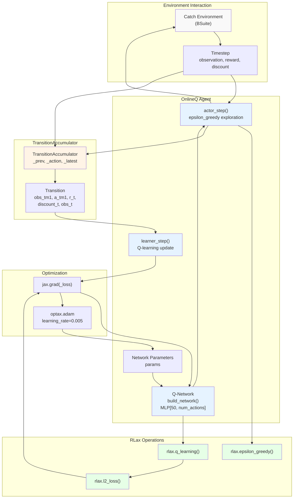
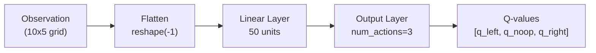
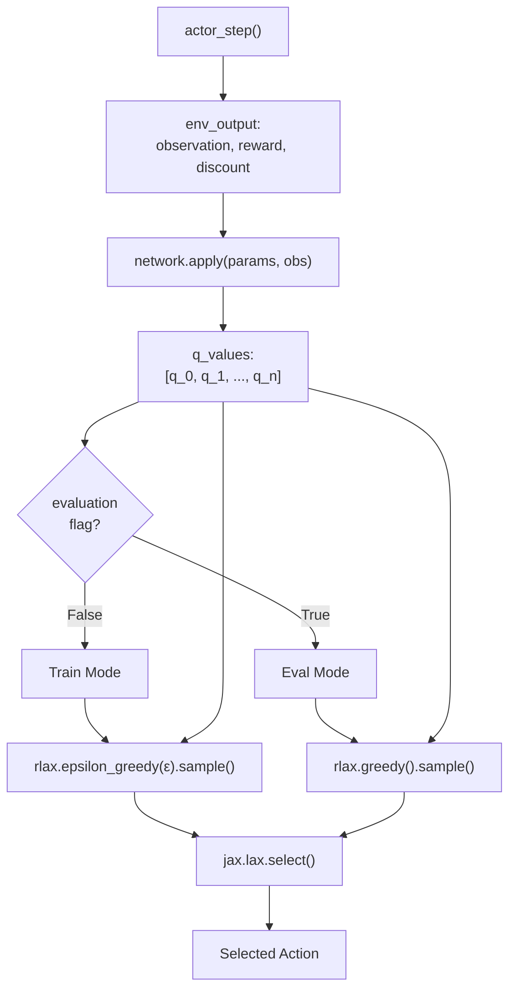
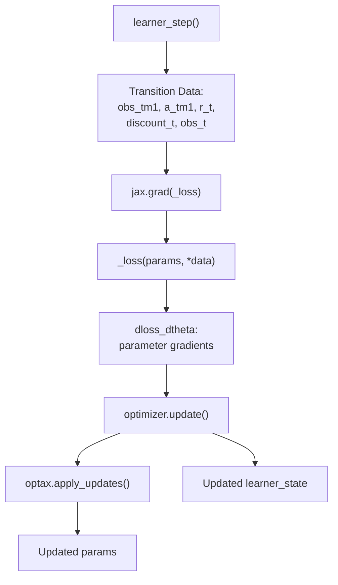
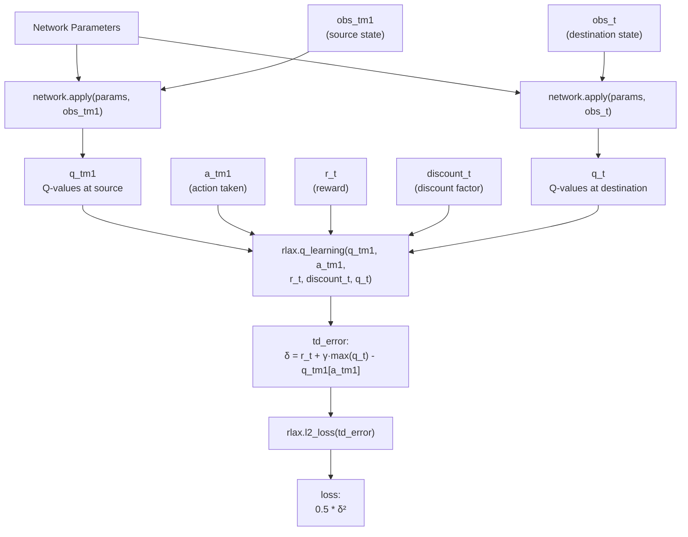

<!-- source: DeepWiki mcp.deepwiki.com · repo google-deepmind/rlax · page 9.2 Online Q-Learning Example · fetched 2026-10-26 -->

# Online Q-Learning Example

<details>
<summary>Relevant source files</summary>

The following files were used as context for generating this wiki page:

- [README.md](README.md)
- [examples/__init__.py](examples/__init__.py)
- [examples/experiment.py](examples/experiment.py)
- [examples/online_q_learning.py](examples/online_q_learning.py)
- [examples/pop_art.py](examples/pop_art.py)
- [examples/simple_dqn.py](examples/simple_dqn.py)
- [rlax/_src/embedding.py](rlax/_src/embedding.py)

</details>


## Purpose and Scope

This document explains the online Q-learning example implementation in [examples/online_q_learning.py](). This example demonstrates the simplest possible value-based reinforcement learning agent using RLax building blocks. Unlike the DQN example (see [DQN Example](#9.1)), this agent performs immediate single-step updates without a replay buffer or target network, making it ideal for understanding the core Q-learning algorithm.

The example trains an agent on BSuite's Catch environment and showcases:
- Basic Q-learning with `rlax.q_learning()`
- Epsilon-greedy exploration using `rlax.epsilon_greedy()`
- Immediate online learning (no experience replay)
- Single network architecture (no target network)

For distributional Q-learning variants, see [Distributional Reinforcement Learning](#2.2). For PopArt normalization with online Q-learning, see [PopArt Normalization Example](#9.3).

## Overview

The online Q-learning agent implements the classical Q-learning algorithm where the agent learns directly from each transition as it interacts with the environment. This contrasts with off-policy methods that use replay buffers to store and resample past experiences.

**Key Characteristics:**
| Feature | Online Q-Learning | DQN (for comparison) |
|---------|-------------------|----------------------|
| Experience Storage | Single transition | Replay buffer (2000 capacity) |
| Target Network | None | Separate target network |
| Update Frequency | Every transition | After batch sampling |
| Batch Size | 1 | 32 |
| Algorithm | Q-learning | Double Q-learning |
| Exploration | Fixed epsilon | Annealed epsilon |

Sources: [examples/online_q_learning.py:1-150](), [examples/simple_dqn.py:1-186]()

## Architecture Overview



**Diagram: Online Q-Learning Agent Architecture**

The agent consists of three main components that interact in a tight loop: the actor selects actions using epsilon-greedy exploration, the accumulator stores the immediate transition, and the learner updates the network parameters using Q-learning TD errors.

Sources: [examples/online_q_learning.py:80-123](), [examples/experiment.py:21-72]()

## Core Components

### OnlineQ Agent Class

The `OnlineQ` class [examples/online_q_learning.py:80-123]() encapsulates the agent's state and behavior:

**Initialization** [examples/online_q_learning.py:83-93]():
- Creates MLP network via `build_network()` with configurable hidden units
- Initializes Adam optimizer with specified learning rate
- Stores epsilon value for exploration
- JIT-compiles actor and learner steps for performance

**Key Attributes:**
| Attribute | Type | Purpose |
|-----------|------|---------|
| `_network` | `hk.Transformed` | Q-value function approximator |
| `_optimizer` | `optax.GradientTransformation` | Adam optimizer |
| `_epsilon` | `float` | Fixed exploration probability |

Sources: [examples/online_q_learning.py:80-93]()

### Network Architecture



**Diagram: Q-Network Structure**

The `build_network()` function [examples/online_q_learning.py:45-54]() creates a simple feedforward network:
1. Flatten input observation to 1D vector
2. Hidden layer with 50 units (configurable)
3. Output layer with one unit per action
4. Returns raw Q-values (no activation on output)

Sources: [examples/online_q_learning.py:45-54]()

### TransitionAccumulator

The `TransitionAccumulator` class [examples/online_q_learning.py:57-77]() provides minimal storage for online learning:

```python
# Structure maintained internally:
# _prev: previous timestep (obs_tm1, r_tm1, discount_tm1)
# _action: action taken (a_tm1)
# _latest: current timestep (obs_t, r_t, discount_t)
```

**Methods:**

| Method | Purpose | Key Behavior |
|--------|---------|--------------|
| `push(env_output, action)` | Store new timestep | Slides window: latest → prev |
| `sample(batch_size)` | Return transition | Asserts batch_size == 1 |
| `is_ready(batch_size)` | Check if ready | Returns `_prev is not None` |

The accumulator only stores the most recent transition, enforcing the batch size of 1 constraint for online learning.

Sources: [examples/online_q_learning.py:57-77]()

## Actor-Learner Pattern

### Actor Step



**Diagram: Actor Step Data Flow**

The `actor_step()` method [examples/online_q_learning.py:105-110]() implements action selection:

1. **Forward Pass**: Apply network to current observation to get Q-values
2. **Exploration**: Use `rlax.epsilon_greedy(self._epsilon)` to sample action during training
3. **Exploitation**: Use `rlax.greedy()` to select argmax action during evaluation
4. **Conditional Selection**: `jax.lax.select()` chooses between train/eval actions based on flag

**Return Value**: `ActorOutput(actions=a, q_values=q)` tuple and empty actor state `()`

Sources: [examples/online_q_learning.py:105-110]()

### Learner Step

The `learner_step()` method [examples/online_q_learning.py:112-116]() performs the parameter update:



**Diagram: Learner Step Gradient Flow**

**Implementation Details:**
1. Compute gradient of loss with respect to parameters using `jax.grad()`
2. Update optimizer state with new gradients
3. Apply parameter updates using `optax.apply_updates()`
4. Return updated parameters and optimizer state

The learner state contains only the optimizer state (no additional counters or target networks).

Sources: [examples/online_q_learning.py:112-116]()

## Q-Learning Loss Function

The loss computation [examples/online_q_learning.py:118-122]() implements the core Q-learning update:



**Diagram: Q-Learning Loss Computation**

**Mathematical Formulation:**

The Q-learning update follows the standard temporal difference equation:

```
TD Error: δ = r_t + γ·max_a' Q(s_t, a') - Q(s_{t-1}, a_{t-1})
Loss: L = 0.5 * δ²
```

Where:
- `q_tm1 = Q(s_{t-1}, ·)`: Q-values at source state
- `a_tm1`: Action taken at source state
- `r_t`: Immediate reward
- `discount_t`: Discount factor (typically γ = 0.99)
- `q_t = Q(s_t, ·)`: Q-values at destination state

**Key RLax Functions Used:**

| Function | File Reference | Purpose |
|----------|----------------|---------|
| `rlax.q_learning()` | Called at [examples/online_q_learning.py:121]() | Computes TD error |
| `rlax.l2_loss()` | Called at [examples/online_q_learning.py:122]() | Converts error to loss |

The `q_learning()` function from RLax handles indexing into `q_tm1` with action `a_tm1` and computing the max over `q_t`.

Sources: [examples/online_q_learning.py:118-122]()

## Training Loop Integration

The agent integrates with the experiment harness via the `run_loop()` function [examples/experiment.py:21-72]():

```mermaid
sequenceDiagram
    participant Loop as run_loop()
    participant Agent as OnlineQ
    participant Env as Catch
    participant Acc as TransitionAccumulator
    
    Note over Loop: Initialize agent & environment
    Loop->>Agent: initial_params(rng)
    Loop->>Agent: initial_learner_state(params)
    
    loop For each episode
        Loop->>Env: reset()
        Env-->>Loop: initial_timestep
        Loop->>Acc: push(timestep, None)
        Loop->>Agent: initial_actor_state()
        
        loop Until episode ends
            Loop->>Agent: actor_step(params, timestep, ...)
            Agent-->>Loop: ActorOutput(action, q_values)
            Loop->>Env: step(action)
            Env-->>Loop: new_timestep
            Loop->>Acc: push(new_timestep, action)
            
            alt Accumulator ready
                Loop->>Acc: sample(batch_size=1)
                Acc-->>Loop: Transition
                Loop->>Agent: learner_step(params, transition, ...)
                Agent-->>Loop: updated_params, updated_state
            end
        end
        
        alt Evaluation episode
            Note over Loop: Run greedy evaluation<br/>without learning
        end
    end
```

**Diagram: Training Loop Sequence**

**Flow Description:**

1. **Initialization Phase:**
   - Create agent with network parameters
   - Initialize optimizer state
   - Reset environment

2. **Episode Loop:**
   - Reset environment and accumulator
   - Initialize actor state (empty tuple for this agent)

3. **Timestep Loop:**
   - Actor selects action based on Q-values
   - Environment steps forward
   - Accumulator stores transition
   - If accumulator ready, learner updates parameters immediately

4. **Evaluation:**
   - Periodically run episodes with greedy policy
   - No learning during evaluation

The critical difference from DQN is that learning happens **every timestep** rather than after accumulating a replay buffer.

Sources: [examples/experiment.py:21-72](), [examples/online_q_learning.py:125-149]()

## Configuration and Hyperparameters

The example uses command-line flags for configuration [examples/online_q_learning.py:33-42]():

| Flag | Default | Purpose |
|------|---------|---------|
| `seed` | 42 | Random seed for reproducibility |
| `train_episodes` | 500 | Number of training episodes |
| `num_hidden_units` | 50 | Hidden layer size in MLP |
| `epsilon` | 0.01 | Epsilon-greedy exploration probability |
| `discount_factor` | 0.99 | Q-learning discount (γ) |
| `learning_rate` | 0.005 | Adam optimizer learning rate |
| `eval_episodes` | 100 | Episodes for evaluation |
| `evaluate_every` | 50 | Frequency of evaluation |

**Notable Differences from DQN:**
- **Fixed epsilon**: No annealing schedule (DQN: 1.0 → 0.01 over 1000 steps)
- **No batch_size flag**: Hardcoded to 1
- **No replay_capacity**: No replay buffer
- **No target_period**: No target network

Sources: [examples/online_q_learning.py:33-42](), [examples/simple_dqn.py:37-51]()

## Comparison: Online Q-Learning vs. DQN

```mermaid
graph TB
    subgraph "Online Q-Learning"
        OQ_ENV["Environment"]
        OQ_ACC["TransitionAccumulator<br/>(1 transition)"]
        OQ_AGENT["OnlineQ Agent<br/>(single network)"]
        OQ_UPDATE["Immediate Update<br/>every step"]
        
        OQ_ENV --> OQ_ACC
        OQ_ACC --> OQ_AGENT
        OQ_AGENT --> OQ_UPDATE
        OQ_UPDATE --> OQ_AGENT
    end
    
    subgraph "DQN"
        DQN_ENV["Environment"]
        DQN_BUFFER["ReplayBuffer<br/>(2000 capacity)"]
        DQN_AGENT["DQN Agent<br/>(online + target)"]
        DQN_SAMPLE["Batch Sample<br/>(size 32)"]
        DQN_UPDATE["Periodic Update<br/>target network"]
        
        DQN_ENV --> DQN_BUFFER
        DQN_BUFFER --> DQN_SAMPLE
        DQN_SAMPLE --> DQN_AGENT
        DQN_AGENT --> DQN_UPDATE
        DQN_UPDATE --> DQN_AGENT
    end
```



**Diagram: Architectural Comparison**

### Key Algorithmic Differences

| Aspect | Online Q-Learning | DQN |
|--------|-------------------|-----|
| **Experience Storage** | Single transition | Replay buffer with 2000 transitions |
| **Sampling** | Immediate use | Random batch sampling |
| **Network Architecture** | Single Q-network | Online + target networks |
| **Q-Learning Variant** | Standard Q-learning | Double Q-learning |
| **Target Stability** | None (uses same network) | Periodic target network sync |
| **Data Efficiency** | Low (single use) | High (repeated sampling) |
| **Computational Cost** | Low (small updates) | Higher (batch processing) |
| **Correlation** | High (sequential data) | Low (randomized batches) |

### RLax Function Usage

**Online Q-Learning:**
- `rlax.q_learning()` [examples/online_q_learning.py:121]()
- `rlax.epsilon_greedy()` [examples/online_q_learning.py:107]()
- `rlax.greedy()` [examples/online_q_learning.py:108]()
- `rlax.l2_loss()` [examples/online_q_learning.py:122]()

**DQN:**
- `rlax.double_q_learning()` [examples/simple_dqn.py:151]()
- `rlax.epsilon_greedy()` with annealing [examples/simple_dqn.py:130]()
- `rlax.greedy()` [examples/simple_dqn.py:131]()
- `rlax.l2_loss()` [examples/simple_dqn.py:153]()

Sources: [examples/online_q_learning.py:118-122](), [examples/simple_dqn.py:146-153]()

## Running the Example

The example can be executed directly from the command line:

```bash
# Run with default hyperparameters
python examples/online_q_learning.py

# Run with custom configuration
python examples/online_q_learning.py \
  --seed=123 \
  --train_episodes=1000 \
  --epsilon=0.05 \
  --learning_rate=0.001
```

**Expected Output:**
```
Training agent for 500 episodes
Episode    0: Average returns: 0.00
Episode   50: Average returns: 0.45
Episode  100: Average returns: 0.78
Episode  150: Average returns: 0.82
...
```

The agent typically converges to near-optimal performance (0.8-0.9 average return on Catch) within a few hundred episodes.

Sources: [examples/online_q_learning.py:125-149]()

## Code Entity Reference

### Main Classes and Functions

| Entity | Location | Purpose |
|--------|----------|---------|
| `OnlineQ` | [examples/online_q_learning.py:80-123]() | Main agent class |
| `build_network()` | [examples/online_q_learning.py:45-54]() | Creates Q-network |
| `TransitionAccumulator` | [examples/online_q_learning.py:57-77]() | Stores single transition |
| `ActorOutput` | [examples/online_q_learning.py:29]() | Named tuple for actor return |
| `Transition` | [examples/online_q_learning.py:30-31]() | Named tuple for SARSA data |
| `run_loop()` | [examples/experiment.py:21-72]() | Training orchestration |

### Method Signatures

```python
# OnlineQ methods
def initial_params(self, key: jax.random.PRNGKey) -> hk.Params
def initial_actor_state(self) -> Tuple[()]
def initial_learner_state(self, params: hk.Params) -> optax.OptState
def actor_step(self, params, env_output, actor_state, key, evaluation) -> Tuple[ActorOutput, ActorState]
def learner_step(self, params, data, learner_state, unused_key) -> Tuple[hk.Params, optax.OptState]
```

### RLax Functions Used

| Function | Module | Purpose in Example |
|----------|--------|-------------------|
| `q_learning()` | `rlax` | Compute Q-learning TD error |
| `epsilon_greedy()` | `rlax` | Exploration policy |
| `greedy()` | `rlax` | Exploitation policy |
| `l2_loss()` | `rlax` | Convert TD error to loss |

Sources: [examples/online_q_learning.py:80-123]()

## When to Use Online Q-Learning

**Appropriate Use Cases:**
- Educational purposes and understanding core Q-learning
- Environments with low-dimensional state spaces
- Problems where data collection is expensive
- Real-time learning scenarios requiring immediate updates
- Debugging and prototyping before implementing more complex methods

**Limitations:**
- **Sample inefficiency**: Each transition used only once
- **High correlation**: Sequential data can cause instability
- **Slow convergence**: Compared to replay-based methods
- **Overestimation bias**: Single network for both prediction and target
- **Sensitivity to hyperparameters**: Especially learning rate and epsilon

**When to Use DQN Instead:**
- High-dimensional state spaces (images, etc.)
- Need for sample efficiency
- Availability of offline data
- Stability requirements

For more stable online learning with non-stationary rewards, consider the PopArt example (see [PopArt Normalization Example](#9.3)).

Sources: [examples/online_q_learning.py:1-150](), [examples/simple_dqn.py:1-186]()

---

