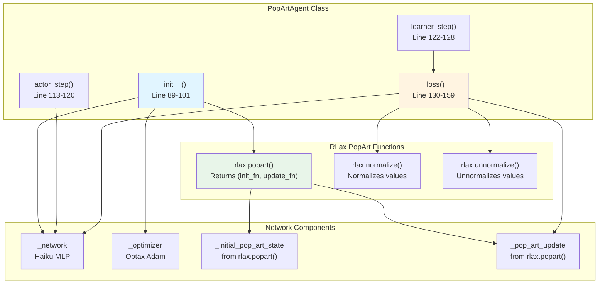
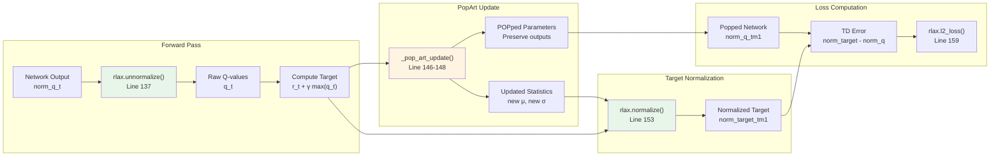
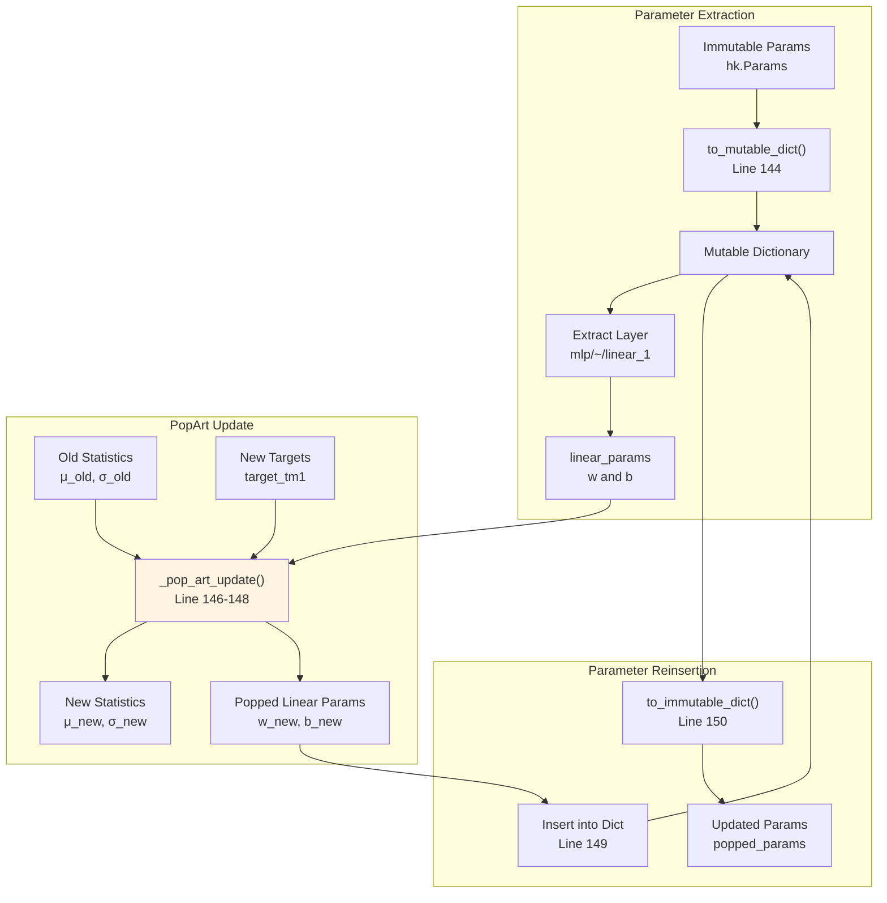
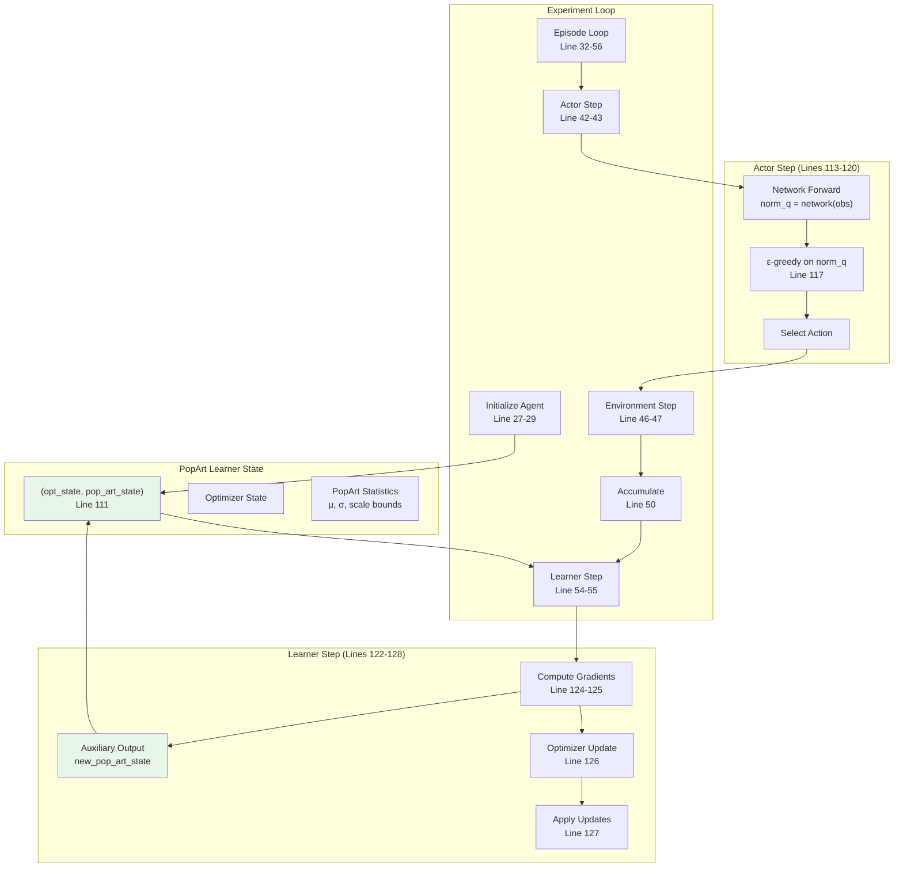

<!-- source: DeepWiki mcp.deepwiki.com · repo google-deepmind/rlax · page 9.3 PopArt Normalization Example · fetched 2026-10-26 -->

# PopArt Normalization Example

<details>
<summary>Relevant source files</summary>

The following files were used as context for generating this wiki page:

- [README.md](README.md)
- [examples/__init__.py](examples/__init__.py)
- [examples/experiment.py](examples/experiment.py)
- [examples/online_q_learning.py](examples/online_q_learning.py)
- [examples/pop_art.py](examples/pop_art.py)
- [examples/simple_dqn.py](examples/simple_dqn.py)
- [rlax/_src/embedding.py](rlax/_src/embedding.py)

</details>


This page explains the PopArt (Preserving Outputs Precisely while Adaptively Rescaling Targets) normalization example, which demonstrates how to handle non-stationary reward scales in reinforcement learning. The example implements an online Q-learning agent with adaptive normalization on the BSuite Catch environment with artificially large rewards (scaled by 10,000x).

For basic Q-learning without normalization, see [Online Q-Learning Example](#9.2). For experience replay and double Q-learning, see [DQN Example](#9.1). For information about value transformations in general, see [Nonlinear Bellman Equations and Value Transformations](#6.1).

## Purpose and Problem Statement

PopArt addresses the challenge of learning when reward scales are large or non-stationary. Without normalization, neural networks struggle with:
- Large magnitude rewards causing gradient instability
- Varying reward scales across different tasks or time periods
- Slow learning due to poorly conditioned value functions

The PopArt algorithm solves this by maintaining running statistics (mean and standard deviation) of targets and adaptively normalizing both network outputs and regression targets while preserving the network's output distribution when statistics are updated.

**Sources:** [examples/pop_art.py:15-18]()

## Agent Architecture

The `PopArtAgent` class in [examples/pop_art.py:86-160]() implements online Q-learning with PopArt normalization. The agent is structurally similar to the standard `OnlineQ` agent but adds normalization logic to the learning step.



**Diagram: PopArtAgent Structure and Dependencies**

**Sources:** [examples/pop_art.py:86-101]()

### Key Components

| Component | Type | Purpose |
|-----------|------|---------|
| `_network` | `hk.Transformed` | MLP that outputs normalized Q-values |
| `_optimizer` | `optax.GradientTransformation` | Adam optimizer for parameter updates |
| `_initial_pop_art_state` | Function | Creates initial PopArt statistics (μ=0, σ=1) |
| `_pop_art_update` | Function | Updates statistics and POPs parameters |
| `_epsilon` | Float | Exploration probability for ε-greedy policy |

The agent is initialized with `num_outputs=1` for PopArt because only the final Q-value output needs normalization, not intermediate activations.

**Sources:** [examples/pop_art.py:89-101]()

## PopArt Operations Cycle

PopArt involves four key operations that work together to maintain normalized learning while adapting to changing target scales:



**Diagram: PopArt Operations Dataflow in Loss Function**

**Sources:** [examples/pop_art.py:130-159]()

### Operation Details

#### 1. Unnormalize (Line 137)

```python
norm_q_t = self._network.apply(params, obs_t)
q_t = rlax.unnormalize(pop_art_state, norm_q_t, indices)
```

Converts normalized Q-values from the network back to raw scale:
```
q_t = norm_q_t * σ + μ
```

#### 2. PopArt Update (Lines 146-148)

```python
popped_linear_params, new_pop_art_state = self._pop_art_update(
    params=linear_params, state=pop_art_state, targets=target_tm1,
    indices=indices)
```

This operation performs two critical steps:
- **ART (Adaptively Rescaling Targets)**: Updates running statistics (μ, σ) from new targets
- **POP (Preserving Outputs Precisely)**: Modifies the final linear layer's weights and biases so that with the new normalization statistics, the network produces the same outputs

The parameter transformation is:
```
W_new = W_old * (σ_old / σ_new)
b_new = (b_old * σ_old + μ_old - μ_new) / σ_new
```

#### 3. Normalize (Line 153)

```python
norm_target_tm1 = rlax.normalize(new_pop_art_state, target_tm1, indices)
```

Converts raw targets to normalized space using updated statistics:
```
norm_target_tm1 = (target_tm1 - μ_new) / σ_new
```

#### 4. Loss Computation (Lines 156-159)

```python
norm_q_tm1 = self._network.apply(popped_params, obs_tm1)
td_error = jax.lax.stop_gradient(norm_target_tm1) - norm_q_tm1[a_tm1]
return rlax.l2_loss(td_error), new_pop_art_state
```

Computes TD error and loss entirely in normalized space, using the POPped parameters.

**Sources:** [examples/pop_art.py:130-159]()

## Parameter Update Mechanism

A critical detail in the PopArt implementation is how the final linear layer's parameters are extracted, updated, and reinserted into the parameter tree:



**Diagram: Parameter Manipulation for POP Operation**

The code explicitly identifies the final linear layer by name: `"mlp/~/linear_1"` at [examples/pop_art.py:143](). This is crucial because only the final layer's parameters need adjustment to preserve outputs when normalization statistics change. Intermediate layers remain unchanged.

**Sources:** [examples/pop_art.py:143-150]()

## Integration with Training Loop

The PopArt agent integrates with the standard experiment loop defined in [examples/experiment.py:21-72](). The key differences from standard Q-learning occur in the learner state and loss function:



**Diagram: PopArt Integration in Training Loop**

### Learner State Structure

The PopArt agent's learner state at [examples/pop_art.py:111]() is a tuple:
```python
(opt_state, pop_art_state)
```

The `pop_art_state` contains:
- `mean`: Running mean (μ) of targets
- `std`: Running standard deviation (σ) of targets  
- Bounds on scale to prevent numerical instability

This state is both an input and output of the loss function, making the gradient computation use `has_aux=True` at [examples/pop_art.py:124-125]().

**Sources:** [examples/pop_art.py:111](), [examples/pop_art.py:122-128](), [examples/experiment.py:21-72]()

## Comparison to Standard Q-Learning

The table below contrasts the PopArt agent with the standard `OnlineQ` agent from [examples/online_q_learning.py]():

| Aspect | OnlineQ Agent | PopArtAgent |
|--------|---------------|-------------|
| **Network Output** | Raw Q-values | Normalized Q-values |
| **Target Computation** | Direct: `r + γ max(q)` | Unnormalize → compute → normalize |
| **Loss Computation** | `TD(q_raw, target_raw)` | `TD(q_norm, target_norm)` |
| **Learner State** | `opt_state` only | `(opt_state, pop_art_state)` |
| **Gradient Computation** | Standard `jax.grad()` | `jax.grad(..., has_aux=True)` |
| **Parameter Updates** | Direct optimizer application | POP then optimizer application |
| **Handles Large Rewards** | Struggles with scale >100 | Handles scale >10,000 |
| **Adaptation** | Static | Adaptive to changing scales |

**Sources:** [examples/online_q_learning.py:80-123](), [examples/pop_art.py:86-160]()

### Code Comparison: Loss Functions

**Standard Q-Learning** [examples/online_q_learning.py:118-122]():
```python
def _loss(self, params, obs_tm1, a_tm1, r_t, discount_t, obs_t):
    q_tm1 = self._network.apply(params, obs_tm1)
    q_t = self._network.apply(params, obs_t)
    td_error = rlax.q_learning(q_tm1, a_tm1, r_t, discount_t, q_t)
    return rlax.l2_loss(td_error)
```

**PopArt Q-Learning** [examples/pop_art.py:130-159]():
```python
def _loss(self, params, pop_art_state, obs_tm1, a_tm1, r_t, discount_t, obs_t):
    indices = jnp.array(0)
    
    # Unnormalize to compute target
    norm_q_t = self._network.apply(params, obs_t)
    q_t = rlax.unnormalize(pop_art_state, norm_q_t, indices)
    target_tm1 = r_t + discount_t * jnp.max(q_t)
    
    # Update statistics and POP parameters
    popped_linear_params, new_pop_art_state = self._pop_art_update(...)
    
    # Normalize target
    norm_target_tm1 = rlax.normalize(new_pop_art_state, target_tm1, indices)
    
    # Compute loss in normalized space
    norm_q_tm1 = self._network.apply(popped_params, obs_tm1)
    td_error = jax.lax.stop_gradient(norm_target_tm1) - norm_q_tm1[a_tm1]
    return rlax.l2_loss(td_error), new_pop_art_state
```

The PopArt version adds significant complexity but enables stable learning with large or changing reward scales.

**Sources:** [examples/online_q_learning.py:118-122](), [examples/pop_art.py:130-159]()

## Configuration and Hyperparameters

The PopArt example uses specific configuration at [examples/pop_art.py:37-48]():

| Parameter | Value | Purpose |
|-----------|-------|---------|
| `reward_scale` | 10,000 | Artificially inflates rewards to test normalization |
| `pop_art_step_size` | 0.003 | Learning rate for PopArt statistics |
| `scale_lb` | 1e-5 | Lower bound on scale to prevent division by zero |
| `scale_ub` | 1e5 | Upper bound on scale to prevent overflow |
| `num_outputs` | 1 | Only normalize the Q-value output, not per-action |
| `learning_rate` | 0.005 | Standard Adam learning rate |
| `epsilon` | 0.01 | ε-greedy exploration rate |
| `discount_factor` | 0.99 | Q-learning discount |

The `reward_scale` of 10,000 [examples/pop_art.py:39]() creates an environment where standard Q-learning would struggle due to large magnitude gradients. The PopArt agent handles this by maintaining normalized targets internally.

**Sources:** [examples/pop_art.py:37-48](), [examples/pop_art.py:100-101]()

## Actor Step: Action Selection

Unlike the learner, the actor step [examples/pop_art.py:113-120]() is remarkably simple because ε-greedy exploration works identically on normalized and unnormalized Q-values:

```python
def actor_step(self, params, env_output, actor_state, key, evaluation):
    norm_q = self._network.apply(params, env_output.observation)
    # Normalization is linear, so argmax is preserved
    train_a = rlax.epsilon_greedy(self._epsilon).sample(key, norm_q)
    eval_a = rlax.greedy().sample(key, norm_q)
    a = jax.lax.select(evaluation, eval_a, train_a)
    return ActorOutput(actions=a), actor_state
```

The comment at [examples/pop_art.py:115-116]() notes that since normalization is an affine transformation, the argmax over actions is invariant. Therefore, the agent can select actions directly from normalized Q-values without unnormalizing.

**Sources:** [examples/pop_art.py:113-120]()

## Running the Example

The example is executed via the command line with configurable flags:

```bash
python examples/pop_art.py \
    --seed=42 \
    --reward_scale=10000 \
    --train_episodes=1000 \
    --learning_rate=0.005 \
    --pop_art_step_size=0.003
```

The experiment loop at [examples/experiment.py:21-72]() orchestrates:
1. Training episodes with learning updates after each transition
2. Periodic evaluation every 50 episodes  
3. Printing average returns during evaluation

The PopArt agent demonstrates faster learning compared to standard Q-learning on the scaled-reward environment because it maintains stable, normalized targets throughout training.

**Sources:** [examples/pop_art.py:162-185](), [examples/experiment.py:21-72]()

## Key Takeaways

1. **PopArt solves the large reward scale problem** by maintaining running statistics and adaptively normalizing both network outputs and targets

2. **The POP operation preserves outputs** when normalization changes by adjusting the final linear layer's weights and biases: `W_new = W_old * (σ_old / σ_new)` and `b_new = (b_old * σ_old + μ_old - μ_new) / σ_new`

3. **Normalization is transparent to action selection** because argmax is invariant under affine transformations

4. **The loss function requires `has_aux=True`** to return both the loss and updated PopArt state: `return loss, new_pop_art_state`

5. **Only the final layer is modified** by the POP operation; intermediate layers and features remain unchanged

6. **Three RLax functions enable PopArt**: `rlax.popart()` creates the system, `rlax.normalize()` and `rlax.unnormalize()` transform values

**Sources:** [examples/pop_art.py:1-189]()

---

