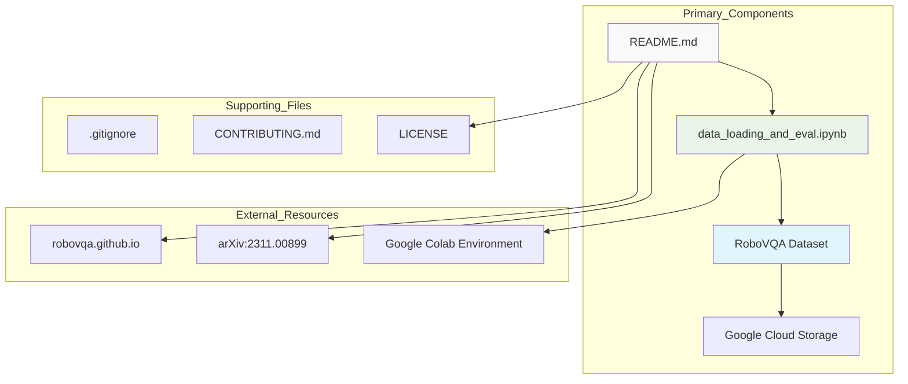
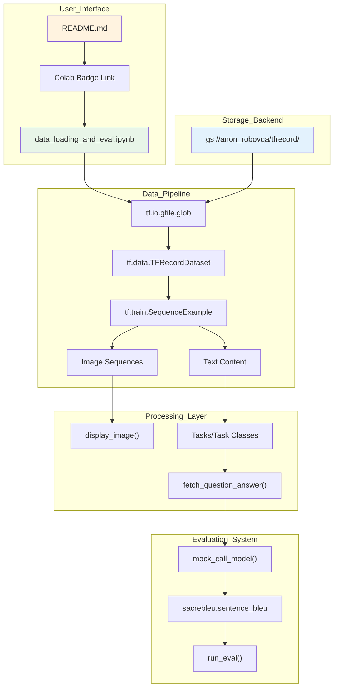
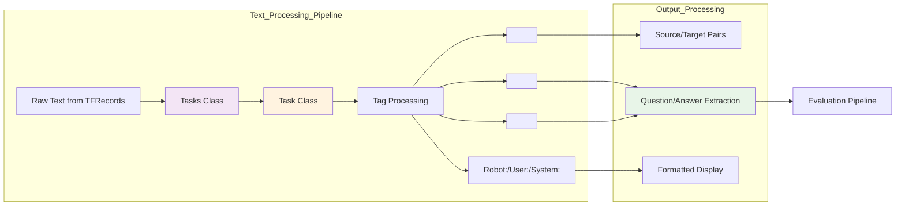
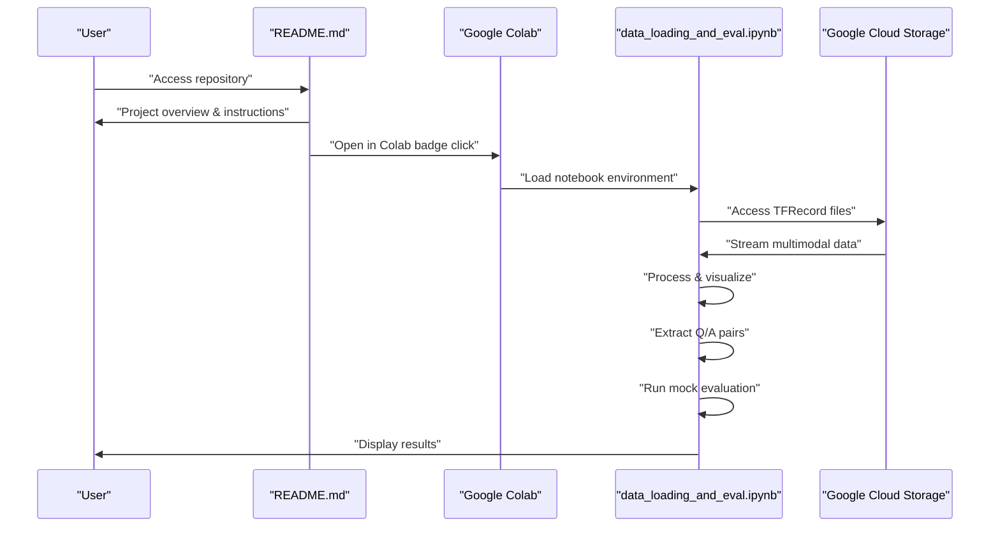

<!-- source: DeepWiki mcp.deepwiki.com · repo google-deepmind/robovqa · page 1 Overview · fetched 2026-10-26 -->

# Overview

Relevant source files

The following files were used as context for generating this wiki page:

- [README.md](README.md)

## Purpose and Scope

This document provides a comprehensive overview of the RoboVQA repository, explaining what RoboVQA is as a research project and clarifying that this repository contains example code for dataset interaction rather than the full model implementation. The overview covers the repository's purpose, architecture, and key components.

For detailed information about specific implementation components, see [Core Implementation](#3). For usage instructions and setup guidance, see [Getting Started](#2).

## What is RoboVQA?

RoboVQA is a high-level reasoning model designed for robotics applications, specifically focused on multimodal long-horizon reasoning. The research project enables robots to understand and reason about complex, multi-step tasks by combining visual perception with natural language understanding.

**Key Characteristics:**
- **Multimodal**: Processes both visual data (image sequences) and textual conversations
- **Long-horizon**: Handles extended task sequences rather than single-step actions  
- **Reasoning-focused**: Emphasizes high-level decision making over low-level control
- **Robotics-oriented**: Designed specifically for robotic applications and environments

The academic paper "RoboVQA: Multimodal Long-Horizon Reasoning for Robotics" (arXiv:2311.00899) provides the theoretical foundation, while the project website at robovqa.github.io offers additional context and resources.

Sources: [README.md:3-4](), [README.md:18-23]()

## Repository Purpose and Scope

This repository serves as a **demonstration interface** for the RoboVQA dataset, not the complete model implementation. The codebase is designed primarily for educational and research purposes, providing example code that shows how to interact with the released dataset.

### Repository Components

**Repository Structure Analysis:**
- **Documentation Hub**: `README.md` serves as the primary entry point and user guide
- **Functional Core**: `data_loading_and_eval.ipynb` contains the actual implementation
- **Dataset Interface**: Code focuses on loading and processing multimodal data from cloud storage
- **Evaluation Framework**: Includes mock evaluation pipeline with BLEU score calculation

Sources: [README.md:1-46]()

## High-Level Architecture

The repository implements a streamlined architecture designed for dataset interaction and evaluation demonstration:

### System Flow Diagram

**Architecture Principles:**
- **Single Notebook Design**: All functionality concentrated in one Jupyter notebook for simplicity
- **Cloud-Native Storage**: Leverages Google Cloud Storage for large-scale TFRecord distribution
- **Streaming Pipeline**: Uses TensorFlow's data pipeline for efficient processing of large datasets
- **Mock Evaluation**: Provides evaluation framework structure without requiring actual model implementation

Sources: [README.md:8-13]()

## Key Technical Components

### Multimodal Data Handling

The system processes two primary data types from the RoboVQA dataset:

| Data Type | Format | Processing Function | Purpose |
|-----------|---------|-------------------|---------|
| Image Sequences | JPEG arrays | `display_image()` | Visual context for robotic tasks |
| Conversational Text | UTF-8 strings | `Tasks`/`Task` classes | Natural language instructions and responses |

### Text Processing Architecture

**Text Processing Features:**
- **Conversational AI Tags**: Sophisticated tagging system distinguishes between model predictions and conditioning text
- **Speaker Identification**: Separates dialogue by Robot, User, and System speakers
- **Answer Type Classification**: Handles both binary (yes/no) and discrete (categorical) answer types
- **Question-Answer Extraction**: Automated extraction of evaluation pairs from conversational data

Sources: Based on architectural analysis from provided diagrams

## Usage Workflow

The repository follows a straightforward usage pattern designed for educational demonstration:

### User Interaction Sequence

**Workflow Characteristics:**
- **Single Entry Point**: Users begin with README.md documentation
- **Cloud-Based Execution**: Leverages Google Colab for zero-setup execution
- **Guided Experience**: Inline comments provide step-by-step instructions
- **Complete Demonstration**: Shows full pipeline from data loading to evaluation

Sources: [README.md:8-13]()

## Project Context and Licensing

### Academic and Legal Framework

The repository operates within a structured academic and legal framework:

**Academic Context:**
- Research paper: "RoboVQA: Multimodal Long-Horizon Reasoning for Robotics" (arXiv:2311.00899)
- Authors: Multi-institutional team from DeepMind and collaborating organizations
- Publication year: 2023

**Legal Structure:**
- **Software License**: Apache License, Version 2.0 for all code components
- **Content License**: Creative Commons Attribution 4.0 International (CC-BY) for documentation and other materials
- **Copyright**: DeepMind Technologies Limited (2023)
- **Disclaimer**: "This is not an official Google product"

**Contribution Requirements:**
- Google Contributor License Agreement (CLA) required for external contributions
- Code review process through GitHub pull requests
- Community guidelines compliance

Sources: [README.md:15-46]()

## Summary

This repository serves as an educational demonstration interface for the RoboVQA dataset, providing researchers and practitioners with example code for multimodal robotics data interaction. The architecture emphasizes simplicity and accessibility, with a single Jupyter notebook containing the complete functionality for data loading, processing, and evaluation.

The system's design reflects its purpose as a research tool rather than a production system, with mock evaluation components and cloud-native data access patterns optimized for academic use cases.

---

