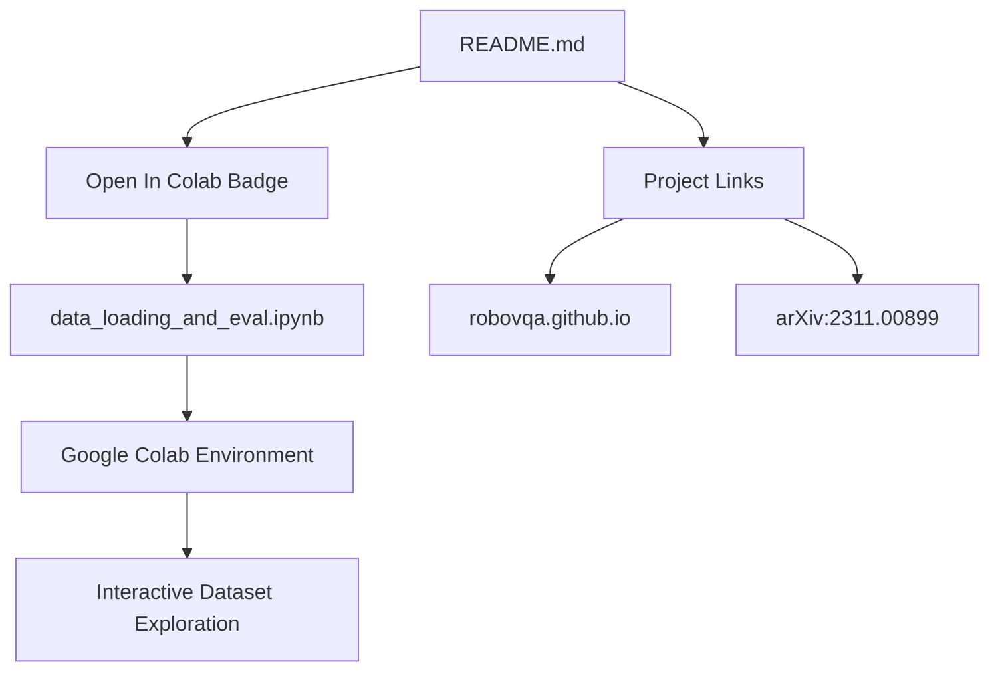
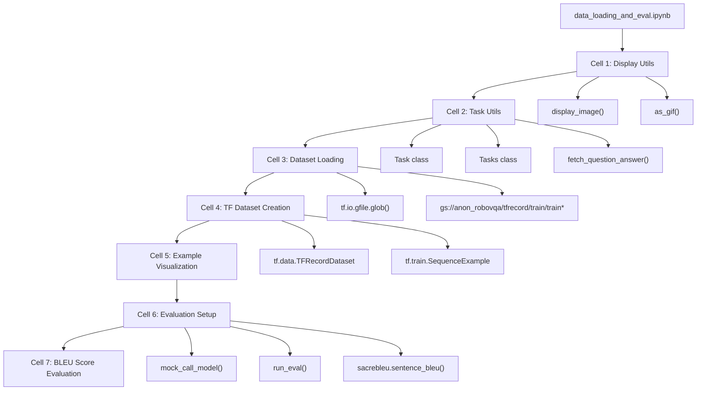
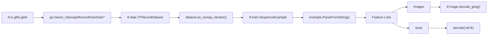
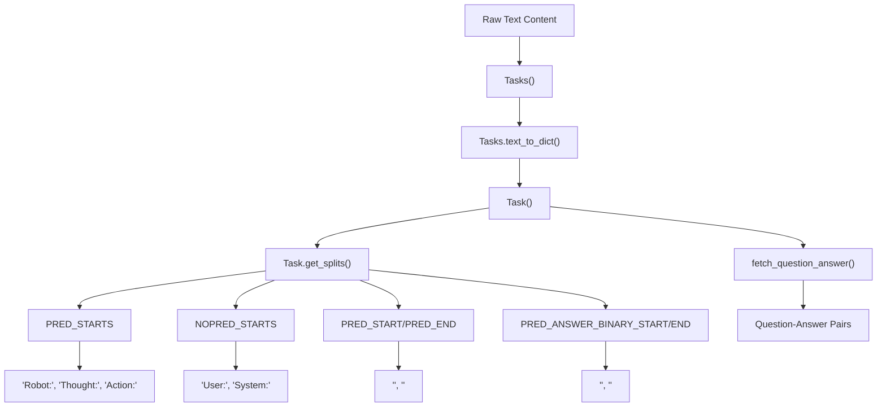
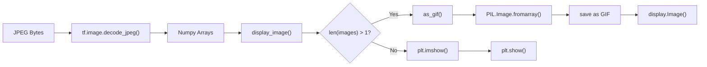
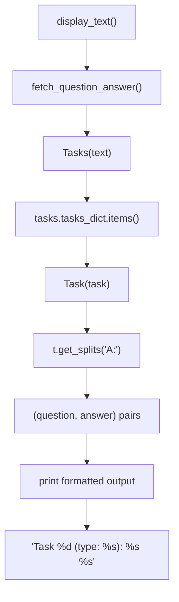
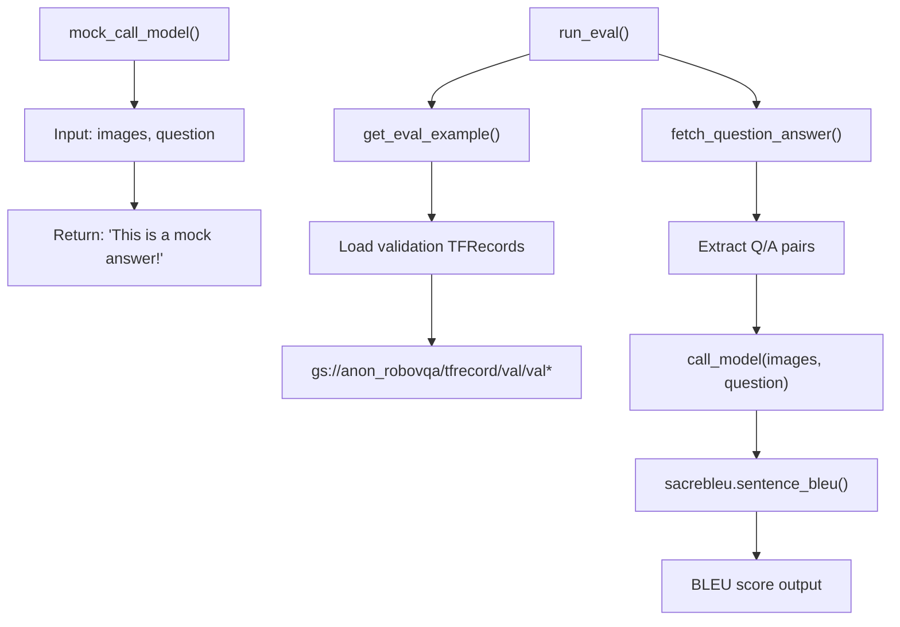

<!-- source: DeepWiki mcp.deepwiki.com · repo google-deepmind/robovqa · page 2 Getting Started · fetched 2026-10-26 -->

# Getting Started

Relevant source files

The following files were used as context for generating this wiki page:

- [README.md](README.md)
- [data_loading_and_eval.ipynb](data_loading_and_eval.ipynb)

This document provides step-by-step instructions for using the RoboVQA repository to interact with the RoboVQA dataset. This repository contains example code for loading, visualizing, and evaluating against the dataset, not the full RoboVQA model implementation.

For comprehensive details about the dataset format and processing pipeline, see [Core Implementation](#3). For information about contributing to the project, see [Development Guide](#4).

## Purpose and Scope

The RoboVQA repository serves as a demonstration interface for the RoboVQA dataset, which contains multimodal long-horizon reasoning data for robotics applications. The primary workflow involves:

1. Accessing the pre-configured Google Colab environment
2. Loading TFRecord data from Google Cloud Storage
3. Visualizing image sequences and text content
4. Running evaluation pipelines with BLEU score metrics

## Prerequisites

| Requirement | Description |
|-------------|-------------|
| Google Account | Required for Google Colab access |
| Internet Connection | Needed to access Google Cloud Storage dataset |
| Browser | Chrome, Firefox, or Safari for Colab compatibility |

No local installation or setup is required - the entire workflow runs in Google Colab.

## Quick Start Workflow

### Repository Entry Point

The primary entry point is through the repository's main documentation:

**User Journey**: Navigate to repository → Click "Open In Colab" badge → Execute notebook cells sequentially

Sources: [README.md:1-46](), [data_loading_and_eval.ipynb:1-541]()

### Core Execution Flow

The main workflow executes through the Jupyter notebook with these key steps:

**Execution Method**: Run cells sequentially from top to bottom in the Colab environment

Sources: [data_loading_and_eval.ipynb:58-541]()

## Data Loading Pipeline

### Google Cloud Storage Access

The dataset is stored in Google Cloud Storage and accessed through TensorFlow's file system utilities:

**Data Access Pattern**: Glob pattern → TFRecord dataset → Numpy iterator → Protocol buffer parsing

Sources: [data_loading_and_eval.ipynb:385-427]()

### Text Processing Architecture

The text processing system handles conversational dialogue with specialized tagging:

**Processing Flow**: Raw text → Tasks container → Individual Task objects → Tag-based splitting → Q/A extraction

Sources: [data_loading_and_eval.ipynb:99-374]()

## Visualization and Display

### Image Sequence Handling

The system provides utilities for displaying both single images and image sequences:

| Function | Purpose | Input | Output |
|----------|---------|--------|--------|
| `display_image()` | Main display function | List of numpy arrays | GIF animation or static image |
| `as_gif()` | GIF creation | List of PIL Images | GIF bytes |

**Display Logic**: Multiple images → GIF animation, Single image → Static matplotlib display

Sources: [data_loading_and_eval.ipynb:66-87]()

### Text Output Formatting

The `display_text()` function processes conversational text and extracts structured question-answer pairs:

**Output Format**: `Task {index} (type: {task_type}): {question} {answer}`

Sources: [data_loading_and_eval.ipynb:356-374]()

## Evaluation Pipeline

### Mock Model Interface

The evaluation system provides a template for model integration:

**Evaluation Flow**: Load validation data → Extract Q/A pairs → Call model → Calculate BLEU scores

Sources: [data_loading_and_eval.ipynb:462-503]()

### BLEU Score Calculation

The system uses the `sacrebleu` library for evaluation metrics:

| Component | Purpose | Input | Output |
|-----------|---------|--------|--------|
| `sacrebleu.sentence_bleu()` | BLEU score calculation | Reference answer, predicted answer | BLEU score percentage |
| `run_eval()` | End-to-end evaluation | Model function | Formatted evaluation results |

**Integration Point**: Replace `mock_call_model()` with your actual model implementation

Sources: [data_loading_and_eval.ipynb:448-503]()

## Next Steps

1. **Dataset Exploration**: Execute all cells in the notebook to see example data
2. **Model Integration**: Replace `mock_call_model()` with your model implementation
3. **Custom Evaluation**: Modify the evaluation pipeline for your specific use case
4. **Data Processing**: Adapt the `Task` and `Tasks` classes for custom text processing needs

For detailed implementation information, see [Core Implementation](#3). For contribution guidelines, see [Development Guide](#4).

Sources: [README.md:1-46](), [data_loading_and_eval.ipynb:1-541]()

---

