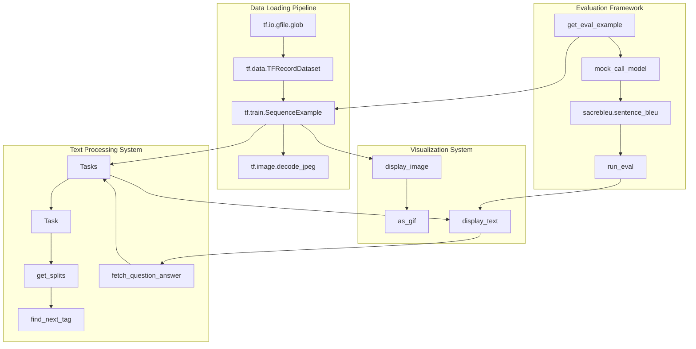
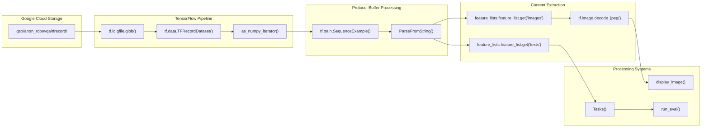
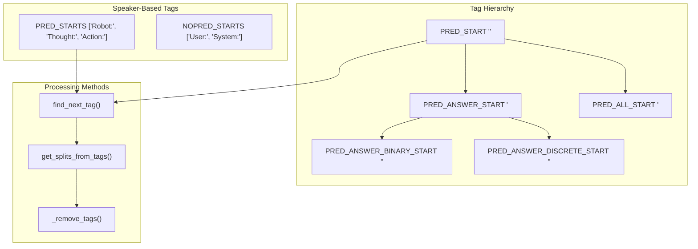
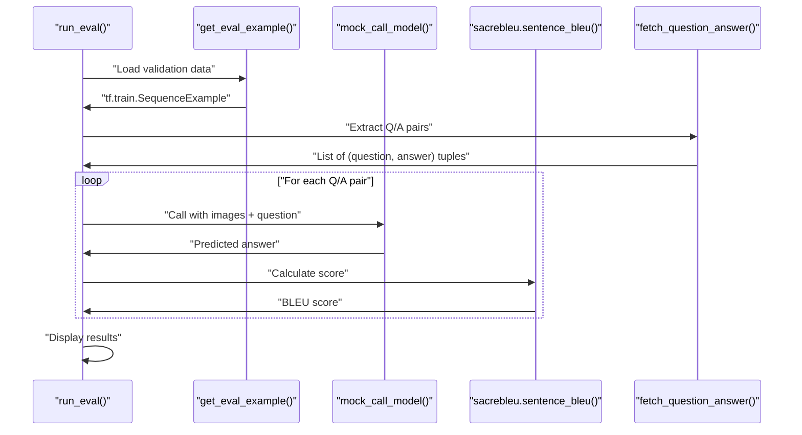

<!-- source: DeepWiki mcp.deepwiki.com · repo google-deepmind/robovqa · page 3 Core Implementation · fetched 2026-10-26 -->

# Core Implementation

Relevant source files

The following files were used as context for generating this wiki page:

- [data_loading_and_eval.ipynb](data_loading_and_eval.ipynb)

This document provides comprehensive documentation of the main functional components within the `data_loading_and_eval.ipynb` notebook. The notebook serves as the primary interface for interacting with the RoboVQA dataset, implementing a complete pipeline from data loading through evaluation.

For information about getting started with the repository, see [Getting Started](#2). For details on specific subsystems, see [Data Loading Pipeline](#3.1), [Text Processing System](#3.2), [Evaluation Framework](#3.3), and [Visualization and Display](#3.4).

## System Architecture Overview

The notebook implements four main subsystems that work together to provide dataset interaction capabilities:

### Core Components Architecture

Sources: [data_loading_and_eval.ipynb:385-540]()

### Data Flow Through Core Systems

Sources: [data_loading_and_eval.ipynb:385-428]()

## Key Implementation Details

### Core Classes and Functions

| Component | Type | Purpose | Key Methods |
|-----------|------|---------|-------------|
| `Task` | Class | Individual text processing with tag handling | `get_splits()`, `find_next_tag()`, `_remove_tags()` |
| `Tasks` | Class | Collection of tasks with parsing capabilities | `add_from_text()`, `text_to_dict()`, `sample_task()` |
| `display_image()` | Function | Image visualization with GIF support | Single image display or animated GIF creation |
| `fetch_question_answer()` | Function | Question-answer extraction from text | Processes task types and returns Q/A pairs |
| `run_eval()` | Function | End-to-end evaluation pipeline | Coordinates model calls and BLEU score calculation |

Sources: [data_loading_and_eval.ipynb:107-375]()

### Tag Processing System

The text processing system uses a sophisticated tagging scheme to differentiate between content the model should predict versus content it should condition on:

Sources: [data_loading_and_eval.ipynb:110-132]()

### Evaluation Pipeline Architecture

The evaluation system provides a framework for model assessment using BLEU scores:

Sources: [data_loading_and_eval.ipynb:462-502]()

## Implementation Patterns

### Data Loading Pattern

The notebook implements a consistent pattern for loading multimodal data:

1. **File Discovery**: Uses `tf.io.gfile.glob()` to locate TFRecord files in Google Cloud Storage
2. **Dataset Creation**: Creates `tf.data.TFRecordDataset` from file paths
3. **Iteration**: Converts to numpy iterator for sequential processing
4. **Protocol Buffer Parsing**: Uses `tf.train.SequenceExample` for structured data extraction
5. **Content Decoding**: Decodes JPEG images and UTF-8 text content

Sources: [data_loading_and_eval.ipynb:385-428]()

### Text Processing Pattern

The text processing follows a tag-based parsing approach:

1. **Task Splitting**: Uses regex patterns to split text into individual tasks
2. **Tag Recognition**: Identifies prediction tags and speaker-based splits
3. **Content Extraction**: Separates source context from target predictions
4. **Question-Answer Pairing**: Extracts Q/A pairs using 'A:' tag splits

Sources: [data_loading_and_eval.ipynb:356-374]()

### Visualization Pattern

The display system handles both static images and animated sequences:

1. **Single Image**: Direct matplotlib display for individual frames
2. **Image Sequence**: Creates animated GIFs using PIL for multiple frames
3. **Text Display**: Formats and displays question-answer pairs with task type information

Sources: [data_loading_and_eval.ipynb:66-88](), [data_loading_and_eval.ipynb:371-374]()

---

