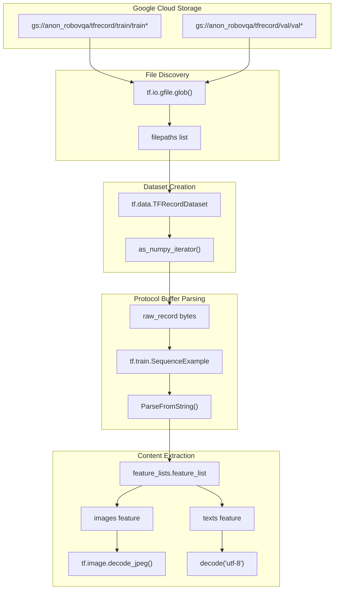
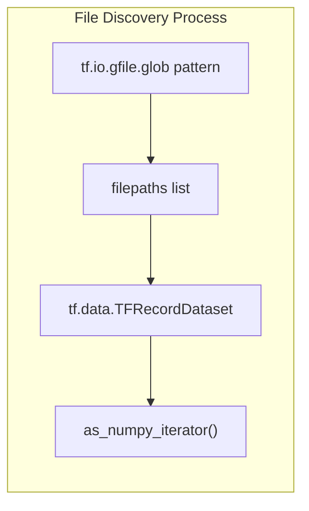
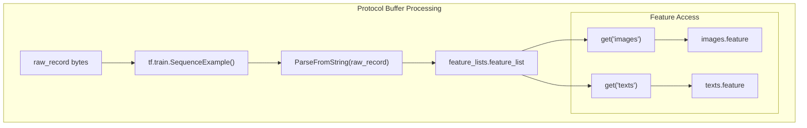
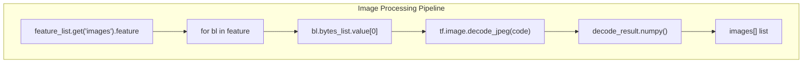
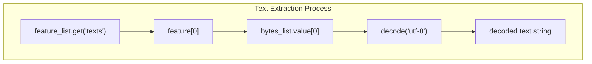
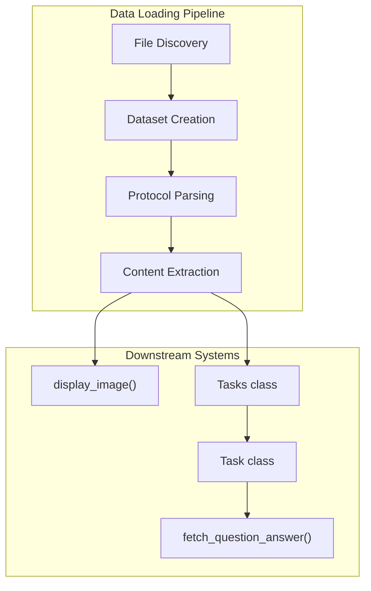

<!-- source: DeepWiki mcp.deepwiki.com · repo google-deepmind/robovqa · page 3.1 Data Loading Pipeline · fetched 2026-10-26 -->

# Data Loading Pipeline

Relevant source files

The following files were used as context for generating this wiki page:

- [data_loading_and_eval.ipynb](data_loading_and_eval.ipynb)

## Purpose and Scope

This document describes the data loading pipeline that retrieves and processes multimodal data from the RoboVQA dataset stored on Google Cloud Storage. The pipeline handles TFRecord files containing video sequences and conversational text, parsing them into usable formats for model training and evaluation.

For information about text processing and tag handling, see [Text Processing System](#3.2). For visualization of the loaded data, see [Visualization and Display](#3.4).

## Architecture Overview

The data loading pipeline operates as a multi-stage system that transforms raw TFRecord files into structured multimodal data. The pipeline consists of four main components: file discovery, dataset creation, protocol buffer parsing, and content extraction.

Sources: [data_loading_and_eval.ipynb:385-427]()

## File Discovery and Dataset Creation

The pipeline begins by discovering TFRecord files on Google Cloud Storage using TensorFlow's file system utilities. The `tf.io.gfile.glob` function patterns match training and validation datasets.

### File Path Patterns

| Dataset Type | Pattern | Purpose |
|-------------|---------|---------|
| Training | `gs://anon_robovqa/tfrecord/train/train*` | Model training data |
| Validation | `gs://anon_robovqa/tfrecord/val/val*` | Model evaluation data |

The discovered file paths are then used to create a `tf.data.TFRecordDataset` object, which provides efficient streaming access to the protocol buffer records.

Sources: [data_loading_and_eval.ipynb:388](), [data_loading_and_eval.ipynb:401-402](), [data_loading_and_eval.ipynb:470-471]()

## Protocol Buffer Parsing

Each record in the TFRecord dataset is a serialized `tf.train.SequenceExample` protocol buffer. The pipeline creates a new `SequenceExample` instance and uses `ParseFromString()` to deserialize the raw bytes into structured data.

### SequenceExample Structure

The `SequenceExample` contains two main components:
- **feature_lists**: Contains sequences of features (images and text)
- **feature_list**: Dictionary-like access to named feature sequences

Sources: [data_loading_and_eval.ipynb:414-416](), [data_loading_and_eval.ipynb:474-475]()

## Image Processing

The image data is stored as JPEG-encoded bytes within the protocol buffer. The pipeline iterates through each image feature, extracts the bytes, and decodes them using `tf.image.decode_jpeg()`.

### Image Extraction Process

1. **Feature Iteration**: Loop through `feature_list.get('images').feature`
2. **Bytes Extraction**: Access `bytes_list.value[0]` for each feature
3. **JPEG Decoding**: Convert bytes to numpy arrays using `tf.image.decode_jpeg()`
4. **Array Conversion**: Call `.numpy()` to get standard numpy arrays

Sources: [data_loading_and_eval.ipynb:418-422](), [data_loading_and_eval.ipynb:483-486]()

## Text Processing

Text content is extracted from the protocol buffer as UTF-8 encoded bytes. The pipeline accesses the first text feature and decodes it to a string for further processing by the text processing system.

### Text Extraction Steps

1. **Feature Access**: Get `feature_list.get("texts").feature[0]`
2. **Bytes Extraction**: Access `bytes_list.value[0]`
3. **UTF-8 Decoding**: Convert bytes to string using `.decode('utf-8')`

The decoded text contains conversational data with specialized tags that are processed by the `Tasks` and `Task` classes.

Sources: [data_loading_and_eval.ipynb:427](), [data_loading_and_eval.ipynb:487]()

## Data Flow Integration

The complete data loading pipeline integrates with downstream processing systems through well-defined interfaces. The extracted images are passed to visualization functions, while the text content is processed by the task parsing system.

### Pipeline Integration Points

| Component | Input | Output | Downstream Consumer |
|-----------|-------|--------|-------------------|
| File Discovery | GCS patterns | File paths | TFRecordDataset |
| Dataset Creation | File paths | Raw records | Protocol parser |
| Protocol Parsing | Raw bytes | SequenceExample | Feature extraction |
| Image Processing | JPEG bytes | Numpy arrays | `display_image()` |
| Text Processing | UTF-8 bytes | String | `Tasks` class |

Sources: [data_loading_and_eval.ipynb:385-427](), [data_loading_and_eval.ipynb:356-368]()

---

