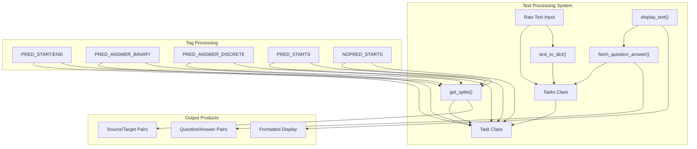
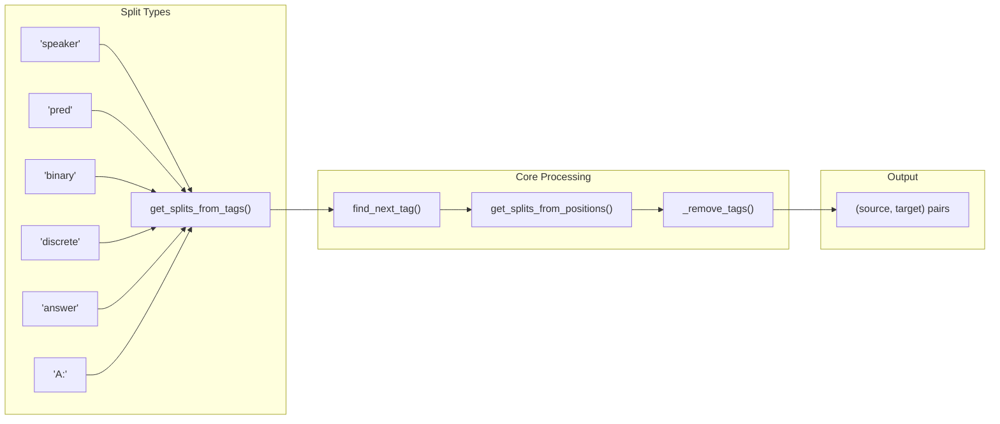
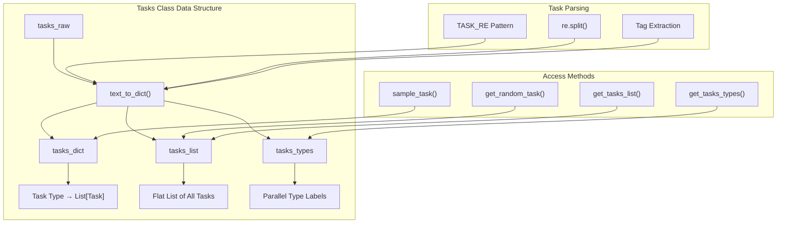
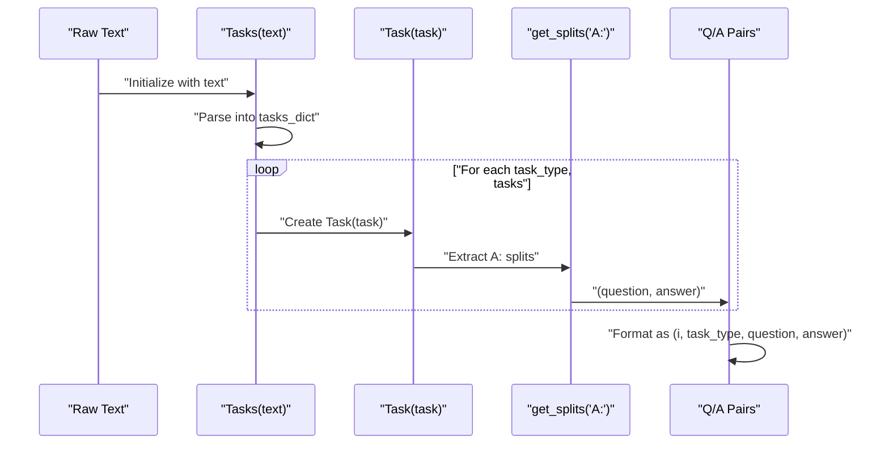
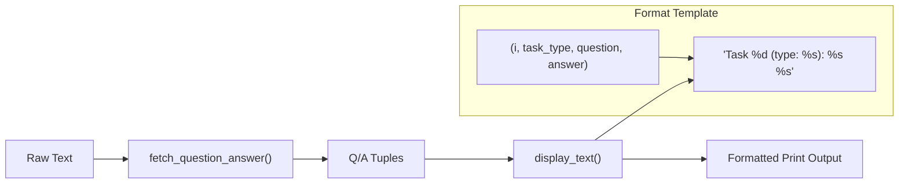
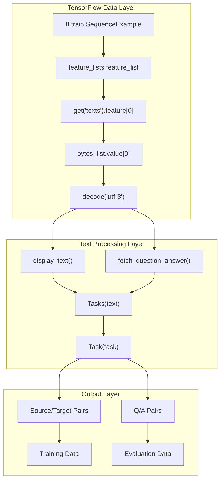

<!-- source: DeepWiki mcp.deepwiki.com · repo google-deepmind/robovqa · page 3.2 Text Processing System · fetched 2026-10-26 -->

# Text Processing System

Relevant source files

The following files were used as context for generating this wiki page:

- [data_loading_and_eval.ipynb](data_loading_and_eval.ipynb)

This document covers the text processing components within the RoboVQA dataset interaction system. The text processing system handles conversational dialogue data with sophisticated tagging mechanisms for distinguishing between content that models should predict versus content they should condition on. For information about loading the underlying TensorFlow data, see [Data Loading Pipeline](#3.1). For details on the evaluation framework that consumes the processed text, see [Evaluation Framework](#3.3).

## Architecture Overview

The text processing system consists of two primary classes that work together to parse and manipulate conversational text data containing prediction tags and speaker identifiers.

### Core Components Architecture

Sources: [data_loading_and_eval.ipynb:99-375]()

## Task Class

The `Task` class handles individual conversational text segments and provides methods for splitting them into source/target pairs based on various tagging schemes.

### Tag Constants and Patterns

The `Task` class defines several categories of prediction tags:

| Tag Type | Start Tag | End Tag | Purpose |
|----------|-----------|---------|---------|
| General Prediction | `<PRED>` | `</PRED>` | All content to be predicted |
| Binary Answer | `<PRED:ANSWER:BINARY>` | `</PRED:ANSWER:BINARY>` | Yes/No responses |
| Discrete Answer | `<PRED:ANSWER:DISCRETE>` | `</PRED:ANSWER:DISCRETE>` | Limited set responses |
| Speaker-based | `Robot:`, `Thought:`, `Action:` | `User:`, `System:` | Conversational turns |

### Text Splitting Mechanisms

The `get_splits()` method [data_loading_and_eval.ipynb:141-166]() supports multiple split types:
- `speaker`: Splits based on conversational roles (`PRED_STARTS` vs `NOPRED_STARTS`)
- `pred`: Splits based on general prediction tags
- `binary`/`discrete`: Splits based on answer type tags
- `answer`: Splits based on any answer tags
- `A:`: Splits specifically on answer markers

Sources: [data_loading_and_eval.ipynb:107-222]()

## Tasks Class

The `Tasks` class serves as a container and parser for multiple task segments, organizing them by task type and providing sampling capabilities.

### Task Organization Structure

The `text_to_dict()` method [data_loading_and_eval.ipynb:256-273]() uses regex pattern `TASK_RE = r'(<task[:w]*>)'` to split raw text into individual task segments organized by task type tags.

Sources: [data_loading_and_eval.ipynb:224-354]()

## Question-Answer Extraction

The system provides specialized functionality for extracting question-answer pairs from conversational text through the `fetch_question_answer()` function.

### Q/A Processing Pipeline

The `fetch_question_answer()` function [data_loading_and_eval.ipynb:356-368]() processes text by:
1. Creating a `Tasks` object from the input text
2. Iterating through each task type and task
3. Using `get_splits('A:')` to find answer segments
4. Extracting and cleaning question/answer pairs
5. Returning tuples of `(index, task_type, question, answer)`

Sources: [data_loading_and_eval.ipynb:356-374]()

## Text Display and Formatting

The system includes a display utility `display_text()` that formats question-answer pairs for human-readable output.

### Display Processing Flow

The `display_text()` function [data_loading_and_eval.ipynb:371-374]() outputs formatted strings in the pattern: `"Task {index} (type: {task_type}): {question} {answer}"`.

Sources: [data_loading_and_eval.ipynb:371-374]()

## Integration with Data Pipeline

The text processing system integrates with the broader RoboVQA data pipeline by processing text content extracted from TensorFlow SequenceExample protocol buffers.

### Data Flow Integration

The system processes UTF-8 decoded text from TensorFlow records [data_loading_and_eval.ipynb:427]() and produces structured output for both training (source/target pairs) and evaluation (question/answer pairs) purposes.

Sources: [data_loading_and_eval.ipynb:427](), [data_loading_and_eval.ipynb:487]()

---

