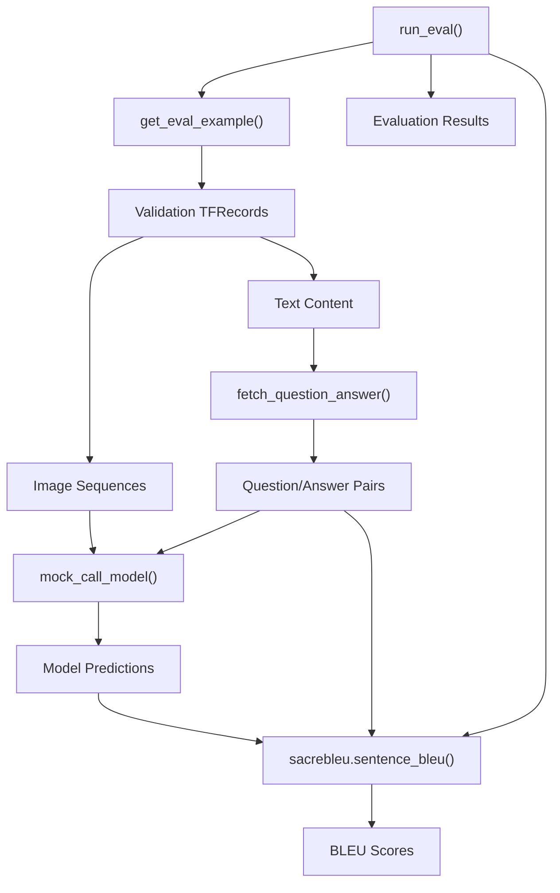
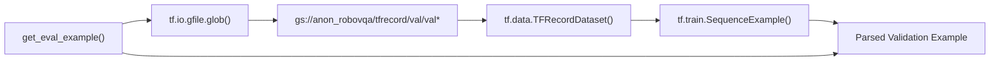
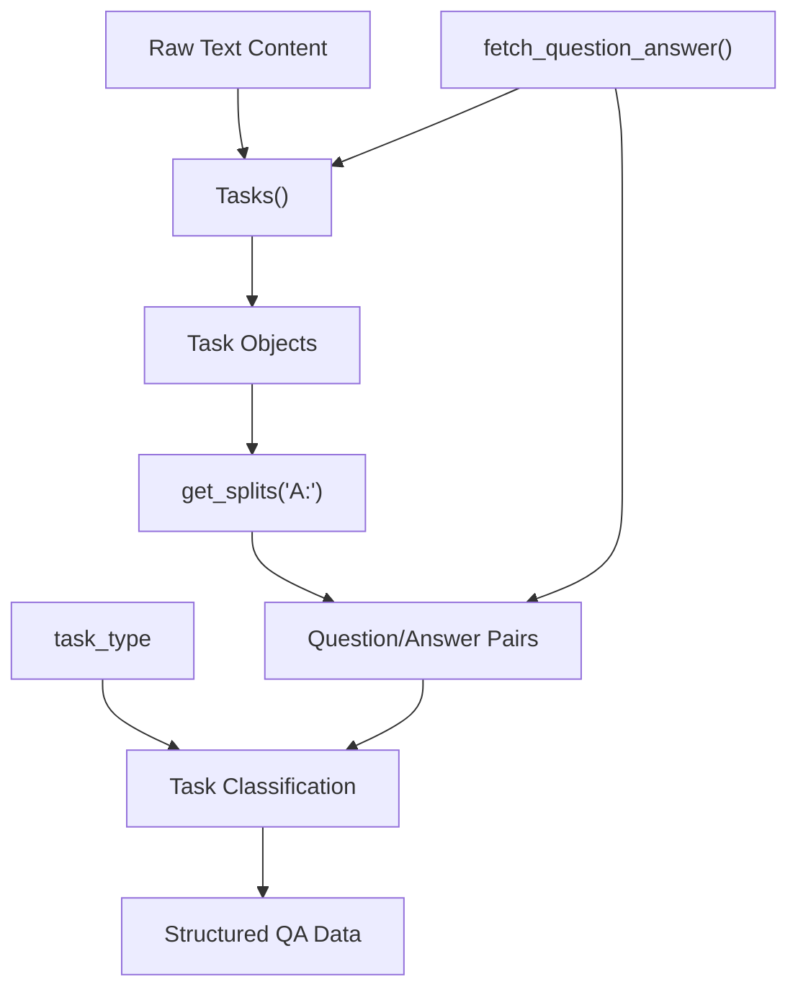
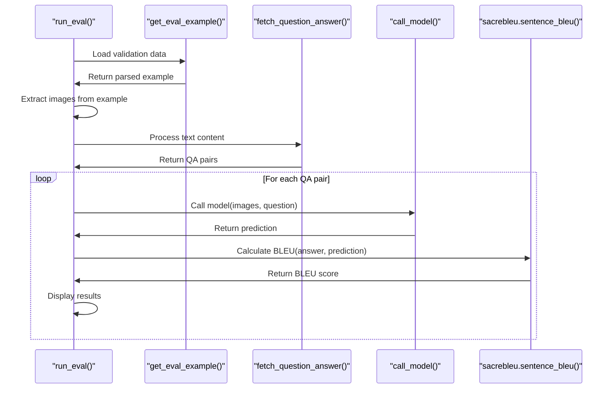
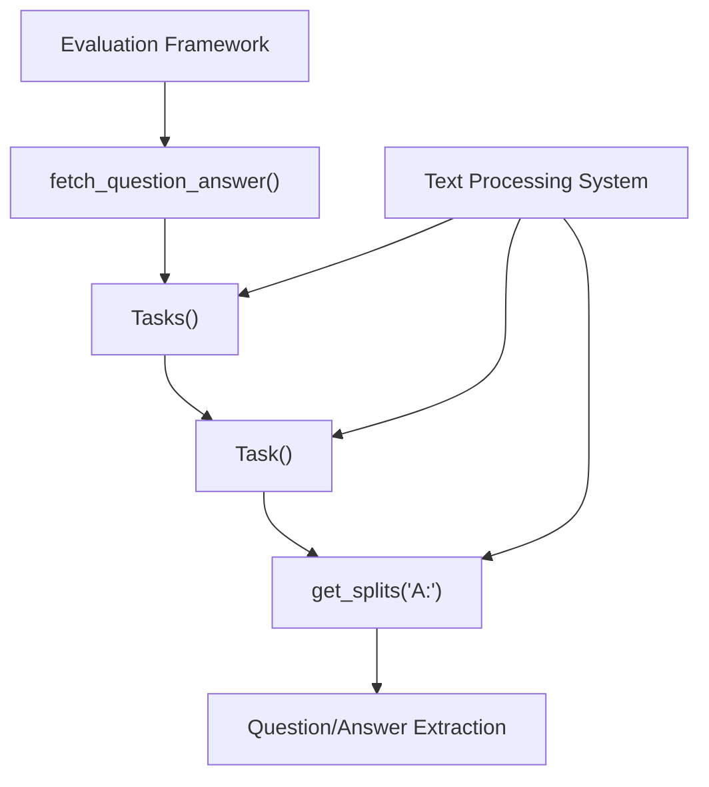
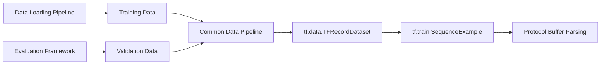

<!-- source: DeepWiki mcp.deepwiki.com · repo google-deepmind/robovqa · page 3.3 Evaluation Framework · fetched 2026-10-26 -->

# Evaluation Framework

<details>
<summary>Relevant source files</summary>

The following files were used as context for generating this wiki page:

- [data_loading_and_eval.ipynb](data_loading_and_eval.ipynb)

</details>


## Purpose and Scope

The evaluation framework provides a standardized pipeline for assessing model performance against the RoboVQA dataset using BLEU scores. This framework serves as a template for researchers to integrate their own multimodal models and evaluate their question-answering capabilities on robotic tasks.

For information about data loading and preprocessing, see [Data Loading Pipeline](#3.1). For details about text processing and question-answer extraction, see [Text Processing System](#3.2).

## Architecture Overview

The evaluation framework follows a modular design that separates model inference, data processing, and metric calculation. The system is designed to be easily extensible for different model architectures while maintaining consistent evaluation protocols.



**Evaluation Pipeline Flow**

Sources: [data_loading_and_eval.ipynb:462-503]()

## Core Components

### Model Interface

The framework defines a standardized interface for model integration through the `mock_call_model` function, which serves as a template for actual model implementations.

| Component | Function | Input | Output |
|-----------|----------|-------|--------|
| Model Interface | `mock_call_model` | Images, Question | Predicted Answer |
| Data Loader | `get_eval_example` | None | Validation Example |
| Evaluation Runner | `run_eval` | Model Function | BLEU Scores |

The model interface expects:
- `images`: List of decoded JPEG arrays representing video frames
- `question`: String containing the question text
- Returns: String containing the predicted answer

Sources: [data_loading_and_eval.ipynb:464-466]()

### Data Loading Component

The `get_eval_example` function handles loading validation data from Google Cloud Storage and parsing TFRecord format.



**Validation Data Loading Pipeline**

Sources: [data_loading_and_eval.ipynb:469-476]()

### Question-Answer Extraction

The framework leverages the text processing system to extract structured question-answer pairs from the validation data using the `fetch_question_answer` function.



**Question-Answer Processing Chain**

Sources: [data_loading_and_eval.ipynb:356-368]()

## Evaluation Pipeline

### Main Evaluation Function

The `run_eval` function orchestrates the complete evaluation process, integrating data loading, model inference, and metric calculation.



**Evaluation Sequence Flow**

Sources: [data_loading_and_eval.ipynb:479-491]()

### Metric Calculation

The framework uses BLEU scores for evaluation, implemented through the `sacrebleu` library. The metric calculation compares predicted answers against ground truth answers at the sentence level.

| Metric | Implementation | Purpose |
|--------|---------------|---------|
| BLEU Score | `sacrebleu.sentence_bleu()` | Measures text similarity between prediction and ground truth |
| Sentence Level | Individual QA pairs | Provides fine-grained evaluation feedback |

The BLEU calculation follows this pattern:
```python
bleu = sacrebleu.sentence_bleu(answer, pred_answer)
```

Sources: [data_loading_and_eval.ipynb:490]()

## Integration with Other Systems

### Text Processing Integration

The evaluation framework integrates with the text processing system through the `fetch_question_answer` function, which utilizes the `Tasks` and `Task` classes to parse structured dialogue.



**Integration with Text Processing**

Sources: [data_loading_and_eval.ipynb:356-368]()

### Data Loading Integration

The evaluation framework reuses the same data loading patterns established in the main data pipeline, ensuring consistency in data handling across training and evaluation phases.



**Shared Data Infrastructure**

Sources: [data_loading_and_eval.ipynb:470-476]()

## Usage Example

The framework provides a complete working example that demonstrates the evaluation process:

```python
run_eval(mock_call_model)
```

This executes the full evaluation pipeline, displaying:
- Questions from the validation set
- Ground truth answers
- Model predictions (from mock function)
- BLEU scores for each question-answer pair

The output format follows this structure:
```
Question: [extracted question]
Answer: [ground truth answer]
Predicted Answer: [model prediction]
BLEU: [calculated score]%
```

Sources: [data_loading_and_eval.ipynb:502](), [data_loading_and_eval.ipynb:488-491]()

---

