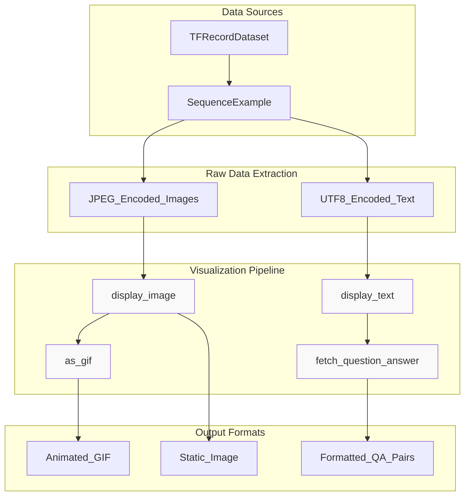
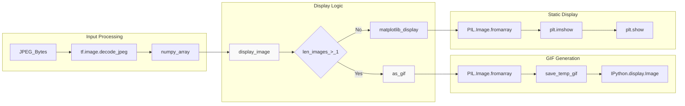
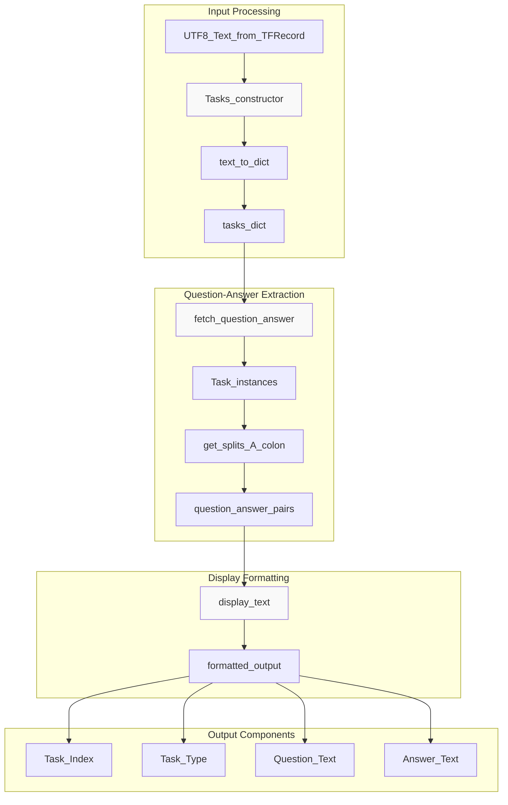
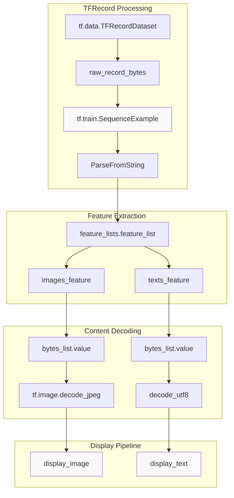

<!-- source: DeepWiki mcp.deepwiki.com · repo google-deepmind/robovqa · page 3.4 Visualization and Display · fetched 2026-10-26 -->

# Visualization and Display

<details>
<summary>Relevant source files</summary>

The following files were used as context for generating this wiki page:

- [data_loading_and_eval.ipynb](data_loading_and_eval.ipynb)

</details>


This section documents the visualization and display utilities that render multimodal data from the RoboVQA dataset for interactive exploration. The system provides specialized functions for displaying image sequences as animated GIFs and formatting structured text content into readable question-answer pairs.

For information about the underlying data loading mechanisms, see [Data Loading Pipeline](#3.1). For details about text processing and tagging systems, see [Text Processing System](#3.2).

## Overview

The visualization system consists of two main components: image display utilities that handle both static images and animated sequences, and text display utilities that parse and format conversational AI content with specialized tagging.



**Sources:** [data_loading_and_eval.ipynb:66-88](), [data_loading_and_eval.ipynb:371-374]()

## Image Display System

The image display system handles visualization of both single images and image sequences through two primary functions: `display_image()` and `as_gif()`.

### Image Processing Pipeline



**Sources:** [data_loading_and_eval.ipynb:78-87](), [data_loading_and_eval.ipynb:71-75]()

### Core Display Functions

| Function | Purpose | Input | Output |
|----------|---------|-------|--------|
| `display_image()` | Main image display controller | List of numpy arrays | Visual display (GIF or static) |
| `as_gif()` | Converts image sequence to GIF | List of PIL Images | GIF bytes |

The `display_image()` function at [data_loading_and_eval.ipynb:78-87]() implements conditional logic:
- **Multiple images**: Creates animated GIF using `as_gif()` helper
- **Single image**: Uses matplotlib for static display

The `as_gif()` function at [data_loading_and_eval.ipynb:71-75]() handles GIF creation:
- Converts numpy arrays to PIL Images
- Saves temporary GIF file with 100ms frame duration
- Returns raw GIF bytes for IPython display

**Sources:** [data_loading_and_eval.ipynb:78-87](), [data_loading_and_eval.ipynb:71-75]()

## Text Display System

The text display system parses structured conversational text and formats it into readable question-answer pairs using the `Tasks` and `Task` classes.

### Text Processing and Display Flow



**Sources:** [data_loading_and_eval.ipynb:356-368](), [data_loading_and_eval.ipynb:371-374]()

### Display Function Implementation

The `display_text()` function at [data_loading_and_eval.ipynb:371-374]() provides formatted output:

```python
def display_text(text):
  question_answers = fetch_question_answer(text)
  for i, task_type, question, answer in question_answers:
    print('Task %d (type: %s): %s %s' % (i, task_type, question, answer))
```

The `fetch_question_answer()` function at [data_loading_and_eval.ipynb:356-368]() extracts structured data:
- Creates `Tasks` instance from raw text
- Iterates through task types and individual tasks
- Uses `Task.get_splits('A:')` to extract question-answer pairs
- Returns tuples of `(index, task_type, question, answer)`

**Sources:** [data_loading_and_eval.ipynb:371-374](), [data_loading_and_eval.ipynb:356-368]()

## Integration with Data Loading

The visualization system integrates directly with the TensorFlow data loading pipeline to process multimodal content from `SequenceExample` protocol buffers.

### Data Extraction and Display Integration



**Sources:** [data_loading_and_eval.ipynb:414-427]()

### Example Usage Pattern

The typical usage pattern at [data_loading_and_eval.ipynb:414-427]() demonstrates the integration:

1. **Image Processing**: Extract JPEG bytes from `feature_lists.feature_list.get('images').feature`
2. **Image Decoding**: Use `tf.image.decode_jpeg()` to convert bytes to numpy arrays
3. **Text Processing**: Extract UTF-8 bytes from `feature_lists.feature_list.get("texts").feature`
4. **Display Execution**: Call `display_image(images)` and `display_text(text)`

**Sources:** [data_loading_and_eval.ipynb:414-427]()

## Output Formats and User Experience

The visualization system produces formatted output designed for interactive exploration in Jupyter/Colab environments.

### Display Output Components

| Component | Format | Purpose |
|-----------|--------|---------|
| Image Sequences | Animated GIF | Visual representation of robot actions |
| Static Images | Matplotlib plot | Single frame visualization |
| Question-Answer Pairs | Formatted text | `Task N (type: X): Question Answer` |
| Task Statistics | Summary text | Task type distribution and counts |

### User Interface Elements

The system provides descriptive output at [data_loading_and_eval.ipynb:423-425]():
- **Video Frames**: "Video image frames (in GIF format)"
- **VQA Tasks**: "All VQA tasks, in format of '<Task num> (task type): <Question> <Answer>'"

This creates a comprehensive view of each dataset example, combining visual and textual information for complete understanding of the multimodal data.

**Sources:** [data_loading_and_eval.ipynb:423-427]()

---

