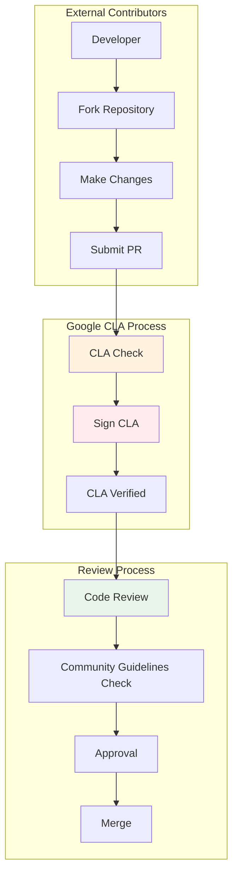
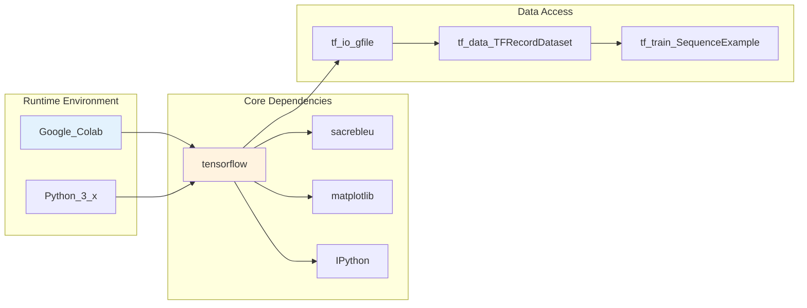
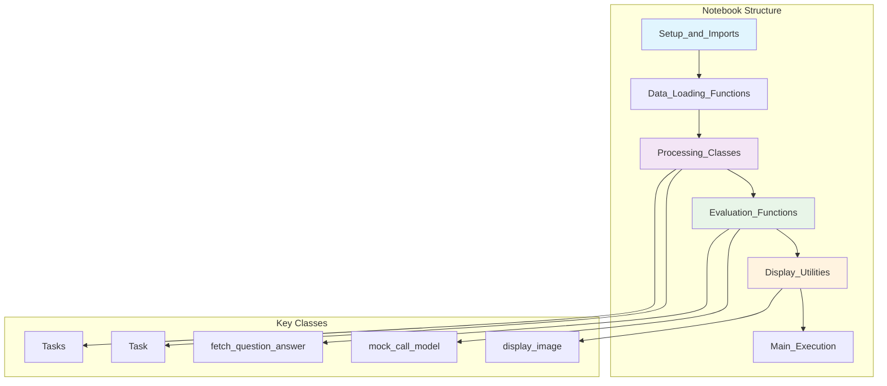

<!-- source: DeepWiki mcp.deepwiki.com · repo google-deepmind/robovqa · page 4 Development Guide · fetched 2026-10-26 -->

# Development Guide

<details>
<summary>Relevant source files</summary>

The following files were used as context for generating this wiki page:

- [CONTRIBUTING.md](CONTRIBUTING.md)

</details>


This document provides guidance for developers who want to contribute to or understand the development practices of the RoboVQA repository. It covers the contribution workflow, development environment setup, and key considerations for working with this demonstration codebase.

For detailed information about the core implementation components, see [Core Implementation](#3). For basic usage instructions, see [Getting Started](#2).

## Development Workflow Overview

The RoboVQA repository follows Google's standard open-source development practices with specific requirements for external contributions. The development workflow centers around the single functional notebook and supporting documentation.

### Contribution Process Flow



Sources: [CONTRIBUTING.md:1-26]()

### Repository Structure for Development

The repository maintains a minimal structure focused on demonstration rather than production development:

| Component | Purpose | Development Notes |
|-----------|---------|------------------|
| `README.md` | Entry point and documentation | Primary user interface |
| `data_loading_and_eval.ipynb` | Main functional code | Core development focus |
| `CONTRIBUTING.md` | Contribution guidelines | Defines development process |
| `LICENSE` | Legal framework | Dual licensing structure |
| `.gitignore` | Build artifact exclusions | Python-specific configuration |

## Development Environment Requirements

### Core Dependencies

The development environment requires specific Python packages for working with the multimodal dataset:



Sources: [data_loading_and_eval.ipynb:1-50]()

### Development Configuration

The `.gitignore` file excludes standard Python development artifacts:

```python
# Python cache and build files
__pycache__/
*.py[cod]
*$py.class
*.so
.Python
build/
develop-eggs/
dist/
downloads/
eggs/
.eggs/
lib/
lib64/
parts/
sdist/
var/
wheels/
*.egg-info/
.installed.cfg
*.egg
MANIFEST
```

Sources: [.gitignore:1-50]()

## Key Development Considerations

### Notebook-Based Development

The primary development artifact is `data_loading_and_eval.ipynb`, which requires specific considerations:

- **Cell-based execution**: Code must be organized in logical cell blocks
- **Inline documentation**: Comments serve as both code documentation and user guidance
- **Output visualization**: Results must be displayable in notebook format
- **Resource management**: Memory and compute considerations for large datasets

### Code Organization Pattern



Sources: [data_loading_and_eval.ipynb:1-500]()

### Data Pipeline Development

When developing data processing components, consider:

- **TFRecord format**: All data is stored in TensorFlow's TFRecord format with `tf.train.SequenceExample` protocol buffers
- **Cloud storage access**: Data loading uses `tf.io.gfile.glob` for Google Cloud Storage access
- **Memory efficiency**: Process data in streaming fashion to handle large datasets
- **Error handling**: Robust parsing of protocol buffer data with graceful degradation

### Testing and Validation

The repository includes a mock evaluation framework:

```python
def mock_call_model(images, text):
    """Mock model call for demonstration purposes"""
    # Placeholder implementation
    return "mock response"

def run_eval(dataset, model_fn):
    """Run evaluation pipeline with BLEU scoring"""
    # Evaluation logic with sacrebleu
    pass
```

Sources: [data_loading_and_eval.ipynb:300-400]()

## Development Best Practices

### Code Style Guidelines

- **PEP 8 compliance**: Follow Python style guidelines
- **Docstring documentation**: Include comprehensive docstrings for all functions
- **Type hints**: Use type annotations where appropriate
- **Error handling**: Implement robust error handling for data processing

### Documentation Standards

- **Inline comments**: Provide context for complex data processing logic
- **Cell markdown**: Use markdown cells to explain notebook sections
- **Function documentation**: Document all parameters and return values
- **Example usage**: Include working examples for all major functions

### Version Control Practices

- **Commit messages**: Use clear, descriptive commit messages
- **Branch naming**: Use descriptive branch names for feature development
- **Pull request descriptions**: Include detailed descriptions of changes
- **Code review**: All changes require review before merging

Sources: [CONTRIBUTING.md:15-20]()

---

