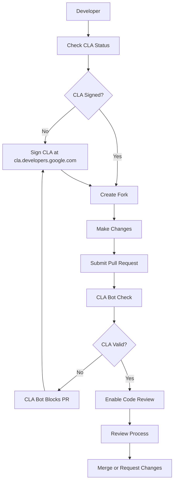
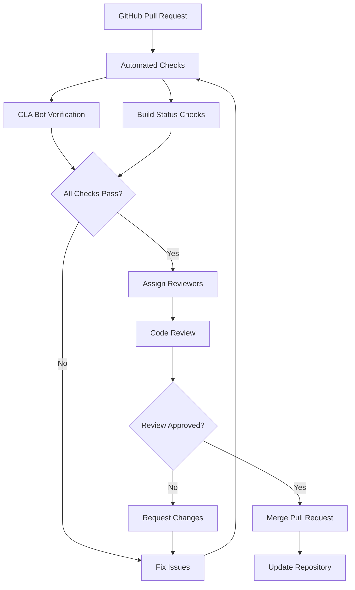
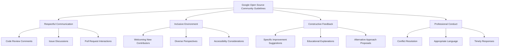
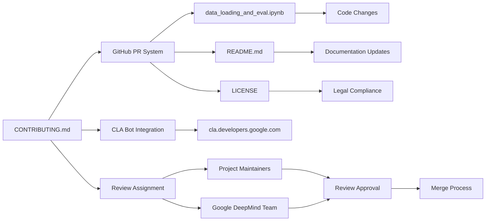

<!-- source: DeepWiki mcp.deepwiki.com · repo google-deepmind/robovqa · page 4.1 Contributing Guidelines · fetched 2026-10-26 -->

# Contributing Guidelines

Relevant source files

The following files were used as context for generating this wiki page:

- [CONTRIBUTING.md](CONTRIBUTING.md)

This document outlines the procedures and requirements for contributing to the RoboVQA repository. It covers the legal agreements, code review processes, and community standards that govern external contributions to this open-source project.

For information about the project's licensing terms and copyright structure, see [Legal Framework](#4.2). For details about the development environment and configuration, see [Project Configuration](#4.3).

## Contributor License Agreement Requirements

All contributions to this project must be accompanied by a signed Contributor License Agreement (CLA). The CLA serves as a legal framework that allows Google to use and redistribute your contributions while preserving your copyright ownership.

### CLA Process Overview

| Component | Description | Required Action |
|-----------|-------------|----------------|
| **Individual CLA** | For personal contributions | Sign at https://cla.developers.google.com/ |
| **Corporate CLA** | For employer-sponsored contributions | Employer signs on your behalf |
| **One-time Process** | CLA applies across Google projects | Re-signing typically not required |

The CLA system maintains a record of all signed agreements, allowing you to check your current status before making contributions.

**Contribution Workflow with CLA Integration**

Sources: [CONTRIBUTING.md:3-13]()

## Code Review Process

All submissions, including those from project members, require code review through GitHub pull requests. This process ensures code quality and maintains consistency across the codebase.

### Review Workflow

The review process follows GitHub's standard pull request workflow with specific requirements for this repository:

### Review Requirements

| Stage | Requirement | Enforcement |
|-------|-------------|-------------|
| **CLA Verification** | Valid CLA on file | Automated via CLA bot |
| **Code Quality** | Adherence to project standards | Manual review |
| **Documentation** | Updates to relevant documentation | Manual review |
| **Testing** | Appropriate test coverage | Manual review |

The review process leverages GitHub's pull request infrastructure, with reviewers assigned based on code ownership and expertise areas.

Sources: [CONTRIBUTING.md:15-20]()

## Community Guidelines

This project follows Google's Open Source Community Guidelines, which establish standards for respectful and productive collaboration.

### Community Standards Framework

### Guideline Application

The community guidelines apply to all project interactions, including:

- **Code Reviews**: Constructive feedback on technical contributions
- **Issue Tracking**: Respectful discussion of bugs and feature requests
- **Documentation**: Collaborative improvement of project documentation
- **General Discussion**: Professional communication in all project forums

Violations of community guidelines are addressed through Google's established reporting and resolution processes.

Sources: [CONTRIBUTING.md:22-25]()

## Contribution Integration with Repository Structure

The contribution process integrates directly with the repository's structure and development workflow:

**Repository Integration Points**

### Key Integration Components

| Component | File Reference | Purpose |
|-----------|---------------|---------|
| **Contribution Rules** | `CONTRIBUTING.md` | Central policy document |
| **CLA Enforcement** | Automated via GitHub integration | Legal compliance |
| **Code Target** | `data_loading_and_eval.ipynb` | Primary contribution area |
| **Documentation** | `README.md` | User-facing documentation updates |

Sources: [CONTRIBUTING.md:1-26]()

## Summary

The contribution process for the RoboVQA repository follows Google's standard open-source practices with three key requirements:

1. **Legal Compliance**: Signed CLA through Google's automated system
2. **Technical Review**: GitHub pull request review by project maintainers
3. **Community Standards**: Adherence to Google's Open Source Community Guidelines

This framework ensures that contributions maintain the project's quality standards while providing legal protection for both contributors and the project maintainers.

---

