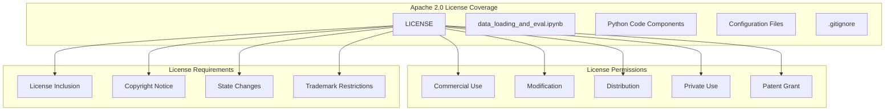
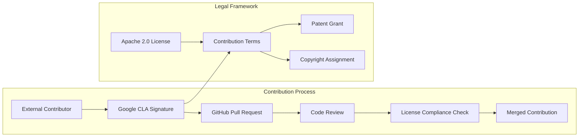
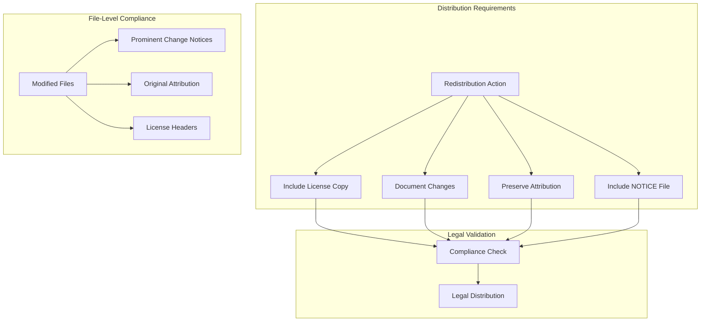

<!-- source: DeepWiki mcp.deepwiki.com · repo google-deepmind/robovqa · page 4.2 Legal Framework · fetched 2026-10-26 -->

# Legal Framework

<details>
<summary>Relevant source files</summary>

The following files were used as context for generating this wiki page:

- [LICENSE](LICENSE)

</details>


## Purpose and Scope

This document covers the legal framework governing the RoboVQA repository, including licensing terms, copyright information, and compliance requirements for usage and contribution. The framework establishes the legal foundation for both software components and associated materials within the project.

For information about the contribution process and community guidelines, see [Contributing Guidelines](#4.1).

## Licensing Structure

The RoboVQA repository operates under a dual licensing model that applies different legal frameworks to different types of content within the project.

### Primary Software License

The core software components are licensed under the Apache License 2.0, as specified in [LICENSE:1-203](). This license provides broad permissions for use, modification, and distribution of the software code.



**Sources**: [LICENSE:1-203]()

### Key License Terms

The Apache 2.0 license grants users the following permissions under [LICENSE:67-88]():

| Permission | Description |
|------------|-------------|
| **Copyright License** | Perpetual, worldwide, non-exclusive, royalty-free license to reproduce, prepare derivative works, publicly display, perform, sublicense, and distribute |
| **Patent License** | Protection against patent claims from contributors for their contributions |
| **Redistribution Rights** | Ability to redistribute in source or object form with proper attribution |

### License Obligations

Users must comply with the following requirements under [LICENSE:90-129]():

| Requirement | Details |
|-------------|---------|
| **License Distribution** | Must provide copy of license with any redistribution |
| **Change Documentation** | Must document any modifications made to files |
| **Attribution Preservation** | Must retain copyright, patent, trademark, and attribution notices |
| **NOTICE File Inclusion** | Must include NOTICE file contents if present |

**Sources**: [LICENSE:67-129]()

## Copyright and Ownership

### Copyright Declaration

The project is copyrighted by DeepMind (Google) as indicated in the license appendix template at [LICENSE:190-203](). The copyright notice follows the standard Apache License format:

```
Copyright [yyyy] [name of copyright owner]

Licensed under the Apache License, Version 2.0 (the "License");
you may not use this file except in compliance with the License.
```

### Contribution License Agreement

Based on the project's association with Google/DeepMind, contributions require signing a Contributor License Agreement (CLA). This ensures that all contributions are properly licensed and compatible with the project's licensing structure.



**Sources**: [LICENSE:131-137]()

## Legal Protections and Limitations

### Warranty Disclaimer

The Apache License includes explicit warranty disclaimers under [LICENSE:144-152]():

- Work provided "AS IS" without warranties
- No warranties of title, non-infringement, merchantability, or fitness for purpose
- Users assume all risks associated with use

### Liability Limitations

The license limits contributor liability under [LICENSE:154-175]():

- No liability for damages arising from license or work usage
- Covers direct, indirect, special, incidental, and consequential damages
- Exceptions only for deliberate and grossly negligent acts

### Trademark Restrictions

The license explicitly restricts trademark usage under [LICENSE:139-142]():

- No permission to use trade names, trademarks, service marks, or product names
- Exception for reasonable and customary use in describing work origin
- Must reproduce NOTICE file content when required

**Sources**: [LICENSE:139-175]()

## Compliance Requirements

### Distribution Compliance

When redistributing the work or derivative works, users must comply with specific requirements:



**Sources**: [LICENSE:90-129]()

### Patent Grant Termination

The license includes patent grant termination provisions under [LICENSE:82-88]():

- Patent licenses terminate if recipient initiates patent litigation
- Applies to claims alleging work constitutes direct or contributory patent infringement
- Termination occurs on the date litigation is filed

### Academic and Research Usage

While not explicitly stated in the license file, the project context suggests additional considerations for academic usage:

- Proper academic citation may be required for research publications
- Dataset usage may be subject to separate terms
- Research use should acknowledge the work appropriately

**Sources**: [LICENSE:74-88]()

## Legal Entity Definitions

The license provides specific definitions for legal entities under [LICENSE:8-66]():

| Term | Definition |
|------|------------|
| **License** | Terms and conditions defined in the document |
| **Licensor** | Copyright owner or authorized entity granting the license |
| **Legal Entity** | Acting entity plus controlled/controlling entities |
| **Work** | Work of authorship made available under the license |
| **Derivative Works** | Works based on or derived from the original work |
| **Contribution** | Work intentionally submitted for inclusion |
| **Contributor** | Licensor and any entity whose contribution is incorporated |

**Sources**: [LICENSE:8-66]()

---

