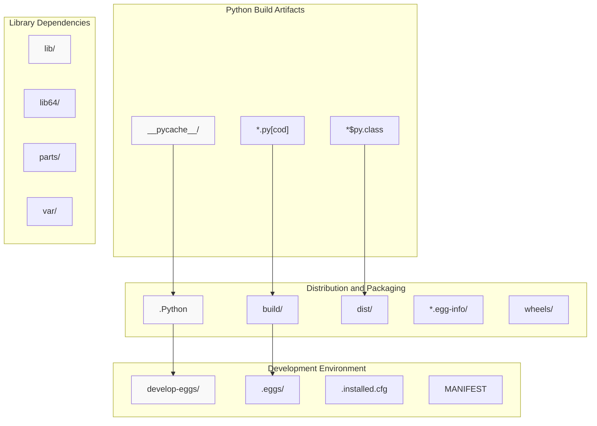
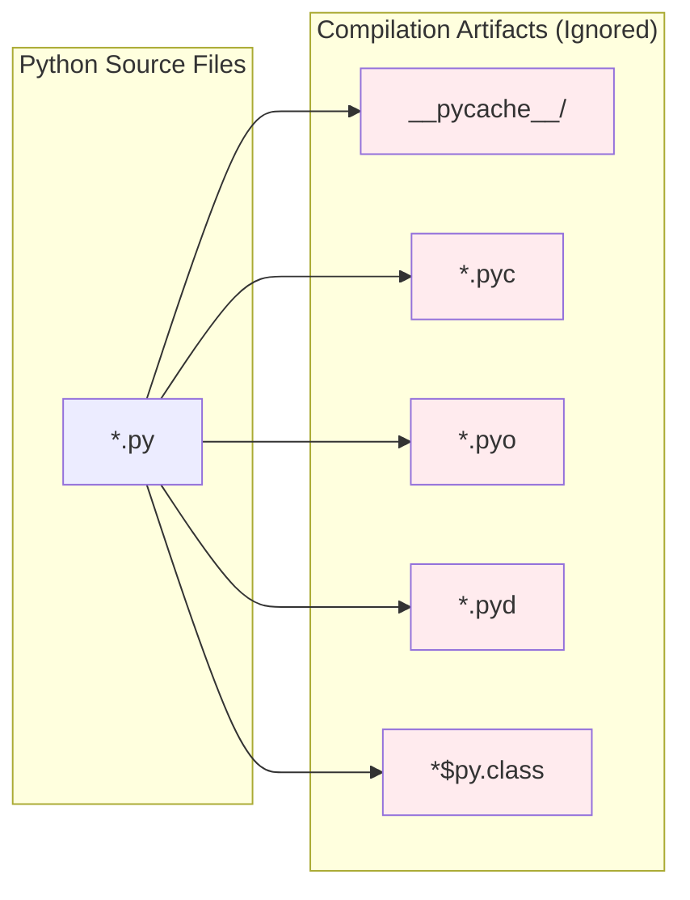
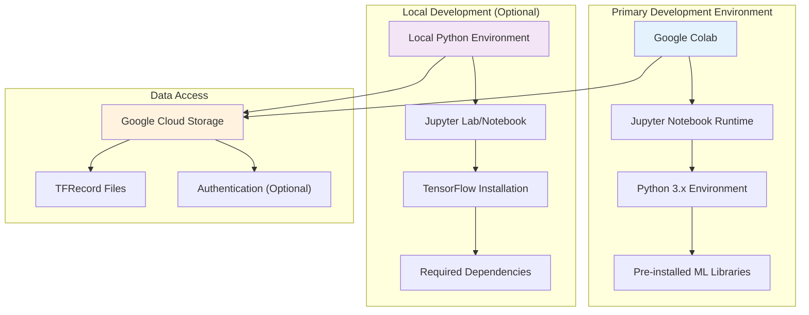
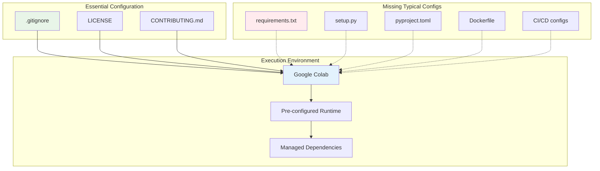

<!-- source: DeepWiki mcp.deepwiki.com · repo google-deepmind/robovqa · page 4.3 Project Configuration · fetched 2026-10-26 -->

# Project Configuration

Relevant source files

The following files were used as context for generating this wiki page:

- [.gitignore](.gitignore)

This document covers the build and development configuration for the RoboVQA repository, including version control settings, development environment setup, and project structure considerations. The configuration is minimal by design, as this repository serves as example code for dataset interaction rather than a full production system.

For information about the contribution process and development workflow, see [Contributing Guidelines](#4.1). For legal and licensing framework details, see [Legal Framework](#4.2).

## Configuration Overview

The RoboVQA repository uses a streamlined configuration approach optimized for research demonstration and educational purposes. The primary configuration focuses on Python development patterns and Jupyter notebook execution within the Google Colab environment.

## Version Control Configuration

The project's version control behavior is defined by `.gitignore`, which implements standard Python development exclusion patterns to prevent build artifacts and temporary files from being committed to the repository.

### Git Ignore Structure

**Git Ignore Categories and Their Purpose**

| Category | Files | Purpose |
|----------|-------|---------|
| **Compiled Python** | `__pycache__/`, `*.py[cod]`, `*$py.class` | Exclude bytecode compilation artifacts |
| **Distribution** | `build/`, `dist/`, `*.egg-info/` | Exclude package build outputs |
| **Development** | `develop-eggs/`, `.eggs/`, `.installed.cfg` | Exclude development environment artifacts |
| **Dependencies** | `lib/`, `lib64/`, `wheels/` | Exclude locally installed packages |

**Sources:** [.gitignore:1-25]()

### Python Bytecode Management

The configuration specifically targets Python's compilation artifacts:

The bytecode exclusion patterns prevent Python's automatic compilation artifacts from being tracked:
- `__pycache__/` directories containing compiled Python files
- `*.py[cod]` matching `.pyc`, `.pyo`, and `.pyd` files
- `*$py.class` matching Jython class files

**Sources:** [.gitignore:1-4]()

## Development Environment Setup

The project's development environment is designed for minimal local setup requirements, with primary execution intended through Google Colab.

### Environment Architecture

**Sources:** [.gitignore:6-24]()

### Package Management Configuration

The `.gitignore` configuration excludes all standard Python package management artifacts:

| Pattern | Description | Impact |
|---------|-------------|---------|
| `build/` | Build output directory | Prevents build artifacts from being committed |
| `dist/` | Distribution files | Excludes packaged distributions |
| `*.egg-info/` | Package metadata | Excludes setuptools metadata |
| `wheels/` | Wheel distributions | Excludes wheel files |
| `.installed.cfg` | Buildout configuration | Excludes buildout state |

This configuration ensures that only source code and documentation are tracked in version control, while all generated files remain local to the development environment.

**Sources:** [.gitignore:6-24]()

## Project Structure Considerations

The repository's configuration reflects its purpose as a demonstration and educational tool rather than a deployable application.

### Configuration Minimalism

The absence of traditional Python project configuration files (requirements.txt, setup.py, etc.) is intentional, as the project relies on Google Colab's pre-configured environment rather than managing its own dependency stack.

**Sources:** [.gitignore:1-25]()

## Development Workflow Integration

The configuration supports the project's intended development workflow, which prioritizes ease of access and educational value over traditional software development practices.

### Colab-Centric Design

The configuration assumes:
- No local installation requirements
- No complex dependency management
- Direct execution in managed environments
- Minimal configuration overhead

This approach aligns with the repository's role as example code for academic and research purposes, where the barrier to entry should be as low as possible.

**Sources:** [.gitignore:1-25]()