# Page: Overview

# Overview

<details>
<summary>Relevant source files</summary>

The following files were used as context for generating this wiki page:

- [README.md](README.md)

</details>


## Purpose and Scope

This document provides a comprehensive overview of the RoboVQA repository, explaining what RoboVQA is as a research project and clarifying that this repository contains example code for dataset interaction rather than the full model implementation. The overview covers the repository's purpose, architecture, and key components.

For detailed information about specific implementation components, see [Core Implementation](#3). For usage instructions and setup guidance, see [Getting Started](#2).

## What is RoboVQA?

RoboVQA is a high-level reasoning model designed for robotics applications, specifically focused on multimodal long-horizon reasoning. The research project enables robots to understand and reason about complex, multi-step tasks by combining visual perception with natural language understanding.

**Key Characteristics:**
- **Multimodal**: Processes both visual data (image sequences) and textual conversations
- **Long-horizon**: Handles extended task sequences rather than single-step actions  
- **Reasoning-focused**: Emphasizes high-level decision making over low-level control
- **Robotics-oriented**: Designed specifically for robotic applications and environments

The academic paper "RoboVQA: Multimodal Long-Horizon Reasoning for Robotics" (arXiv:2311.00899) provides the theoretical foundation, while the project website at robovqa.github.io offers additional context and resources.

Sources: [README.md:3-4](), [README.md:18-23]()

## Repository Purpose and Scope

This repository serves as a **demonstration interface** for the RoboVQA dataset, not the complete model implementation. The codebase is designed primarily for educational and research purposes, providing example code that shows how to interact with the released dataset.

### Repository Components

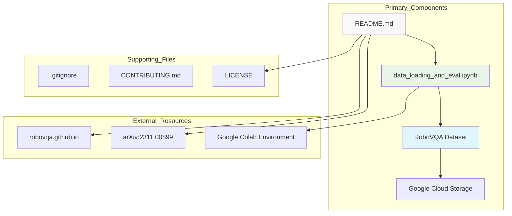

**Repository Structure Analysis:**
- **Documentation Hub**: `README.md` serves as the primary entry point and user guide
- **Functional Core**: `data_loading_and_eval.ipynb` contains the actual implementation
- **Dataset Interface**: Code focuses on loading and processing multimodal data from cloud storage
- **Evaluation Framework**: Includes mock evaluation pipeline with BLEU score calculation

Sources: [README.md:1-46]()

## High-Level Architecture

The repository implements a streamlined architecture designed for dataset interaction and evaluation demonstration:

### System Flow Diagram

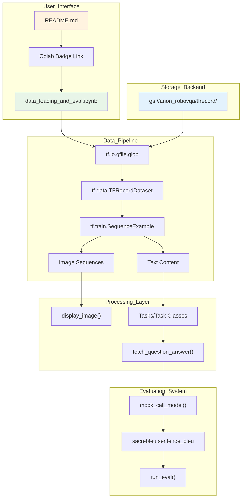

**Architecture Principles:**
- **Single Notebook Design**: All functionality concentrated in one Jupyter notebook for simplicity
- **Cloud-Native Storage**: Leverages Google Cloud Storage for large-scale TFRecord distribution
- **Streaming Pipeline**: Uses TensorFlow's data pipeline for efficient processing of large datasets
- **Mock Evaluation**: Provides evaluation framework structure without requiring actual model implementation

Sources: [README.md:8-13]()

## Key Technical Components

### Multimodal Data Handling

The system processes two primary data types from the RoboVQA dataset:

| Data Type | Format | Processing Function | Purpose |
|-----------|---------|-------------------|---------|
| Image Sequences | JPEG arrays | `display_image()` | Visual context for robotic tasks |
| Conversational Text | UTF-8 strings | `Tasks`/`Task` classes | Natural language instructions and responses |

### Text Processing Architecture

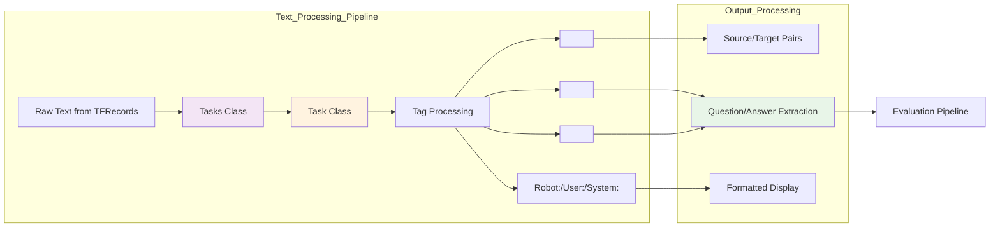

**Text Processing Features:**
- **Conversational AI Tags**: Sophisticated tagging system distinguishes between model predictions and conditioning text
- **Speaker Identification**: Separates dialogue by Robot, User, and System speakers
- **Answer Type Classification**: Handles both binary (yes/no) and discrete (categorical) answer types
- **Question-Answer Extraction**: Automated extraction of evaluation pairs from conversational data

Sources: Based on architectural analysis from provided diagrams

## Usage Workflow

The repository follows a straightforward usage pattern designed for educational demonstration:

### User Interaction Sequence

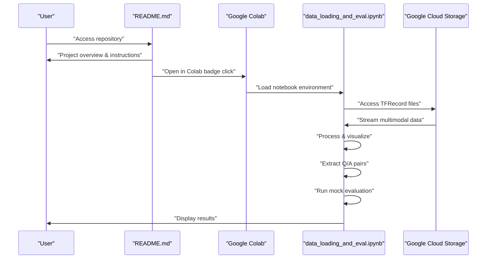

**Workflow Characteristics:**
- **Single Entry Point**: Users begin with README.md documentation
- **Cloud-Based Execution**: Leverages Google Colab for zero-setup execution
- **Guided Experience**: Inline comments provide step-by-step instructions
- **Complete Demonstration**: Shows full pipeline from data loading to evaluation

Sources: [README.md:8-13]()

## Project Context and Licensing

### Academic and Legal Framework

The repository operates within a structured academic and legal framework:

**Academic Context:**
- Research paper: "RoboVQA: Multimodal Long-Horizon Reasoning for Robotics" (arXiv:2311.00899)
- Authors: Multi-institutional team from DeepMind and collaborating organizations
- Publication year: 2023

**Legal Structure:**
- **Software License**: Apache License, Version 2.0 for all code components
- **Content License**: Creative Commons Attribution 4.0 International (CC-BY) for documentation and other materials
- **Copyright**: DeepMind Technologies Limited (2023)
- **Disclaimer**: "This is not an official Google product"

**Contribution Requirements:**
- Google Contributor License Agreement (CLA) required for external contributions
- Code review process through GitHub pull requests
- Community guidelines compliance

Sources: [README.md:15-46]()

## Summary

This repository serves as an educational demonstration interface for the RoboVQA dataset, providing researchers and practitioners with example code for multimodal robotics data interaction. The architecture emphasizes simplicity and accessibility, with a single Jupyter notebook containing the complete functionality for data loading, processing, and evaluation.

The system's design reflects its purpose as a research tool rather than a production system, with mock evaluation components and cloud-native data access patterns optimized for academic use cases.

---

# Page: Getting Started

# Getting Started

<details>
<summary>Relevant source files</summary>

The following files were used as context for generating this wiki page:

- [README.md](README.md)
- [data_loading_and_eval.ipynb](data_loading_and_eval.ipynb)

</details>


This document provides step-by-step instructions for using the RoboVQA repository to interact with the RoboVQA dataset. This repository contains example code for loading, visualizing, and evaluating against the dataset, not the full RoboVQA model implementation.

For comprehensive details about the dataset format and processing pipeline, see [Core Implementation](#3). For information about contributing to the project, see [Development Guide](#4).

## Purpose and Scope

The RoboVQA repository serves as a demonstration interface for the RoboVQA dataset, which contains multimodal long-horizon reasoning data for robotics applications. The primary workflow involves:

1. Accessing the pre-configured Google Colab environment
2. Loading TFRecord data from Google Cloud Storage
3. Visualizing image sequences and text content
4. Running evaluation pipelines with BLEU score metrics

## Prerequisites

| Requirement | Description |
|-------------|-------------|
| Google Account | Required for Google Colab access |
| Internet Connection | Needed to access Google Cloud Storage dataset |
| Browser | Chrome, Firefox, or Safari for Colab compatibility |

No local installation or setup is required - the entire workflow runs in Google Colab.

## Quick Start Workflow

### Repository Entry Point

The primary entry point is through the repository's main documentation:

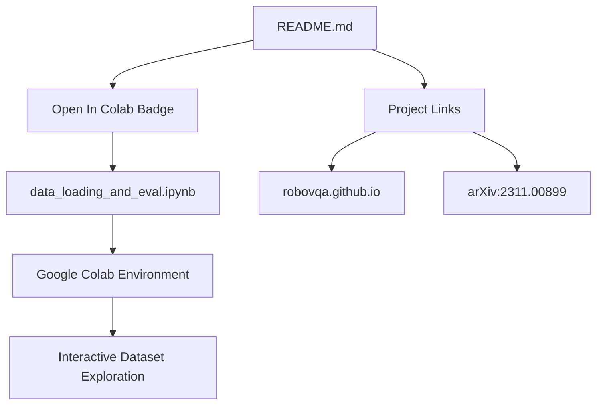

**User Journey**: Navigate to repository → Click "Open In Colab" badge → Execute notebook cells sequentially

Sources: [README.md:1-46](), [data_loading_and_eval.ipynb:1-541]()

### Core Execution Flow

The main workflow executes through the Jupyter notebook with these key steps:

```mermaid
graph TD
    A[data_loading_and_eval.ipynb] --> B["Cell 1: Display Utils"]
    B --> C["Cell 2: Task Utils"]
    C --> D["Cell 3: Dataset Loading"]
    D --> E["Cell 4: TF Dataset Creation"]
    E --> F["Cell 5: Example Visualization"]
    F --> G["Cell 6: Evaluation Setup"]
    G --> H["Cell 7: BLEU Score Evaluation"]
    
    B --> B1["display_image()"]
    B --> B2["as_gif()"]
    
    C --> C1["Task class"]
    C --> C2["Tasks class"]
    C --> C3["fetch_question_answer()"]
    
    D --> D1["tf.io.gfile.glob()"]
    D --> D2["gs://anon_robovqa/tfrecord/train/train*"]
    
    E --> E1["tf.data.TFRecordDataset"]
    E --> E2["tf.train.SequenceExample"]
    
    G --> G1["mock_call_model()"]
    G --> G2["run_eval()"]
    G --> G3["sacrebleu.sentence_bleu()"]
```

**Execution Method**: Run cells sequentially from top to bottom in the Colab environment

Sources: [data_loading_and_eval.ipynb:58-541]()

## Data Loading Pipeline

### Google Cloud Storage Access

The dataset is stored in Google Cloud Storage and accessed through TensorFlow's file system utilities:

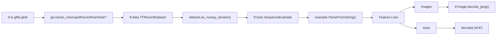

**Data Access Pattern**: Glob pattern → TFRecord dataset → Numpy iterator → Protocol buffer parsing

Sources: [data_loading_and_eval.ipynb:385-427]()

### Text Processing Architecture

The text processing system handles conversational dialogue with specialized tagging:

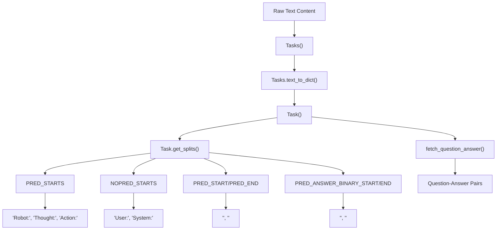

**Processing Flow**: Raw text → Tasks container → Individual Task objects → Tag-based splitting → Q/A extraction

Sources: [data_loading_and_eval.ipynb:99-374]()

## Visualization and Display

### Image Sequence Handling

The system provides utilities for displaying both single images and image sequences:

| Function | Purpose | Input | Output |
|----------|---------|--------|--------|
| `display_image()` | Main display function | List of numpy arrays | GIF animation or static image |
| `as_gif()` | GIF creation | List of PIL Images | GIF bytes |

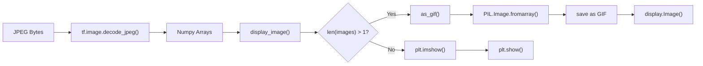

**Display Logic**: Multiple images → GIF animation, Single image → Static matplotlib display

Sources: [data_loading_and_eval.ipynb:66-87]()

### Text Output Formatting

The `display_text()` function processes conversational text and extracts structured question-answer pairs:

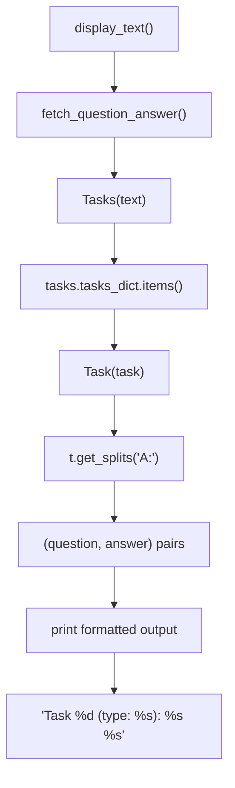

**Output Format**: `Task {index} (type: {task_type}): {question} {answer}`

Sources: [data_loading_and_eval.ipynb:356-374]()

## Evaluation Pipeline

### Mock Model Interface

The evaluation system provides a template for model integration:

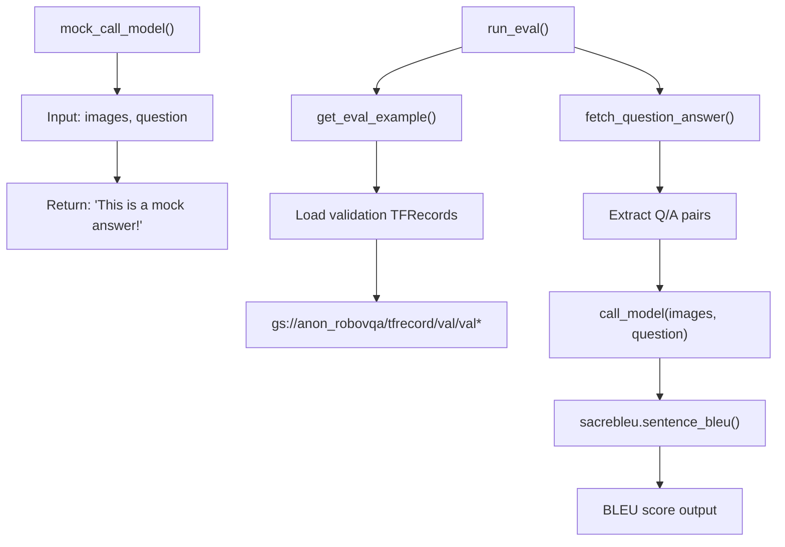

**Evaluation Flow**: Load validation data → Extract Q/A pairs → Call model → Calculate BLEU scores

Sources: [data_loading_and_eval.ipynb:462-503]()

### BLEU Score Calculation

The system uses the `sacrebleu` library for evaluation metrics:

| Component | Purpose | Input | Output |
|-----------|---------|--------|--------|
| `sacrebleu.sentence_bleu()` | BLEU score calculation | Reference answer, predicted answer | BLEU score percentage |
| `run_eval()` | End-to-end evaluation | Model function | Formatted evaluation results |

**Integration Point**: Replace `mock_call_model()` with your actual model implementation

Sources: [data_loading_and_eval.ipynb:448-503]()

## Next Steps

1. **Dataset Exploration**: Execute all cells in the notebook to see example data
2. **Model Integration**: Replace `mock_call_model()` with your model implementation
3. **Custom Evaluation**: Modify the evaluation pipeline for your specific use case
4. **Data Processing**: Adapt the `Task` and `Tasks` classes for custom text processing needs

For detailed implementation information, see [Core Implementation](#3). For contribution guidelines, see [Development Guide](#4).

Sources: [README.md:1-46](), [data_loading_and_eval.ipynb:1-541]()

---

# Page: Core Implementation

# Core Implementation

<details>
<summary>Relevant source files</summary>

The following files were used as context for generating this wiki page:

- [data_loading_and_eval.ipynb](data_loading_and_eval.ipynb)

</details>


This document provides comprehensive documentation of the main functional components within the `data_loading_and_eval.ipynb` notebook. The notebook serves as the primary interface for interacting with the RoboVQA dataset, implementing a complete pipeline from data loading through evaluation.

For information about getting started with the repository, see [Getting Started](#2). For details on specific subsystems, see [Data Loading Pipeline](#3.1), [Text Processing System](#3.2), [Evaluation Framework](#3.3), and [Visualization and Display](#3.4).

## System Architecture Overview

The notebook implements four main subsystems that work together to provide dataset interaction capabilities:

### Core Components Architecture

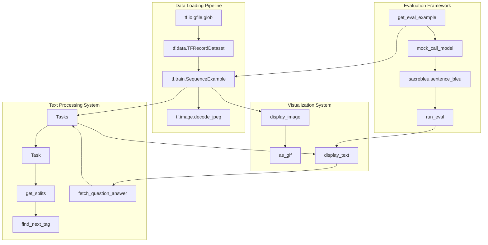

Sources: [data_loading_and_eval.ipynb:385-540]()

### Data Flow Through Core Systems

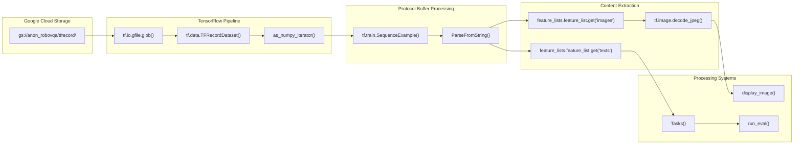

Sources: [data_loading_and_eval.ipynb:385-428]()

## Key Implementation Details

### Core Classes and Functions

| Component | Type | Purpose | Key Methods |
|-----------|------|---------|-------------|
| `Task` | Class | Individual text processing with tag handling | `get_splits()`, `find_next_tag()`, `_remove_tags()` |
| `Tasks` | Class | Collection of tasks with parsing capabilities | `add_from_text()`, `text_to_dict()`, `sample_task()` |
| `display_image()` | Function | Image visualization with GIF support | Single image display or animated GIF creation |
| `fetch_question_answer()` | Function | Question-answer extraction from text | Processes task types and returns Q/A pairs |
| `run_eval()` | Function | End-to-end evaluation pipeline | Coordinates model calls and BLEU score calculation |

Sources: [data_loading_and_eval.ipynb:107-375]()

### Tag Processing System

The text processing system uses a sophisticated tagging scheme to differentiate between content the model should predict versus content it should condition on:

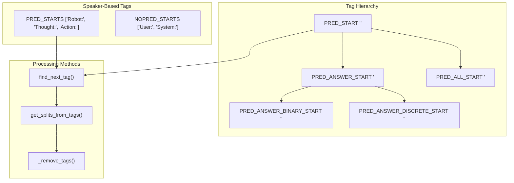

Sources: [data_loading_and_eval.ipynb:110-132]()

### Evaluation Pipeline Architecture

The evaluation system provides a framework for model assessment using BLEU scores:

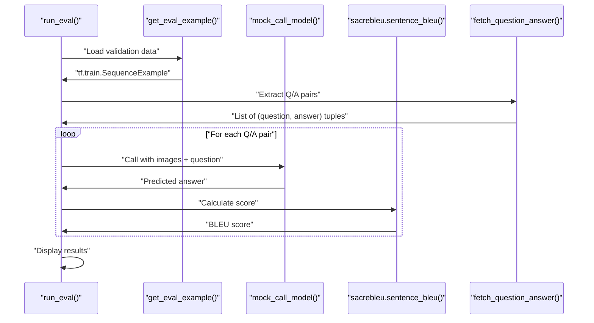

Sources: [data_loading_and_eval.ipynb:462-502]()

## Implementation Patterns

### Data Loading Pattern

The notebook implements a consistent pattern for loading multimodal data:

1. **File Discovery**: Uses `tf.io.gfile.glob()` to locate TFRecord files in Google Cloud Storage
2. **Dataset Creation**: Creates `tf.data.TFRecordDataset` from file paths
3. **Iteration**: Converts to numpy iterator for sequential processing
4. **Protocol Buffer Parsing**: Uses `tf.train.SequenceExample` for structured data extraction
5. **Content Decoding**: Decodes JPEG images and UTF-8 text content

Sources: [data_loading_and_eval.ipynb:385-428]()

### Text Processing Pattern

The text processing follows a tag-based parsing approach:

1. **Task Splitting**: Uses regex patterns to split text into individual tasks
2. **Tag Recognition**: Identifies prediction tags and speaker-based splits
3. **Content Extraction**: Separates source context from target predictions
4. **Question-Answer Pairing**: Extracts Q/A pairs using 'A:' tag splits

Sources: [data_loading_and_eval.ipynb:356-374]()

### Visualization Pattern

The display system handles both static images and animated sequences:

1. **Single Image**: Direct matplotlib display for individual frames
2. **Image Sequence**: Creates animated GIFs using PIL for multiple frames
3. **Text Display**: Formats and displays question-answer pairs with task type information

Sources: [data_loading_and_eval.ipynb:66-88](), [data_loading_and_eval.ipynb:371-374]()

---

# Page: Data Loading Pipeline

# Data Loading Pipeline

<details>
<summary>Relevant source files</summary>

The following files were used as context for generating this wiki page:

- [data_loading_and_eval.ipynb](data_loading_and_eval.ipynb)

</details>


## Purpose and Scope

This document describes the data loading pipeline that retrieves and processes multimodal data from the RoboVQA dataset stored on Google Cloud Storage. The pipeline handles TFRecord files containing video sequences and conversational text, parsing them into usable formats for model training and evaluation.

For information about text processing and tag handling, see [Text Processing System](#3.2). For visualization of the loaded data, see [Visualization and Display](#3.4).

## Architecture Overview

The data loading pipeline operates as a multi-stage system that transforms raw TFRecord files into structured multimodal data. The pipeline consists of four main components: file discovery, dataset creation, protocol buffer parsing, and content extraction.

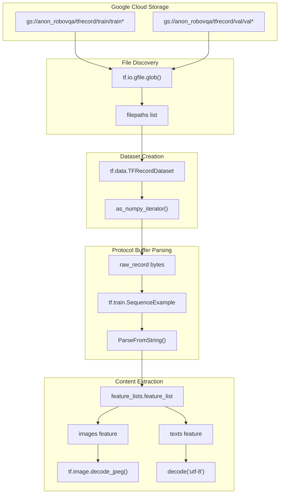

Sources: [data_loading_and_eval.ipynb:385-427]()

## File Discovery and Dataset Creation

The pipeline begins by discovering TFRecord files on Google Cloud Storage using TensorFlow's file system utilities. The `tf.io.gfile.glob` function patterns match training and validation datasets.

### File Path Patterns

| Dataset Type | Pattern | Purpose |
|-------------|---------|---------|
| Training | `gs://anon_robovqa/tfrecord/train/train*` | Model training data |
| Validation | `gs://anon_robovqa/tfrecord/val/val*` | Model evaluation data |

The discovered file paths are then used to create a `tf.data.TFRecordDataset` object, which provides efficient streaming access to the protocol buffer records.

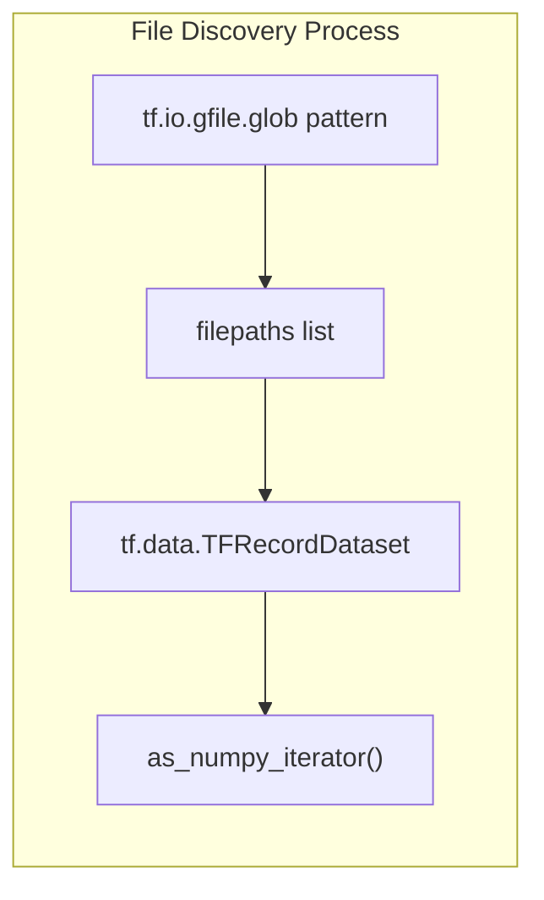

Sources: [data_loading_and_eval.ipynb:388](), [data_loading_and_eval.ipynb:401-402](), [data_loading_and_eval.ipynb:470-471]()

## Protocol Buffer Parsing

Each record in the TFRecord dataset is a serialized `tf.train.SequenceExample` protocol buffer. The pipeline creates a new `SequenceExample` instance and uses `ParseFromString()` to deserialize the raw bytes into structured data.

### SequenceExample Structure

The `SequenceExample` contains two main components:
- **feature_lists**: Contains sequences of features (images and text)
- **feature_list**: Dictionary-like access to named feature sequences

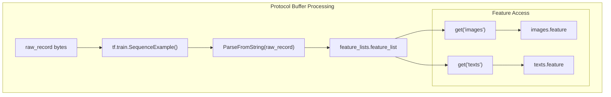

Sources: [data_loading_and_eval.ipynb:414-416](), [data_loading_and_eval.ipynb:474-475]()

## Image Processing

The image data is stored as JPEG-encoded bytes within the protocol buffer. The pipeline iterates through each image feature, extracts the bytes, and decodes them using `tf.image.decode_jpeg()`.

### Image Extraction Process

1. **Feature Iteration**: Loop through `feature_list.get('images').feature`
2. **Bytes Extraction**: Access `bytes_list.value[0]` for each feature
3. **JPEG Decoding**: Convert bytes to numpy arrays using `tf.image.decode_jpeg()`
4. **Array Conversion**: Call `.numpy()` to get standard numpy arrays

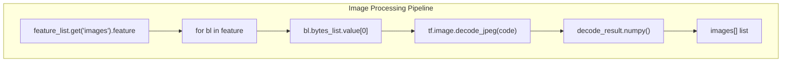

Sources: [data_loading_and_eval.ipynb:418-422](), [data_loading_and_eval.ipynb:483-486]()

## Text Processing

Text content is extracted from the protocol buffer as UTF-8 encoded bytes. The pipeline accesses the first text feature and decodes it to a string for further processing by the text processing system.

### Text Extraction Steps

1. **Feature Access**: Get `feature_list.get("texts").feature[0]`
2. **Bytes Extraction**: Access `bytes_list.value[0]`
3. **UTF-8 Decoding**: Convert bytes to string using `.decode('utf-8')`

The decoded text contains conversational data with specialized tags that are processed by the `Tasks` and `Task` classes.

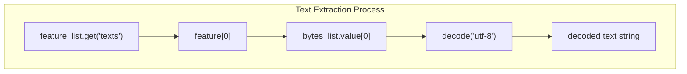

Sources: [data_loading_and_eval.ipynb:427](), [data_loading_and_eval.ipynb:487]()

## Data Flow Integration

The complete data loading pipeline integrates with downstream processing systems through well-defined interfaces. The extracted images are passed to visualization functions, while the text content is processed by the task parsing system.

### Pipeline Integration Points

| Component | Input | Output | Downstream Consumer |
|-----------|-------|--------|-------------------|
| File Discovery | GCS patterns | File paths | TFRecordDataset |
| Dataset Creation | File paths | Raw records | Protocol parser |
| Protocol Parsing | Raw bytes | SequenceExample | Feature extraction |
| Image Processing | JPEG bytes | Numpy arrays | `display_image()` |
| Text Processing | UTF-8 bytes | String | `Tasks` class |

```mermaid
graph TD
    subgraph "Data Loading Pipeline"
        FILE_DISCOVERY["File Discovery"]
        DATASET_CREATION["Dataset Creation"]
        PROTOCOL_PARSING["Protocol Parsing"]
        CONTENT_EXTRACTION["Content Extraction"]
    end
    
    subgraph "Downstream Systems"
        DISPLAY_IMAGE["display_image()"]
        TASKS_CLASS["Tasks class"]
        TASK_CLASS["Task class"]
        FETCH_QA["fetch_question_answer()"]
    end
    
    FILE_DISCOVERY --> DATASET_CREATION
    DATASET_CREATION --> PROTOCOL_PARSING
    PROTOCOL_PARSING --> CONTENT_EXTRACTION
    CONTENT_EXTRACTION --> DISPLAY_IMAGE
    CONTENT_EXTRACTION --> TASKS_CLASS
    TASKS_CLASS --> TASK_CLASS
    TASK_CLASS --> FETCH_QA
```

Sources: [data_loading_and_eval.ipynb:385-427](), [data_loading_and_eval.ipynb:356-368]()

---

# Page: Text Processing System

# Text Processing System

<details>
<summary>Relevant source files</summary>

The following files were used as context for generating this wiki page:

- [data_loading_and_eval.ipynb](data_loading_and_eval.ipynb)

</details>


This document covers the text processing components within the RoboVQA dataset interaction system. The text processing system handles conversational dialogue data with sophisticated tagging mechanisms for distinguishing between content that models should predict versus content they should condition on. For information about loading the underlying TensorFlow data, see [Data Loading Pipeline](#3.1). For details on the evaluation framework that consumes the processed text, see [Evaluation Framework](#3.3).

## Architecture Overview

The text processing system consists of two primary classes that work together to parse and manipulate conversational text data containing prediction tags and speaker identifiers.

### Core Components Architecture

```mermaid
graph TB
    subgraph "Text Processing System"
        A["Tasks Class"] --> B["Task Class"]
        C["Raw Text Input"] --> A
        D["text_to_dict()"] --> A
        E["get_splits()"] --> B
        F["fetch_question_answer()"] --> A
        G["display_text()"] --> F
    end
    
    subgraph "Tag Processing"
        H["PRED_START/END"] --> E
        I["PRED_ANSWER_BINARY"] --> E
        J["PRED_ANSWER_DISCRETE"] --> E
        K["PRED_STARTS"] --> E
        L["NOPRED_STARTS"] --> E
    end
    
    subgraph "Output Products"
        M["Source/Target Pairs"]
        N["Question/Answer Pairs"]
        O["Formatted Display"]
    end
    
    E --> M
    F --> N
    G --> O
    
    C --> D
    H --> B
    I --> B
    J --> B
    K --> B
    L --> B
```

Sources: [data_loading_and_eval.ipynb:99-375]()

## Task Class

The `Task` class handles individual conversational text segments and provides methods for splitting them into source/target pairs based on various tagging schemes.

### Tag Constants and Patterns

The `Task` class defines several categories of prediction tags:

| Tag Type | Start Tag | End Tag | Purpose |
|----------|-----------|---------|---------|
| General Prediction | `<PRED>` | `</PRED>` | All content to be predicted |
| Binary Answer | `<PRED:ANSWER:BINARY>` | `</PRED:ANSWER:BINARY>` | Yes/No responses |
| Discrete Answer | `<PRED:ANSWER:DISCRETE>` | `</PRED:ANSWER:DISCRETE>` | Limited set responses |
| Speaker-based | `Robot:`, `Thought:`, `Action:` | `User:`, `System:` | Conversational turns |

### Text Splitting Mechanisms

```mermaid
graph LR
    subgraph "Split Types"
        A["'speaker'"] --> B["get_splits_from_tags()"]
        C["'pred'"] --> B
        D["'binary'"] --> B
        E["'discrete'"] --> B
        F["'answer'"] --> B
        G["'A:'"] --> B
    end
    
    subgraph "Core Processing"
        B --> H["find_next_tag()"]
        H --> I["get_splits_from_positions()"]
        I --> J["_remove_tags()"]
    end
    
    subgraph "Output"
        J --> K["(source, target) pairs"]
    end
```

The `get_splits()` method [data_loading_and_eval.ipynb:141-166]() supports multiple split types:
- `speaker`: Splits based on conversational roles (`PRED_STARTS` vs `NOPRED_STARTS`)
- `pred`: Splits based on general prediction tags
- `binary`/`discrete`: Splits based on answer type tags
- `answer`: Splits based on any answer tags
- `A:`: Splits specifically on answer markers

Sources: [data_loading_and_eval.ipynb:107-222]()

## Tasks Class

The `Tasks` class serves as a container and parser for multiple task segments, organizing them by task type and providing sampling capabilities.

### Task Organization Structure

```mermaid
graph TB
    subgraph "Tasks Class Data Structure"
        A["tasks_raw"] --> B["text_to_dict()"]
        B --> C["tasks_dict"]
        B --> D["tasks_list"]
        B --> E["tasks_types"]
        
        C --> F["Task Type → List[Task]"]
        D --> G["Flat List of All Tasks"]
        E --> H["Parallel Type Labels"]
    end
    
    subgraph "Task Parsing"
        I["TASK_RE Pattern"] --> B
        J["re.split()"] --> B
        K["Tag Extraction"] --> B
    end
    
    subgraph "Access Methods"
        L["get_random_task()"] --> D
        M["sample_task()"] --> C
        N["get_tasks_list()"] --> D
        O["get_tasks_types()"] --> E
    end
```

The `text_to_dict()` method [data_loading_and_eval.ipynb:256-273]() uses regex pattern `TASK_RE = r'(<task[:w]*>)'` to split raw text into individual task segments organized by task type tags.

Sources: [data_loading_and_eval.ipynb:224-354]()

## Question-Answer Extraction

The system provides specialized functionality for extracting question-answer pairs from conversational text through the `fetch_question_answer()` function.

### Q/A Processing Pipeline

```mermaid
sequenceDiagram
    participant Input as "Raw Text"
    participant Tasks as "Tasks(text)"
    participant Task as "Task(task)"
    participant Splits as "get_splits('A:')"
    participant Output as "Q/A Pairs"
    
    Input->>Tasks: "Initialize with text"
    Tasks->>Tasks: "Parse into tasks_dict"
    
    loop "For each task_type, tasks"
        Tasks->>Task: "Create Task(task)"
        Task->>Splits: "Extract A: splits"
        Splits->>Output: "(question, answer)"
    end
    
    Output->>Output: "Format as (i, task_type, question, answer)"
```

The `fetch_question_answer()` function [data_loading_and_eval.ipynb:356-368]() processes text by:
1. Creating a `Tasks` object from the input text
2. Iterating through each task type and task
3. Using `get_splits('A:')` to find answer segments
4. Extracting and cleaning question/answer pairs
5. Returning tuples of `(index, task_type, question, answer)`

Sources: [data_loading_and_eval.ipynb:356-374]()

## Text Display and Formatting

The system includes a display utility `display_text()` that formats question-answer pairs for human-readable output.

### Display Processing Flow

```mermaid
graph LR
    A["Raw Text"] --> B["fetch_question_answer()"]
    B --> C["Q/A Tuples"]
    C --> D["display_text()"]
    D --> E["Formatted Print Output"]
    
    subgraph "Format Template"
        F["'Task %d (type: %s): %s %s'"]
        G["(i, task_type, question, answer)"]
    end
    
    D --> F
    G --> F
```

The `display_text()` function [data_loading_and_eval.ipynb:371-374]() outputs formatted strings in the pattern: `"Task {index} (type: {task_type}): {question} {answer}"`.

Sources: [data_loading_and_eval.ipynb:371-374]()

## Integration with Data Pipeline

The text processing system integrates with the broader RoboVQA data pipeline by processing text content extracted from TensorFlow SequenceExample protocol buffers.

### Data Flow Integration

```mermaid
graph TB
    subgraph "TensorFlow Data Layer"
        A["tf.train.SequenceExample"] --> B["feature_lists.feature_list"]
        B --> C["get('texts').feature[0]"]
        C --> D["bytes_list.value[0]"]
        D --> E["decode('utf-8')"]
    end
    
    subgraph "Text Processing Layer"
        E --> F["display_text()"]
        E --> G["fetch_question_answer()"]
        F --> H["Tasks(text)"]
        G --> H
        H --> I["Task(task)"]
    end
    
    subgraph "Output Layer"
        I --> J["Source/Target Pairs"]
        I --> K["Q/A Pairs"]
        J --> L["Training Data"]
        K --> M["Evaluation Data"]
    end
```

The system processes UTF-8 decoded text from TensorFlow records [data_loading_and_eval.ipynb:427]() and produces structured output for both training (source/target pairs) and evaluation (question/answer pairs) purposes.

Sources: [data_loading_and_eval.ipynb:427](), [data_loading_and_eval.ipynb:487]()

---

# Page: Evaluation Framework

# Evaluation Framework

<details>
<summary>Relevant source files</summary>

The following files were used as context for generating this wiki page:

- [data_loading_and_eval.ipynb](data_loading_and_eval.ipynb)

</details>


## Purpose and Scope

The evaluation framework provides a standardized pipeline for assessing model performance against the RoboVQA dataset using BLEU scores. This framework serves as a template for researchers to integrate their own multimodal models and evaluate their question-answering capabilities on robotic tasks.

For information about data loading and preprocessing, see [Data Loading Pipeline](#3.1). For details about text processing and question-answer extraction, see [Text Processing System](#3.2).

## Architecture Overview

The evaluation framework follows a modular design that separates model inference, data processing, and metric calculation. The system is designed to be easily extensible for different model architectures while maintaining consistent evaluation protocols.

```mermaid
flowchart TD
    A["get_eval_example()"] --> B["Validation TFRecords"]
    B --> C["Image Sequences"]
    B --> D["Text Content"]
    C --> E["mock_call_model()"]
    D --> F["fetch_question_answer()"]
    F --> G["Question/Answer Pairs"]
    G --> E
    E --> H["Model Predictions"]
    H --> I["sacrebleu.sentence_bleu()"]
    G --> I
    I --> J["BLEU Scores"]
    K["run_eval()"] --> A
    K --> I
    K --> L["Evaluation Results"]
```

**Evaluation Pipeline Flow**

Sources: [data_loading_and_eval.ipynb:462-503]()

## Core Components

### Model Interface

The framework defines a standardized interface for model integration through the `mock_call_model` function, which serves as a template for actual model implementations.

| Component | Function | Input | Output |
|-----------|----------|-------|--------|
| Model Interface | `mock_call_model` | Images, Question | Predicted Answer |
| Data Loader | `get_eval_example` | None | Validation Example |
| Evaluation Runner | `run_eval` | Model Function | BLEU Scores |

The model interface expects:
- `images`: List of decoded JPEG arrays representing video frames
- `question`: String containing the question text
- Returns: String containing the predicted answer

Sources: [data_loading_and_eval.ipynb:464-466]()

### Data Loading Component

The `get_eval_example` function handles loading validation data from Google Cloud Storage and parsing TFRecord format.

```mermaid
flowchart LR
    A["tf.io.gfile.glob()"] --> B["gs://anon_robovqa/tfrecord/val/val*"]
    B --> C["tf.data.TFRecordDataset()"]
    C --> D["tf.train.SequenceExample()"]
    D --> E["Parsed Validation Example"]
    
    F["get_eval_example()"] --> A
    F --> E
```

**Validation Data Loading Pipeline**

Sources: [data_loading_and_eval.ipynb:469-476]()

### Question-Answer Extraction

The framework leverages the text processing system to extract structured question-answer pairs from the validation data using the `fetch_question_answer` function.

```mermaid
flowchart TD
    A["Raw Text Content"] --> B["Tasks()"]
    B --> C["Task Objects"]
    C --> D["get_splits('A:')"]
    D --> E["Question/Answer Pairs"]
    
    F["fetch_question_answer()"] --> B
    F --> E
    
    G["task_type"] --> H["Task Classification"]
    E --> H
    H --> I["Structured QA Data"]
```

**Question-Answer Processing Chain**

Sources: [data_loading_and_eval.ipynb:356-368]()

## Evaluation Pipeline

### Main Evaluation Function

The `run_eval` function orchestrates the complete evaluation process, integrating data loading, model inference, and metric calculation.

```mermaid
sequenceDiagram
    participant RE as "run_eval()"
    participant GEE as "get_eval_example()"
    participant FQA as "fetch_question_answer()"
    participant CM as "call_model()"
    participant SB as "sacrebleu.sentence_bleu()"
    
    RE->>GEE: Load validation data
    GEE->>RE: Return parsed example
    RE->>RE: Extract images from example
    RE->>FQA: Process text content
    FQA->>RE: Return QA pairs
    
    loop For each QA pair
        RE->>CM: Call model(images, question)
        CM->>RE: Return prediction
        RE->>SB: Calculate BLEU(answer, prediction)
        SB->>RE: Return BLEU score
        RE->>RE: Display results
    end
```

**Evaluation Sequence Flow**

Sources: [data_loading_and_eval.ipynb:479-491]()

### Metric Calculation

The framework uses BLEU scores for evaluation, implemented through the `sacrebleu` library. The metric calculation compares predicted answers against ground truth answers at the sentence level.

| Metric | Implementation | Purpose |
|--------|---------------|---------|
| BLEU Score | `sacrebleu.sentence_bleu()` | Measures text similarity between prediction and ground truth |
| Sentence Level | Individual QA pairs | Provides fine-grained evaluation feedback |

The BLEU calculation follows this pattern:
```python
bleu = sacrebleu.sentence_bleu(answer, pred_answer)
```

Sources: [data_loading_and_eval.ipynb:490]()

## Integration with Other Systems

### Text Processing Integration

The evaluation framework integrates with the text processing system through the `fetch_question_answer` function, which utilizes the `Tasks` and `Task` classes to parse structured dialogue.

```mermaid
flowchart TD
    A["Evaluation Framework"] --> B["fetch_question_answer()"]
    B --> C["Tasks()"]
    C --> D["Task()"]
    D --> E["get_splits('A:')"]
    E --> F["Question/Answer Extraction"]
    
    G["Text Processing System"] --> C
    G --> D
    G --> E
```

**Integration with Text Processing**

Sources: [data_loading_and_eval.ipynb:356-368]()

### Data Loading Integration

The evaluation framework reuses the same data loading patterns established in the main data pipeline, ensuring consistency in data handling across training and evaluation phases.

```mermaid
flowchart LR
    A["Common Data Pipeline"] --> B["tf.data.TFRecordDataset"]
    B --> C["tf.train.SequenceExample"]
    C --> D["Protocol Buffer Parsing"]
    
    E["Training Data"] --> A
    F["Validation Data"] --> A
    
    G["Evaluation Framework"] --> F
    H["Data Loading Pipeline"] --> E
```

**Shared Data Infrastructure**

Sources: [data_loading_and_eval.ipynb:470-476]()

## Usage Example

The framework provides a complete working example that demonstrates the evaluation process:

```python
run_eval(mock_call_model)
```

This executes the full evaluation pipeline, displaying:
- Questions from the validation set
- Ground truth answers
- Model predictions (from mock function)
- BLEU scores for each question-answer pair

The output format follows this structure:
```
Question: [extracted question]
Answer: [ground truth answer]
Predicted Answer: [model prediction]
BLEU: [calculated score]%
```

Sources: [data_loading_and_eval.ipynb:502](), [data_loading_and_eval.ipynb:488-491]()

---

# Page: Visualization and Display

# Visualization and Display

<details>
<summary>Relevant source files</summary>

The following files were used as context for generating this wiki page:

- [data_loading_and_eval.ipynb](data_loading_and_eval.ipynb)

</details>


This section documents the visualization and display utilities that render multimodal data from the RoboVQA dataset for interactive exploration. The system provides specialized functions for displaying image sequences as animated GIFs and formatting structured text content into readable question-answer pairs.

For information about the underlying data loading mechanisms, see [Data Loading Pipeline](#3.1). For details about text processing and tagging systems, see [Text Processing System](#3.2).

## Overview

The visualization system consists of two main components: image display utilities that handle both static images and animated sequences, and text display utilities that parse and format conversational AI content with specialized tagging.

```mermaid
graph TB
    subgraph "Data Sources"
        A[TFRecordDataset]
        B[SequenceExample]
    end
    
    subgraph "Raw Data Extraction"
        C[JPEG_Encoded_Images]
        D[UTF8_Encoded_Text]
    end
    
    subgraph "Visualization Pipeline"
        E[display_image]
        F[display_text]
        G[as_gif]
        H[fetch_question_answer]
    end
    
    subgraph "Output Formats"
        I[Animated_GIF]
        J[Static_Image]
        K[Formatted_QA_Pairs]
    end
    
    A --> B
    B --> C
    B --> D
    C --> E
    D --> F
    E --> G
    E --> J
    G --> I
    F --> H
    H --> K
    
    style E fill:#f9f9f9
    style F fill:#f9f9f9
    style G fill:#f9f9f9
    style H fill:#f9f9f9
```

**Sources:** [data_loading_and_eval.ipynb:66-88](), [data_loading_and_eval.ipynb:371-374]()

## Image Display System

The image display system handles visualization of both single images and image sequences through two primary functions: `display_image()` and `as_gif()`.

### Image Processing Pipeline

```mermaid
graph LR
    subgraph "Input Processing"
        A[JPEG_Bytes] --> B[tf.image.decode_jpeg]
        B --> C[numpy_array]
    end
    
    subgraph "Display Logic"
        C --> D[display_image]
        D --> E{len_images_>_1}
        E -->|Yes| F[as_gif]
        E -->|No| G[matplotlib_display]
    end
    
    subgraph "GIF Generation"
        F --> H[PIL.Image.fromarray]
        H --> I[save_temp_gif]
        I --> J[IPython.display.Image]
    end
    
    subgraph "Static Display"
        G --> K[PIL.Image.fromarray]
        K --> L[plt.imshow]
        L --> M[plt.show]
    end
    
    style D fill:#f9f9f9
    style F fill:#f9f9f9
```

**Sources:** [data_loading_and_eval.ipynb:78-87](), [data_loading_and_eval.ipynb:71-75]()

### Core Display Functions

| Function | Purpose | Input | Output |
|----------|---------|-------|--------|
| `display_image()` | Main image display controller | List of numpy arrays | Visual display (GIF or static) |
| `as_gif()` | Converts image sequence to GIF | List of PIL Images | GIF bytes |

The `display_image()` function at [data_loading_and_eval.ipynb:78-87]() implements conditional logic:
- **Multiple images**: Creates animated GIF using `as_gif()` helper
- **Single image**: Uses matplotlib for static display

The `as_gif()` function at [data_loading_and_eval.ipynb:71-75]() handles GIF creation:
- Converts numpy arrays to PIL Images
- Saves temporary GIF file with 100ms frame duration
- Returns raw GIF bytes for IPython display

**Sources:** [data_loading_and_eval.ipynb:78-87](), [data_loading_and_eval.ipynb:71-75]()

## Text Display System

The text display system parses structured conversational text and formats it into readable question-answer pairs using the `Tasks` and `Task` classes.

### Text Processing and Display Flow

```mermaid
graph TD
    subgraph "Input Processing"
        A[UTF8_Text_from_TFRecord] --> B[Tasks_constructor]
        B --> C[text_to_dict]
        C --> D[tasks_dict]
    end
    
    subgraph "Question-Answer Extraction"
        D --> E[fetch_question_answer]
        E --> F[Task_instances]
        F --> G[get_splits_A_colon]
        G --> H[question_answer_pairs]
    end
    
    subgraph "Display Formatting"
        H --> I[display_text]
        I --> J[formatted_output]
    end
    
    subgraph "Output Components"
        J --> K[Task_Index]
        J --> L[Task_Type]
        J --> M[Question_Text]
        J --> N[Answer_Text]
    end
    
    style B fill:#f9f9f9
    style E fill:#f9f9f9
    style I fill:#f9f9f9
```

**Sources:** [data_loading_and_eval.ipynb:356-368](), [data_loading_and_eval.ipynb:371-374]()

### Display Function Implementation

The `display_text()` function at [data_loading_and_eval.ipynb:371-374]() provides formatted output:

```python
def display_text(text):
  question_answers = fetch_question_answer(text)
  for i, task_type, question, answer in question_answers:
    print('Task %d (type: %s): %s %s' % (i, task_type, question, answer))
```

The `fetch_question_answer()` function at [data_loading_and_eval.ipynb:356-368]() extracts structured data:
- Creates `Tasks` instance from raw text
- Iterates through task types and individual tasks
- Uses `Task.get_splits('A:')` to extract question-answer pairs
- Returns tuples of `(index, task_type, question, answer)`

**Sources:** [data_loading_and_eval.ipynb:371-374](), [data_loading_and_eval.ipynb:356-368]()

## Integration with Data Loading

The visualization system integrates directly with the TensorFlow data loading pipeline to process multimodal content from `SequenceExample` protocol buffers.

### Data Extraction and Display Integration

```mermaid
graph TB
    subgraph "TFRecord Processing"
        A[tf.data.TFRecordDataset] --> B[raw_record_bytes]
        B --> C[tf.train.SequenceExample]
        C --> D[ParseFromString]
    end
    
    subgraph "Feature Extraction"
        D --> E[feature_lists.feature_list]
        E --> F[images_feature]
        E --> G[texts_feature]
    end
    
    subgraph "Content Decoding"
        F --> H[bytes_list.value]
        G --> I[bytes_list.value]
        H --> J[tf.image.decode_jpeg]
        I --> K[decode_utf8]
    end
    
    subgraph "Display Pipeline"
        J --> L[display_image]
        K --> M[display_text]
    end
    
    style C fill:#f9f9f9
    style L fill:#f9f9f9
    style M fill:#f9f9f9
```

**Sources:** [data_loading_and_eval.ipynb:414-427]()

### Example Usage Pattern

The typical usage pattern at [data_loading_and_eval.ipynb:414-427]() demonstrates the integration:

1. **Image Processing**: Extract JPEG bytes from `feature_lists.feature_list.get('images').feature`
2. **Image Decoding**: Use `tf.image.decode_jpeg()` to convert bytes to numpy arrays
3. **Text Processing**: Extract UTF-8 bytes from `feature_lists.feature_list.get("texts").feature`
4. **Display Execution**: Call `display_image(images)` and `display_text(text)`

**Sources:** [data_loading_and_eval.ipynb:414-427]()

## Output Formats and User Experience

The visualization system produces formatted output designed for interactive exploration in Jupyter/Colab environments.

### Display Output Components

| Component | Format | Purpose |
|-----------|--------|---------|
| Image Sequences | Animated GIF | Visual representation of robot actions |
| Static Images | Matplotlib plot | Single frame visualization |
| Question-Answer Pairs | Formatted text | `Task N (type: X): Question Answer` |
| Task Statistics | Summary text | Task type distribution and counts |

### User Interface Elements

The system provides descriptive output at [data_loading_and_eval.ipynb:423-425]():
- **Video Frames**: "Video image frames (in GIF format)"
- **VQA Tasks**: "All VQA tasks, in format of '<Task num> (task type): <Question> <Answer>'"

This creates a comprehensive view of each dataset example, combining visual and textual information for complete understanding of the multimodal data.

**Sources:** [data_loading_and_eval.ipynb:423-427]()

---

# Page: Development Guide

# Development Guide

<details>
<summary>Relevant source files</summary>

The following files were used as context for generating this wiki page:

- [CONTRIBUTING.md](CONTRIBUTING.md)

</details>


This document provides guidance for developers who want to contribute to or understand the development practices of the RoboVQA repository. It covers the contribution workflow, development environment setup, and key considerations for working with this demonstration codebase.

For detailed information about the core implementation components, see [Core Implementation](#3). For basic usage instructions, see [Getting Started](#2).

## Development Workflow Overview

The RoboVQA repository follows Google's standard open-source development practices with specific requirements for external contributions. The development workflow centers around the single functional notebook and supporting documentation.

### Contribution Process Flow

```mermaid
graph TB
    subgraph "External Contributors"
        A[Developer] 
        B[Fork Repository]
        C[Make Changes]
        D[Submit PR]
    end
    
    subgraph "Google CLA Process"
        E[CLA Check]
        F[Sign CLA]
        G[CLA Verified]
    end
    
    subgraph "Review Process"
        H[Code Review]
        I[Community Guidelines Check]
        J[Approval]
        K[Merge]
    end
    
    A --> B
    B --> C
    C --> D
    D --> E
    E --> F
    F --> G
    G --> H
    H --> I
    I --> J
    J --> K
    
    style E fill:#fff3e0
    style F fill:#ffebee
    style H fill:#e8f5e8
```

Sources: [CONTRIBUTING.md:1-26]()

### Repository Structure for Development

The repository maintains a minimal structure focused on demonstration rather than production development:

| Component | Purpose | Development Notes |
|-----------|---------|------------------|
| `README.md` | Entry point and documentation | Primary user interface |
| `data_loading_and_eval.ipynb` | Main functional code | Core development focus |
| `CONTRIBUTING.md` | Contribution guidelines | Defines development process |
| `LICENSE` | Legal framework | Dual licensing structure |
| `.gitignore` | Build artifact exclusions | Python-specific configuration |

## Development Environment Requirements

### Core Dependencies

The development environment requires specific Python packages for working with the multimodal dataset:

```mermaid
graph LR
    subgraph "Runtime Environment"
        A[Google_Colab]
        B[Python_3_x]
    end
    
    subgraph "Core Dependencies"
        C[tensorflow]
        D[sacrebleu]
        E[matplotlib]
        F[IPython]
    end
    
    subgraph "Data Access"
        G[tf_io_gfile]
        H[tf_data_TFRecordDataset]
        I[tf_train_SequenceExample]
    end
    
    A --> C
    B --> C
    C --> D
    C --> E
    C --> F
    C --> G
    G --> H
    H --> I
    
    style A fill:#e3f2fd
    style C fill:#fff3e0
```

Sources: [data_loading_and_eval.ipynb:1-50]()

### Development Configuration

The `.gitignore` file excludes standard Python development artifacts:

```python
# Python cache and build files
__pycache__/
*.py[cod]
*$py.class
*.so
.Python
build/
develop-eggs/
dist/
downloads/
eggs/
.eggs/
lib/
lib64/
parts/
sdist/
var/
wheels/
*.egg-info/
.installed.cfg
*.egg
MANIFEST
```

Sources: [.gitignore:1-50]()

## Key Development Considerations

### Notebook-Based Development

The primary development artifact is `data_loading_and_eval.ipynb`, which requires specific considerations:

- **Cell-based execution**: Code must be organized in logical cell blocks
- **Inline documentation**: Comments serve as both code documentation and user guidance
- **Output visualization**: Results must be displayable in notebook format
- **Resource management**: Memory and compute considerations for large datasets

### Code Organization Pattern

```mermaid
graph TB
    subgraph "Notebook Structure"
        A[Setup_and_Imports]
        B[Data_Loading_Functions]
        C[Processing_Classes]
        D[Evaluation_Functions]
        E[Display_Utilities]
        F[Main_Execution]
    end
    
    subgraph "Key Classes"
        G[Task]
        H[Tasks]
        I[mock_call_model]
        J[display_image]
        K[fetch_question_answer]
    end
    
    A --> B
    B --> C
    C --> D
    D --> E
    E --> F
    
    C --> G
    C --> H
    D --> I
    E --> J
    D --> K
    
    style A fill:#e1f5fe
    style C fill:#f3e5f5
    style D fill:#e8f5e8
    style E fill:#fff3e0
```

Sources: [data_loading_and_eval.ipynb:1-500]()

### Data Pipeline Development

When developing data processing components, consider:

- **TFRecord format**: All data is stored in TensorFlow's TFRecord format with `tf.train.SequenceExample` protocol buffers
- **Cloud storage access**: Data loading uses `tf.io.gfile.glob` for Google Cloud Storage access
- **Memory efficiency**: Process data in streaming fashion to handle large datasets
- **Error handling**: Robust parsing of protocol buffer data with graceful degradation

### Testing and Validation

The repository includes a mock evaluation framework:

```python
def mock_call_model(images, text):
    """Mock model call for demonstration purposes"""
    # Placeholder implementation
    return "mock response"

def run_eval(dataset, model_fn):
    """Run evaluation pipeline with BLEU scoring"""
    # Evaluation logic with sacrebleu
    pass
```

Sources: [data_loading_and_eval.ipynb:300-400]()

## Development Best Practices

### Code Style Guidelines

- **PEP 8 compliance**: Follow Python style guidelines
- **Docstring documentation**: Include comprehensive docstrings for all functions
- **Type hints**: Use type annotations where appropriate
- **Error handling**: Implement robust error handling for data processing

### Documentation Standards

- **Inline comments**: Provide context for complex data processing logic
- **Cell markdown**: Use markdown cells to explain notebook sections
- **Function documentation**: Document all parameters and return values
- **Example usage**: Include working examples for all major functions

### Version Control Practices

- **Commit messages**: Use clear, descriptive commit messages
- **Branch naming**: Use descriptive branch names for feature development
- **Pull request descriptions**: Include detailed descriptions of changes
- **Code review**: All changes require review before merging

Sources: [CONTRIBUTING.md:15-20]()

---

# Page: Contributing Guidelines

# Contributing Guidelines

<details>
<summary>Relevant source files</summary>

The following files were used as context for generating this wiki page:

- [CONTRIBUTING.md](CONTRIBUTING.md)

</details>


This document outlines the procedures and requirements for contributing to the RoboVQA repository. It covers the legal agreements, code review processes, and community standards that govern external contributions to this open-source project.

For information about the project's licensing terms and copyright structure, see [Legal Framework](#4.2). For details about the development environment and configuration, see [Project Configuration](#4.3).

## Contributor License Agreement Requirements

All contributions to this project must be accompanied by a signed Contributor License Agreement (CLA). The CLA serves as a legal framework that allows Google to use and redistribute your contributions while preserving your copyright ownership.

### CLA Process Overview

| Component | Description | Required Action |
|-----------|-------------|----------------|
| **Individual CLA** | For personal contributions | Sign at https://cla.developers.google.com/ |
| **Corporate CLA** | For employer-sponsored contributions | Employer signs on your behalf |
| **One-time Process** | CLA applies across Google projects | Re-signing typically not required |

The CLA system maintains a record of all signed agreements, allowing you to check your current status before making contributions.

**Contribution Workflow with CLA Integration**

```mermaid
graph TD
    A[Developer] --> B["Check CLA Status"]
    B --> C{"CLA Signed?"}
    C -->|No| D["Sign CLA at cla.developers.google.com"]
    C -->|Yes| E["Create Fork"]
    D --> E
    E --> F["Make Changes"]
    F --> G["Submit Pull Request"]
    G --> H["CLA Bot Check"]
    H --> I{"CLA Valid?"}
    I -->|No| J["CLA Bot Blocks PR"]
    I -->|Yes| K["Enable Code Review"]
    J --> D
    K --> L["Review Process"]
    L --> M["Merge or Request Changes"]
```

Sources: [CONTRIBUTING.md:3-13]()

## Code Review Process

All submissions, including those from project members, require code review through GitHub pull requests. This process ensures code quality and maintains consistency across the codebase.

### Review Workflow

The review process follows GitHub's standard pull request workflow with specific requirements for this repository:

```mermaid
graph TD
    A["GitHub Pull Request"] --> B["Automated Checks"]
    B --> C["CLA Bot Verification"]
    B --> D["Build Status Checks"]
    C --> E{"All Checks Pass?"}
    D --> E
    E -->|No| F["Fix Issues"]
    E -->|Yes| G["Assign Reviewers"]
    F --> B
    G --> H["Code Review"]
    H --> I{"Review Approved?"}
    I -->|No| J["Request Changes"]
    I -->|Yes| K["Merge Pull Request"]
    J --> F
    K --> L["Update Repository"]
```

### Review Requirements

| Stage | Requirement | Enforcement |
|-------|-------------|-------------|
| **CLA Verification** | Valid CLA on file | Automated via CLA bot |
| **Code Quality** | Adherence to project standards | Manual review |
| **Documentation** | Updates to relevant documentation | Manual review |
| **Testing** | Appropriate test coverage | Manual review |

The review process leverages GitHub's pull request infrastructure, with reviewers assigned based on code ownership and expertise areas.

Sources: [CONTRIBUTING.md:15-20]()

## Community Guidelines

This project follows Google's Open Source Community Guidelines, which establish standards for respectful and productive collaboration.

### Community Standards Framework

```mermaid
graph TB
    A["Google Open Source Community Guidelines"] --> B["Respectful Communication"]
    A --> C["Inclusive Environment"]
    A --> D["Constructive Feedback"]
    A --> E["Professional Conduct"]
    
    B --> F["Code Review Comments"]
    B --> G["Issue Discussions"]
    B --> H["Pull Request Interactions"]
    
    C --> I["Welcoming New Contributors"]
    C --> J["Diverse Perspectives"]
    C --> K["Accessibility Considerations"]
    
    D --> L["Specific Improvement Suggestions"]
    D --> M["Educational Explanations"]
    D --> N["Alternative Approach Proposals"]
    
    E --> O["Conflict Resolution"]
    E --> P["Appropriate Language"]
    E --> Q["Timely Responses"]
```

### Guideline Application

The community guidelines apply to all project interactions, including:

- **Code Reviews**: Constructive feedback on technical contributions
- **Issue Tracking**: Respectful discussion of bugs and feature requests
- **Documentation**: Collaborative improvement of project documentation
- **General Discussion**: Professional communication in all project forums

Violations of community guidelines are addressed through Google's established reporting and resolution processes.

Sources: [CONTRIBUTING.md:22-25]()

## Contribution Integration with Repository Structure

The contribution process integrates directly with the repository's structure and development workflow:

**Repository Integration Points**

```mermaid
graph LR
    A["CONTRIBUTING.md"] --> B["GitHub PR System"]
    A --> C["CLA Bot Integration"]
    A --> D["Review Assignment"]
    
    B --> E["data_loading_and_eval.ipynb"]
    B --> F["README.md"]
    B --> G["LICENSE"]
    
    C --> H["cla.developers.google.com"]
    
    D --> I["Project Maintainers"]
    D --> J["Google DeepMind Team"]
    
    E --> K["Code Changes"]
    F --> L["Documentation Updates"]
    G --> M["Legal Compliance"]
    
    I --> N["Review Approval"]
    J --> N
    N --> O["Merge Process"]
```

### Key Integration Components

| Component | File Reference | Purpose |
|-----------|---------------|---------|
| **Contribution Rules** | `CONTRIBUTING.md` | Central policy document |
| **CLA Enforcement** | Automated via GitHub integration | Legal compliance |
| **Code Target** | `data_loading_and_eval.ipynb` | Primary contribution area |
| **Documentation** | `README.md` | User-facing documentation updates |

Sources: [CONTRIBUTING.md:1-26]()

## Summary

The contribution process for the RoboVQA repository follows Google's standard open-source practices with three key requirements:

1. **Legal Compliance**: Signed CLA through Google's automated system
2. **Technical Review**: GitHub pull request review by project maintainers
3. **Community Standards**: Adherence to Google's Open Source Community Guidelines

This framework ensures that contributions maintain the project's quality standards while providing legal protection for both contributors and the project maintainers.

---

# Page: Legal Framework

# Legal Framework

<details>
<summary>Relevant source files</summary>

The following files were used as context for generating this wiki page:

- [LICENSE](LICENSE)

</details>


## Purpose and Scope

This document covers the legal framework governing the RoboVQA repository, including licensing terms, copyright information, and compliance requirements for usage and contribution. The framework establishes the legal foundation for both software components and associated materials within the project.

For information about the contribution process and community guidelines, see [Contributing Guidelines](#4.1).

## Licensing Structure

The RoboVQA repository operates under a dual licensing model that applies different legal frameworks to different types of content within the project.

### Primary Software License

The core software components are licensed under the Apache License 2.0, as specified in [LICENSE:1-203](). This license provides broad permissions for use, modification, and distribution of the software code.

```mermaid
graph TB
    subgraph "Apache 2.0 License Coverage"
        A[LICENSE]
        B["data_loading_and_eval.ipynb"]
        C["Python Code Components"]
        D["Configuration Files"]
        E[".gitignore"]
    end
    
    subgraph "License Permissions"
        F["Commercial Use"]
        G["Modification"]
        H["Distribution"]
        I["Private Use"]
        J["Patent Grant"]
    end
    
    subgraph "License Requirements"
        K["License Inclusion"]
        L["Copyright Notice"]
        M["State Changes"]
        N["Trademark Restrictions"]
    end
    
    A --> F
    A --> G
    A --> H
    A --> I
    A --> J
    
    A --> K
    A --> L
    A --> M
    A --> N
```

**Sources**: [LICENSE:1-203]()

### Key License Terms

The Apache 2.0 license grants users the following permissions under [LICENSE:67-88]():

| Permission | Description |
|------------|-------------|
| **Copyright License** | Perpetual, worldwide, non-exclusive, royalty-free license to reproduce, prepare derivative works, publicly display, perform, sublicense, and distribute |
| **Patent License** | Protection against patent claims from contributors for their contributions |
| **Redistribution Rights** | Ability to redistribute in source or object form with proper attribution |

### License Obligations

Users must comply with the following requirements under [LICENSE:90-129]():

| Requirement | Details |
|-------------|---------|
| **License Distribution** | Must provide copy of license with any redistribution |
| **Change Documentation** | Must document any modifications made to files |
| **Attribution Preservation** | Must retain copyright, patent, trademark, and attribution notices |
| **NOTICE File Inclusion** | Must include NOTICE file contents if present |

**Sources**: [LICENSE:67-129]()

## Copyright and Ownership

### Copyright Declaration

The project is copyrighted by DeepMind (Google) as indicated in the license appendix template at [LICENSE:190-203](). The copyright notice follows the standard Apache License format:

```
Copyright [yyyy] [name of copyright owner]

Licensed under the Apache License, Version 2.0 (the "License");
you may not use this file except in compliance with the License.
```

### Contribution License Agreement

Based on the project's association with Google/DeepMind, contributions require signing a Contributor License Agreement (CLA). This ensures that all contributions are properly licensed and compatible with the project's licensing structure.

```mermaid
graph LR
    subgraph "Contribution Process"
        A["External Contributor"]
        B["Google CLA Signature"]
        C["GitHub Pull Request"]
        D["Code Review"]
        E["License Compliance Check"]
        F["Merged Contribution"]
    end
    
    subgraph "Legal Framework"
        G["Apache 2.0 License"]
        H["Contribution Terms"]
        I["Patent Grant"]
        J["Copyright Assignment"]
    end
    
    A --> B
    B --> C
    C --> D
    D --> E
    E --> F
    
    B --> H
    G --> H
    H --> I
    H --> J
```

**Sources**: [LICENSE:131-137]()

## Legal Protections and Limitations

### Warranty Disclaimer

The Apache License includes explicit warranty disclaimers under [LICENSE:144-152]():

- Work provided "AS IS" without warranties
- No warranties of title, non-infringement, merchantability, or fitness for purpose
- Users assume all risks associated with use

### Liability Limitations

The license limits contributor liability under [LICENSE:154-175]():

- No liability for damages arising from license or work usage
- Covers direct, indirect, special, incidental, and consequential damages
- Exceptions only for deliberate and grossly negligent acts

### Trademark Restrictions

The license explicitly restricts trademark usage under [LICENSE:139-142]():

- No permission to use trade names, trademarks, service marks, or product names
- Exception for reasonable and customary use in describing work origin
- Must reproduce NOTICE file content when required

**Sources**: [LICENSE:139-175]()

## Compliance Requirements

### Distribution Compliance

When redistributing the work or derivative works, users must comply with specific requirements:

```mermaid
graph TD
    subgraph "Distribution Requirements"
        A["Redistribution Action"]
        B["Include License Copy"]
        C["Document Changes"]
        D["Preserve Attribution"]
        E["Include NOTICE File"]
    end
    
    subgraph "File-Level Compliance"
        F["Modified Files"]
        G["Prominent Change Notices"]
        H["Original Attribution"]
        I["License Headers"]
    end
    
    subgraph "Legal Validation"
        J["Compliance Check"]
        K["Legal Distribution"]
    end
    
    A --> B
    A --> C
    A --> D
    A --> E
    
    F --> G
    F --> H
    F --> I
    
    B --> J
    C --> J
    D --> J
    E --> J
    J --> K
```

**Sources**: [LICENSE:90-129]()

### Patent Grant Termination

The license includes patent grant termination provisions under [LICENSE:82-88]():

- Patent licenses terminate if recipient initiates patent litigation
- Applies to claims alleging work constitutes direct or contributory patent infringement
- Termination occurs on the date litigation is filed

### Academic and Research Usage

While not explicitly stated in the license file, the project context suggests additional considerations for academic usage:

- Proper academic citation may be required for research publications
- Dataset usage may be subject to separate terms
- Research use should acknowledge the work appropriately

**Sources**: [LICENSE:74-88]()

## Legal Entity Definitions

The license provides specific definitions for legal entities under [LICENSE:8-66]():

| Term | Definition |
|------|------------|
| **License** | Terms and conditions defined in the document |
| **Licensor** | Copyright owner or authorized entity granting the license |
| **Legal Entity** | Acting entity plus controlled/controlling entities |
| **Work** | Work of authorship made available under the license |
| **Derivative Works** | Works based on or derived from the original work |
| **Contribution** | Work intentionally submitted for inclusion |
| **Contributor** | Licensor and any entity whose contribution is incorporated |

**Sources**: [LICENSE:8-66]()

---

# Page: Project Configuration

# Project Configuration

<details>
<summary>Relevant source files</summary>

The following files were used as context for generating this wiki page:

- [.gitignore](.gitignore)

</details>


This document covers the build and development configuration for the RoboVQA repository, including version control settings, development environment setup, and project structure considerations. The configuration is minimal by design, as this repository serves as example code for dataset interaction rather than a full production system.

For information about the contribution process and development workflow, see [Contributing Guidelines](#4.1). For legal and licensing framework details, see [Legal Framework](#4.2).

## Configuration Overview

The RoboVQA repository uses a streamlined configuration approach optimized for research demonstration and educational purposes. The primary configuration focuses on Python development patterns and Jupyter notebook execution within the Google Colab environment.

## Version Control Configuration

The project's version control behavior is defined by `.gitignore`, which implements standard Python development exclusion patterns to prevent build artifacts and temporary files from being committed to the repository.

### Git Ignore Structure

```mermaid
graph TB
    subgraph "Python Build Artifacts"
        A["__pycache__/"]
        B["*.py[cod]"]
        C["*$py.class"]
    end
    
    subgraph "Distribution and Packaging"
        D[".Python"]
        E["build/"]
        F["dist/"]
        G["*.egg-info/"]
        H["wheels/"]
    end
    
    subgraph "Development Environment"
        I["develop-eggs/"]
        J[".eggs/"]
        K[".installed.cfg"]
        L["MANIFEST"]
    end
    
    subgraph "Library Dependencies"
        M["lib/"]
        N["lib64/"]
        O["parts/"]
        P["var/"]
    end
    
    A --> D
    B --> E
    C --> F
    D --> I
    E --> J
    
    style A fill:#f9f9f9
    style D fill:#f9f9f9
    style I fill:#f9f9f9
    style M fill:#f9f9f9
```

**Git Ignore Categories and Their Purpose**

| Category | Files | Purpose |
|----------|-------|---------|
| **Compiled Python** | `__pycache__/`, `*.py[cod]`, `*$py.class` | Exclude bytecode compilation artifacts |
| **Distribution** | `build/`, `dist/`, `*.egg-info/` | Exclude package build outputs |
| **Development** | `develop-eggs/`, `.eggs/`, `.installed.cfg` | Exclude development environment artifacts |
| **Dependencies** | `lib/`, `lib64/`, `wheels/` | Exclude locally installed packages |

**Sources:** [.gitignore:1-25]()

### Python Bytecode Management

The configuration specifically targets Python's compilation artifacts:

```mermaid
graph LR
    subgraph "Python Source Files"
        A["*.py"]
    end
    
    subgraph "Compilation Artifacts (Ignored)"
        B["__pycache__/"]
        C["*.pyc"]
        D["*.pyo"]
        E["*.pyd"]
        F["*$py.class"]
    end
    
    A --> B
    A --> C
    A --> D
    A --> E
    A --> F
    
    style B fill:#ffebee
    style C fill:#ffebee
    style D fill:#ffebee
    style E fill:#ffebee
    style F fill:#ffebee
```

The bytecode exclusion patterns prevent Python's automatic compilation artifacts from being tracked:
- `__pycache__/` directories containing compiled Python files
- `*.py[cod]` matching `.pyc`, `.pyo`, and `.pyd` files
- `*$py.class` matching Jython class files

**Sources:** [.gitignore:1-4]()

## Development Environment Setup

The project's development environment is designed for minimal local setup requirements, with primary execution intended through Google Colab.

### Environment Architecture

```mermaid
graph TD
    subgraph "Primary Development Environment"
        A["Google Colab"]
        B["Jupyter Notebook Runtime"]
        C["Python 3.x Environment"]
        D["Pre-installed ML Libraries"]
    end
    
    subgraph "Local Development (Optional)"
        E["Local Python Environment"]
        F["Jupyter Lab/Notebook"]
        G["TensorFlow Installation"]
        H["Required Dependencies"]
    end
    
    subgraph "Data Access"
        I["Google Cloud Storage"]
        J["TFRecord Files"]
        K["Authentication (Optional)"]
    end
    
    A --> B
    B --> C
    C --> D
    
    E --> F
    F --> G
    G --> H
    
    A --> I
    E --> I
    I --> J
    I --> K
    
    style A fill:#e3f2fd
    style E fill:#f3e5f5
    style I fill:#fff3e0
```

**Sources:** [.gitignore:6-24]()

### Package Management Configuration

The `.gitignore` configuration excludes all standard Python package management artifacts:

| Pattern | Description | Impact |
|---------|-------------|---------|
| `build/` | Build output directory | Prevents build artifacts from being committed |
| `dist/` | Distribution files | Excludes packaged distributions |
| `*.egg-info/` | Package metadata | Excludes setuptools metadata |
| `wheels/` | Wheel distributions | Excludes wheel files |
| `.installed.cfg` | Buildout configuration | Excludes buildout state |

This configuration ensures that only source code and documentation are tracked in version control, while all generated files remain local to the development environment.

**Sources:** [.gitignore:6-24]()

## Project Structure Considerations

The repository's configuration reflects its purpose as a demonstration and educational tool rather than a deployable application.

### Configuration Minimalism

```mermaid
graph TB
    subgraph "Essential Configuration"
        A[".gitignore"]
        B["LICENSE"]
        C["CONTRIBUTING.md"]
    end
    
    subgraph "Missing Typical Configs"
        D["requirements.txt"]
        E["setup.py"]
        F["pyproject.toml"]
        G["Dockerfile"]
        H["CI/CD configs"]
    end
    
    subgraph "Execution Environment"
        I["Google Colab"]
        J["Pre-configured Runtime"]
        K["Managed Dependencies"]
    end
    
    A --> I
    B --> I
    C --> I
    
    D -.-> I
    E -.-> I
    F -.-> I
    G -.-> I
    H -.-> I
    
    I --> J
    J --> K
    
    style A fill:#e8f5e8
    style D fill:#ffebee
    style I fill:#e3f2fd
```

The absence of traditional Python project configuration files (requirements.txt, setup.py, etc.) is intentional, as the project relies on Google Colab's pre-configured environment rather than managing its own dependency stack.

**Sources:** [.gitignore:1-25]()

## Development Workflow Integration

The configuration supports the project's intended development workflow, which prioritizes ease of access and educational value over traditional software development practices.

### Colab-Centric Design

The configuration assumes:
- No local installation requirements
- No complex dependency management
- Direct execution in managed environments
- Minimal configuration overhead

This approach aligns with the repository's role as example code for academic and research purposes, where the barrier to entry should be as low as possible.

**Sources:** [.gitignore:1-25]()