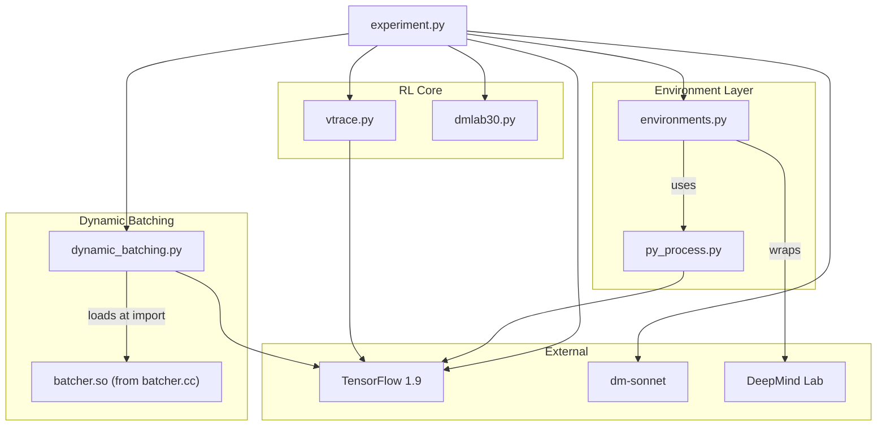
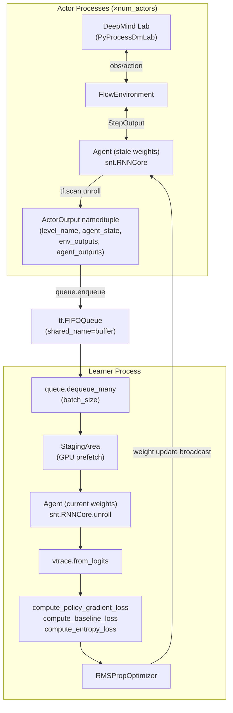

<!-- source: DeepWiki mcp.deepwiki.com · repo google-deepmind/scalable_agent · page 1 Overview · fetched 2026-10-26 -->

# Overview

<details>
<summary>Relevant source files</summary>

The following files were used as context for generating this wiki page:

- [README.md](README.md)
- [experiment.py](experiment.py)

</details>


This page introduces the `scalable_agent` repository, explains the IMPALA distributed reinforcement learning algorithm it implements, and maps every major source file to its role in the system. It is a starting point for navigating the codebase — for deeper coverage of any component, follow the links to the dedicated wiki pages listed throughout.

---

## What This Repository Implements

`scalable_agent` is a TensorFlow 1.x implementation of **IMPALA** (Importance Weighted Actor-Learner Architectures), described in the paper *"IMPALA: Scalable Distributed Deep-RL with Importance Weighted Actor-Learner Architectures"* (Espeholt et al., ICML 2018).

The core design separates **environment interaction** (actors) from **gradient computation** (learner). Because actors run a potentially stale copy of the policy, the learner applies **V-trace** importance-weighted off-policy correction before computing gradients. This separation allows the number of actors — and therefore environment throughput — to scale independently of the learner.

The implementation targets **DeepMind Lab** environments, specifically the DMLab-30 benchmark suite, but the architecture has been applied to other domains (Atari, Street View navigation, image generation) according to the paper.

---

## Repository File Map

The table below lists every significant source file, its language, and its responsibility.

| File | Language | Responsibility |
|---|---|---|
| `experiment.py` | Python | Top-level entry point. Defines `Agent`, `build_actor`, `build_learner`, `train()`, `test()`. |
| `vtrace.py` | Python | V-trace off-policy return computation. |
| `environments.py` | Python | `PyProcessDmLab` and `FlowEnvironment` wrappers for DeepMind Lab. |
| `py_process.py` | Python | Subprocess isolation via `multiprocessing.Pipe`; `PyProcess` and `PyProcessHook`. |
| `dynamic_batching.py` | Python | `@batch_fn` decorator API for batching actor inference calls. |
| `batcher.cc` | C++ | TensorFlow custom ops backing `dynamic_batching.py`; compiled to `batcher.so`. |
| `dmlab30.py` | Python | DMLab-30 level lists, human/random score tables, `compute_human_normalized_score`. |
| `vtrace_test.py` | Python | Unit tests for `vtrace.py`. |
| `dynamic_batching_test.py` | Python | Unit tests for `dynamic_batching.py`. |
| `py_process_test.py` | Python | Unit tests for `py_process.py`. |
| `Dockerfile` | Docker | Reference build environment (TF 1.9, dm-sonnet 1.23, DeepMind Lab). |

Sources: [experiment.py:1-40](), [README.md:1-88]()

---

## Component Dependency Graph

**Diagram: Module dependency relationships (experiment.py at center)**



Sources: [experiment.py:27-38](), [README.md:25-30]()

---

## The IMPALA Algorithm: Actors and Learner

IMPALA's key insight is that **actors and the learner run concurrently and asynchronously**. Each actor maintains its own copy of the environment and a local (potentially stale) copy of the policy weights. Actors produce **trajectories** — sequences of observations, actions, and rewards — and push them into a shared queue. The learner dequeues batches of trajectories, re-evaluates them under the **current** policy, and applies V-trace correction to account for the policy lag before computing gradients.

**Diagram: IMPALA actor-learner data flow (code entities)**



Sources: [experiment.py:459-643](), [experiment.py:334-415](), [experiment.py:94-97]()

---

## Key Data Structures

Two named tuples are defined in `experiment.py` and flow through the entire system:

**`ActorOutput`** — produced by `build_actor`, enqueued by actors, dequeued by the learner:

```
ActorOutput(level_name, agent_state, env_outputs, agent_outputs)
```

[experiment.py:94-95]()

**`AgentOutput`** — produced by `Agent._head` at every timestep during actor unrolls and learner re-evaluation:

```
AgentOutput(action, policy_logits, baseline)
```

[experiment.py:96-97]()

These structures are passed through `tf.FIFOQueue` by flattening with `nest.flatten` and reconstructed with `nest.pack_sequence_as`. See [page 2](#2) for the full data flow description.

---

## Training Modes

The `main()` function in [experiment.py:682-700]() dispatches to one of two top-level functions based on `--mode`:

| Mode | Function | Description |
|---|---|---|
| `train` | `train(action_set, level_names)` | Runs the full actor-learner training loop. Supports single-machine (`--task=-1`) and distributed (`--job_name=learner\|actor`) setups. |
| `test` | `test(action_set, level_names)` | Loads a checkpoint, runs actors for `--test_num_episodes` episodes per level, reports mean return and optionally human-normalized score. |

**Single-machine mode** (`--task=-1`): actors run as `QueueRunner` threads in the same process; dynamic batching is enabled if `batcher.so` is available to improve GPU utilization.

**Distributed mode**: each process is either a learner (`--job_name=learner --task=0`) or one actor (`--job_name=actor --task=i`). The `tf.train.ClusterSpec` assigns actors to ports `8001+i` and the learner to port `8000`.

Sources: [experiment.py:459-500](), [experiment.py:682-700](), [README.md:37-79]()

---

## Quick-Start Commands

Single-machine training (default level `explore_goal_locations_small`):

```sh
python experiment.py --num_actors=48 --batch_size=32
```

Distributed learner:

```sh
python experiment.py --job_name=learner --task=0 --num_actors=150 \
    --level_name=dmlab30 --batch_size=32 --reward_clipping=soft_asymmetric
```

Distributed actors (one per task id):

```sh
python experiment.py --job_name=actor --task=$i \
    --num_actors=150 --level_name=dmlab30
```

Evaluation:

```sh
python experiment.py --mode=test --level_name=dmlab30 --test_num_episodes=10
```

Sources: [README.md:37-79]()

---

## Where to Go Next

| Topic | Wiki Page |
|---|---|
| Full training loop, `train()`, `test()`, `ActorOutput` lifecycle | [IMPALA Training System](#2) |
| `Agent` class, convolutional torso, LSTM, `_build`/`unroll` | [Agent Architecture](#2.1) |
| `build_actor`, `tf.scan` unroll, `FlowEnvironment` wiring | [Actors](#2.2) |
| `build_learner`, loss functions, RMSProp optimizer | [Learner and Loss Computation](#2.3) |
| All `--flag` definitions and their effects | [Configuration and Flags](#2.4) |
| V-trace algorithm and `vtrace.py` API | [V-trace Algorithm](#3) |
| Dynamic batching system end-to-end | [Dynamic Batching](#4) |
| `PyProcessDmLab`, `FlowEnvironment`, `DEFAULT_ACTION_SET` | [DeepMind Lab Integration](#5.1) |
| `PyProcess`, `_TFProxy`, `PyProcessHook` | [Python Process Management](#5.2) |
| DMLab-30 levels, `compute_human_normalized_score` | [DMLab-30 Benchmark](#6) |
| Docker build, `batcher.so` compilation, deployment | [Setup and Deployment](#7) |

---

