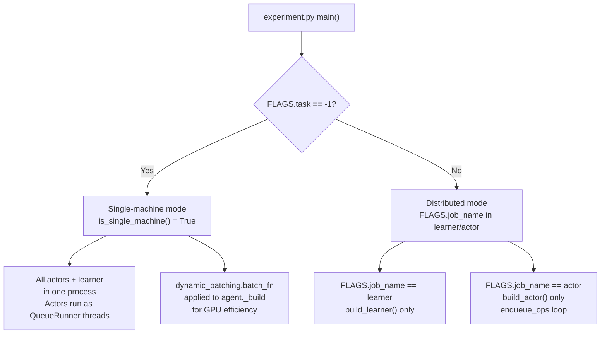
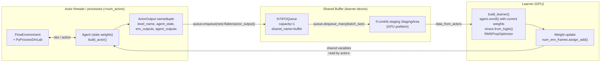
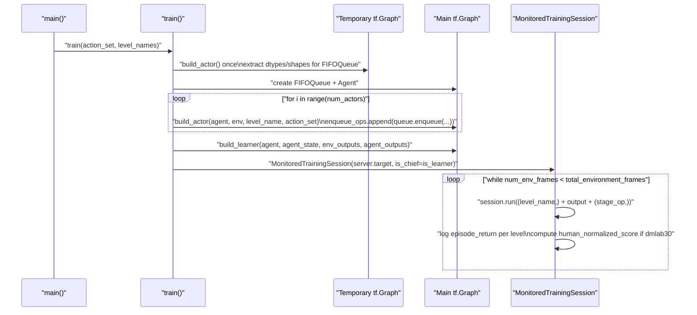
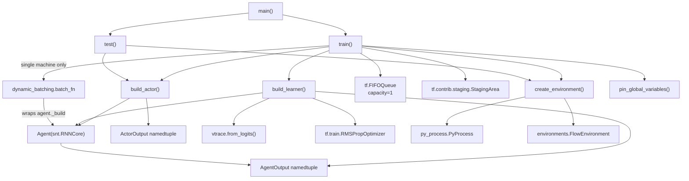

<!-- source: DeepWiki mcp.deepwiki.com · repo google-deepmind/scalable_agent · page 2 IMPALA Training System · fetched 2026-10-26 -->

# IMPALA Training System

<details>
<summary>Relevant source files</summary>

The following files were used as context for generating this wiki page:

- [README.md](README.md)
- [experiment.py](experiment.py)

</details>


This page describes the distributed training architecture of the IMPALA implementation: how actors and the learner are organized, what data flows between them, and how `train()` and `test()` in [experiment.py]() wire everything together. For the neural network architecture of the agent itself, see [Agent Architecture](#2.1). For actor internals, see [Actors](#2.2). For learner loss computation details, see [Learner and Loss Computation](#2.3). For V-trace off-policy correction, see [V-trace Algorithm](#3).

---

## Overview

IMPALA separates **experience generation** from **learning**. Multiple actor processes run the environment and a stale copy of the policy to generate trajectories. A single learner consumes those trajectories from a shared queue, computes importance-weighted V-trace returns, and updates the policy. Because actors generate data with weights that may lag behind the learner, V-trace off-policy correction is applied on every batch.

All orchestration lives in `experiment.py`. The two top-level entry points are `train()` and `test()`.

Sources: [experiment.py:459-700]()

---

## Core Data Structures

Two namedtuples form the contract between actors and the learner.

| Namedtuple | Fields | Defined at |
|---|---|---|
| `ActorOutput` | `level_name`, `agent_state`, `env_outputs`, `agent_outputs` | [experiment.py:94-95]() |
| `AgentOutput` | `action`, `policy_logits`, `baseline` | [experiment.py:96-97]() |

`ActorOutput` is what each actor enqueues. The learner dequeues a batch of these and reconstructs the full training inputs from them.

- `env_outputs` is a `StepOutput` namedtuple from `environments.py` with fields `reward`, `info`, `done`, and `observation`. Its time dimension is `T+1` (unroll length plus the bootstrapped initial step).
- `agent_outputs` is an `AgentOutput` with the same `T+1` time dimension, recording what the **actor's stale policy** produced at each step.
- `agent_state` is the initial LSTM hidden state at the start of the unroll, used on the learner to replay the trajectory through the **current** policy.

Sources: [experiment.py:94-97](), [experiment.py:300-309]()

---

## Deployment Modes

The `train()` function supports two topologies, selected via the `--task` flag.

**Figure: Deployment Mode Selection**



Sources: [experiment.py:459-487](), [experiment.py:506-518](), [experiment.py:533-534](), [experiment.py:640-643]()

| Flag | Single-machine value | Distributed value |
|---|---|---|
| `local_job_device` | `''` | `/job:<name>/task:<id>` |
| `shared_job_device` | `''` | `/job:learner/task:0` |
| `global_variable_device` | `/gpu` | `shared_job_device + '/cpu'` |
| Actor scheduling | `QueueRunner` threads | Separate processes, explicit `session.run(enqueue_ops)` |

In distributed mode, global variables are pinned to the learner's CPU via `pin_global_variables()` [experiment.py:442-456]() so that pulling weights from the learner to actors does not require repeated GPU memory copies.

Sources: [experiment.py:459-487](), [experiment.py:442-456]()

---

## Actor–Learner Data Flow

**Figure: Runtime Data Flow (`train()` function)**



Sources: [experiment.py:502-503](), [experiment.py:527-529](), [experiment.py:533-534](), [experiment.py:547-574](), [experiment.py:560-574]()

The queue has **capacity 1** [experiment.py:503](). This provides minimal buffering — actors can run one unroll ahead of the learner — preventing runaway staleness without starving the learner.

The `StagingArea` [experiment.py:563-568]() holds one pre-staged batch on the GPU, allowing data transfer and the training step to overlap. This adds at most one step of policy lag.

---

## `train()` Execution Sequence

**Figure: `train()` Graph Construction and Session Loop**



Sources: [experiment.py:459-643]()

### Batch Reconstruction

When the learner dequeues a batch, it goes through two transformations:

1. **Unflattening**: `nest.pack_sequence_as(structure, dequeued)` [experiment.py:549]() reconstructs the `ActorOutput` structure from the flat list of tensors that the queue stores.
2. **Time-major transpose**: `make_time_major()` [experiment.py:551-553]() transposes `env_outputs` and `agent_outputs` from `[batch, time, ...]` to `[time, batch, ...]` because `agent.unroll()` and `vtrace.from_logits()` expect time as the leading dimension.

Sources: [experiment.py:547-557]()

---

## `test()` Function

The `test()` function is structurally simpler than `train()`. It builds a single graph with one actor per level (no learner, no queue), loads a checkpoint via `SingularMonitoredSession`, and runs each level until `test_num_episodes` complete episodes are collected.

```
test(action_set, level_names)
  └── for each level_name:
        env = create_environment(level_name, seed=1, is_test=True)
        outputs[level_name] = build_actor(agent, env, level_name, action_set)
  └── SingularMonitoredSession(checkpoint_dir=FLAGS.logdir)
        └── session.run(env_outputs.done, env_outputs.info)  [repeated]
        └── collect episode_return when done[1:] is True
  └── if dmlab30: compute_human_normalized_score(level_returns)
```

Test mode uses `is_test=True` in `create_environment()` [experiment.py:433](), which sets `allowHoldOutLevels=true` and a fixed `mixerSeed=0x600D5EED` for reproducible evaluation.

Sources: [experiment.py:646-679]()

---

## `create_environment()`

`create_environment()` [experiment.py:418-439]() is the factory used by both `train()` and `test()` to assemble the two-layer environment stack:

```
create_environment(level_name, seed, is_test=False)
  └── py_process.PyProcess(environments.PyProcessDmLab, level_name, config, num_action_repeats, seed)
        └── environments.FlowEnvironment(p.proxy)
```

The resulting `FlowEnvironment` is the object passed as `env` to `build_actor()`. For details on this stack, see [Environment Infrastructure](#5).

Sources: [experiment.py:418-439]()

---

## Key Relationships Between Code Entities

**Figure: Code Entity Dependency Map for `experiment.py`**



Sources: [experiment.py:459-700]()

---

## Loss Functions

Three loss component functions are defined at module level and called from `build_learner()`:

| Function | Formula summary | Source |
|---|---|---|
| `compute_policy_gradient_loss()` | `sum(cross_entropy(logits, actions) * stop_gradient(advantages))` | [experiment.py:326-331]() |
| `compute_baseline_loss()` | `0.5 * sum((vs - baseline)²)` | [experiment.py:312-316]() |
| `compute_entropy_loss()` | `-sum(policy * log_policy)` | [experiment.py:319-323]() |

The total loss is:

```
total_loss = policy_gradient_loss
           + baseline_cost  * baseline_loss
           + entropy_cost   * entropy_loss
```

where `baseline_cost` defaults to `0.5` and `entropy_cost` defaults to `0.00025`. See [Learner and Loss Computation](#2.3) for how `vtrace_returns.pg_advantages` and `vtrace_returns.vs` are derived.

Sources: [experiment.py:312-331](), [experiment.py:389-395]()

---

## Learning Rate Schedule

The learner uses a polynomial decay schedule that linearly anneals the learning rate from `FLAGS.learning_rate` to `0` over `FLAGS.total_environment_frames` steps, using the global step counter `num_environment_frames` as the clock:

```python
learning_rate = tf.train.polynomial_decay(
    FLAGS.learning_rate, num_env_frames,
    FLAGS.total_environment_frames, 0)
optimizer = tf.train.RMSPropOptimizer(learning_rate, FLAGS.decay,
                                      FLAGS.momentum, FLAGS.epsilon)
```

[experiment.py:399-402]()

The global step is incremented by `batch_size × unroll_length × num_action_repeats` per training step [experiment.py:407-408](), so it tracks **environment frames** (not gradient steps).

Sources: [experiment.py:398-408]()

---

## Summary of Responsibilities

| Component | Role | Primary code location |
|---|---|---|
| `train()` | Builds the full TF graph; runs the session loop; logs summaries | [experiment.py:459-643]() |
| `test()` | Loads checkpoint; runs actors; collects episode returns | [experiment.py:646-679]() |
| `build_actor()` | Constructs the `tf.scan`-based unroll loop; produces `ActorOutput` | [experiment.py:228-309]() |
| `build_learner()` | Unrolls agent with current weights; computes losses; applies gradients | [experiment.py:334-415]() |
| `create_environment()` | Assembles `PyProcess` + `FlowEnvironment` stack | [experiment.py:418-439]() |
| `pin_global_variables()` | Context manager pinning global vars to a specific device | [experiment.py:442-456]() |
| `ActorOutput` | Namedtuple carrying trajectory data from actor to learner | [experiment.py:94-95]() |
| `AgentOutput` | Namedtuple carrying per-step agent outputs | [experiment.py:96-97]() |
| `Agent` | `snt.RNNCore` implementing the policy and value function | [experiment.py:104-225]() |

---

