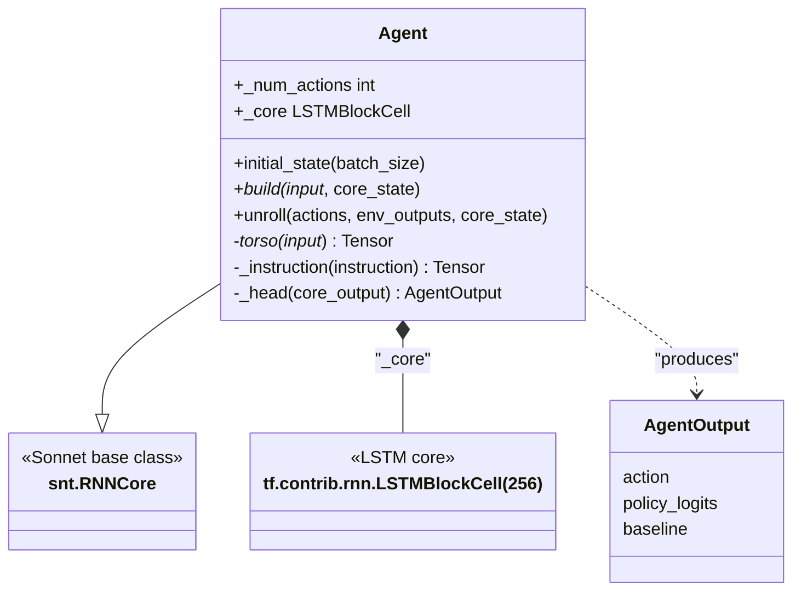
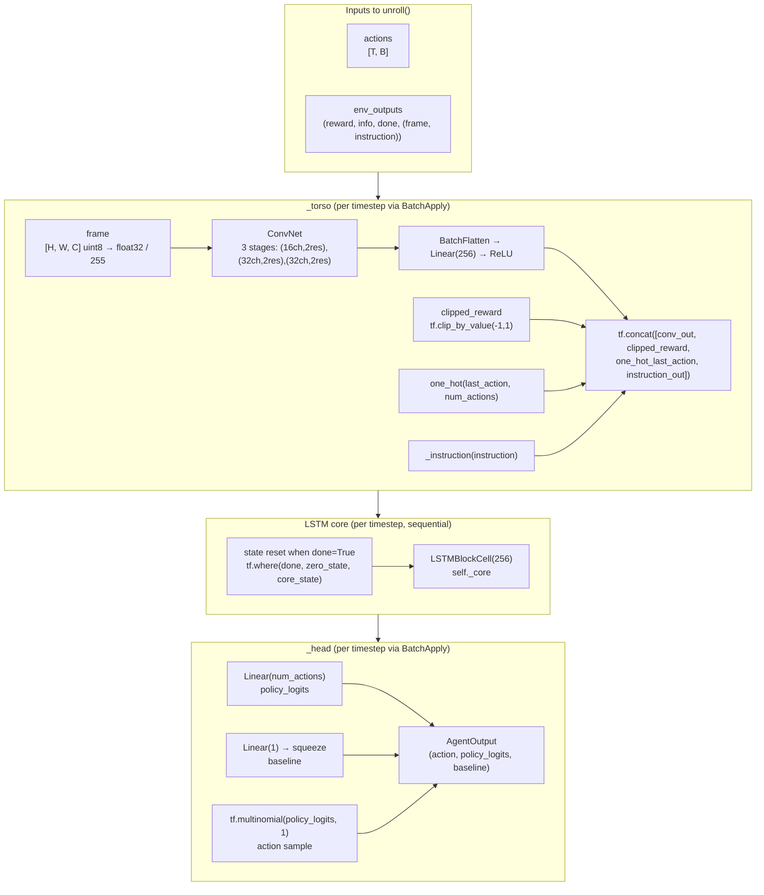
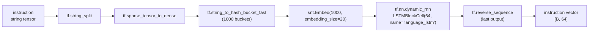
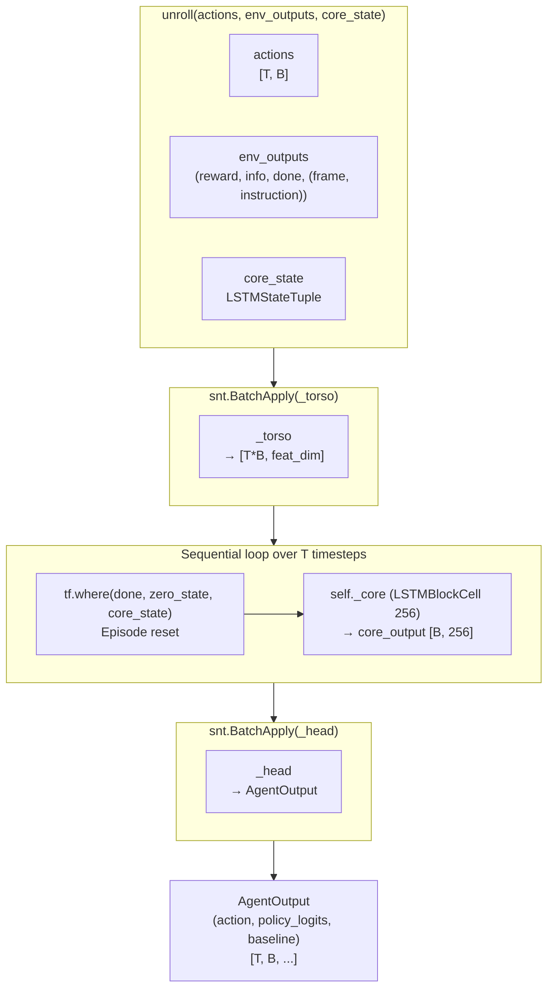

<!-- source: DeepWiki mcp.deepwiki.com · repo google-deepmind/scalable_agent · page 2.1 Agent Architecture · fetched 2026-10-26 -->

# Agent Architecture

<details>
<summary>Relevant source files</summary>

The following files were used as context for generating this wiki page:

- [experiment.py](experiment.py)

</details>


This page documents the `Agent` class defined in [experiment.py:104-225](), which is the neural network at the center of the IMPALA system. It covers the class structure, each sub-network component, the data flow through the forward pass, and how the agent produces `AgentOutput` values.

For how actors use an `Agent` instance to generate experience trajectories, see [Actors](#2.2). For how the learner re-runs the agent to compute losses, see [Learner and Loss Computation](#2.3).

---

## Overview

`Agent` is a Sonnet `RNNCore` module. It wraps a 256-unit LSTM and exposes the standard Sonnet recurrent interface: `initial_state` to create a zero state and `_build` / `unroll` to step or unroll through a sequence.

Both actors (inference) and the learner (training) use the same `Agent` object with the same weights. Actors call `agent(...)` — which dispatches to `_build` — for single-step inference. The learner calls `agent.unroll(...)` to re-process entire trajectories for gradient computation.

**Key named tuples:**

| Named tuple | Defined at | Fields |
|---|---|---|
| `AgentOutput` | [experiment.py:96-97]() | `action`, `policy_logits`, `baseline` |
| `ActorOutput` | [experiment.py:94-95]() | `level_name`, `agent_state`, `env_outputs`, `agent_outputs` |

---

## Class Structure

**Agent class diagram:**



Sources: [experiment.py:104-116]()

---

## Sub-Networks

The forward pass is decomposed into three private methods: `_torso`, `_instruction`, and `_head`. The diagram below shows how these compose:

**Forward pass data flow:**



Sources: [experiment.py:143-225]()

---

### Convolutional Torso (`_torso`)

Defined at [experiment.py:143-186]().

The torso processes one frame at a time (applied across all timesteps via `snt.BatchApply`). It takes a `(last_action, env_output)` tuple and returns a flat feature vector.

**Convolutional stages:**

| Stage | Channels | Residual blocks | Downscale |
|---|---|---|---|
| 0 | 16 | 2 | MaxPool 3×3, stride 2 |
| 1 | 32 | 2 | MaxPool 3×3, stride 2 |
| 2 | 32 | 2 | MaxPool 3×3, stride 2 |

Each residual block at stage `i`, block `j` (variable scope `residual_i_j`) computes:

```
block_input = conv_out
conv_out = ReLU(conv_out)
conv_out = Conv2D(num_ch, 3, SAME)(conv_out)
conv_out = ReLU(conv_out)
conv_out = Conv2D(num_ch, 3, SAME)(conv_out)
conv_out += block_input
```

After all conv stages: `ReLU → BatchFlatten → Linear(256) → ReLU`.

The torso concatenates four components into the final output:

| Component | Source | Notes |
|---|---|---|
| `conv_out` | Convolutional output | 256-dimensional |
| `clipped_reward` | `reward` from `env_output` | Clipped to `[-1, 1]`, shape `[B, 1]` |
| `one_hot_last_action` | `last_action` | Shape `[B, num_actions]` |
| `instruction_out` | `_instruction(instruction)` | 64-dimensional |

Sources: [experiment.py:143-186]()

---

### Instruction Embedding (`_instruction`)

Defined at [experiment.py:118-141]().

This sub-network converts a variable-length string instruction into a fixed-size 64-dimensional vector.

**Pipeline:**



- Words are hashed into 1000 buckets (small collision risk; a vocabulary lookup is an alternative).
- Embedding size is 20.
- A separate `LSTMBlockCell(64)` named `language_lstm` processes the embedded sequence.
- `tf.reverse_sequence` is used to extract the last valid output per sequence.

Sources: [experiment.py:118-141]()

---

### Head (`_head`)

Defined at [experiment.py:188-198]().

The head takes the 256-dimensional LSTM output and produces the `AgentOutput` tuple.

| Output field | Computation | Shape |
|---|---|---|
| `policy_logits` | `Linear(num_actions)(core_output)` | `[B, num_actions]` |
| `baseline` | `squeeze(Linear(1)(core_output))` | `[B]` |
| `action` | `tf.multinomial(policy_logits, 1)` | `[B]` |

`policy_logits` are raw (un-normalized) and are used by the learner for V-trace importance weight computation. `baseline` is the value function estimate used as a bootstrap target.

Sources: [experiment.py:188-198]()

---

## LSTM Core and State Management

The LSTM is a `tf.contrib.rnn.LSTMBlockCell(256)` instantiated as `self._core` inside `Agent.__init__` [experiment.py:107-113]().

**State reset on episode boundary:**

The `unroll` method iterates over timesteps manually rather than using `tf.nn.dynamic_rnn`. This is necessary because the LSTM state must be reset to zeros at episode boundaries (when `done=True`), which `dynamic_rnn` does not support directly.

```
for input_, d in zip(tf.unstack(torso_outputs), tf.unstack(done)):
    core_state = nest.map_structure(
        functools.partial(tf.where, d),
        initial_core_state, core_state)
    core_output, core_state = self._core(input_, core_state)
```

[experiment.py:218-223]()

When `done` is `True` for a batch element, `tf.where` selects `initial_core_state` (zeros) for that element before the next LSTM step.

> **Note:** This manual loop prevents using CuDNN-backed RNNs. The code comments that XLA compilation is a potential workaround, requiring a change from `LSTMBlockCell` to `snt.LSTMCell` [experiment.py:214-215]().

**`initial_state`:**

[experiment.py:115-116]() returns `self._core.zero_state(batch_size, tf.float32)`, a standard Sonnet/TF LSTM state tuple of zeros.

Sources: [experiment.py:107-116](), [experiment.py:207-225]()

---

## `_build` vs `unroll`

Both methods produce `AgentOutput`, but they differ in how they handle the time dimension.

| Method | Caller | Time dimension handling |
|---|---|---|
| `_build(input_, core_state)` | Actors (single step inference via `agent(...)`) | Adds a time dimension of 1 via `tf.expand_dims`, calls `unroll`, then removes it via `tf.squeeze` |
| `unroll(actions, env_outputs, core_state)` | Learner (`build_learner`) and internally by `_build` | Processes a full `[T, B, ...]` sequence; decorated with `@snt.reuse_variables` to share weights |

`_build` is a thin wrapper:

```
actions, env_outputs = nest.map_structure(
    lambda t: tf.expand_dims(t, 0), (action, env_output))
outputs, core_state = self.unroll(actions, env_outputs, core_state)
return nest.map_structure(lambda t: tf.squeeze(t, 0), outputs), core_state
```

[experiment.py:200-205]()

The `@snt.reuse_variables` decorator on `unroll` [experiment.py:207]() ensures the same variable scope (and thus the same weights) is used for all calls, whether from actors or the learner.

**Dynamic batching integration:**

In single-machine mode, `agent._build` is replaced at runtime with a `@dynamic_batching.batch_fn`-decorated version [experiment.py:513-517](). This batches concurrent `_build` calls from multiple actor threads into a single GPU kernel call, improving utilization. The dynamic batching layer is described in detail in [Dynamic Batching](#4).

Sources: [experiment.py:200-225](), [experiment.py:506-517]()

---

## Complete Data Flow Through Agent

**Full agent forward pass with code entity names:**



Sources: [experiment.py:207-225]()

---

