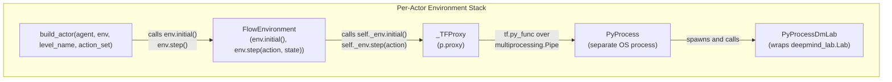
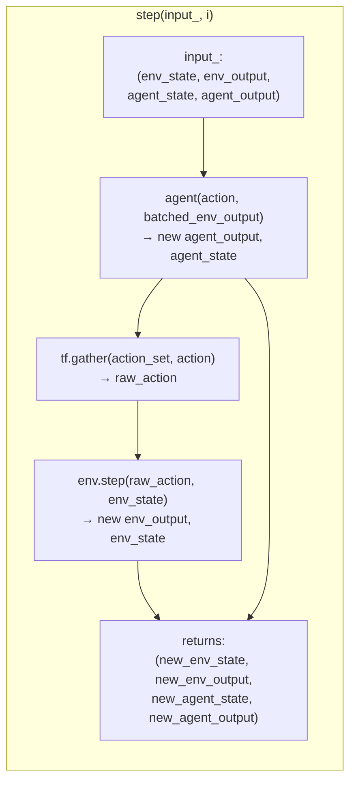
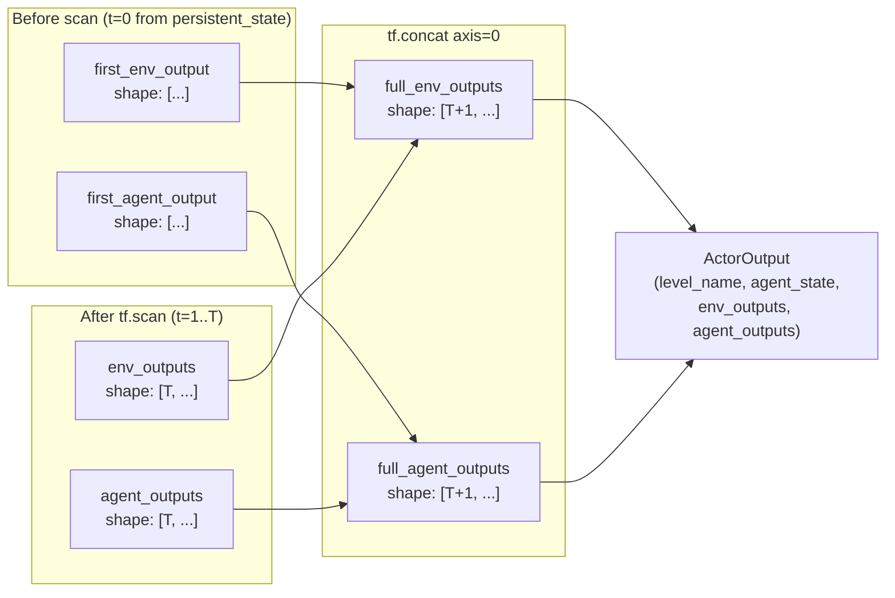
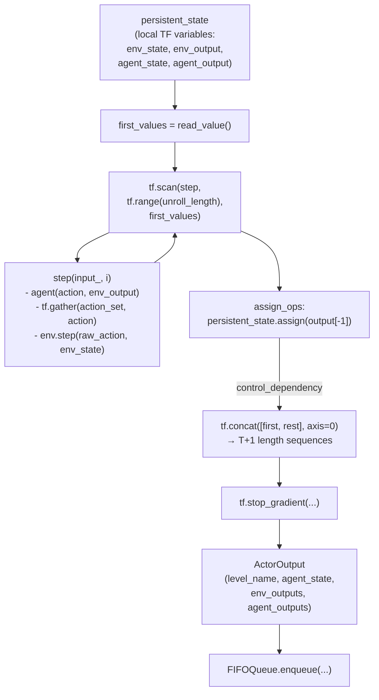

<!-- source: DeepWiki mcp.deepwiki.com · repo google-deepmind/scalable_agent · page 2.2 Actors · fetched 2026-10-26 -->

# Actors

<details>
<summary>Relevant source files</summary>

The following files were used as context for generating this wiki page:

- [environments.py](environments.py)
- [experiment.py](experiment.py)
- [py_process.py](py_process.py)

</details>


This page covers the actor side of IMPALA training: the `build_actor` function, the `tf.scan`-based unroll loop, how `ActorOutput` is produced, and how `PyProcess` and `FlowEnvironment` are composed to provide an environment interface to each actor.

For the learner that consumes actor output, see [2.3](#2.3). For the environment infrastructure (`FlowEnvironment`, `PyProcessDmLab`) in depth, see [5.1](#5.1) and [5.2](#5.2). For the agent neural network that actors invoke, see [2.1](#2.1).

---

## Role of an Actor

Each actor runs an interaction loop: it steps its own environment copy using a **stale** version of the agent's weights, collects a fixed-length trajectory (an *unroll*), and pushes the resulting `ActorOutput` to a shared queue consumed by the learner.

Because actor weights may lag behind learner weights, the learner applies V-trace importance-weighted corrections. This is described in [3](#3).

---

## Data Structures

Two namedtuples define the data that actors produce.

[experiment.py:94-97]()

| Namedtuple | Fields | Shape / Description |
|---|---|---|
| `ActorOutput` | `level_name` | String scalar: which level this unroll is from |
| | `agent_state` | LSTM state at the **start** of the unroll |
| | `env_outputs` | `StepOutput` of shape `[T+1, ...]` |
| | `agent_outputs` | `AgentOutput` of shape `[T+1, ...]` |
| `AgentOutput` | `action` | Sampled discrete action index |
| | `policy_logits` | Logits over the action set |
| | `baseline` | Scalar value estimate |

The `+1` in `[T+1, ...]` arises because the first timestep's values (carried over from the previous unroll) are prepended to the scan outputs before packing — see [Unroll Assembly](#unroll-assembly) below.

**Sources:** [experiment.py:94-97]()

---

## Environment Wiring

Before examining the actor loop itself, it is useful to understand what `env` is.

**Actor diagram: Environment stack per actor**



`create_environment` [experiment.py:418-439]() assembles this stack:

1. Instantiates `PyProcess(environments.PyProcessDmLab, level_name, config, num_action_repeats, seed)` — this spawns a subprocess running the lab simulator.
2. Passes `p.proxy` to `FlowEnvironment` — the proxy intercepts attribute access and generates `tf.py_func` ops that communicate over a `multiprocessing.Pipe`.
3. Returns the `FlowEnvironment` instance, which is what `build_actor` receives as `env`.

`FlowEnvironment` introduces a sequential `flow` integer token threaded through `tf.control_dependencies` to ensure environment steps execute in order within the TensorFlow graph. Its two callable methods used by actors are:

| Method | Returns |
|---|---|
| `env.initial()` | `(StepOutput, env_state)` — initial observation with zeroed reward/info |
| `env.step(raw_action, env_state)` | `(StepOutput, new_env_state)` |

`StepOutput` is a namedtuple with fields `(reward, info, done, observation)`, where `info` is a `StepOutputInfo(episode_return, episode_step)`.

**Sources:** [experiment.py:418-439](), [environments.py:134-218](), [py_process.py:61-105](), [py_process.py:161-183]()

---

## build_actor

`build_actor` [experiment.py:228-309]() is the function that constructs the entire actor TensorFlow subgraph. It takes four arguments:

| Argument | Type | Description |
|---|---|---|
| `agent` | `Agent` (snt.RNNCore) | Shared agent instance (same weights as the learner in single-machine mode) |
| `env` | `FlowEnvironment` | Environment for this actor |
| `level_name` | `str` | Level identifier, included in `ActorOutput` |
| `action_set` | tuple | Mapping from action index to native action vectors |

### Initialization Phase

[experiment.py:231-251]()

The function first establishes the initial values needed to start the loop:

1. `env.initial()` → `(initial_env_output, initial_env_state)`
2. `agent.initial_state(1)` → `initial_agent_state` (LSTM zeros, batch size 1)
3. A dummy agent forward pass produces `dummy_agent_output`, from which `initial_agent_output` is constructed as **all-zeros tensors** of the correct shapes.

These initial values are then stored into **local TF variables** (not global) using `tf.get_local_variable`. This is the `persistent_state`:

```
persistent_state = (env_state_var, env_output_var, agent_state_var, agent_output_var)
```

Local variables are explicitly excluded from parameter servers in distributed training, ensuring that per-actor carry-state is never synchronized across machines.

**Sources:** [experiment.py:231-251]()

### The step Function

[experiment.py:253-269]()

`step(input_, unused_i)` is the body passed to `tf.scan`. Each call performs one agent–environment interaction:



Key details:
- The **previous** agent output's action (`agent_output[0]`) is fed back as the action input for the current agent call.
- The env output is wrapped with `tf.expand_dims` along axis 0 to add a batch dimension before the agent call, since the agent expects `[batch, ...]` shaped inputs.
- `tf.gather(action_set, action)` translates the discrete action index to a 7-element native action vector from `DEFAULT_ACTION_SET`.

**Sources:** [experiment.py:253-269](), [environments.py:53-63]()

### The tf.scan Loop

[experiment.py:272-285]()

```python
first_values = nest.map_structure(lambda v: v.read_value(), persistent_state)
output = tf.scan(step, tf.range(FLAGS.unroll_length), first_values)
```

- `persistent_state` is read via `.read_value()` to capture a consistent snapshot at graph construction time.
- `tf.scan` applies `step` exactly `FLAGS.unroll_length` times (default: 100), threading the output of each call as the input to the next.
- The `elems` argument `tf.range(FLAGS.unroll_length)` is unused inside `step` but required to specify the number of iterations.
- `output` is a nested structure where each leaf tensor has a leading dimension of `unroll_length`, representing the stacked results across all steps.

**Sources:** [experiment.py:272-285]()

### Persistent State Update

[experiment.py:287-298]()

After the scan, the **last** value of each state variable is written back to `persistent_state`:

```python
assign_ops = nest.map_structure(lambda v, t: v.assign(t[-1]),
                                persistent_state, output)
```

This is what allows the next call to `build_actor`'s output op to continue from where the previous unroll ended, rather than restarting from initial values.

**Sources:** [experiment.py:287-298]()

### Unroll Assembly

[experiment.py:290-309]()

Inside a `tf.control_dependencies(assign_ops)` block (guaranteeing state is persisted before the output is used):

1. The **first** values (from `persistent_state` before the scan) are stripped of their batch dimension.
2. The scan `output` values are also reshaped: the batch dimension (always 1 for actors) is removed with `t[:, 0]`.
3. The first value and the scan output are concatenated along time dimension to produce `full_agent_outputs` and `full_env_outputs`, each of length `T+1`.

Finally, `ActorOutput` is assembled and all tensors have `tf.stop_gradient` applied — no backpropagation happens on the actor side.

**Unroll assembly diagram**



**Sources:** [experiment.py:290-309]()

---

## Complete build_actor Data Flow



**Sources:** [experiment.py:228-309](), [experiment.py:520-529]()

---

## Actor Execution Model

### Single-Machine Mode

[experiment.py:462-534]()

In single-machine mode (`FLAGS.task == -1`):

- All `num_actors` actors are built into the **same TF graph** as the learner.
- Each actor's `enqueue_ops` is registered with a `tf.train.QueueRunner`, which runs each enqueue op in a separate **thread**.
- If `dynamic_batching` is available, the agent's `_build` method is wrapped with `@dynamic_batching.batch_fn` so that inference calls from multiple actors are batched together on the GPU. See [4.1](#4.1) for the batching API.

### Distributed Mode

[experiment.py:470-485]()

In distributed mode:

- Each actor process runs independently with `FLAGS.job_name == 'actor'` and a unique `FLAGS.task` id.
- The actor builds only its own subgraph (the `if is_actor_fn(i)` guard).
- Actors push directly to the shared `FIFOQueue` on the learner (`shared_job_device`).
- The learner process runs the dequeue and learning loop.
- Global variables (agent weights) are pinned to `shared_job_device + '/cpu'` via `pin_global_variables` [experiment.py:442-456]() to reduce copy cost.

| Mode | Actor execution | Agent weights | Queue |
|---|---|---|---|
| Single-machine | Threads via `QueueRunner` | GPU (shared in-graph) | In-process `FIFOQueue` |
| Distributed | Separate processes | CPU on learner machine | Remote `FIFOQueue` via gRPC |

**Sources:** [experiment.py:459-534](), [experiment.py:442-456]()

---

## Level Assignment

When training on the full DMLab-30 suite (`FLAGS.level_name == 'dmlab30'`), levels are assigned to actors **round-robin**:

[experiment.py:522-527]()

```
level_name = level_names[i % len(level_names)]
```

Each actor is therefore permanently assigned to a single level for the duration of training. The `level_name` string is included in every `ActorOutput` so the learner can associate episode returns with the correct level when computing per-level metrics.

**Sources:** [experiment.py:521-527](), [experiment.py:600-638]()

---

## Test Mode

The `test` function [experiment.py:646-679]() reuses `build_actor` directly: one actor graph is built per level, and the session is run until `FLAGS.test_num_episodes` episode completions are observed per level. No learner or queue is involved — the actor output is inspected directly by reading `env_outputs.done` and `env_outputs.info`.

**Sources:** [experiment.py:646-679]()

---

