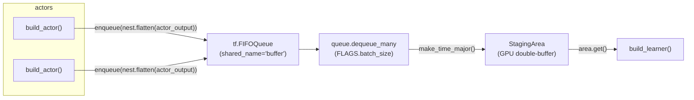
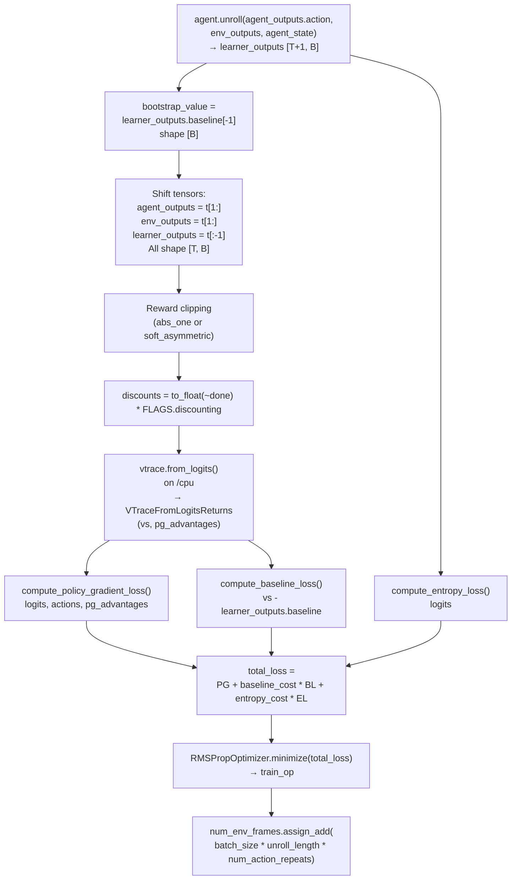
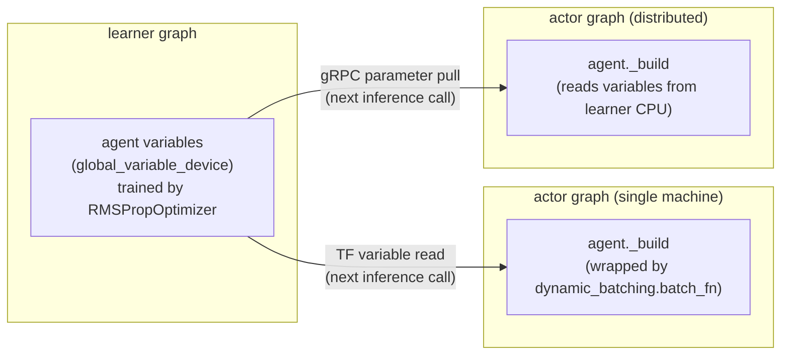
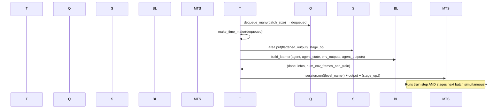

<!-- source: DeepWiki mcp.deepwiki.com · repo google-deepmind/scalable_agent · page 2.3 Learner and Loss Computation · fetched 2026-10-26 -->

# Learner and Loss Computation

<details>
<summary>Relevant source files</summary>

The following files were used as context for generating this wiki page:

- [experiment.py](experiment.py)
- [vtrace.py](vtrace.py)

</details>


This page documents the learner side of IMPALA training: the `build_learner` function, the three loss components, V-trace off-policy correction, the RMSProp optimizer, and how gradients flow back into the shared agent weights. For how actors produce the data that the learner consumes, see [Actors](#2.2). For a full treatment of the V-trace algorithm itself, see [V-trace Algorithm](#3).

---

## Role in the Training System

The learner is the sole gradient-computing entity in the system. Actors run a possibly-stale copy of the agent policy and stream trajectory data into a shared FIFO queue. The learner continuously dequeues batches of those trajectories, re-evaluates the agent under current weights, applies V-trace importance weighting to correct for the policy lag, computes a composite loss, and updates the shared agent variables via RMSProp.

**Data flow into the learner:**



Sources: [experiment.py:502-574]()

---

## Inputs and Outputs of `build_learner`

`build_learner` is defined at [experiment.py:334-415](). It accepts four arguments:

| Argument | Type | Shape | Description |
|---|---|---|---|
| `agent` | `Agent` (snt.RNNCore) | — | The shared agent module |
| `agent_state` | LSTM state tuple | `[B, ...]` | Initial LSTM state for each sequence in the batch |
| `env_outputs` | `StepOutput` namedtuple | `[T+1, B, ...]` | Time-major environment outputs from actors |
| `agent_outputs` | `AgentOutput` namedtuple | `[T+1, B, ...]` | Time-major actor-side policy outputs (stale) |

It returns a tuple `(done, infos, num_env_frames_and_train)`. Evaluating `num_env_frames_and_train` in a session causes a training step and increments the global frame counter.

---

## Internal Computation Steps

**Learner and Loss Computation — step-by-step:**



Sources: [experiment.py:334-415]()

---

### Step 1 — Re-evaluating the Agent (Learner Forward Pass)

[experiment.py:350-351]()

```
learner_outputs, _ = agent.unroll(agent_outputs.action, env_outputs, agent_state)
```

`agent.unroll` is called with the **actor's recorded actions** and the original environment observations. This re-runs the agent under **current (learner) weights**, producing fresh `policy_logits` and `baseline` values for the same trajectory the actor executed. The result has shape `[T+1, B]`.

---

### Step 2 — Index Alignment

[experiment.py:354-363]()

The IMPALA convention is that `env_outputs[t]` is the observation that caused `agent_outputs[t]`. After the unroll there is an off-by-one: the last learner baseline is used as the bootstrap, and everything is trimmed to length `T`:

| Tensor | Operation | Resulting shape |
|---|---|---|
| `bootstrap_value` | `learner_outputs.baseline[-1]` | `[B]` |
| `agent_outputs` | `t[1:]` | `[T, B]` |
| `rewards, infos, done` from `env_outputs` | `t[1:]` | `[T, B]` |
| `learner_outputs` | `t[:-1]` | `[T, B]` |

---

### Step 3 — Reward Clipping

[experiment.py:365-370]()

Two modes are supported via `FLAGS.reward_clipping`:

| Mode | Formula |
|---|---|
| `abs_one` | `clip(r, -1, 1)` |
| `soft_asymmetric` | `tanh(r/5) * 5`, negative rewards additionally scaled by `0.3` |

---

### Step 4 — Discounts

[experiment.py:372]()

```python
discounts = tf.to_float(~done) * FLAGS.discounting
```

When a terminal step is encountered (`done=True`), the discount is zeroed, preventing value estimates from bootstrapping across episode boundaries.

---

### Step 5 — V-trace Off-Policy Correction

[experiment.py:374-385]()

```python
vtrace_returns = vtrace.from_logits(
    behaviour_policy_logits=agent_outputs.policy_logits,  # from actor (stale)
    target_policy_logits=learner_outputs.policy_logits,   # from learner (current)
    actions=agent_outputs.action,
    discounts=discounts,
    rewards=clipped_rewards,
    values=learner_outputs.baseline,
    bootstrap_value=bootstrap_value)
```

This is placed explicitly on `/cpu` because the sequential backward scan in V-trace runs faster there. The call returns a `VTraceFromLogitsReturns` namedtuple; the learner uses two fields:

| Field | Shape | Used for |
|---|---|---|
| `vs` | `[T, B]` | Baseline regression target |
| `pg_advantages` | `[T, B]` | Policy gradient weighting |

For full algorithm details see [V-trace Algorithm](#3).

---

### Step 6 — Loss Computation

Three standalone helper functions build the loss components:

#### Policy Gradient Loss

[experiment.py:326-331]()

```python
def compute_policy_gradient_loss(logits, actions, advantages):
    cross_entropy = tf.nn.sparse_softmax_cross_entropy_with_logits(
        labels=actions, logits=logits)
    advantages = tf.stop_gradient(advantages)
    policy_gradient_loss_per_timestep = cross_entropy * advantages
    return tf.reduce_sum(policy_gradient_loss_per_timestep)
```

`advantages` receives `tf.stop_gradient` so gradients flow only through the log-policy term. The result is summed over both the time and batch dimensions.

#### Baseline Loss

[experiment.py:312-316]()

```python
def compute_baseline_loss(advantages):
    return .5 * tf.reduce_sum(tf.square(advantages))
```

Called with `vtrace_returns.vs - learner_outputs.baseline` (the TD error). The `0.5` factor ensures `d(loss)/d(baseline) = advantage`, matching the standard squared-error value regression update.

#### Entropy Regularization Loss

[experiment.py:319-323]()

```python
def compute_entropy_loss(logits):
    policy = tf.nn.softmax(logits)
    log_policy = tf.nn.log_softmax(logits)
    entropy_per_timestep = tf.reduce_sum(-policy * log_policy, axis=-1)
    return -tf.reduce_sum(entropy_per_timestep)
```

The negated entropy is added to the loss, so minimizing the loss maximizes entropy — encouraging exploration.

#### Combined Loss

[experiment.py:388-395]()

```
total_loss = PG_loss
           + FLAGS.baseline_cost × baseline_loss
           + FLAGS.entropy_cost  × entropy_loss
```

Default coefficient values: `baseline_cost = 0.5`, `entropy_cost = 0.00025`.

---

### Step 7 — Optimization

[experiment.py:397-408]()

The learning rate follows a linear decay schedule from `FLAGS.learning_rate` to `0` over `FLAGS.total_environment_frames` steps:

```python
learning_rate = tf.train.polynomial_decay(
    FLAGS.learning_rate, num_env_frames,
    FLAGS.total_environment_frames, 0)
optimizer = tf.train.RMSPropOptimizer(learning_rate, FLAGS.decay,
                                      FLAGS.momentum, FLAGS.epsilon)
train_op = optimizer.minimize(total_loss)
```

Default optimizer settings:

| Parameter | Flag | Default |
|---|---|---|
| Initial learning rate | `--learning_rate` | `0.00048` |
| Decay (ρ) | `--decay` | `0.99` |
| Momentum | `--momentum` | `0.0` |
| Epsilon (ε) | `--epsilon` | `0.1` |

After `train_op`, the global step counter `num_environment_frames` is incremented by `batch_size × unroll_length × num_action_repeats` inside a `tf.control_dependencies` block:

[experiment.py:405-408]()

```python
with tf.control_dependencies([train_op]):
    num_env_frames_and_train = num_env_frames.assign_add(
        FLAGS.batch_size * FLAGS.unroll_length * FLAGS.num_action_repeats)
```

Evaluating `num_env_frames_and_train` guarantees the weight update has occurred before the frame count advances.

---

## Weight Synchronization to Actors

There is no explicit weight-copy operation. Instead, actors and the learner share the same `Agent` module and its underlying TF variables, placed on `global_variable_device`.



- **Single machine:** All actors run in threads within the same process. They read the latest variable values on the next inference call, incurring up to 1 training step of policy lag due to the `StagingArea` double-buffer.
- **Distributed:** Global variables are pinned to `shared_job_device + '/cpu'` [experiment.py:478](). Actor workers pull updated values via gRPC before each `agent._build` call.

Sources: [experiment.py:459-534]()

---

## TF Summaries Emitted

[experiment.py:411-413]()

| Summary | Type | Description |
|---|---|---|
| `learning_rate` | scalar | Current decayed learning rate |
| `total_loss` | scalar | Combined weighted loss value |
| `action` | histogram | Distribution of actions taken by actors |

---

## How `build_learner` Fits into `train()`

[experiment.py:536-574]()



Each call to `session.run` in the main training loop executes both the current training step (`output`) and the staging of the next batch (`stage_op`) atomically, hiding data-transfer latency behind compute.

Sources: [experiment.py:559-602]()

---

